# 数据流与计算模型

> 第 1 次课 · 分布式实时计算

从支付事件到可核对的用户累计额

<!--
同学们，假设一家店的收银屏幕要随时显示每位顾客已经支付多少钱。支付系统不断送来消息，有成功、有失败，同一笔成功还可能再送一次。屏幕上的金额应该怎样变化？今天我们把这些记录放到一条可看见的处理线上，逐步算出每位顾客的累计额。大家要能指着每个箭头说出记录为什么留下、为什么跳过、金额为什么改变。最后，我们一起把这条线写成一份别人可以照着实现和核对的计算方案。

[Sources]
- https://nightlies.apache.org/flink/flink-docs-release-2.3/docs/concepts/stateful-stream-processing/
- 教学构造数据：course/data/cases.json；金额单位为分。专项场景在页面注明参数。
-->

---
class: course story-course
---
## 收银记录怎样变成营业额

<figure class="story-figure"></figure>

- 输入是一条条支付消息；输出是<strong>每位用户的成功支付累计额</strong>。
- 一条消息经过处理，可能增加金额，也可能保持结果不变。

<!--
大家先看左边，收银端每收到一次支付通知，就把一张小票送进来。中间这位统计员按规则记账：成功的小票首次计入，失败或重复的小票跳过。右边的屏幕按用户分别显示结果。请大家判断，看到一笔2000分，能不能立刻说营业额增加2000？还不能，我们至少要知道支付是否成功、以前是否已经算过，以及它属于哪位用户。接下来每个计算步骤，都是为了解答其中一个具体问题。

[Sources]
- https://nightlies.apache.org/flink/flink-docs-release-2.3/docs/concepts/stateful-stream-processing/
- 教学构造数据：course/data/cases.json；金额单位为分。专项场景在页面注明参数。
-->

---
class: course story-course
---
## 一条支付事件的字段

<figure class="story-figure">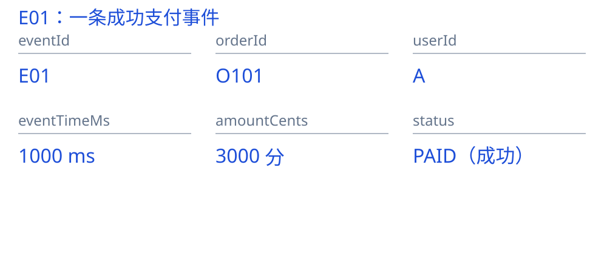</figure>

- <strong>事件</strong>描述一次已经发生的业务事实；eventId 标识其身份。
- 金额使用整数分；时间、用户、状态分别回答何时、归谁、是否成功。

<!--
我们拿出今天的第一条记录E01。它说用户A为订单O101成功支付了3000分，业务发生在课堂起点后的1秒。eventId是事件的编号，orderId是订单的编号，两者回答的问题不同。同一个订单可能有多次支付尝试，每次尝试用自己的eventId识别。大家再看金额，我们统一写整数分，3000分就是30元，后面的推演始终使用分。请大家把每个字段对应到一个业务问题：哪件事、谁的订单、何时发生、付了多少、是否成功。

[Sources]
- https://nightlies.apache.org/flink/flink-docs-release-2.3/docs/concepts/stateful-stream-processing/
- 教学构造数据：course/data/cases.json；金额单位为分。专项场景在页面注明参数。
-->

---
class: course story-course
---
## 业务对象与事件的关系

<figure class="story-figure">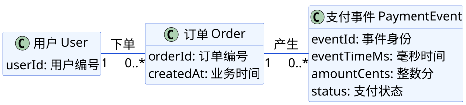</figure>

- <strong>用户下订单，订单产生支付事件。</strong> 类图描述对象类别和关系。
- 一个订单对应 0 到多条支付事件；<code>0..*</code> 表示零到多。

<!--
大家看这张标准的UML类图。每个长方形代表一类对象，上半部写名字，下半部写这类对象需要记住的属性。顺着用户到订单的连线读：一位用户可以下很多订单；再顺着订单到支付事件读：一个订单可以还没有支付，也可以经历几次尝试。连线旁的0..*就是零到多的意思。这里画的是业务对象之间的关系，箭头没有表示数据正在流动。先分清“有哪些对象”，以后我们再画“记录经过哪些计算”。

[Sources]
- https://www.omg.org/spec/UML/2.5.1/PDF
- 教学构造数据：course/data/cases.json；金额单位为分。专项场景在页面注明参数。
-->

---
class: course story-course
---
## 业务时间与到达顺序

<figure class="story-figure">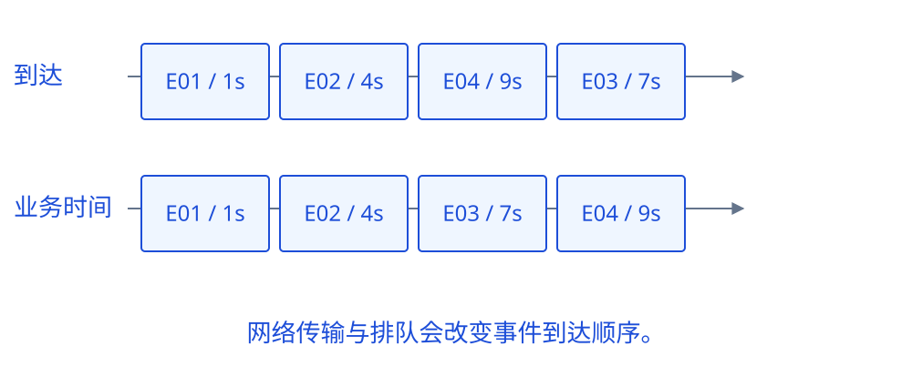</figure>

- E04 在 9 s 发生却先到；E03 在 7 s 发生却后到：这是<strong>乱序</strong>。
- 事件时间描述业务先后；arrival 描述本例收到记录的次序。

<!--
请看两行队伍，上面按我们收到消息的次序，下面按业务真正发生的时间。第三张收到的是9秒的E04，第四张却是7秒的E03。两条消息经过网络与排队后，到达顺序发生了变化。大家可以把手指放在E03上，沿两行各找一次位置：事件身份没变，顺序变了。今天先按收到的顺序维护累计额；到了第三讲，我们会进一步问，这种乱序为什么会改变十秒营业额的发布时机。

[Sources]
- https://nightlies.apache.org/flink/flink-docs-release-2.3/docs/concepts/stateful-stream-processing/
- 教学构造数据：course/data/cases.json；金额单位为分。专项场景在页面注明参数。
-->

---
class: course story-course
layout: section
---
## 1 · 支付记录与业务口径

<ol class="outline"><li class="current">支付记录与业务口径</li><li>算子怎样产生结果</li><li>数据流与标准图示</li><li>批流模型与方案设计</li></ol>

<!--
现在我们把业务问题写成可以判定的输入和结果。大家已经认识了事件编号、金额与时间，接下来特别留意“记录条数”和“不同事件数”的区别。我们会让相同事件出现两次，看看如果只按行加钱，结果会偏到哪里。判断口径写清楚以后，后面的算子才知道究竟要做什么。

[Sources]
- https://nightlies.apache.org/flink/flink-docs-release-2.3/docs/concepts/stateful-stream-processing/
-->

---
class: course story-course
---
## 完整输入包含十二次投递

<figure class="story-figure">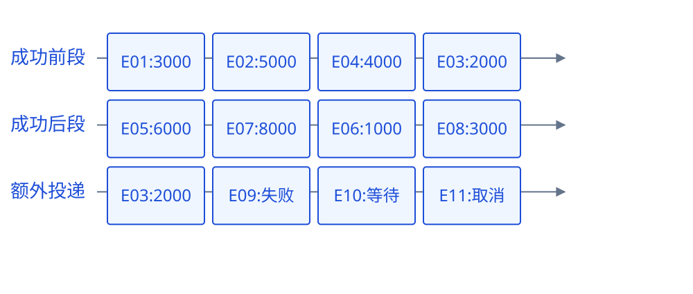</figure>

- 共 12 条投递：9 条 PAID，另有 FAILED、PENDING、CANCELLED 各 1 条。
- E03 出现两次，身份与金额相同；8 个不同成功事件合计 <strong>32000 分</strong>。

<!--
我们先清点输入。成功队列里有九次投递，其中E03出现了两次；另有失败、等待和取消三条消息。请先分别数出“收到的消息”和“不同的成功支付”。这两个计数分别是十二和八。图中两次E03对应同一笔业务，请圈出它们共同的事件身份。后面每一步都会让某些记录留下或者离开，最终的32000分必须能追溯到八个不同事件。

[Sources]
- https://nightlies.apache.org/flink/flink-docs-release-2.3/docs/concepts/stateful-stream-processing/
- 教学构造数据：course/data/cases.json；金额单位为分。专项场景在页面注明参数。
-->

---
class: course story-course
---
## 投递位置与业务身份

<figure class="story-figure">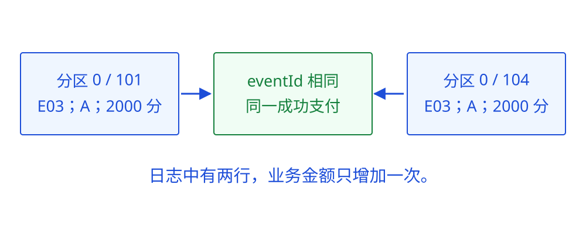</figure>

- E03 在分区 0 的 Offset 101 与 104 各投递一次。
- <strong>Offset 定位日志记录；eventId 判断是否为同一业务事件。</strong>

<!--
请看这两张小票，日志位置分别是101和104，但eventId都写E03，内容也都是用户A成功支付2000分。这两行日志记录了同一笔支付的两次投递。如果两笔支付金额恰好都是2000分，各自的eventId仍能区分它们。大家现在用一句话区分两个编号：Offset帮助我们找到一条投递记录，eventId帮助我们认出一件业务事实。第五讲恢复重放时，这个区别还会再次出现。

[Sources]
- https://nightlies.apache.org/flink/flink-docs-release-2.3/docs/concepts/stateful-stream-processing/
- 教学构造数据：course/data/cases.json；金额单位为分。专项场景在页面注明参数。
-->

---
class: course story-course
---
## 成功支付累计额的计算口径

<figure class="story-figure"></figure>

- 保留 status=PAID；按 eventId 去重；按 userId 分组求金额与笔数。
- 每个已接纳的新事件使该用户的<strong>金额加 amountCents，笔数加 1</strong>。

<!--
我们把需求写完整：先留下成功支付，再认出已经算过的事件，然后找到所属用户，最后更新金额和笔数。请问，第二次E03到达时，金额和笔数各怎样变化？两者都保持原值，因为这次投递对应已经计入的支付。再看用户归属：B的支付更新B的账，A的账保持原值，所以分组键也属于计算口径。核对系统时，我们逐项检查成功条件、事件身份、用户归属和金额笔数。

[Sources]
- https://nightlies.apache.org/flink/flink-docs-release-2.3/docs/concepts/stateful-stream-processing/
- 教学构造数据：course/data/cases.json；金额单位为分。专项场景在页面注明参数。
-->

---
class: course story-course
---
## 少一道去重会多出二千分

<figure class="story-figure"></figure>

- 九次成功投递直接相加得到 34000 分；其中 E03 重复贡献 2000 分。
- <strong>34000 − 2000 = 32000 分</strong>：差额定位到第二次 E03；去重依据是事件身份。

<!--
图中左边是“看见成功就加钱”的结果34000，右边是按唯一事件计算的32000。我们把差额2000圈出来，再回输入找证据，正好是第二次投递的E03。这2000分来自已经计入的同一笔支付，因此应从重复统计中扣除。如果直接把两个相同金额当作重复，别的顾客真正支付2000也会被误删。所以去重比较稳定的业务身份，金额用于核对重复造成的差额。

[Sources]
- https://nightlies.apache.org/flink/flink-docs-release-2.3/docs/concepts/stateful-stream-processing/
- 教学构造数据：course/data/cases.json；金额单位为分。专项场景在页面注明参数。
-->

---
class: course story-course
layout: section
---
## 2 · 算子怎样产生结果

<ol class="outline"><li>支付记录与业务口径</li><li class="current">算子怎样产生结果</li><li>数据流与标准图示</li><li>批流模型与方案设计</li></ol>

<!--
接下来我们把刚才的业务规则拆成计算动作。每个动作叫一个算子，它只承担明确的一种变换。大家顺着图看同一条记录怎样改变表示、怎样与历史比较、怎样找到自己的累计状态。看到一个新名称时，先问它的输入是什么、输出是什么，再问它需要保留哪些历史。

[Sources]
- https://nightlies.apache.org/flink/flink-docs-release-2.3/docs/concepts/stateful-stream-processing/
-->

---
class: course story-course
---
## 算子把一种输入变成一种输出

<figure class="story-figure"></figure>

- <strong>算子（Operator）</strong>对数据流执行一种变换。
- Source 读入记录，Sink 写出结果，中间算子完成过滤、去重和聚合。

<!--
现在把统计员的动作拆开。左边Source负责把外部记录读进来，右边Sink负责把结果写出去，中间每个算子完成一件具体事情。例如过滤算子收到一条记录，判断状态，决定送出还是跳过；聚合算子收到一条新支付，找出原来的金额并更新。算子描述计算图中的逻辑动作；机器是承载执行的设备。第二讲才会决定这个动作展开成几个执行实例、放在哪些机器上。

[Sources]
- https://nightlies.apache.org/flink/flink-docs-release-2.3/docs/concepts/stateful-stream-processing/
- 教学构造数据：course/data/cases.json；金额单位为分。专项场景在页面注明参数。
-->

---
class: course story-course
---
## 过滤只决定记录是否通过

<figure class="story-figure"></figure>

- 过滤条件：status=PAID；9 次成功投递继续，3 次其他状态离开。
- 过滤后 E03 仍有两条；<strong>去重需要继续比较 eventId</strong>。

<!--
大家看分叉处，判断条件只写“是否成功”。成功的E03两次都满足这个条件，因此两次都会继续走；E09失败、E10等待、E11取消则离开主计算路径。请一位同学沿E09走一遍，说明它在哪个判断处被挡住。再沿第二次E03走一遍，会发现它没有在这里被挡住。过滤按支付状态放行；后面的去重算子再用已见身份识别重复。

[Sources]
- https://nightlies.apache.org/flink/flink-docs-release-2.3/docs/concepts/stateful-stream-processing/
- 教学构造数据：course/data/cases.json；金额单位为分。专项场景在页面注明参数。
-->

---
class: course story-course
---
## 映射改变表示，保留计算所需字段

<figure class="story-figure">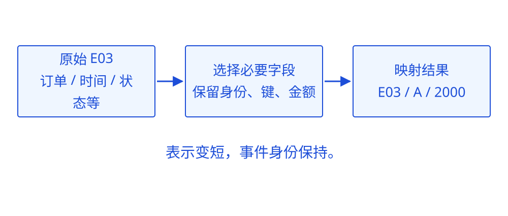</figure>

- <strong>映射（Map）</strong>把每条输入变为需要的表示；本例条数仍为 9。
- 留下 eventId、userId、amountCents；后续去重仍然需要事件身份。

<!--
一张原始小票有订单、时间、状态等很多字段，本例累计用户金额需要三项：认出事件的编号、找到用户的键和金额。映射就是把需要的信息整理成下一步方便使用的形式。请问，能不能只留下用户和金额，把eventId丢掉？如果这样做，后面就没有依据区分两次E03了。因此保留字段的依据是后续计算需求：去重用eventId，分组用userId，累计用金额。这里每条成功输入仍对应一条输出，九条没有减少。

[Sources]
- https://nightlies.apache.org/flink/flink-docs-release-2.3/docs/concepts/stateful-stream-processing/
- 教学构造数据：course/data/cases.json；金额单位为分。专项场景在页面注明参数。
-->

---
class: course story-course
---
## 第一次 E03：查询已见集合

<figure class="story-figure"></figure>

- 去重状态 Seen 保存已接纳的 eventId；E03 尚未出现。
- <strong>先接纳，再把 E03 放入 Seen</strong>；输出一次 2000 分增量。

<!--
我们现在来到第一次E03。去重算子手里保留一份已见事件编号集合，叫Seen。它查找E03，没有找到，于是承认这是一个新事件，把编号放进集合，再把这条支付送往后面。大家看Seen，里面保存E01、E02、E04这样的事件身份；累计金额保存在后面的用户状态中。它存在的目的，是让未来另一条消息到来时能作判断。看到这里，请用“查历史、记身份、放行”三个具体动作解释第一次E03为什么能够通过。

[Sources]
- https://nightlies.apache.org/flink/flink-docs-release-2.3/docs/concepts/stateful-stream-processing/
- 教学构造数据：course/data/cases.json；金额单位为分。专项场景在页面注明参数。
-->

---
class: course story-course
---
## 第二次 E03：历史使输出保持不变

<figure class="story-figure"></figure>

- Offset 104 再次投递 E03；Seen 已包含 E03，因此不再输出。
- 输入消费继续前进；金额与笔数都<strong>保持不变</strong>。

<!--
同学们，现在把两页并在脑中比较。同样一条E03，为什么这次不能通过？因为Seen已经不同了，里面已经有E03。算子仍然读取了这条日志记录，但不再产生新的支付增量，所以用户A的金额和笔数都不变。请大家沿这条记录看两个动作：Source读到E03，去重算子识别它后停止发送增量。状态的作用就在这里：同样的输入内容，结合不同的历史，可能得到不同处理决定。将来故障恢复时，这份历史也需要被正确恢复。

[Sources]
- https://nightlies.apache.org/flink/flink-docs-release-2.3/docs/concepts/stateful-stream-processing/
- 教学构造数据：course/data/cases.json；金额单位为分。专项场景在页面注明参数。
-->

---
class: course story-course
---
## 按用户分组，金额进入对应历史

<figure class="story-figure">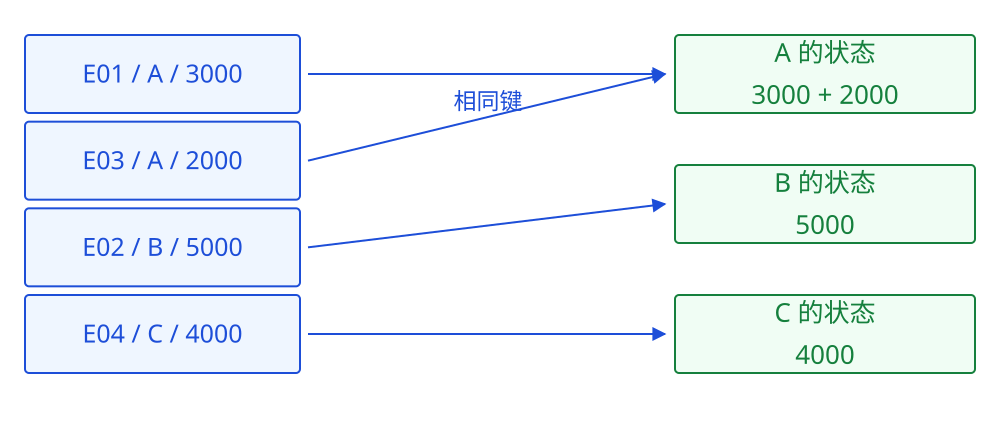</figure>

- <strong>业务键（Key）</strong>标识同一组；本例使用 userId。
- A、B、C 分别维护累计状态，同组记录进入同一份历史。

<!--
去重之后，我们要决定钱归谁。看三条箭头，E01和E03都属于用户A，所以走向A的累计状态；E02属于B，不能加到A上。图中A、B、C表示三份逻辑归属。分组让相同业务键的记录共享后续计算历史；机器上的放置由并行执行决定。以后无论并行度怎样变化，这个归属都必须保持，才能让一个用户的累计额完整。

[Sources]
- https://nightlies.apache.org/flink/flink-docs-release-2.3/docs/concepts/stateful-stream-processing/
- 教学构造数据：course/data/cases.json；金额单位为分。专项场景在页面注明参数。
-->

---
class: course story-course
---
## 状态保存后续输入需要的历史

<figure class="story-figure">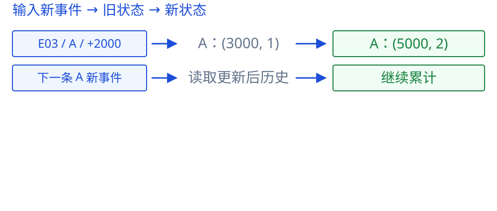</figure>

- <strong>状态（State）</strong>是算子保留的历史信息，用于处理后续输入。
- 每个用户保存（累计金额，成功笔数）；新事件更新同一组状态。

<!--
图中间原来的状态是A已经支付3000分、成功一笔。下一条新事件E03带来2000分，我们读取旧金额、相加，再把笔数从一改成二。新的状态是5000分、两笔。之前的累计已经保存在状态里，每次读取旧值并加入当前新支付即可完成更新。大家用这张图回答定义：为什么累计值属于状态？因为后来的E03必须用到它。再问Seen是不是状态？也是，因为后来的重复判断需要它。

[Sources]
- https://nightlies.apache.org/flink/flink-docs-release-2.3/docs/concepts/stateful-stream-processing/
- 教学构造数据：course/data/cases.json；金额单位为分。专项场景在页面注明参数。
-->

---
class: course story-course
---
## 步骤一：E01、E02 建立两组状态

<figure class="story-figure"></figure>

- E01：A 从（0,0）到（3000,1）；E02：B 到（5000,1）。
- 当前总额 8000 分，来自两位用户各一笔。

<!--
我们开始完整地走八个唯一成功事件。先把所有用户状态看作零。E01先到，查用户A那一格，金额加3000、笔数加一；E02再到，查的是B那一格，A保持不动。B的5000写入B自己的状态；核对全店总额时，再将A和B两组相加。右边8000分是一个交叉核对数，实际用户状态仍然分别保存。下面的每次更新，我们都明确指出究竟动了哪一格。

[Sources]
- https://nightlies.apache.org/flink/flink-docs-release-2.3/docs/concepts/stateful-stream-processing/
- 教学构造数据：course/data/cases.json；金额单位为分。专项场景在页面注明参数。
-->

---
class: course story-course
---
## 步骤二：乱序改变到达次序，不改变归属

<figure class="story-figure"></figure>

- 先到 E04：C 得到 4000；后到 E03：A 从 3000 到 5000。
- 当前 A=5000，B=5000，C=4000；合计 <strong>14000 分</strong>。

<!--
现在第三个到达的是E04，用户C第一次出现，给C建立4000分、一笔的状态。然后7秒的E03才到达，它虽然发生得更早，但仍然属于A，更新A原来的3000成为5000。请问，乱序会不会让这份全历史累计额漏掉E03？在我们当前保留全部历史并接纳所有唯一成功事件的规则下，不会，它晚到也照样加到A上。第三讲的时间窗口会增加一个关闭和修正边界，今天先把没有窗口时的机制看清楚。

[Sources]
- https://nightlies.apache.org/flink/flink-docs-release-2.3/docs/concepts/stateful-stream-processing/
- 教学构造数据：course/data/cases.json；金额单位为分。专项场景在页面注明参数。
-->

---
class: course story-course
---
## 步骤三：E05、E07 分别更新 B、C

<figure class="story-figure">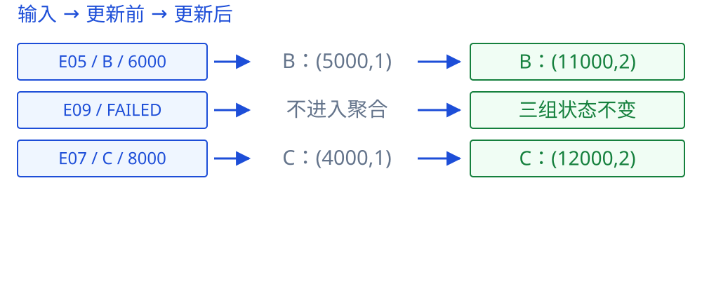</figure>

- E05：B 5000 + 6000 = 11000；E07：C 4000 + 8000 = 12000。
- E09 为 FAILED：它的 2500 分在过滤处离开，不改变状态。

<!--
中间的E09金额2500分、状态失败，按过滤条件离开累计路径。随后E05和E07分别更新B与C。请大家沿图中的旧值走：B从5000到11000，C从4000到12000，A仍是5000。E09按失败条件离开，E05和E07继续累计；这三条记录的去向都符合计算口径。核对时要同时检查经过和跳过的路径。

[Sources]
- https://nightlies.apache.org/flink/flink-docs-release-2.3/docs/concepts/stateful-stream-processing/
- 教学构造数据：course/data/cases.json；金额单位为分。专项场景在页面注明参数。
-->

---
class: course story-course
---
## 步骤四：最终用户结果与全店核对

<figure class="story-figure"></figure>

- E06 更新 A 到（6000,3）；E08 更新 B 到（14000,3）。
- 最终 C=（12000,2）；金额合计 32000，笔数合计 8。

<!--
最后两笔新的成功支付是A的E06和B的E08。A原来5000分，加1000后是6000分，笔数三；B原来11000分，加3000后是14000分，也有三笔。C保留12000分、两笔。大家现在做两种核对：横着看，每个用户的输入都能对回自己的状态；竖着加，6000加14000加12000得到32000，三加三加二得到八。后面重复E03与等待、取消消息到达，结果保持不变，这就完成了全部十二次投递的解释。

[Sources]
- https://nightlies.apache.org/flink/flink-docs-release-2.3/docs/concepts/stateful-stream-processing/
- 教学构造数据：course/data/cases.json；金额单位为分。专项场景在页面注明参数。
-->

---
class: course story-course
---
## 无状态判断与有状态计算

<figure class="story-figure"></figure>

- 过滤只看当前记录；去重需要 Seen；累计需要每个用户的旧金额。
- <strong>同一条输入能否独立决定输出</strong>，帮助判断是否需要历史。

<!--
大家比较三个动作。判断status是否成功，拿到当前记录就能决定；判断E03是不是重复，必须知道过去是否见过；计算新的用户累计额，必须知道旧金额。后两个动作跨记录保留历史，属于有状态计算。消息中的status则是当前支付的业务字段。请同学用过滤作例子：它读取当前记录的PAID就能判断，因此属于无状态计算。

[Sources]
- https://nightlies.apache.org/flink/flink-docs-release-2.3/docs/concepts/stateful-stream-processing/
- 教学构造数据：course/data/cases.json；金额单位为分。专项场景在页面注明参数。
-->

---
class: course story-course
---
## 独立练习：新增与重复各怎样更新

- 初始：A=（6000分,3笔），Seen 含 E01—E08。
- 依次到达：E12 / A / 1500 / PAID；E03 / A / 2000 / PAID。
- 画输入、Seen、A 状态三列；写出每条之后的金额和笔数。

<!--
现在请大家在纸上画出处理过程。初始状态已经给出，先处理新的E12，再处理又一次E03。每次都先问“成功吗”，再问“身份见过吗”，最后才更新金额。每条输入都画出身份判断、输出增量和更新后状态，标明第二次输入使A保持原值的依据。画完后请同桌只看你画的箭头复述一遍，看看是否能判断每条记录经历了哪个处理决定。

[Sources]
- https://nightlies.apache.org/flink/flink-docs-release-2.3/docs/concepts/stateful-stream-processing/
- 教学构造数据：course/data/cases.json；金额单位为分。专项场景在页面注明参数。
-->

---
class: course story-course
---
## 练习答案：只有 E12 产生新增量

<figure class="story-figure">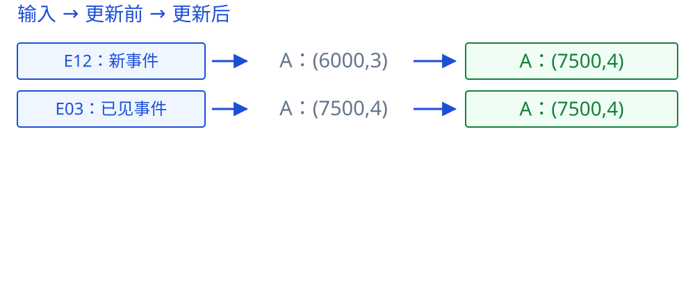</figure>

- E12 首次出现：A→（7500,4），Seen 加入 E12。
- E03 已见：A 保持（7500,4）；两条投递仅新增一笔支付。

<!--
我们一起核对。E12成功，而且没有出现在Seen，所以把1500分送给A，旧6000变7500，笔数三变四，同时记录E12。下一条E03虽然也是成功，但Seen早就包含它，因此不再向A发送增量。请大家找出自己图里是否写出了这一处“停止输出”，如果只有7500这个结果，还看不出你是通过什么机制得到的。以后写方案时同样需要把判断规则放出来，让别人能验证它会怎样对待重复输入。

[Sources]
- https://nightlies.apache.org/flink/flink-docs-release-2.3/docs/concepts/stateful-stream-processing/
- 教学构造数据：course/data/cases.json；金额单位为分。专项场景在页面注明参数。
-->

---
class: course story-course
layout: section
---
## 3 · 数据流与标准图示

<ol class="outline"><li>支付记录与业务口径</li><li>算子怎样产生结果</li><li class="current">数据流与标准图示</li><li>批流模型与方案设计</li></ol>

<!--
我们已经亲手让数据经过了每个动作，接下来把这些动作画成别人能读懂的标准图。三种图各自回答不同问题：类图说明对象关系，活动图说明一条记录如何作选择，数据流DAG说明计算怎样连接。请按要表达的对象关系、处理路径或数据依赖选择图种。

[Sources]
- https://nightlies.apache.org/flink/flink-docs-release-2.3/docs/concepts/stateful-stream-processing/
-->

---
class: course story-course
---
## 支付汇总的数据流 DAG

- <strong>有向无环图（DAG）</strong>：节点是算子，边是数据流方向，图中没有有向环。
- 去重按 eventId 识别身份，累计按 userId 归组；两种键承担不同职责。

<!--
请大家沿最左边的输入一直走到右边的输出。每个节点是一种计算动作，每条箭头表示上一种输出送入下一种输入。这里叫DAG，是因为连线有方向，沿箭头不会绕回原来的算子。我们特意把两次分组写出来：去重先按事件身份组织历史，用户累计再按用户组织历史。若只画一个模糊的“分组”，别人就无法知道重复判断和用户账本分别依赖什么键。这张图描述计算关系，下一讲才把它展开到机器和执行实例。

[Sources]
- https://nightlies.apache.org/flink/flink-docs-release-2.3/docs/concepts/stateful-stream-processing/
- 教学构造数据：course/data/cases.json；金额单位为分。专项场景在页面注明参数。
-->

---
class: course story-course
---
## DAG 的绘制与检查

<figure class="story-figure">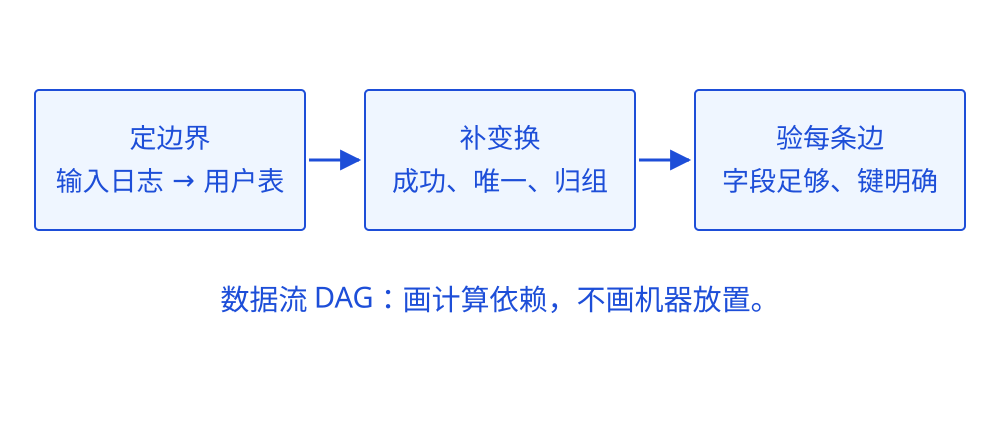</figure>

- 先写输入与输出，再补必要变换；每条边都应说清传递什么记录。
- 检查：身份是否保留、键是否明确、状态是否画在所属算子旁。

<!--
现在请大家用这三步重画刚才的图。先在纸两端写支付日志和用户累计表，再从结果往前倒推：要累计必须有用户键，要去重必须保留事件身份，要只算成功就必须有过滤。最后顺着箭头逐段检查记录字段。特别是映射如果提前删掉eventId，后面虽然还画了去重节点，这张图也已经无法实现。画完后，逐个检查节点是否取得完成该动作所需的字段。

[Sources]
- https://nightlies.apache.org/flink/flink-docs-release-2.3/docs/concepts/stateful-stream-processing/
- 教学构造数据：course/data/cases.json；金额单位为分。专项场景在页面注明参数。
-->

---
class: course story-course
---
## 类图的属性与多重性

<figure class="story-figure"></figure>

- 类名说明对象种类；属性说明对象保存的信息；多重性约束关系数量。
- “1 — 0..*”读作：每个事件属于一个订单，订单可以有多个事件。

<!--
回到这张类图，这次我们逐个读符号。矩形中上面是类名，下面是属性区；连线表示对象之间有关联，端点旁的数字约束另一端能关联多少对象。请大家把Order旁的1指给同桌看：它表示每条支付事件属于一个订单。再看事件旁的0..*，表示一个订单可以暂时没有支付事件，也可能有多条。把这个关系读反，后面用订单编号去重时就很容易误删不同的支付尝试。

[Sources]
- https://www.omg.org/spec/UML/2.5.1/PDF
- 教学构造数据：course/data/cases.json；金额单位为分。专项场景在页面注明参数。
-->

---
class: course story-course
---
## 类图练习：退款也需要身份

- 为订单加入 RefundEvent：refundId、eventTimeMs、amountCents。
- 标明 Order 与 RefundEvent 的关系及多重性。
- 说明：同一退款重投时，比较哪个字段？金额方向怎样进入净额？

<!--
请大家在原来的订单旁边增加一种退款事件。退款是一类业务事件，有自己的编号、发生时间和金额。接着考虑一个订单是否可能没有退款、是否允许多次部分退款，由本题给出的允许多次退款规则来确定多重性。最后把类图与计算联系起来：同一笔退款再次投递，必须认出同一身份；真正的新退款则让净额减少。请在图旁写出身份判断和净额变化，将对象关系连到计算规则。

[Sources]
- https://www.omg.org/spec/UML/2.5.1/PDF
- 教学构造数据：course/data/cases.json；金额单位为分。专项场景在页面注明参数。
-->

---
class: course story-course
---
## 退款类图与净额更新

<figure class="story-figure"></figure>

- Order 1 — 0..* RefundEvent；退款以 refundId 去重。
- 专项例：用户 A 原净额 6000，R01 退款 1500 两次投递，净额只减到 <strong>4500</strong>。

<!--
答案图给订单接上了退款事件，退款编号独立于支付编号。现在用数据验证：A原来6000分，新退款R01金额1500，第一条到达时净额减到4500；第二次仍是R01，不能再减，否则会变3000。请问，能不能拿原支付的eventId判断所有退款都重复？不行，同一支付可能对应多次合法部分退款，所以要使用这次退款自己的稳定身份。这说明类图中的身份设计，会直接决定数据流能否正确处理重投。

[Sources]
- https://www.omg.org/spec/UML/2.5.1/PDF
- 教学构造数据：course/data/cases.json；金额单位为分。专项场景在页面注明参数。
-->

---
class: course story-course
---
## 活动图描述单条记录的处理路径

<figure class="story-figure"></figure>

- 实心圆开始，菱形按条件分支，圆角框执行动作，终点结束本条处理。
- 顺着“成功且未见”路径，才会记录身份并更新用户累计额。

<!--
我们把镜头从整个数据流缩到单条记录。这张UML活动图从上往下读，先问支付成功吗，不成功就走跳过路径；成功再问身份是否已见，已见也跳过。只有两个条件都满足，才记录身份并更新金额。大家分别把第一次E03和第二次E03放进去，指着分叉处说明它们从哪里走向不同方向。这里的终点表示本条记录处理结束，不表示整个持续运行的作业停机。用标准符号，可以让不同同学画出的图具有一致读法。

[Sources]
- https://www.omg.org/spec/UML/2.5.1/PDF
- 教学构造数据：course/data/cases.json；金额单位为分。专项场景在页面注明参数。
-->

---
class: course story-course
---
## 活动图的绘制步骤

<figure class="story-figure"></figure>

- 列出判断与动作；给分支写条件；让每条路径有明确去向。
- 用 E03 首投、E03 重投、E09 失败三条输入逐路检查。

<!--
请大家先在纸上分别写“判断”和“动作”。判断是能回答是或否的条件，比如是否成功；动作则是记身份、更新金额或跳过。把判断放进菱形，动作放进圆角框，箭头边上写明哪种条件走这条路。画好以后，分别用成功首投、重复和失败输入检查各条路径。若某条分支没有去向，执行者就不知道这条记录下一步怎么办。活动图因此也能帮助我们发现业务规则有没有遗漏。

[Sources]
- https://www.omg.org/spec/UML/2.5.1/PDF
- 教学构造数据：course/data/cases.json；金额单位为分。专项场景在页面注明参数。
-->

---
class: course story-course
---
## 绘图练习：支付与退款的净额

- 输入：支付 P01=3000；退款 R01=1000；R01 再投一次。
- 分别按 paymentId、refundId 去重；画活动图并给每步净额。
- 退款只允许引用已存在支付；本题支付先到、三条均有效。

<!--
这次请大家把活动图用于另一组完整输入。先处理支付P01，再处理退款R01，最后故意再送一次退款。每个分支旁写清比较的身份，不能用“金额相同”替代。净额从零开始，每处理一条就在图旁写一次数值。题目已经规定支付先到、退款有效，所以现在只需要围绕事件类型、身份与增减方向画清路径。画完后请解释，第二次R01为什么结束处理却没有再次改变净额。

[Sources]
- https://nightlies.apache.org/flink/flink-docs-release-2.3/docs/concepts/stateful-stream-processing/
- 教学构造数据：course/data/cases.json；金额单位为分。专项场景在页面注明参数。
-->

---
class: course story-course
---
## 绘图答案：类型决定方向，身份决定次数

<figure class="story-figure"></figure>

- P01：0→3000；R01：3000→2000；重复 R01：2000→2000。
- 每种业务事件有稳定身份；通过后才按支付加、退款减更新净额。

<!--
我们把三条输入依次走完。支付P01首次出现，净额从零到3000；退款R01首次出现，减1000后到2000；第二次R01被退款已见集合识别，2000保持。大家看，类型和身份承担两件不同事情：类型决定通过以后加还是减，身份决定这件事实是否已经产生过影响。把两种判断写到同一张活动图里，别人就能用新的金额和新的事件编号重复验证你的方案，而不仅知道本题最后是2000。

[Sources]
- https://nightlies.apache.org/flink/flink-docs-release-2.3/docs/concepts/stateful-stream-processing/
- 教学构造数据：course/data/cases.json；金额单位为分。专项场景在页面注明参数。
-->

---
class: course story-course
layout: section
---
## 4 · 批流模型与方案设计

<ol class="outline"><li>支付记录与业务口径</li><li>算子怎样产生结果</li><li>数据流与标准图示</li><li class="current">批流模型与方案设计</li></ol>

<!--
现在我们已经知道每条记录怎样计算，还要决定何时把输入当作完整、多久更新结果。我们先比较固定的一段历史和持续到来的记录，再用Dataflow的四个问题把业务口径、时间范围、发布时机与修正方式分开。这样写出的方案，才不会只列一串技术名称。

[Sources]
- https://nightlies.apache.org/flink/flink-docs-release-2.3/docs/concepts/stateful-stream-processing/
-->

---
class: course story-course
---
## 有界与无界描述输入是否结束

<figure class="story-figure">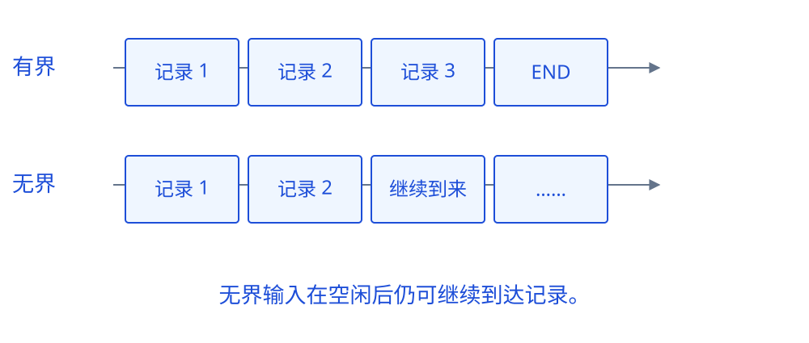</figure>

- <strong>有界输入</strong>有确定终点；无界输入持续到来，运行时没有自然结束点。
- 今天 0—24 时的归档是有界数据；持续订阅支付日志是无界输入。

<!--
大家看上面一行，一天的归档已经封好，最后一条之后明确写着结束，这就叫有界。下面一行持续订阅支付，输入没有预先确定的终点，这叫无界。有界与无界按输入是否有确定终点区分：十亿条封存归档是有界输入，持续订阅的流即使当前只有几条也属于无界输入。无界输入需要规定“十秒营业额何时先发布、后来的记录怎样修正”，让结果按规则持续产出。

[Sources]
- https://nightlies.apache.org/flink/flink-docs-release-2.3/docs/concepts/stateful-stream-processing/
- 教学构造数据：course/data/cases.json；金额单位为分。专项场景在页面注明参数。
-->

---
class: course story-course
---
## 批处理先确定输入，再运行计算

<figure class="story-figure"></figure>

- 先固定归档边界，再读取全部记录，最终输出一次结果。
- 本例批输入为这 12 次投递；同一口径得到 8 笔、32000 分。

<!--
把今天的十二条消息先收成一个固定文件，然后运行刚才那条过滤、去重和聚合线，就是一次有界计算。由于输入终点确定，我们可以在全部处理完成后给出最终结果。请问批处理是否就不需要去重？仍然需要，因为文件里同样可能包含第二次E03。批和流改变执行组织与输入完成的判断，成功过滤和身份去重仍按同一业务口径执行。只要使用同一份输入与规则，最后仍应得到八笔32000分。

[Sources]
- https://nightlies.apache.org/flink/flink-docs-release-2.3/docs/concepts/stateful-stream-processing/
- 教学构造数据：course/data/cases.json；金额单位为分。专项场景在页面注明参数。
-->

---
class: course story-course
---
## 流处理随输入到来增量更新

<figure class="story-figure"></figure>

- 每个新事件结合旧状态，增量更新累计结果。
- 前四个唯一成功事件先得到 14000；后续逐步更新到 32000 分。

<!--
现在不等归档完成，消息到来就进入同一条处理线。前四个不同成功事件处理后，我们已经可以看到14000分，随后继续变成20000、28000、29000、32000等中间结果。每次利用旧状态和新事件完成一次增量更新。这些数值表示截至当前已处理输入的累计额，后续新事件会继续更新它。持续计算需要同时说明当前结果的含义和后续更新规则，这正是下一组模型问题要解决的。

[Sources]
- https://nightlies.apache.org/flink/flink-docs-release-2.3/docs/concepts/stateful-stream-processing/
- 教学构造数据：course/data/cases.json；金额单位为分。专项场景在页面注明参数。
-->

---
class: course story-course
---
## 同一输入与口径的批流核对

<figure class="story-figure"></figure>

- 批末结果与流处理相同前缀后的状态应一致：A6000、B14000、C12000。
- 比较前提：同一去重规则、同一输入集合、同一金额单位。

<!--
我们把两种执行结果并排。左边等文件结束后算一次，右边随着输入不断更新；当它们都处理了相同十二次投递，用户结果应该一致。若左边算32000，右边34000，就沿同一份输入检查规则；例如流端漏掉去重，会多计E03的2000分。这里的相等有条件：比较的是同一批业务事实、同一成功口径和同一身份规则。到了有窗口、迟到清理的场景，还要把接纳边界写清楚，才能公平核对。

[Sources]
- https://nightlies.apache.org/flink/flink-docs-release-2.3/docs/concepts/stateful-stream-processing/
- 教学构造数据：course/data/cases.json；金额单位为分。专项场景在页面注明参数。
-->

---
class: course story-course
---
## 延迟与吞吐量衡量不同方面

<figure class="story-figure"></figure>

- <strong>延迟</strong>是单条记录从输入到结果所用时间；<strong>吞吐量</strong>是每秒处理条数。
- 专项例：消息 12:00:01 到达，12:00:03 可见，延迟 2 s。

<!--
大家看这条单事件时间线，第一处是记录到达，第二处是结果可被查询，两者相差两秒，这叫延迟。再看下面，一秒内系统完成了多少条，这叫吞吐量。吞吐和延迟衡量不同方面：等满一批再一起处理时，每秒完成条数可以很高，第一条的等待时间也可能很长。写方案时要分别给出两种目标，并说明观测起点和终点。否则“系统很实时”这句话，别人无法据此判断是否满足业务需求。

[Sources]
- https://nightlies.apache.org/flink/flink-docs-release-2.3/docs/concepts/stateful-stream-processing/
- 教学构造数据：course/data/cases.json；金额单位为分。专项场景在页面注明参数。
-->

---
class: course story-course
---
## Dataflow：What 与 Where

<figure class="story-figure"></figure>

- <strong>What（算什么）</strong>：唯一成功支付的金额和笔数。
- <strong>Where（在哪段事件时间算）</strong>：按用户与每个 10 s 窗口归组。

<!--
我们把一个常见需求拆开：每十秒显示每位用户的成功支付金额。先问What，也就是算什么：成功过滤、身份去重、金额求和和笔数计数。再问Where，也就是每条事件属于哪个计算范围，比如按用户并落入某个十秒事件时间窗口。大家发现，同样3000分，若用户不同或业务时间属于另一窗，就不能加到同一格。Dataflow把这些决定分开，是为了让方案中的每一条规则都能指到具体输入和状态。

[Sources]
- https://research.google/pubs/the-dataflow-model-a-practical-approach-to-balancing-correctness-latency-and-cost-in-massive-scale-unbounded-out-of-order-data-processing/
- https://nightlies.apache.org/flink/flink-docs-release-2.3/docs/dev/datastream/operators/windows/
- 教学构造数据：course/data/cases.json；金额单位为分。专项场景在页面注明参数。
-->

---
class: course story-course
---
## Dataflow：When 与 How

<figure class="story-figure"></figure>

- <strong>When（何时输出）</strong>：提前、进度到达窗口边界、迟到更新。
- <strong>How（怎样修正）</strong>：输出新增贡献、累计值，或撤回旧值再给新值。

<!--
确定了某一格算什么，还没决定屏幕什么时候看到它。When回答发布时机：每几条先报一次，或者事件时间进度越过窗口边界再报。How则回答第二次输出和第一次是什么关系，是只增加2500，还是把原14000改成16500。请大家记住这两个问题：一条消息什么时候发出来，与消息内容代表增量还是完整新值，是不同的决定。第三讲我们会把这些输出逐次画出来，看看为什么把累计值全部相加会多算。

[Sources]
- https://research.google/pubs/the-dataflow-model-a-practical-approach-to-balancing-correctness-latency-and-cost-in-massive-scale-unbounded-out-of-order-data-processing/
- https://nightlies.apache.org/flink/flink-docs-release-2.3/docs/dev/datastream/operators/windows/
- 教学构造数据：course/data/cases.json；金额单位为分。专项场景在页面注明参数。
-->

---
class: course story-course
---
## 计算方案需要可核对的规则

<figure class="story-figure">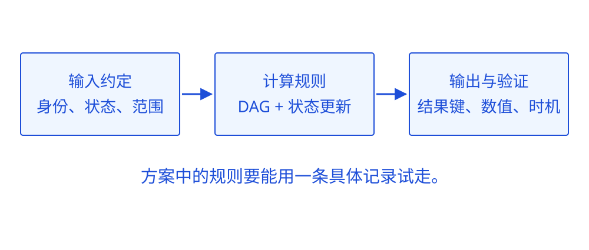</figure>

- 输入：字段、身份、范围；计算：筛选、去重、分组、状态。
- 输出：结果键、单位、更新时间；验证：逐笔追踪与总额核对。

<!--
现在请大家尝试把这节课写成一份方案。先说清输入字段、稳定身份和计算覆盖范围，再选择承载这些规则的引擎与数据库。再给出数据流，说明哪些记录被接纳、状态怎样更新。最后约定输出怎么识别一行、多久更新以及金额单位，并给一组可以独立算出的输入和预期结果。一个读者拿到这些信息，才有机会复现32000，发现多出的2000究竟来自哪里。

[Sources]
- https://nightlies.apache.org/flink/flink-docs-release-2.3/docs/concepts/stateful-stream-processing/
- 教学构造数据：course/data/cases.json；金额单位为分。专项场景在页面注明参数。
-->

---
class: course story-course
---
## 方案示范：用户支付累计表

<figure class="story-figure">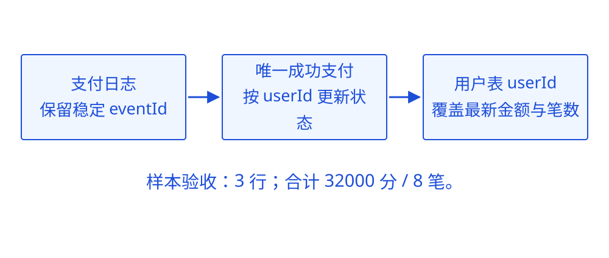</figure>

- 保留 eventId、userId、amountCents；过滤 PAID，按身份去重后按用户累计。
- 以 userId 定位结果行；新事件到来时替换该行的金额与笔数。

<!--
我们给门店写一份可以照着执行的示范。输入保留三个计算字段，状态条件在过滤前判断；成功事件按eventId识别重投，再把唯一事件交给对应用户。每个用户保存累计金额和笔数，输出以userId找到那一行并写成最新值。核对样本用今天十二次投递，应该得到A六千三笔、B一万四千三笔、C一万二千两笔。这里还没有承诺故障后的外部写入语义，第五讲会把恢复与输出协议补完整；当前我们先把正常运行的对象与计算规则写严谨。

[Sources]
- https://nightlies.apache.org/flink/flink-docs-release-2.3/docs/concepts/stateful-stream-processing/
- 教学构造数据：course/data/cases.json；金额单位为分。专项场景在页面注明参数。
-->

---
class: course story-course
---
## 独立方案练习：门店净收入

- 每个门店统计支付减退款的净额；两类事件都可能重复投递。
- 专项输入：店 S 支付 P1=5000、P2=3000、退款 R1=1200、R1 重投。
- 写输入身份、DAG、状态、输出键与预期值；画出重投离开的路径。

<!--
这次请大家独立设计门店净收入，不再直接照抄按用户的图。业务键换成门店，支付和退款分别有自己的事件身份，退款金额按减号进入净额。题目给了全部四条投递，请你在方案旁按条演算，不只写最后6800。检查自己的图有没有保留类型与身份，有没有解释重复退款会停在哪一步，以及结果表里用哪个键找到门店S。请同桌拿这四条输入试走你的方案，看看能否得到同一结果。

[Sources]
- https://nightlies.apache.org/flink/flink-docs-release-2.3/docs/concepts/stateful-stream-processing/
- 教学构造数据：course/data/cases.json；金额单位为分。专项场景在页面注明参数。
-->

---
class: course story-course
---
## 方案答案：净额 6800 分

<figure class="story-figure"></figure>

- P1、P2 新增 8000；R1 首投扣 1200，重投跳过，最终 6800。
- 输出按 storeId 替换净额；Seen 使用（事件类型，事件编号）识别身份。

<!--
我们用图检查答案。P1和P2各第一次到达，门店S的净额从零到5000再到8000；R1第一次到达减1200，得到6800；再次R1不产生增量。若支付编号和退款编号可能重名，就用（事件类型，事件编号）共同识别身份。输出行以门店定位，写的是当前净额6800。请大家据此检查，自己的方案是否真的解释了数据、规则和结果之间的关系。

[Sources]
- https://nightlies.apache.org/flink/flink-docs-release-2.3/docs/concepts/stateful-stream-processing/
- 教学构造数据：course/data/cases.json；金额单位为分。专项场景在页面注明参数。
-->

---
class: course story-course
---
## 本讲的计算关系

<figure class="story-figure"></figure>

- 事件身份决定是否新增；业务键决定更新哪份状态。
- DAG 连接计算；时间与输出规则决定结果何时、以何种含义发布。

<!--
请大家回到开头的收银屏幕，现在应该能够从左到右解释一笔支付。先识别它是成功还是其他状态，再依据稳定身份判断是否已经计入，然后按用户键找到那份历史，更新金额和笔数。类图帮我们定义对象，活动图帮我们检查分支，数据流图帮我们连接算子。最后，用Dataflow的四个问题约定范围与输出。下一讲我们保留这条计算逻辑，研究怎样把它展开成多个同时工作的实例，放到两台机器上执行。

[Sources]
- https://nightlies.apache.org/flink/flink-docs-release-2.3/docs/concepts/stateful-stream-processing/
- 教学构造数据：course/data/cases.json；金额单位为分。专项场景在页面注明参数。
-->

---
class: course story-course
---
## 附录：局部求和怎样合并

<figure class="story-figure">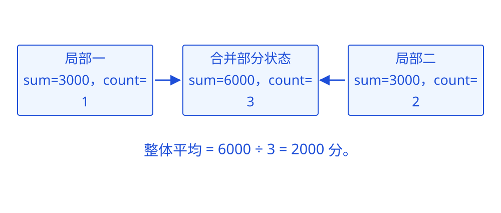</figure>

- 加法可结合：（3000+2000）+1000 = 3000+（2000+1000）=6000。
- 求平均数时合并（总和，个数），再用总和除以个数。

<!--
如果记录分给不同执行实例，可以先算局部和，再把局部和相加。对于A的三笔3000、2000、1000，不论怎样分组，完整合并后都是6000。这里成立的原因是加法具有结合律。请再看平均值，若一边只有一条3000，另一边两条2000和1000，两组平均分别3000和1500，直接再平均得到2250，却不是整体2000。保留总和与个数后再合并，才能恢复正确整体平均。这会帮助我们理解第二讲的局部聚合。

[Sources]
- https://nightlies.apache.org/flink/flink-docs-release-2.3/docs/concepts/stateful-stream-processing/
- 教学构造数据：course/data/cases.json；金额单位为分。专项场景在页面注明参数。
-->

---
class: course story-course
---
## 附录：输出行的字段

<figure class="story-figure">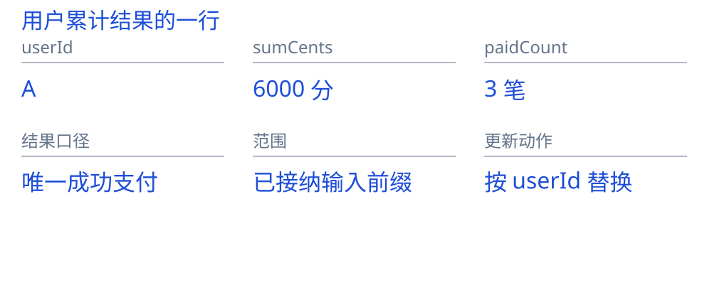</figure>

- 结果行至少包含 userId、sumCents、paidCount；时间窗口结果还需窗口边界。
- 行键描述“哪一个结果”；数值与更新时间描述“这一版结果是什么”。

<!--
结果应同时给出数值与计算依据。看到6000，别人还需要知道它属于用户A，是哪一段输入的累计，用的是分还是元，以及何时更新。如果改成按十秒窗口统计，单独userId还不能区分不同窗口，要把窗口起止也放进结果键。大家看这张示例行，字段共同限定了它代表的对象。后面第三讲比较14000和16500时，它们必须对应同一个结果键，才能说明第二次是在修正第一次。

[Sources]
- https://nightlies.apache.org/flink/flink-docs-release-2.3/docs/concepts/stateful-stream-processing/
- 教学构造数据：course/data/cases.json；金额单位为分。专项场景在页面注明参数。
-->
