# 数据流与计算模型

> 第 1 次课 · 分布式实时计算

从支付事件到可核对的用户累计额

<!--
同学们，假设一家店的收银屏幕要随时显示每位顾客已经支付多少钱。传统报表等到半夜跑一次批任务再出数，可现实里风控和运营等不了几小时；支付系统不断送来消息，有成功、有失败，同一笔成功还可能重投。屏幕上的金额应该怎样变化？今天我们把这些记录放到一条可视化的处理线上，逐步算出每位顾客的累计额。大家要能指着每个箭头说出记录为什么留下、为什么跳过、金额为什么改变，再从具体小票上升到通用的批流计算模型。

[Sources]
- https://nightlies.apache.org/flink/flink-docs-release-2.3/docs/concepts/stateful-stream-processing/
- 教学构造数据：course/data/cases.json；金额单位为分。特定示例在页面注明参数。
-->

---
class: course story-course
---
## 收银记录怎样变成营业额

<figure class="story-figure">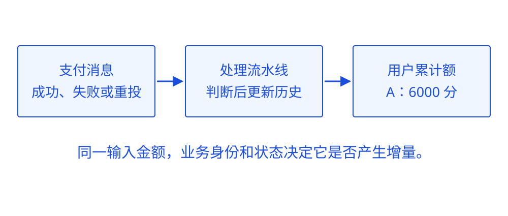</figure>

<strong>输入流</strong>：一条条不断到达的支付消息（成功、失败或重投）

<strong>输出账本</strong>：每位用户的成功支付累计额

<strong>判断前提</strong>：须先确认成功状态、是否重复与归属用户

<!--
大家先看左边，收银端每收到一次支付通知，就把一张小票送进来。中间这位统计员按规则记账：成功的小票首次计入，失败或重复的小票跳过。右边的屏幕按用户分别显示结果。请大家判断，看到一笔 2000 分，能不能立刻说营业额增加 2000？还不能，我们至少要知道支付是否成功、以前是否已经算过，以及它属于哪位用户。接下来每个计算步骤，都是为了解答其中一个具体问题。

[Sources]
- https://nightlies.apache.org/flink/flink-docs-release-2.3/docs/concepts/stateful-stream-processing/
- 教学构造数据：course/data/cases.json；金额单位为分。特定示例在页面注明参数。
-->

---
class: course story-course
---
## 一条支付事件的字段

<figure class="story-figure"></figure>

<strong>身份字段</strong>：`eventId` 标识单次支付事件，`orderId` 标识所属订单

<strong>业务字段</strong>：`userId` 归属用户，`eventTimeMs` 发生时间

<strong>数值与状态</strong>：`amountCents` 用整数分避开精度误差，`status` 标明成败

<!--
我们拿出今天的第一条记录 E01。它说用户 A 为订单 O101 成功支付了 3000 分，业务发生在课堂起点后的 1 秒。eventId 是事件的编号，orderId 是订单的编号，两者回答的问题不同：同一个订单可能有多次支付尝试，每次尝试用自己的 eventId 识别。大家再看金额，我们统一用整数分，3000 分就是 30 元，这样能避开浮点数精度误差，后面的推演始终使用分。请大家把每个字段对应到一个业务问题：哪件事、谁的订单、何时发生、多少金额与处理状态。

[Sources]
- https://nightlies.apache.org/flink/flink-docs-release-2.3/docs/concepts/stateful-stream-processing/
- 教学构造数据：course/data/cases.json；金额单位为分。特定示例在页面注明参数。
-->

---
class: course story-course
---
## 业务对象与事件的关系

<figure class="story-figure"></figure>

<strong>UML 类图</strong>：矩形画对象类别与属性，连线画对象间的关系

<strong>多重性</strong>：`1 — 0..*` 表示一个订单可对应零到多条支付事件

<!--
大家看这张标准的 UML 类图。每个长方形代表一类对象，上半部写名字，下半部写这类对象需要记住的属性。顺着用户到订单的连线读：一位用户可以下很多订单；再顺着订单到支付事件读：一个订单可以还没有支付，也可以经历几次尝试。连线旁的 0..* 就是零到多的意思。先分清“有哪些对象和关系”，后面我们再画“记录经过哪些算子去更新状态”。

[Sources]
- https://www.omg.org/spec/UML/2.5.1/PDF
- 教学构造数据：course/data/cases.json；金额单位为分。特定示例在页面注明参数。
-->

---
class: course story-course
---
## 业务时间与到达顺序

<figure class="story-figure"></figure>

<strong>事件时间</strong>：业务真正发生的时刻（E03 在 7 s，E04 在 9 s）

<strong>到达顺序</strong>：经网络排队后进入系统的次序（E04 先到、E03 后到）

<strong>乱序现象</strong>：到达次序与事件时间先后不一致

<!--
请看两行队伍，上面按我们收到消息的次序，下面按业务真正发生的时间。第三张收到的是 9 秒的 E04，第四张却是 7 秒的 E03。两条消息经过网络转发、重试和队列排队后，到达顺序发生了颠倒。大家可以把手指放在 E03 上，沿两行各找一次位置：事件身份没变，顺序变了。今天我们先按收到的顺序维护全历史累计额；到了第三讲统计十秒窗口时，这种乱序就会直接挑战结果什么时候发布。

[Sources]
- https://nightlies.apache.org/flink/flink-docs-release-2.3/docs/concepts/stateful-stream-processing/
- 教学构造数据：course/data/cases.json；金额单位为分。特定示例在页面注明参数。
-->

---
class: course story-course
layout: section
---
## 1 · 支付记录与业务口径

<ol class="outline"><li class="current">支付记录与业务口径</li><li>算子怎样产生结果</li><li>数据流与标准图示</li><li>批流模型与方案设计</li></ol>

<!--
现在我们把业务需求写成可判定的输入与口径。大家已经认识了事件编号、金额与时间，接下来特别留意“记录投递次数”和“唯一业务事件数”的区别。我们会让同一笔支付投递两次，看看只按行数加钱会把账算偏多少。口径钉死以后，后面的算子才知道究竟要做什么。

[Sources]
- https://nightlies.apache.org/flink/flink-docs-release-2.3/docs/concepts/stateful-stream-processing/
-->

---
class: course story-course
---
## 完整输入包含十二次投递

<figure class="story-figure"></figure>

<strong>投递总数</strong>：共 12 条（9 条 PAID，另有 FAILED / PENDING / CANCELLED 各 1 条）

<strong>重复投递</strong>：E03 出现两次，身份与金额相同

<strong>有效总计</strong>：8 个唯一成功事件，合计 <strong>32000 分</strong>

<!--
我们先清点全量输入。成功队列里有九次投递，其中 E03 出现了两次；另有失败、等待和取消三条非成功消息。请先分别数出“收到的投递数”和“不同的成功支付数”，这两个计数分别是十二和八。图中两次 E03 对应同一笔业务支付，请圈出它们共同的事件身份。后面每一步都会让某些记录留下或者离开，最终的 32000 分必须能逐笔追溯到这八个唯一事件。

[Sources]
- https://nightlies.apache.org/flink/flink-docs-release-2.3/docs/concepts/stateful-stream-processing/
- 教学构造数据：course/data/cases.json；金额单位为分。特定示例在页面注明参数。
-->

---
class: course story-course
---
## 投递位置与业务身份

<figure class="story-figure"></figure>

<strong>投递位置</strong>：E03 在分区 0 的 Offset 101 与 104 各出现一次

<strong>职责区分</strong>：`Offset` 定位日志行，`eventId` 判断是否为同一业务事件

<!--
请看这两张小票，日志位置分别是 101 和 104，但 eventId 都写着 E03，内容也都是用户 A 成功支付 2000 分。这两行日志记录了同一笔支付的两次投递。假如另有一笔完全不同的支付刚好也是 2000 分，它的 eventId 会是全新的编号，绝不能拿金额去充当身份。大家用一句话区分两个编号：Offset 帮我们在日志队伍里找一条投递记录，eventId 帮我们认出是不是同一件业务事实。第五讲讲故障重放时，这两个编号还会一起出场。

[Sources]
- https://nightlies.apache.org/flink/flink-docs-release-2.3/docs/concepts/stateful-stream-processing/
- 教学构造数据：course/data/cases.json；金额单位为分。特定示例在页面注明参数。
-->

---
class: course story-course
---
## 成功支付累计额的计算口径

<figure class="story-figure">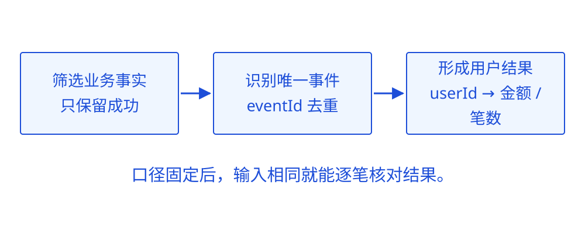</figure>

<strong>计算步骤</strong>：筛选 `status=PAID` → 按 `eventId` 去重 → 按 `userId` 分组

<strong>更新规则</strong>：每个新接纳事件使该用户<strong>金额加 amountCents、笔数加 1</strong>

<!--
我们把需求口径写成四步契约：先留下成功支付，再认出已经算过的事件，然后找到所属用户，最后更新金额和笔数。请问，第二次 E03 到达时，金额和笔数各怎样变化？两者都保持原值，因为这次投递对应已经计入的支付。再看用户归属：B 的支付更新 B 的账，A 的账保持原值，所以分组键也属于计算口径。以后核对系统时，我们就逐项检查成功条件、事件身份、用户归属和金额笔数。

[Sources]
- https://nightlies.apache.org/flink/flink-docs-release-2.3/docs/concepts/stateful-stream-processing/
- 教学构造数据：course/data/cases.json；金额单位为分。特定示例在页面注明参数。
-->

---
class: course story-course
---
## 少一道去重会多出二千分

<figure class="story-figure">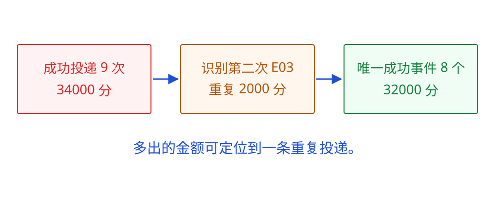</figure>

<strong>直接相加</strong>：9 次成功投递合计 <strong>34000 分</strong>（E03 被计入两次）

<strong>正确口径</strong>：8 个唯一事件合计 <strong>32000 分</strong>，差额定位到第二次 E03

> 问题：能不能偷懒拿“金额相等”来判重？

<!--
图中左边是“看见成功就加钱”的结果 34000，右边是按唯一事件计算的 32000。我们把差额 2000 圈出来，回到输入找证据，正好就是第二次投递的 E03。如果不按业务身份去重，而是偷懒拿金额判重，别的顾客刚好也付了 2000 元就会被误删。所以去重必须比对稳定的业务身份，多出来的金额差则用来反向核对哪里漏了去重。

[Sources]
- https://nightlies.apache.org/flink/flink-docs-release-2.3/docs/concepts/stateful-stream-processing/
- 教学构造数据：course/data/cases.json；金额单位为分。特定示例在页面注明参数。
-->

---
class: course story-course
layout: section
---
## 2 · 算子怎样产生结果

<ol class="outline"><li>支付记录与业务口径</li><li class="current">算子怎样产生结果</li><li>数据流与标准图示</li><li>批流模型与方案设计</li></ol>

<!--
接下来我们把刚才的业务规则拆成一组独立算子。每个算子只承担明确的一种变换。大家顺着图看同一条记录怎样改变表示、怎样与历史比较、怎样找到自己的累计状态。每遇到一个新算子，先问它的输入和输出是什么，再问它要不要保留历史。

[Sources]
- https://nightlies.apache.org/flink/flink-docs-release-2.3/docs/concepts/stateful-stream-processing/
-->

---
class: course story-course
---
## 算子把一种输入变成一种输出

<figure class="story-figure">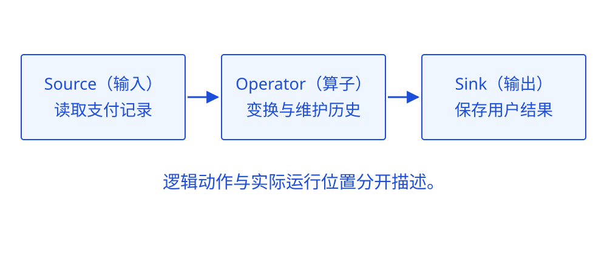</figure>

<strong>算子（Operator）</strong>：对数据流执行一种变换的逻辑单元

<strong>流水线分工</strong>：Source 读入 → Filter / Dedup / Sum 变换 → Sink 写出

<!--
现在把统计员的工作拆解成标准组件。左边 Source 负责把外部记录读进来，右边 Sink 负责把结果写出去，中间每个算子专注完成一件事：过滤算子按条件放行或拦截，聚合算子取出原来的金额并累加更新。算子描述的是计算图里的逻辑变换，至于这组变换展开成几个并发实例、跑在几台机器上，我们在第二讲再展开部署。

[Sources]
- https://nightlies.apache.org/flink/flink-docs-release-2.3/docs/concepts/stateful-stream-processing/
- 教学构造数据：course/data/cases.json；金额单位为分。特定示例在页面注明参数。
-->

---
class: course story-course
---
## 过滤只决定记录是否通过

<figure class="story-figure">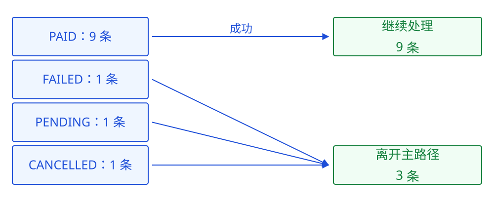</figure>

<strong>过滤条件</strong>：`status=PAID`；9 次成功放行，其余 3 次离开主路径

> 检验：过滤后 E03 仍有两条，去重须交由下游比较 `eventId`

<!--
大家看分叉处，过滤算子的判断条件只写了一条“是否成功”。成功的 E03 两次都满足条件，所以两次都会放行；E09 失败、E10 等待、E11 取消则被拦截下来。请大家沿 E09 走一遍，它在过滤判断处离开；再沿第二次 E03 走一遍，你会发现过滤管不了重复投递，必须留给下游的去重算子接手。

[Sources]
- https://nightlies.apache.org/flink/flink-docs-release-2.3/docs/concepts/stateful-stream-processing/
- 教学构造数据：course/data/cases.json；金额单位为分。特定示例在页面注明参数。
-->

---
class: course story-course
---
## 映射改变表示，保留计算所需字段

<figure class="story-figure"></figure>

<strong>映射（Map）</strong>：逐条变换数据结构，本例输出条数仍为 9

<strong>字段裁剪</strong>：保留下游所需的 `eventId`、`userId` 与 `amountCents`

<!--
上游小票带着订单号、时间、状态等一堆字段，后面的去重和累计其实用不到那么多信息。映射算子把每条记录精简成三个必要字段：留着 eventId 给去重用，留着 userId 给分组用，留着 amountCents 给求和用。裁剪字段时一定要往前看一眼下游依赖，万一顺手把 eventId 丢了，后面的去重算子就成了无米之炊。

[Sources]
- https://nightlies.apache.org/flink/flink-docs-release-2.3/docs/concepts/stateful-stream-processing/
- 教学构造数据：course/data/cases.json；金额单位为分。特定示例在页面注明参数。
-->

---
class: course story-course
---
## 第一次 E03：查询已见集合

<figure class="story-figure">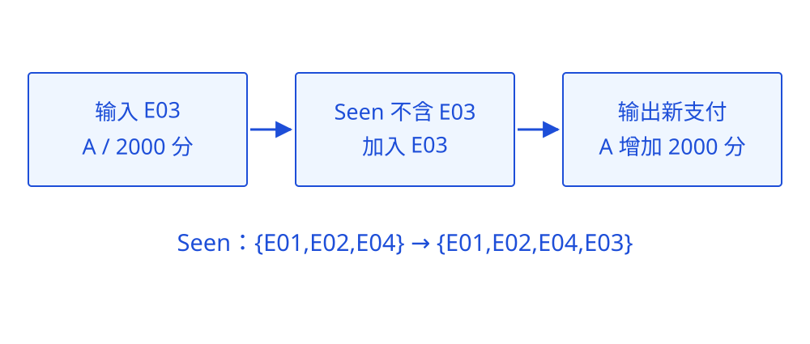</figure>

<strong>去重集合 Seen</strong>：保存已接纳的事件编号，此时尚不含 E03

<strong>动作顺序</strong>：查未见 → 记入 `Seen` → 向下游发出 2000 分增量

<!--
我们现在来到第一次 E03。去重算子手里维护着一份已接纳事件编号的集合，叫 Seen。它先查一下 E03 在不在里面，结果没找到，于是承认这是一笔新支付，把 E03 写进 Seen，同时把这 2000 分往后送。请大家分清两份历史的职责：Seen 记住“来过谁”，后面的累计状态记住“加了多少钱”。用“查历史、记身份、再放行”这三个动作，就能说清楚第一次 E03 为什么能通过。

[Sources]
- https://nightlies.apache.org/flink/flink-docs-release-2.3/docs/concepts/stateful-stream-processing/
- 教学构造数据：course/data/cases.json；金额单位为分。特定示例在页面注明参数。
-->

---
class: course story-course
---
## 第二次 E03：历史使输出保持不变

<figure class="story-figure">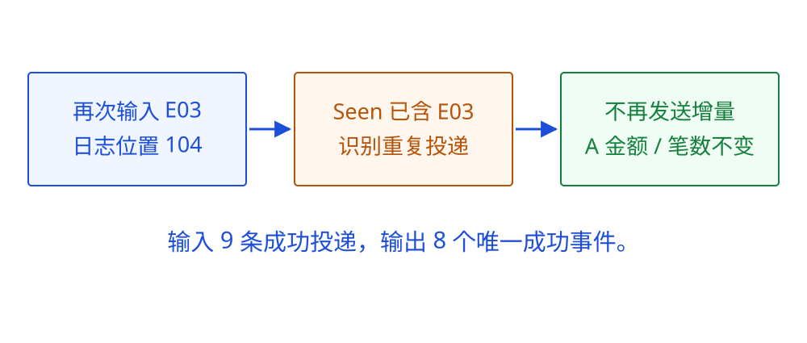</figure>

<strong>重复抵达</strong>：Offset 104 再次送来 E03，`Seen` 中已有该编号

<strong>处理结果</strong>：拦截不发送，输入位点前进，用户金额与笔数不变

<!--
现在把前后两页对比来看。同样一条 E03，为什么这一次被拦了下来？因为算子手里的历史 Seen 已经变了，里面早就有 E03。Source 依然把这条日志读了出来，偏移量照常往前走，但去重算子认出它是旧事件后直接吞掉，不再往后发增量。这就引出了流计算里最关键的性质：同样的输入记录，结合不同的历史状态，会产生截然不同的输出决定。

[Sources]
- https://nightlies.apache.org/flink/flink-docs-release-2.3/docs/concepts/stateful-stream-processing/
- 教学构造数据：course/data/cases.json；金额单位为分。特定示例在页面注明参数。
-->

---
class: course story-course
---
## 按用户分组，金额进入对应历史

<figure class="story-figure"></figure>

<strong>业务键（Key）</strong>：标识状态归属组，本例采用 `userId`

<strong>状态隔离</strong>：A、B、C 各自拥有独立账本，同键记录落入同一历史

<!--
去重之后，我们要决定这笔钱算在谁的账上。顺着箭头看，E01 和 E03 都属于用户 A，双双走进 A 的累计格；E02 属于 B，走进 B 的格子。A、B、C 代表三份互相隔离的逻辑账本。后面就算系统把计算拆成几十个并发实例，也必须靠业务键把同一个用户的所有支付送到同一份状态里，否则账本就会算碎。

[Sources]
- https://nightlies.apache.org/flink/flink-docs-release-2.3/docs/concepts/stateful-stream-processing/
- 教学构造数据：course/data/cases.json；金额单位为分。特定示例在页面注明参数。
-->

---
class: course story-course
---
## 状态保存后续输入需要的历史

<figure class="story-figure"></figure>

<strong>状态（State）</strong>：算子跨事件保留的历史记忆

<strong>增量累加</strong>：每用户存 `(累计金额, 成功笔数)`，新事件直接在旧值上更新

<!--
同学们看用户 A 的这一格是如何演进的。原本格子里写着 3000 分和 1 笔，E03 带着 2000 分进来后，累计算子不需要重新翻看 E01 的原始小票，直接取出旧值 3000 加上 2000 得到 5000，笔数加 1 变成 2。这种“旧状态加新增量”的增量计算模式，让系统不必把海量历史全存在内存里重算。前面去重用的 Seen 集合和这里用的用户账本，本质上都是跨事件保留的状态。

[Sources]
- https://nightlies.apache.org/flink/flink-docs-release-2.3/docs/concepts/stateful-stream-processing/
- 教学构造数据：course/data/cases.json；金额单位为分。特定示例在页面注明参数。
-->

---
class: course story-course
---
## 步骤一：E01、E02 建立两组状态

<figure class="story-figure">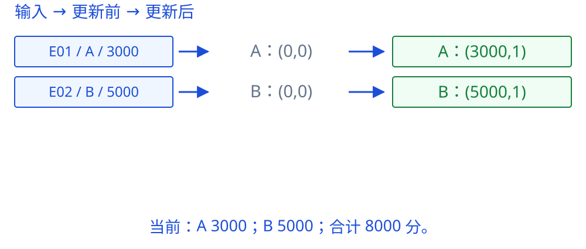</figure>

<strong>状态更新</strong>：E01 使 A → `(3000, 1)`；E02 使 B → `(5000, 1)`

<strong>全店核对</strong>：当前累计 <strong>8000 分</strong>（2 笔）

<!--
我们现在按到达顺序完整走一遍这八个唯一成功事件。初始状态全为零。E01 先到，打开用户 A 的格子记下 3000 分、1 笔；E02 再到，打开 B 的格子记下 5000 分、1 笔，A 的格子纹丝不动。右边的 8000 分是把 A 和 B 加起来做的全店交叉核对，底层状态依然按用户分开保管。

[Sources]
- https://nightlies.apache.org/flink/flink-docs-release-2.3/docs/concepts/stateful-stream-processing/
- 教学构造数据：course/data/cases.json；金额单位为分。特定示例在页面注明参数。
-->

---
class: course story-course
---
## 步骤二：乱序改变到达次序，不改变归属

<figure class="story-figure">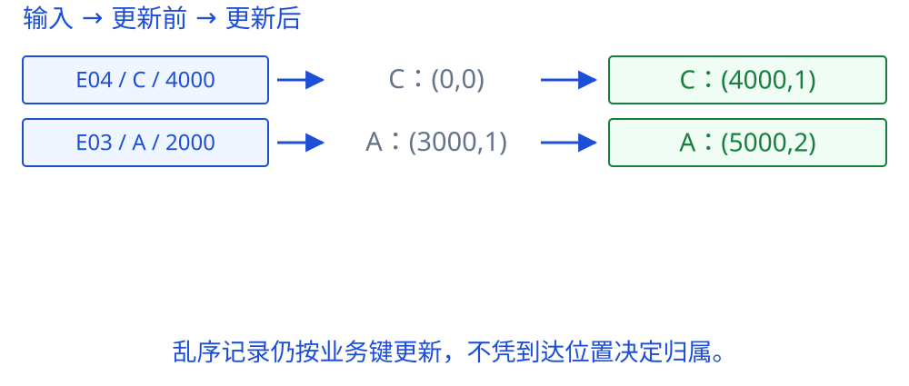</figure>

<strong>乱序到达</strong>：先到 E04 使 C → `4000`，后到 E03 使 A → `5000`

<strong>全店核对</strong>：A=5000、B=5000、C=4000，合计 <strong>14000 分</strong>

<!--
第三条到达的是发生在 9 秒的 E04，它为新用户 C 开出一格 4000 分、1 笔。紧接着迟一点到的 E03 虽然发生在更早的 7 秒，但只要按 userId 路由，照样稳稳落在用户 A 的格子里，把 A 从 3000 推到 5000。因为现在算的是全历史累计、还没有切时间窗口，谁先到谁后到并不影响加法总和；一旦第三讲按每十秒切窗，这种乱序就需要靠水位线来管了。

[Sources]
- https://nightlies.apache.org/flink/flink-docs-release-2.3/docs/concepts/stateful-stream-processing/
- 教学构造数据：course/data/cases.json；金额单位为分。特定示例在页面注明参数。
-->

---
class: course story-course
---
## 步骤三：E05、E07 分别更新 B、C

<figure class="story-figure"></figure>

<strong>状态更新</strong>：E05 使 B → `11000`，E07 使 C → `12000`

<strong>拦截验证</strong>：E09（FAILED, 2500 分）已在过滤阶段退出，三组状态不变

<!--
接着看中间混进来的 E09，金额 2500 分，但状态是失败，在最前面的过滤算子就被拦住了，根本见不到累计算子的面，三组状态安然无恙。随后的 E05 和 E07 都是有效支付，分别把 B 推到 11000、把 C 推到 12000，A 依然保持 5000。核对流系统时，既要确认放行对了，也要确认拦截对了。

[Sources]
- https://nightlies.apache.org/flink/flink-docs-release-2.3/docs/concepts/stateful-stream-processing/
- 教学构造数据：course/data/cases.json；金额单位为分。特定示例在页面注明参数。
-->

---
class: course story-course
---
## 步骤四：最终用户结果与全店核对

<figure class="story-figure">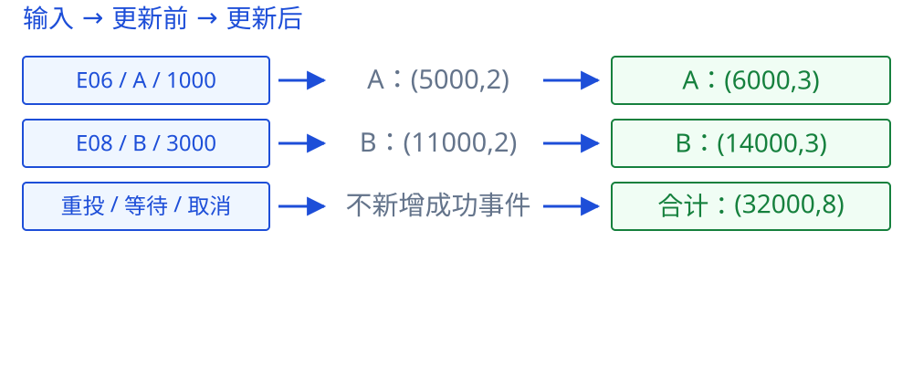</figure>

<strong>用户终值</strong>：A=`(6000, 3)`，B=`(14000, 3)`，C=`(12000, 2)`

<strong>全店核对</strong>：唯一成功事件 8 笔，合计 <strong>32000 分</strong>

<!--
最后两笔有效支付是 A 的 E06 和 B 的 E08。A 加 1000 来到 6000 分、3 笔；B 加 3000 来到 14000 分、3 笔；C 保持 12000 分、2 笔。现在做双向交叉验算：横着看每个用户的明细都能对上，竖着把 6000、14000 和 12000 加起来恰好是 32000 分，笔数相加恰好是 8 笔。后面再来的重投 E03 以及等待、取消消息都不会改写这份终值。

[Sources]
- https://nightlies.apache.org/flink/flink-docs-release-2.3/docs/concepts/stateful-stream-processing/
- 教学构造数据：course/data/cases.json；金额单位为分。特定示例在页面注明参数。
-->

---
class: course story-course
---
## 无状态判断与有状态计算

<figure class="story-figure">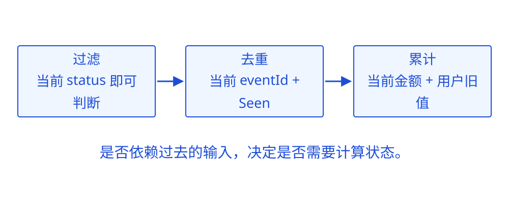</figure>

<strong>无状态（Filter / Map）</strong>：只凭当前单条记录即可完成判断或转换

<strong>有状态（Dedup / Sum）</strong>：必须读取过去留下的 `Seen` 或用户历史

<strong>划分标尺</strong>：单条输入能否独立决定输出

<!--
把三个核心算子摆在一起对比就能发现一条清晰的分界线。过滤算子只看手头这一条记录的 status 是不是 PAID，看完就能拍板，完全不用记过去发生过什么，这是无状态计算；去重算子必须翻看历史集合 Seen，累计算子必须读取用户的旧累计额，离开了以前留下的上下文就算不对，这是有状态计算。大家注意区分“数据自带的 status 字段”和“算子自己保存的状态”，前者跟着每条消息走，后者长在计算引擎里。

[Sources]
- https://nightlies.apache.org/flink/flink-docs-release-2.3/docs/concepts/stateful-stream-processing/
- 教学构造数据：course/data/cases.json；金额单位为分。特定示例在页面注明参数。
-->

---
class: course story-course
---
## 独立练习：新增与重复各怎样更新

<strong>初始状态</strong>：A=`(6000 分, 3 笔)`，`Seen` 含 E01—E08

<strong>依次输入</strong>：E12（A, 1500, PAID）→ E03（A, 2000, PAID）

<strong>推演目标</strong>：列出输入、`Seen` 与 A 状态三列，标出每步结果

> 问题：E03 再次到达时，Seen 与用户金额各怎样变化？

<!--
现在请同学们在纸上推演一遍。初始状态已经给定，先后进入两条新消息：先是一笔新的 E12，再是一笔老的 E03。每收到一条都按顺序过三道关：是否成功、身份见过没有、怎么更新用户状态。画完后请同桌只看你的箭头和状态框复述一遍，检验逻辑是否一眼就能看明白。

[Sources]
- https://nightlies.apache.org/flink/flink-docs-release-2.3/docs/concepts/stateful-stream-processing/
- 教学构造数据：course/data/cases.json；金额单位为分。特定示例在页面注明参数。
-->

---
class: course story-course
---
## 练习答案：只有 E12 产生新增量

<figure class="story-figure"></figure>

<strong>E12（新事件）</strong>：写入 `Seen`，A 更新为 `(7500, 4)`

<strong>E03（已见事件）</strong>：被 `Seen` 拦截，A 保持 `(7500, 4)` 不变

<!--
对照屏幕核对步骤。第一条 E12 状态成功且不在 Seen 里，系统记下 E12 并放行 1500 分，用户 A 顺利来到 7500 分、4 笔。第二条 E03 虽然也是成功支付，但一查 Seen 发现早就存在了，去重算子在门口直接拦截，用户 A 稳稳停在 7500 分。以后设计方案时，重复投递走哪条路、停在哪一步，都要像这样能逐笔验证。

[Sources]
- https://nightlies.apache.org/flink/flink-docs-release-2.3/docs/concepts/stateful-stream-processing/
- 教学构造数据：course/data/cases.json；金额单位为分。特定示例在页面注明参数。
-->

---
class: course story-course
layout: section
---
## 3 · 数据流与标准图示

<ol class="outline"><li>支付记录与业务口径</li><li>算子怎样产生结果</li><li class="current">数据流与标准图示</li><li>批流模型与方案设计</li></ol>

<!--
我们已经亲手让数据走过了每个动作，接下来要把这些规则画成工程里通用的标准图。三种图各管一摊：类图定义业务对象和关系，活动图画单条记录的分叉路径，数据流 DAG 画算子之间的连接。根据你想让对方看清什么，挑对图种。

[Sources]
- https://nightlies.apache.org/flink/flink-docs-release-2.3/docs/concepts/stateful-stream-processing/
-->

---
class: course story-course
---
## 支付汇总的数据流 DAG

<strong>有向无环图（DAG）</strong>：节点为算子、有向边为数据流，图中无环路

<strong>分工两键</strong>：去重按 `eventId` 判重，累计按 `userId` 分组

<!--
沿着最左边的支付日志一直走到右边的用户结果表。每个方框代表一类计算算子，每根箭头代表上游算子的输出流向下游算子。之所以叫 DAG（有向无环图），是因为数据顺着箭头一路往前走，不会绕回来死循环。请注意图里特意拆出了两处不同的分组键：去重靠 eventId 把同一件事聚在一起判重，累计靠 userId 把同一个人的消费聚在一起算账。图里只画逻辑依赖，机器和并行实例留到下一讲再排。

[Sources]
- https://nightlies.apache.org/flink/flink-docs-release-2.3/docs/concepts/stateful-stream-processing/
- 教学构造数据：course/data/cases.json；金额单位为分。特定示例在页面注明参数。
-->

---
class: course story-course
---
## DAG 的绘制与检查

<figure class="story-figure"></figure>

<strong>倒推画法</strong>：先定输入与输出，再补中间变换并标明边上字段

<strong>三项核对</strong>：事件身份未裁丢、分组键明确、状态落在所属算子旁

<!--
画数据流 DAG 有个非常好用的倒推法：先定好起点（原始日志）和终点（用户结果表），然后从后往前追问依赖。下游算累计要 userId 和金额，再往前做去重就需要保留 eventId，最前面的过滤要看 status。画完每一条边都检查一下：前面的映射有没有把后面需要的字段裁丢？只要每一步的依赖都能对上，这张计算图就立住了。

[Sources]
- https://nightlies.apache.org/flink/flink-docs-release-2.3/docs/concepts/stateful-stream-processing/
- 教学构造数据：course/data/cases.json；金额单位为分。特定示例在页面注明参数。
-->

---
class: course story-course
---
## 类图的属性与多重性

<figure class="story-figure"></figure>

<strong>类图要素</strong>：类名定对象种类，属性定数据字段，多重性定数量约束

<strong>关系读法</strong>：`1 — 0..*` 表示一条支付仅属一单，一单可有多条支付

<!--
回到刚才的类图，我们把符号彻底读透。矩形顶上写类名，下面列属性，连线两端的数字叫多重性。请大家把 Order 旁边的“1”和事件旁边的“0..*”指出来：一笔订单可以还没付款，也可以尝试多次付款，而每一条支付事件都只能属于唯一一个订单。万一把这层关系搞反，拿 orderId 去替支付事件做去重，同一笔订单的第二次正常补款就会被误删。

[Sources]
- https://www.omg.org/spec/UML/2.5.1/PDF
- 教学构造数据：course/data/cases.json；金额单位为分。特定示例在页面注明参数。
-->

---
class: course story-course
---
## 类图练习：退款也需要身份

<strong>新增对象</strong>：`RefundEvent`（含 `refundId`、`eventTimeMs`、`amountCents`）

<strong>绘制要求</strong>：标明 `Order` 与 `RefundEvent` 的关联及多重性

> 问题：同一退款重投时比较哪个字段？能否借用原支付的 `eventId`？

<!--
现在请同学们给订单加上退款分支。退款是另一类独立业务事实，有自己的退款编号、发生时间和金额。先根据“一个订单允许多次部分退款”的业务要求确定连线两端的数字，再把模型接到计算规则上：万一同一笔退款消息重投了，用哪个字段判重？真正的新退款通过后，净额是加还是减？把对象身份和计算逻辑连起来看。

[Sources]
- https://www.omg.org/spec/UML/2.5.1/PDF
- 教学构造数据：course/data/cases.json；金额单位为分。特定示例在页面注明参数。
-->

---
class: course story-course
---
## 退款类图与净额更新

<figure class="story-figure">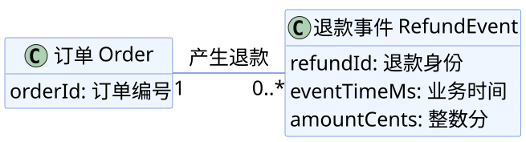</figure>

<strong>关联关系</strong>：`Order 1 — 0..* RefundEvent`，退款须按自身 `refundId` 去重

<strong>净额验证</strong>：原净额 6000，R01 退款 1500 投递两次，净额仅扣减至 <strong>4500</strong>

<!--
对照答案图检查自己的连线：订单到退款依然是 1 对 0..*，而且退款编号独立于支付编号。拿数字验证一下：A 原有 6000 分，R01 第一次到达扣减 1500 变成 4500；第二次再收到相同的 R01，去重识别出来后直接跳过，净额守在 4500 而不是掉到 3000。这里顺便思考一个问题：能不能偷懒拿原支付的 eventId 替退款判重？当然不行，一笔支付可能对应两笔合法的拆单部分退款，只有退款自己的 refundId 才靠得住。

[Sources]
- https://www.omg.org/spec/UML/2.5.1/PDF
- 教学构造数据：course/data/cases.json；金额单位为分。特定示例在页面注明参数。
-->

---
class: course story-course
---
## 活动图描述单条记录的处理路径

<figure class="story-figure">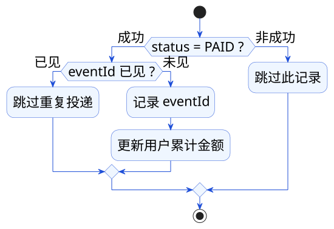</figure>

<strong>控制流元素</strong>：实心起点 → 菱形条件分支 → 圆角动作框 → 终点

<strong>生效路径</strong>：仅当“成功且未见”两条判断都通过，才写入 `Seen` 并累加金额

<!--
同学们看标准的 UML 活动图，它专门跟踪单条记录进入算子后的走向。记录从黑圆点进来，第一道菱形判断是不是 PAID，不是就直接拐去终点；第二道菱形查 Seen 里有没有这个 eventId，有也直接拐去终点。只有连过两关的“成功且未见”记录，才会走到底下的动作框：先把身份写进 Seen，再把金额加给用户，然后结束这条记录的旅程。用活动图表达控制流，规则有没有漏掉分支一眼就能看穿。

[Sources]
- https://www.omg.org/spec/UML/2.5.1/PDF
- 教学构造数据：course/data/cases.json；金额单位为分。特定示例在页面注明参数。
-->

---
class: course story-course
---
## 活动图的绘制步骤

<figure class="story-figure">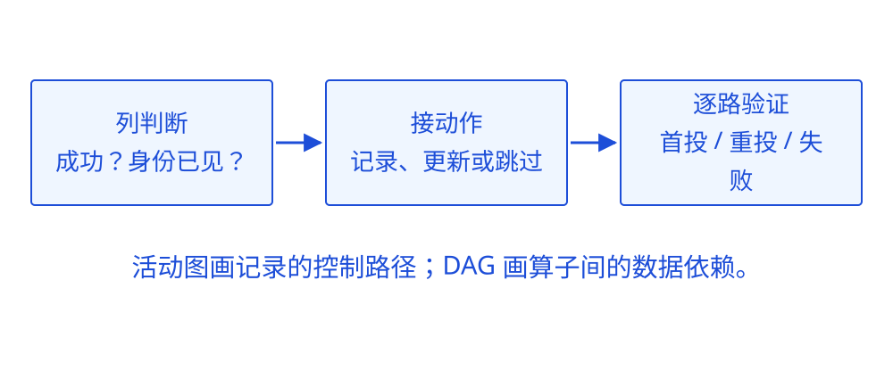</figure>

<strong>绘制顺序</strong>：列菱形判断与动作框 → 标清分支触发条件 → 确保无悬空路径

<strong>样本试走</strong>：依次拿首投 E03、重投 E03、失败 E09 三条记录走通全图

<!--
画活动图时，先把“需要问的是非题”挑出来放进菱形，把“要干的活”放进圆角框，再给每根岔路箭头写清触发条件。画完别急着收工，找三条典型样本试跑一遍：首投 E03 能不能顺畅加钱？重投 E03 能不能被拦下来？失败 E09 能不能安全离开？只要发现哪条分支悬空没落点，往往就意味着业务规则还有漏洞。

[Sources]
- https://www.omg.org/spec/UML/2.5.1/PDF
- 教学构造数据：course/data/cases.json；金额单位为分。特定示例在页面注明参数。
-->

---
class: course story-course
---
## 绘图练习：支付与退款的净额

<strong>输入序列</strong>：支付 P01=3000 → 退款 R01=1000 → R01 重投一次（均有效）

<strong>绘制目标</strong>：分别按 `paymentId` 与 `refundId` 去重，画出活动图并标出每步净额

<!--
这次换一组包含支付和退款的序列，用活动图走一遍净额计算。要求按事件类型分别用 paymentId 和 refundId 去重，绝不能拿“金额相同”替代身份校验。净额从 0 开始，沿着三条记录一步步标出更新后的金额，并在图旁用一句话解释第二次 R01 为什么停住了。

[Sources]
- https://nightlies.apache.org/flink/flink-docs-release-2.3/docs/concepts/stateful-stream-processing/
- 教学构造数据：course/data/cases.json；金额单位为分。特定示例在页面注明参数。
-->

---
class: course story-course
---
## 绘图答案：类型决定方向，身份决定次数

<figure class="story-figure">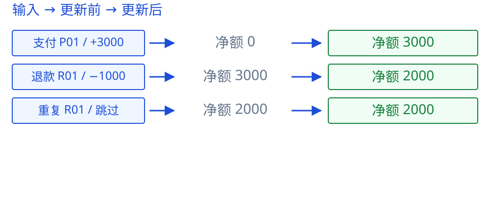</figure>

<strong>轨迹变化</strong>：P01（0 → 3000）→ R01（3000 → 2000）→ 重复 R01（2000 → 2000）

<strong>核心法则</strong>：事件类型定加减方向，事件身份定是否已生效

<!--
核对这三步的状态轨迹。第一条支付 P01 首次出现，净额由 0 跳到 3000；第二条退款 R01 首次出现，净额减去 1000 来到 2000；第三条又来了个 R01，在退款已见集合里一查发现来过，直接跳过，净额维持 2000。大家记住这句口诀：事件类型管方向（加还是减），事件身份管次数（算不算过）。把这两层逻辑画透了，换任何新金额都能直接套用。

[Sources]
- https://nightlies.apache.org/flink/flink-docs-release-2.3/docs/concepts/stateful-stream-processing/
- 教学构造数据：course/data/cases.json；金额单位为分。特定示例在页面注明参数。
-->

---
class: course story-course
layout: section
---
## 4 · 批流模型与方案设计

<ol class="outline"><li>支付记录与业务口径</li><li>算子怎样产生结果</li><li>数据流与标准图示</li><li class="current">批流模型与方案设计</li></ol>

<!--
前面我们把一条流的计算逻辑拆解清楚了。现在拉高视角，看看工业界怎么把批处理和流处理放进同一套模型。过去为了同时要“实时看板”和“夜间精确报表”，工程上常常被迫用 Lambda 架构维护两套完全不同的代码，开发和核对成本都很高。Dataflow 模型的突破，在于把“批”看成“流”的特例，并用 What、Where、When、How 四个问题把所有计算统一起来。

[Sources]
- https://nightlies.apache.org/flink/flink-docs-release-2.3/docs/concepts/stateful-stream-processing/
-->

---
class: course story-course
---
## 有界与无界描述输入，批与流描述引擎

<figure class="story-figure"></figure>

<strong>有界 / 无界</strong>：描述数据集本身是否有明确终点

<strong>批 / 流引擎</strong>：描述计算引擎的调度与输出方式

<strong>模型统一</strong>：批处理是流处理在“全局窗口 + 完整水位线 + 单次触发”下的特例

<!--
大家先纠正一个常见混淆：“有界和无界”说的是数据本身，“批处理和流处理”说的是执行引擎。上面这行封存的 0 到 24 点归档日志有明确终点，叫有界数据；下面持续订阅的 Kafka 支付流永远不会自己结束，叫无界数据。从计算模型来看，只要流引擎足够强，完全可以用同一套代码既跑无界实时流、也跑有界历史文件：批处理本质上只是“把全量文件塞进同一个全局大窗口、等数据全到齐后触发一次”的流处理特例。

[Sources]
- https://research.google/pubs/the-dataflow-model-a-practical-approach-to-balancing-correctness-latency-and-cost-in-massive-scale-unbounded-out-of-order-data-processing/
- https://nightlies.apache.org/flink/flink-docs-release-2.3/docs/concepts/stateful-stream-processing/
-->

---
class: course story-course
---
## 批处理先固定输入，再运行计算

<figure class="story-figure">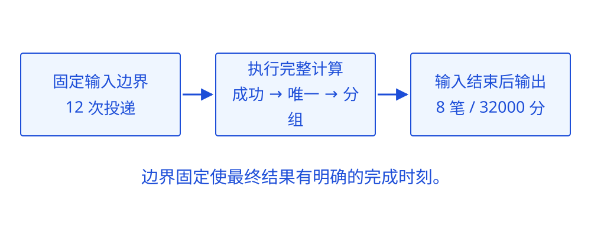</figure>

<strong>执行特点</strong>：先等待全量输入边界固定，再统一计算并输出一次终值

<strong>同口径结果</strong>：本例 12 次投递作批输入，仍得 8 笔、<strong>32000 分</strong>

<!--
如果把今天这十二条支付投递封存成一份固定文件，用批模式跑刚才那条过滤、去重、求和流水线，特点是能等所有数据全部读完再一次性亮出最终答案 32000 分。但请注意，换成批处理同样不能省掉去重，文件里照样躺着两笔 E03。只要业务逻辑和口径没变，无论批跑还是流跑，算出来的业务账本必须一致。

[Sources]
- https://nightlies.apache.org/flink/flink-docs-release-2.3/docs/concepts/stateful-stream-processing/
- 教学构造数据：course/data/cases.json；金额单位为分。特定示例在页面注明参数。
-->

---
class: course story-course
---
## 流处理随输入到来增量更新

<figure class="story-figure">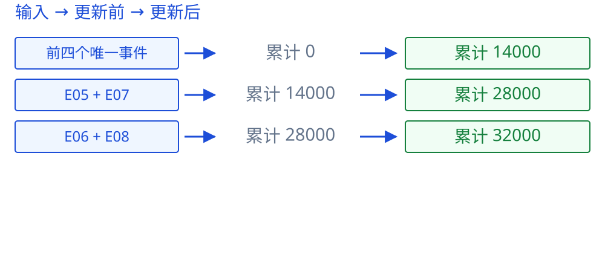</figure>

<strong>执行特点</strong>：不等输入结束，每条新事件结合旧状态增量推进

<strong>演进输出</strong>：前四笔先算出 14000 分，后续事件逐步推进至 <strong>32000 分</strong>

<!--
现实业务往往等不到半夜关门才算账。换成流模式后，每进来一条记录就立刻结合旧状态做一次增量计算：前四笔跑完就能看见 14000 分，后面一路跳到 20000、28000、29000、32000。这里没有所谓的“大结局时刻”，因此流计算必须额外约定清楚：什么时候把当前中间结果往外发、后面迟到的数据来时怎么修正。

[Sources]
- https://nightlies.apache.org/flink/flink-docs-release-2.3/docs/concepts/stateful-stream-processing/
- 教学构造数据：course/data/cases.json；金额单位为分。特定示例在页面注明参数。
-->

---
class: course story-course
---
## 同一输入与口径的批流核对

<figure class="story-figure">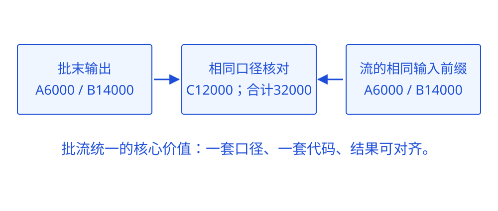</figure>

<strong>一致性检验</strong>：同输入、同口径下，流处理与批处理终值一致（A6000 / B14000 / C12000）

<strong>工程价值</strong>：告别 Lambda 架构维护两套独立代码的对账难题

<!--
以前 Lambda 架构拿 Hadoop 跑批、拿 Storm 跑流，两边语言、引擎、口径各写一套，对起账来头疼欲裂。现在把同一份过滤、去重、累计逻辑交给批流统一的引擎，只要给定相同的十二条输入和相同的口径，流跑完前缀得到的 A 6000、B 14000、C 12000 与批跑出来一模一样。要是两边对不上，一定是一边的规则漏了（比如少写了去重）或者时间窗界定不同，拿同一份样本一查便知。

[Sources]
- https://research.google/pubs/the-dataflow-model-a-practical-approach-to-balancing-correctness-latency-and-cost-in-massive-scale-unbounded-out-of-order-data-processing/
- https://nightlies.apache.org/flink/flink-docs-release-2.3/docs/concepts/stateful-stream-processing/
-->

---
class: course story-course
---
## 延迟与吞吐量衡量不同方面

<figure class="story-figure">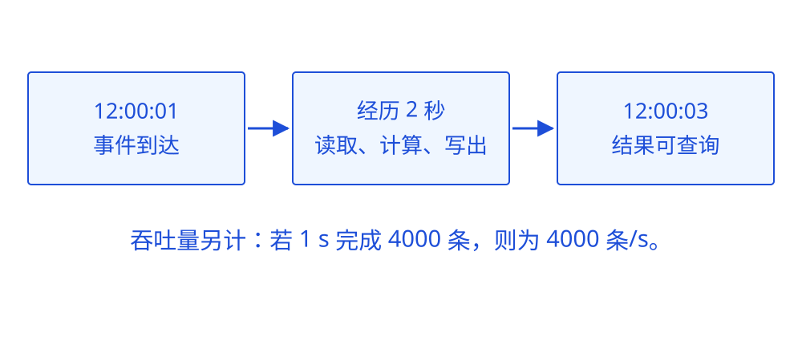</figure>

<strong>端到端延迟</strong>：单条记录从进入系统到结果可见的时间（如 12:00:01 → 12:00:03 = <strong>2 s</strong>）

<strong>系统吞吐量</strong>：单位时间内流水线消化的数据条数（如 <strong>4000 条/s</strong>）

> 权衡：攒批可拉高吞吐，却往往拉长首条记录的等待延迟

<!--
工程上评价流系统性能，最怕只说一句“很快”，必须拆成延迟和吞吐量两个指标。看这条时间线：消息在 12:00:01 进来，12:00:03 下游就能查到结果，中间经过读取、计算、落库花了两秒，这叫延迟；而一秒钟之内流水线一共消化了多少条记录（比如 4000 条/s），这叫吞吐量。很多时候两者会打架：攒一大批再算，吞吐量飙升，但第一条进来的消息延迟就拉长了。写技术方案时，两个指标都要标出目标值和观测边界。

[Sources]
- https://nightlies.apache.org/flink/flink-docs-release-2.3/docs/concepts/stateful-stream-processing/
- 教学构造数据：course/data/cases.json；金额单位为分。特定示例在页面注明参数。
-->

---
class: course story-course
---
## Dataflow：What 与 Where

<figure class="story-figure">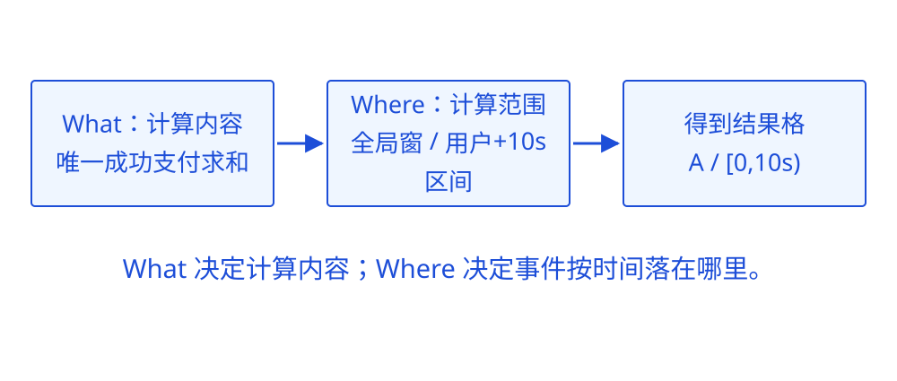</figure>

<strong>What（算什么）</strong>：唯一成功支付的金额与笔数求和

<strong>Where（在哪算）</strong>：批处理取全局窗口，流处理按用户与 10 s 窗口归组

<!--
Dataflow 模型用四个经典问题把批流彻底统一在了一起。先看前两个：What 回答“做什么变换”，这里就是过滤成功、按 eventId 去重再求和；Where 回答“在事件时间的哪段范围里算”，如果是传统批处理，默认是覆盖全数据的全局大窗口，而实时看板则往往切成一个个 10 秒区间。大家发现没有？换了个窗口范围，核心算子逻辑 What 一行都不用改。

[Sources]
- https://research.google/pubs/the-dataflow-model-a-practical-approach-to-balancing-correctness-latency-and-cost-in-massive-scale-unbounded-out-of-order-data-processing/
- https://nightlies.apache.org/flink/flink-docs-release-2.3/docs/dev/datastream/operators/windows/
- 教学构造数据：course/data/cases.json；金额单位为分。特定示例在页面注明参数。
-->

---
class: course story-course
---
## Dataflow：When 与 How

<figure class="story-figure">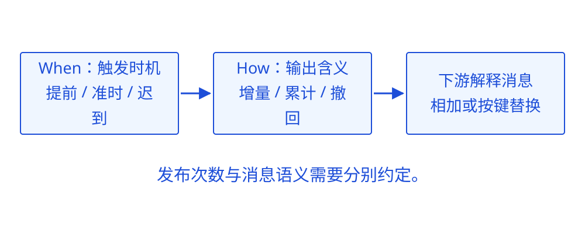</figure>

<strong>When（何时发）</strong>：批末触发一次，或流上按水位线与提前/迟到触发

<strong>How（如何改）</strong>：产出增量（Discarding）、累计（Accumulating）或撤回（Retracting）

<!--
再看后两个决定动态输出的问题。When 回答“什么时候把格子里算好的结果放出去”：批处理等到全量结束一次放行，流处理可以靠水位线准时放行，也可以提前报个临时数、晚了再补报一次。How 回答“后发的消息跟前面发的什么关系”：是只报新涨出来的那 2500 分，还是把更新后的总额 16500 覆盖过去，或者先撤回旧数再发新数？把 WWWH 这四张牌组合起来，批处理和各种复杂流计算就只是同一张配置表上的不同选项。

[Sources]
- https://research.google/pubs/the-dataflow-model-a-practical-approach-to-balancing-correctness-latency-and-cost-in-massive-scale-unbounded-out-of-order-data-processing/
- https://nightlies.apache.org/flink/flink-docs-release-2.3/docs/dev/datastream/operators/windows/
- 教学构造数据：course/data/cases.json；金额单位为分。特定示例在页面注明参数。
-->

---
class: course story-course
---
## 计算方案需要可核对的规则

<figure class="story-figure"></figure>

<strong>输入与计算</strong>：列明字段、唯一身份、时间范围、过滤去重与状态结构

<strong>输出与验收</strong>：写清结果主键、单位、更新方式与手工逐笔核对样本

<!--
把今天学的所有零件组装成一份可评审的计算方案。结构非常清晰：开头写输入（有哪些字段、用什么做唯一身份、时间窗口还是全历史）；中间写计算 DAG 和每个算子的状态；末尾写输出（用什么键定位结果行、金额单位、怎么更新）以及一套手工也能验算的小样本。别人拿着你这份方案，不用猜就能把 32000 分从头算一遍，那才算合格。

[Sources]
- https://nightlies.apache.org/flink/flink-docs-release-2.3/docs/concepts/stateful-stream-processing/
- 教学构造数据：course/data/cases.json；金额单位为分。特定示例在页面注明参数。
-->

---
class: course story-course
---
## 方案示范：用户支付累计表

<figure class="story-figure"></figure>

<strong>计算链路</strong>：过滤 PAID → 按 `eventId` 去重 → 按 `userId` 累加金额与笔数

<strong>输出更新</strong>：以 `userId` 为主键覆盖刷新最新金额（样本合计 32000 分 / 8 笔）

<!--
拿商店用户累计需求做一份示范。输入保留三个核心字段，按 eventId 过滤重复投递，再按 userId 更新各自累计金额和笔数；输出以 userId 作为结果行主键，每次把最新的累计值和笔数覆写上去。用十二条样本投递验证，最终交出 A 6000 分 3 笔、B 14000 分 3 笔、C 12000 分 2 笔。至于机器崩了之后怎么回滚、外部数据库怎么抗重放，我们在第五讲再补齐容错拼图。

[Sources]
- https://nightlies.apache.org/flink/flink-docs-release-2.3/docs/concepts/stateful-stream-processing/
- 教学构造数据：course/data/cases.json；金额单位为分。特定示例在页面注明参数。
-->

---
class: course story-course
---
## 独立方案练习：门店净收入

<strong>业务要求</strong>：按门店 `storeId` 统计“支付减退款”的净额（均有重投可能）

<strong>给定序列</strong>：店 S 支付 P1=5000、P2=3000、退款 R1=1200、R1 重投一次

<strong>设计要求</strong>：写出输入身份、DAG、状态、输出键与预期净额

> 问题：若支付与退款系统各自发号导致编号撞车，去重键怎么设计？

<!--
现在请同学们独立设计门店净收入方案。这次业务键换成了门店 storeId，事件同时包含支付和退款两种类型，都要各自防重。题目给了四条测试投递，请你不仅算出最终的 6800 分，还要把每一条怎么经过过滤、去重、分组和状态更新标在图上，特别说清楚第二次 R1 在哪一步停下来、输出表用什么键找到门店 S。

[Sources]
- https://nightlies.apache.org/flink/flink-docs-release-2.3/docs/concepts/stateful-stream-processing/
- 教学构造数据：course/data/cases.json；金额单位为分。特定示例在页面注明参数。
-->

---
class: course story-course
---
## 方案答案：净额 6800 分

<figure class="story-figure">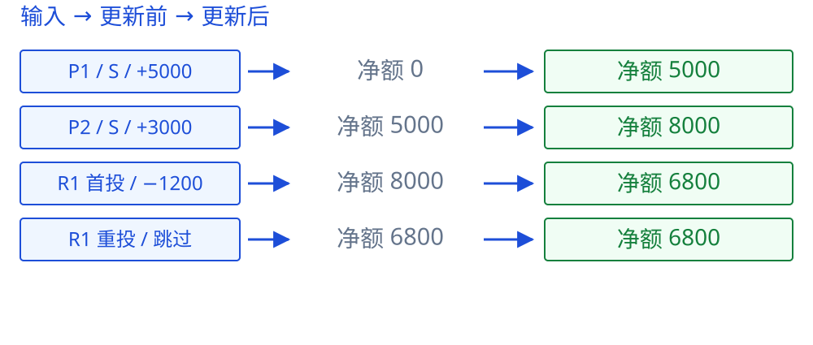</figure>

<strong>净额过程</strong>：P1(+5000) → P2(+3000) → R1(−1200) → 重投 R1 跳过，终值 <strong>6800 分</strong>

<strong>关键设计</strong>：`Seen` 用 `(事件类型, 事件编号)` 复合键防重，输出按 `storeId` 覆写

<!--
核对这份参考设计。P1 和 P2 依次入账推高到 8000，R1 首投减去 1200 落到 6800，R1 重投在去重环节直接止步。注意一个小细节：万一支付系统和退款系统各自独立发号，编号撞车了怎么办？在去重集合 Seen 里用“（事件类型，事件编号）”组成联合身份就彻底安全了。输出表以 storeId 为主键覆写最新净额 6800。

[Sources]
- https://nightlies.apache.org/flink/flink-docs-release-2.3/docs/concepts/stateful-stream-processing/
- 教学构造数据：course/data/cases.json；金额单位为分。特定示例在页面注明参数。
-->

---
class: course story-course
---
## 本讲的计算关系

<figure class="story-figure">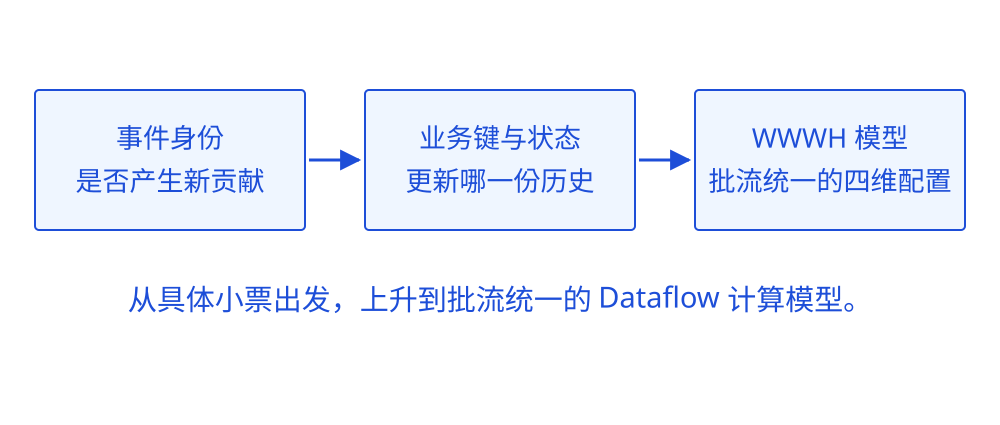</figure>

<strong>身份与键</strong>：事件身份决定是否新增，业务键决定更新哪份状态

<strong>模型统一</strong>：Dataflow 四维（WWWH）将计算语义、范围、触发与修正统一表达

<!--
回到开头那块收银屏幕，现在我们可以完整解释一笔支付的旅程了。过滤挑出成功交易，去重靠 eventId 挡住重投，按 userId 分组后依托增量状态更新累计额；类图、活动图和 DAG 分别帮我们刻画对象、分支和数据依赖；最后用 Dataflow 的 What、Where、When、How 把批处理和流处理统一起来。下一讲我们保持这套计算逻辑不变，看看怎样把它铺到多台机器上并行跑起来。

[Sources]
- https://nightlies.apache.org/flink/flink-docs-release-2.3/docs/concepts/stateful-stream-processing/
- 教学构造数据：course/data/cases.json；金额单位为分。特定示例在页面注明参数。
-->

---
class: course story-course
---
## 附录：局部求和怎样合并

<figure class="story-figure"></figure>

<strong>加法结合律</strong>：`(3000 + 2000) + 1000 = 3000 + (2000 + 1000) = 6000`

<strong>平均值陷阱</strong>：须保留并合并 `(sum, count)`，切勿对局部均值直接再求平均

<!--
第二讲会用到一个重要技巧：先局部聚合、再全局汇总。这背后的数学依据是代数结合律：加法怎么加括号结果都一样。但如果算的是平均客单价，能不能各分片先算出自己的平均值，最后再把平均值加起来除以分片数？绝对不行！看图里的例子：分片一 3000 分 1 笔（均价 3000），分片二 3000 分 2 笔（均价 1500），直接平均会误算出 2250；只有把部分状态存成（sum, count）二元组，合并成（6000, 3）再相除，才能得出真正的均价 2000 分。

[Sources]
- https://nightlies.apache.org/flink/flink-docs-release-2.3/docs/concepts/stateful-stream-processing/
- 教学构造数据：course/data/cases.json；金额单位为分。特定示例在页面注明参数。
-->

---
class: course story-course
---
## 附录：输出行的字段

<figure class="story-figure"></figure>

<strong>必填字段</strong>：`userId`、`sumCents`、`paidCount`（窗口场景须附带窗口起止边界）

<strong>字段分工</strong>：行键标识更新对象，数值与时间戳标识当前最新结果

<!--
最后看一眼对外输出行该怎么设计字段。只扔出去一个光秃秃的 6000 没有任何意义，读者还需要知道它是哪个用户（userId）、几笔凑出来的（paidCount）、单位是分还是元、算到哪一步了。到了第三讲做十秒窗口时，光有 userId 还不够，必须把 windowStart 和 windowEnd 一起塞进主键里，才能把不同时间段的结果区分开。

[Sources]
- https://nightlies.apache.org/flink/flink-docs-release-2.3/docs/concepts/stateful-stream-processing/
- 教学构造数据：course/data/cases.json；金额单位为分。特定示例在页面注明参数。
-->
