# 主从架构与并行执行

> 第 2 次课 · 分布式实时计算

把计算展开为能运行、能观测的系统

<!--
同学们，上一讲我们把支付记录变成了可核对的用户累计额。现在门店越来越多，一台机器扛不住每秒几千笔流水，怎么把这套计算稳妥地铺到多台机器上跑？相比传统批处理和微批系统按阶段攒批、阻塞落盘的做法，Flink 原生流引擎直接让上游算子把记录流水线式地推向下游。这节课我们从逻辑图一步步展开到子任务、Task、Slot、进程和物理机器，再顺着反压和热点键把性能瓶颈算个明白。

[Sources]
- https://nightlies.apache.org/flink/flink-docs-release-2.3/docs/concepts/flink-architecture/
- 教学构造数据：course/data/cases.json；金额单位为分。特定示例在页面注明参数。
-->

---
class: course story-course
---
## 同一作业的逻辑、执行与放置

<figure class="story-figure"></figure>

<strong>逻辑视图</strong>：算子连接与计算语义

<strong>物理视图</strong>：并发子任务与数据交换方式

<strong>部署视图</strong>：进程、Slot 与物理节点布局

<!--
大家用三个镜头看同一份作业。最上面一层是逻辑算子图，只关心业务规则；中间把累计展开成四个并行实例，看清数据流在网络上怎么路由；最下面才决定把这些实例塞进哪两台物理机器。本讲示例假设输入已经完成事件身份去重，让我们能把注意力集中在任务个数、线程切换与资源安排上。以后看任何分布式系统的架构图，都要先分清它在画逻辑、物理执行还是部署位置。

[Sources]
- https://nightlies.apache.org/flink/flink-docs-release-2.3/docs/concepts/flink-architecture/
- 教学构造数据：course/data/cases.json；金额单位为分。特定示例在页面注明参数。
-->

---
class: course story-course
---
## 程序、进程、线程与机器

<figure class="story-figure">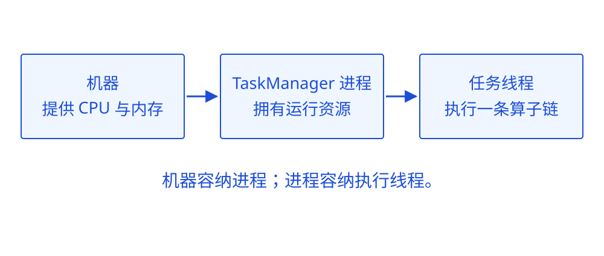</figure>

<strong>机器</strong>：提供 CPU 核与物理内存

<strong>TaskManager 进程</strong>：独立 JVM 进程，管理资源与 Slot

<strong>线程</strong>：进程内执行具体 Task 的调度路径

<!--
把操作系统的基本概念落到 Flink 集群里。最底层是物理机器或容器，上面运行着一个个 JVM 进程，工作进程就叫 TaskManager。真正逐条读消息、更新状态的执行单位，是进程里面的线程。为了防止多个任务互相抢爆内存，TaskManager 把自身资源切分成若干个 Slot（槽位），再让算子链跑在 Slot 对应的线程里。容量规划时千万别把线程数、Slot 数和机器数混为一谈。

[Sources]
- https://nightlies.apache.org/flink/flink-docs-release-2.3/docs/concepts/flink-architecture/
-->

---
class: course story-course
layout: section
---
## 1 · 运行进程与职责

<ol class="outline"><li class="current">运行进程与职责</li><li>并行子任务与数据交换</li><li>资源分配与部署</li><li>瓶颈、积压与方案设计</li></ol>

<!--
先看清集群里的角色分工。大家沿两种不同颜色的路径看：控制交互负责提交作业、分配 Slot 和协调检查点；数据通道负责在工作节点之间高速流水线搬运业务记录。分清这两条路径，后面排查故障和性能问题才不会找错门。

[Sources]
- https://nightlies.apache.org/flink/flink-docs-release-2.3/docs/concepts/stateful-stream-processing/
-->

---
class: course story-course
---
## Client 提交，协调器安排，工作进程执行

<figure class="story-figure">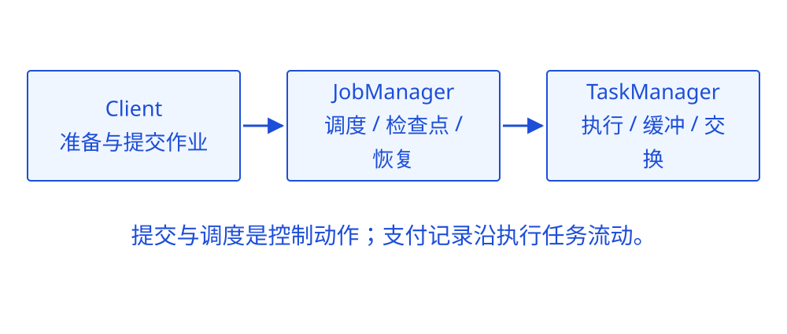</figure>

<strong>Client</strong>：编译作业图并提交给集群

<strong>JobManager</strong>：全局调度、检查点协调与故障恢复

<strong>TaskManager</strong>：流水线（Pipeline）执行任务并跨节点交换数据

<!--
看这张主从协同架构。左边的 Client 把我们写好的计算代码编译成逻辑图与执行图，提交给中间的协调器 JobManager；JobManager 挑出可用的 TaskManager，把子任务派下去，并在运行期间定期组织检查点快照。跟 MapReduce 或 Spark 每算完一个 Stage 就得等上一阶段全部写完 Shuffle 才放行不同，Flink 在 TaskManager 之间建立长连接，记录像水流一样边算边向下游传递，这也是流引擎低延迟的根基。

[Sources]
- https://nightlies.apache.org/flink/flink-docs-release-2.3/docs/concepts/flink-architecture/
-->

---
class: course story-course
---
## 提交作业之后，Client 可以断开

<figure class="story-figure">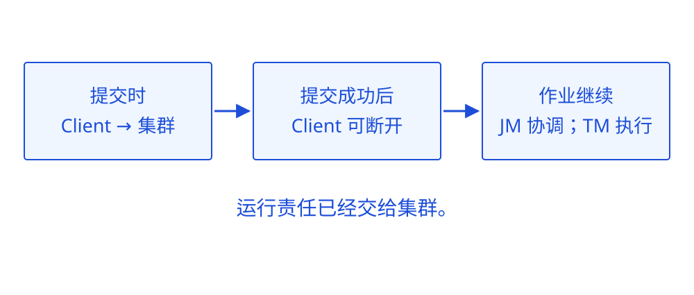</figure>

<strong>提交阶段</strong>：Client 将作业计划与代码发往 JobManager

<strong>运行阶段</strong>：集群接管后续调度与容错，Client 可退出（Detached 模式）

<!--
假设老师在自己的笔记本电脑上把门店统计作业提交到了机房集群，随即合上笔记本回家，门店营业额会停下来吗？不会。在分离提交模式下，Client 把执行计划和作业代码交给 JobManager 后，它的使命就结束了；后续的调度、任务拉起和故障重启全由集群接管。平时写方案时要注意把“提交客户端”和“常驻运行的流集群”剥离开。

[Sources]
- https://nightlies.apache.org/flink/flink-docs-release-2.3/docs/concepts/flink-architecture/
-->

---
class: course story-course
---
## 协调职责为什么需要全局视角

<figure class="story-figure">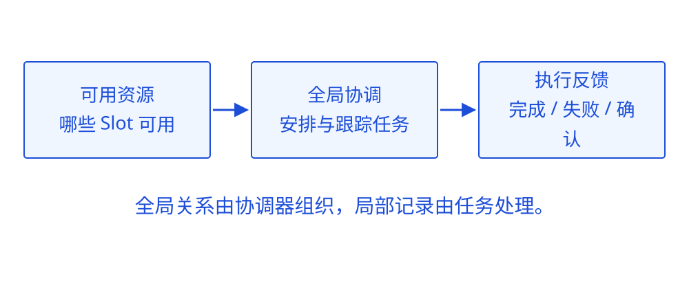</figure>

<strong>全局调度</strong>：掌握全集群空闲 Slot 分布

<strong>统一容错</strong>：协调所有并行任务的恢复边界

> 问题：为什么 Flink 有算子 DAG，却不靠血缘重算恢复？

<!--
同学们可能会问，两台工作机器能不能自己商量着跑，干嘛非要一个 JobManager 协调？想两件事就明白了：第一，任务调度要看全集群哪台机器还有空 Slot；第二，第五讲做容错时，所有并行节点必须在同一逻辑切面上完成快照，出故障时由协调器统一喊停、重新拉起并对齐边界。顺便对比 Spark：Spark 靠 RDD 血缘（Lineage）记下转换步骤以便重算丢掉的分片，而连续流作业会跑几个月甚至几年，血缘链会无限拉长，所以 Flink 选择周期性做快照并由协调器统一恢复。

[Sources]
- https://nightlies.apache.org/flink/flink-docs-release-2.3/docs/concepts/flink-architecture/
-->

---
class: course story-course
---
## JobManager 内部的管理角色

<figure class="story-figure"></figure>

<strong>Dispatcher</strong>：接收作业提交并拉起作业管理器

<strong>ResourceManager</strong>：统一调度全集群 Slot 资源

<strong>JobMaster</strong>：一对一负责单个作业的执行与检查点

<!--
把 JobManager 放大看，它内部其实包含三个各司其职的小管家：Dispatcher 负责对外接单，每收到一个新作业就帮它拉起一位专属的 JobMaster；ResourceManager 掌管全集群所有 TaskManager 汇报上来的 Slot 资源池；而 JobMaster 只盯自己这一份作业，向资源管家申请 Slot 并协调它的检查点。这样一来，哪怕集群同时跑着十个实时作业，各自的执行进度也不会乱套。

[Sources]
- https://nightlies.apache.org/flink/flink-docs-release-2.3/docs/concepts/flink-architecture/
-->

---
class: course story-course
---
## TaskManager 的工作现场

<figure class="story-figure"></figure>

<strong>数据路径</strong>：输入缓冲 → 任务线程（读写托管状态）→ 输出缓冲

<strong>反压传导</strong>：下游缓冲满时停发信用额度，逐段放慢上游读取

<!--
走进真正干活的 TaskManager 内部。工作线程从输入网络缓冲里拎出一条支付记录，顺着算子逻辑判断、读写本地托管状态，再把结果塞进输出缓冲发给下游。如果下游突然变慢，消费不了这么快，上游的输出缓冲很快就会顶满。Flink 通道里采用基于信用的流控机制，下游没空位就不发“信用额度”，上游只好放慢读取，这就是待会儿我们要定量计算的反压。

[Sources]
- https://nightlies.apache.org/flink/flink-docs-release-2.3/docs/concepts/flink-architecture/
-->

---
class: course story-course
---
## 控制流与数据流走不同路径

<figure class="story-figure"></figure>

<strong>控制路径</strong>：提交、调度、心跳与检查点确认（经过 JobManager）

<strong>数据路径</strong>：业务事件在外部存储与 TaskManager 之间直连传输

<!--
用标准的 UML 组件图把刚才的架构关系钉清楚。Client 到 JobManager 是提交作业，JobManager 和 TaskManager 之间走的是调度命令、心跳和检查点确认；真正的业务支付记录从上游日志直接走进 TaskManager，算完直接写往外部库，绝不经过 JobManager。遇到“为什么数据库收不到新支付”时，沿着数据路径查；遇到“为什么任务挂了没重启”，沿着控制路径查。

[Sources]
- https://nightlies.apache.org/flink/flink-docs-release-2.3/docs/concepts/flink-architecture/
- https://www.omg.org/spec/UML/2.5.1/PDF
-->

---
class: course story-course
---
## 组件图的符号与绘制步骤

<figure class="story-figure">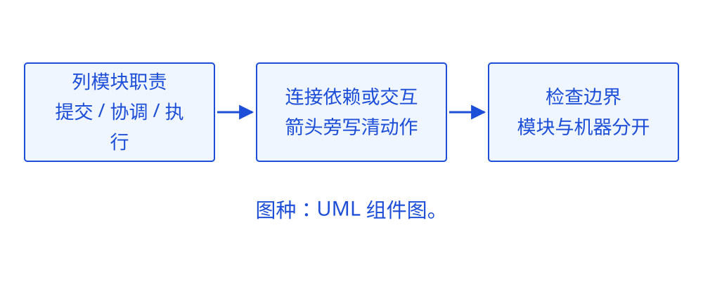</figure>

<strong>列模块</strong>：拆分接入、计算、输出与协调四类组件

<strong>连交互</strong>：依赖箭头指向被依赖方，线上写明具体动作

<strong>划边界</strong>：组件图只管职责依赖，物理位置留给部署图

<!--
画组件图有一个检查小窍门：先框出接入、计算、输出和协调四类模块，再拉箭头写上交互动作。画完以后把每根箭头上的文字遮住一半问自己：会不会被人误以为支付流水绕道去了 JobManager？只要把“调度/ACK”和“读写支付记录”标清楚，模块边界就立住了。至于哪些进程摆在哪台物理服务器上，留给后面的部署图回答。

[Sources]
- https://www.omg.org/spec/UML/2.5.1/PDF
- https://nightlies.apache.org/flink/flink-docs-release-2.3/docs/concepts/flink-architecture/
-->

---
class: course story-course
---
## 组件图练习：加入日志与结果库

<strong>外部模块</strong>：输入端 Kafka，输出端 MySQL

<strong>绘制目标</strong>：画出 Client、JobManager、TaskManager、Kafka、MySQL 五类组件

> 检验：拿一笔支付事件从头指到尾，确认它不经过 JobManager

<!--
请同学们动手把外部存储补进这张组件图。Kafka 负责持久化输入日志，MySQL 负责保存可查询的用户结果，不要把它们画成一个含糊的“外部数据库”。画完后拿一笔支付事件从头指到尾，确认它只经过 Kafka → TaskManager → MySQL，绝对没有拐进 JobManager。

[Sources]
- https://nightlies.apache.org/flink/flink-docs-release-2.3/docs/concepts/flink-architecture/
- https://www.omg.org/spec/UML/2.5.1/PDF
-->

---
class: course story-course
---
## 组件图答案：记录沿工作进程计算

<figure class="story-figure">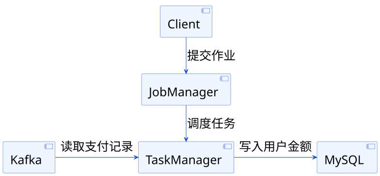</figure>

<strong>业务数据链</strong>：Kafka → TaskManager → MySQL

<strong>控制协调链</strong>：Client → JobManager ↔ TaskManager

<!--
对照屏幕核对自己的组件图。业务数据线从 Kafka 进入 TaskManager 执行过滤和累计，再写入 MySQL；控制线则由 Client 发起，经过 JobManager 协调各 TaskManager。这样画清楚了模块职责，至于重启或重放时 MySQL 会不会重复写，我们在第五讲再配齐专门的出口协议。

[Sources]
- https://nightlies.apache.org/flink/flink-docs-release-2.3/docs/concepts/flink-architecture/
- https://www.omg.org/spec/UML/2.5.1/PDF
-->

---
class: course story-course
layout: section
---
## 2 · 并行子任务与数据交换

<ol class="outline"><li>运行进程与职责</li><li class="current">并行子任务与数据交换</li><li>资源分配与部署</li><li>瓶颈、积压与方案设计</li></ol>

<!--
组件职责分清以后，我们把逻辑算子图展开成并发的物理执行图。并行化最关键的约束是不能算错账：凡是要按用户累计的状态，同一个 userId 的所有记录必须准确落到同一个累计子任务里。下面我们把子任务、数据交换和算子链逐一拆开看。

[Sources]
- https://nightlies.apache.org/flink/flink-docs-release-2.3/docs/concepts/stateful-stream-processing/
-->

---
class: course story-course
---
## 并行度决定算子展开几个实例

<figure class="story-figure"></figure>

<strong>并行度（Parallelism）</strong>：单个算子展开出的并发子任务数

<strong>示例设置</strong>：Sum 并行度设为 4（A0–A3），各自负责分片内的用户键

<!--
一个逻辑上的 Sum 算子，现在被设定为并行度 4，于是水平展开成 A0 到 A3 四个子任务。它们跑着一模一样的累加代码，各自掌管一部分用户的数据。这里一定要区分“同一种算子逻辑”和“并发执行它的多个实例”。接下来给整条流水线的四个算子都设上并行度，数清楚到底展开了多少个子任务。

[Sources]
- https://nightlies.apache.org/flink/flink-docs-release-2.3/docs/concepts/flink-architecture/
-->

---
class: course story-course
---
## 逻辑图展开为十个算子子任务

<figure class="story-figure"></figure>

<strong>子任务总数</strong>：Source(2) + Filter(2) + Aggregate(4) + Sink(2) = <strong>10 个</strong>

<strong>通道连线</strong>：Source → Filter 一对一直传；Filter → Aggregate 按键重新分区

<!--
顺着四列数一遍：2 个 Source、2 个 Filter、4 个 Aggregate、2 个 Sink，加起来一共 10 个算子子任务。相邻两列怎么连线？Source 和 Filter 都是 2 个，可以一对一直接往下传；Filter（2 个）到 Aggregate（4 个）不仅并行度变了，还要按 userId 重新分区归组，所以得画成全连接交叉线。物理执行图就是要把子任务个数和通道连接方式标明白。

[Sources]
- https://nightlies.apache.org/flink/flink-docs-release-2.3/docs/concepts/flink-architecture/
-->

---
class: course story-course
---
## keyBy 让同键记录进入同一份状态

<figure class="story-figure"></figure>

<strong>keyBy</strong>：按业务键哈希路由，保证同键记录落入同一累计实例

<strong>示例路由</strong>：用户 A → A0，用户 B → A2，用户 C → A3

<!--
看用户 A 的两笔支付 E01 和 E03，它们在 Source 可能分别落在不同分区里，但经过 keyBy 按 userId 路由后，两笔钱必须双双走进同一个累计实例 A0。B 固定去 A2，C 固定去 A3，实际引擎用哈希函数对键取模来保证一致性路由。这里顺便提醒一句：keyBy 只保证“同一个人的记录聚在一起”，并不负责把乱序的 7 秒和 9 秒重新按时间排好序。

[Sources]
- https://nightlies.apache.org/flink/flink-docs-release-2.3/docs/concepts/flink-architecture/
- https://nightlies.apache.org/flink/flink-docs-release-2.3/docs/dev/datastream/fault-tolerance/state/
-->

---
class: course story-course
---
## 随机分发会拆散同一用户的累计

<figure class="story-figure"></figure>

<strong>错误反例</strong>：A 的 3000 去 A0、2000 去 A1，两边各自只见局部状态

<strong>正确前提</strong>：依赖全量同键历史的算子前，必须使用 <strong>keyBy</strong>

<!--
故意看一眼画错路由的后果。假如 Filter 到 Aggregate 用了轮询随机分发，用户 A 的 3000 分去了 A0，2000 分去了 A1，两边互不知道对方存在，对外都报自己的局部结果，账本立刻裂成两半。除非后续再显式接一层按 userId 的合并算子，否则凡是依赖全量同键历史的算子，前面都必须配 keyBy。

[Sources]
- https://nightlies.apache.org/flink/flink-docs-release-2.3/docs/concepts/flink-architecture/
- https://nightlies.apache.org/flink/flink-docs-release-2.3/docs/dev/datastream/fault-tolerance/state/
-->

---
class: course story-course
---
## 数据交换策略对应不同分发目的

<figure class="story-figure"></figure>

<strong>Forward</strong>：上下游并行度相同时一对一直传

<strong>keyBy / Rebalance</strong>：按键聚拢状态 vs 无状态轮询均摊

<strong>Broadcast</strong>：将控制或规则流复制一份发给所有下游

<!--
物理图里四种常见连接策略长得很像，背后的语义却差得很远。Forward 上下游并行度一致时点对点直传，省掉跨节点开销；keyBy 保证同键聚在一起；Rebalance 轮流把数据均摊给下游，适合无状态负载均衡，千万不能直接替 keyBy 干按用户求和的活；Broadcast 则把风控规则表复制一份塞给每个下游实例。选错连线策略，要么数据算错，要么网络白白翻倍。

[Sources]
- https://nightlies.apache.org/flink/flink-docs-release-2.3/docs/concepts/flink-architecture/
- https://nightlies.apache.org/flink/flink-docs-release-2.3/docs/dev/datastream/operators/overview/
-->

---
class: course story-course
---
## 算子链把可相连子任务放入同一 Task

<figure class="story-figure"></figure>

<strong>链化条件</strong>：Source(2) 与 Filter(2) 为 Forward 窄依赖

<strong>核心收益</strong>：同线程直接调用，省去 <strong>SerDe 与缓冲拷贝</strong>

<strong>断开边界</strong>：keyBy 需跨实例洗牌，算子链在此断开

<!--
现在看一个非常关键的性能优化：Source 和 Filter 都是 2 个实例，中间是一对一的 Forward 窄依赖，满足链化条件。Flink 直接把 S0 和 F0 焊在同一个 Task 同一条线程里运行。这有什么真金白银的收益？S0 读出一条事件对象后，在线程栈里直接调用 F0 的过滤函数，**完全省掉了跨线程上下文切换、对象序列化反序列化（SerDe）和网络缓冲区拷贝**！到了 keyBy 这里必须重新洗牌路由，算子链也就在此断开。

[Sources]
- https://nightlies.apache.org/flink/flink-docs-release-2.3/docs/concepts/flink-architecture/
-->

---
class: course story-course
---
## 十个算子子任务形成八个 Task

<figure class="story-figure"></figure>

<strong>任务总数</strong>：2 条 Source/Filter 链 + 4 个累计 Task + 2 个输出 Task = <strong>8 个 Task</strong>

<strong>三层计数</strong>：10 个算子子任务 → 8 个 Task → 8 条执行线程

<!--
算子链一焊上去，我们重新清点数目。逻辑层展开的算子子任务依然是 10 个，但由于 S0/F0 和 S1/F1 各自合成了一条链，实际调度运行的 Task 变成了 2 + 4 + 2 = 8 个，对应 8 条执行线程。记住这个分层计数：10 个算子子任务、8 个 Task、8 条线程。待会儿我们还要把这 8 个 Task 塞进 4 个 Slot 里，层层对应才不会乱。

[Sources]
- https://nightlies.apache.org/flink/flink-docs-release-2.3/docs/concepts/flink-architecture/
-->

---
class: course story-course
---
## 链化与并行度是两种调整

<figure class="story-figure"></figure>

<strong>算子链化</strong>：消除相邻算子交接开销，不增加并发实例

<strong>提高并行度</strong>：增加实例数分摊负载，但无法拆散单一热点键

<strong>底线核对</strong>：调优后仍须核对同键状态与最终用户结果一致

<!--
工程里大家常把“调大并行度”和“算子链化”混为一谈，其实它们动的是两个不同的旋钮。链化是在不增加并发度的前提下，砍掉线程之间多余的搬运与序列化开销；提高并行度则是多招几个实例同时干活，但遇到像 keyBy 这种数据倾斜时，多招一倍实例也救不了那个最忙的键。每次调整完，既要看吞吐有没有涨，也要拿样本核对每个用户的累计额。

[Sources]
- https://nightlies.apache.org/flink/flink-docs-release-2.3/docs/concepts/flink-architecture/
- 教学构造数据：course/data/cases.json；金额单位为分。特定示例在页面注明参数。
-->

---
class: course story-course
---
## 物理图练习：重新计数

<strong>作业配置</strong>：Source=2、Filter=2、Aggregate=3、Sink=1（Source 与 Filter 满足链化）

<strong>计算目标</strong>：列出算子子任务数、Task 数、线程数，并画出 keyBy 连线

> 问题：仅凭 6 个 Task，能否直接算出需要几台物理机器？

<!--
请同学们拿出一张纸练一练手。给定 Source=2、Filter=2、Aggregate=3、Sink=1，先把四列方框画开，再按编号把 S 和 F 链成两条，标出 keyBy 的全连接交叉线。数出算子子任务、Task 和执行线程各是多少。最后回答一个架构追问：光知道有 6 个 Task，够不够推导出我们需要买几台服务器？还缺哪些条件？

[Sources]
- https://nightlies.apache.org/flink/flink-docs-release-2.3/docs/concepts/flink-architecture/
-->

---
class: course story-course
---
## 计数答案：八个子任务，六个 Task

<figure class="story-figure">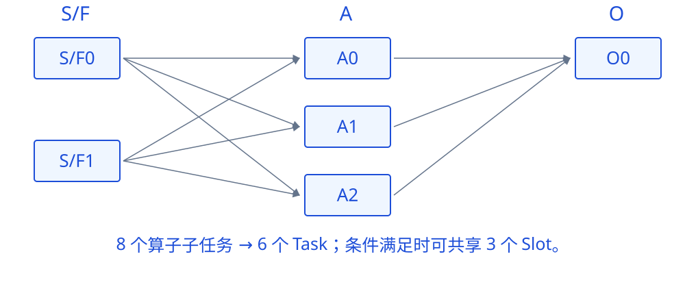</figure>

<strong>计数结果</strong>：8 个算子子任务 → <strong>6 个 Task</strong>（6 条执行线程）

<strong>最小 Slot</strong>：同组共享且单 Slot 资源充足时，由最高并行度 <strong>3</strong> 决定

<!--
核对计数结果：算子子任务 8 个，因为 S 和 F 链成 2 个 Task，加上 3 个累计和 1 个输出，最终跑起 6 个 Task（6 条线程）。在 Flink 默认的同组 Slot 共享规则下，同一个管道里互相不重叠的阶段可以共用一个 Slot，因此最少 Slot 数由最大并行度决定，这里是 3 个。但“需要几个 Slot”和“需要几台机器”中间还隔着每台机器配几个 Slot、内存和 CPU 够不够容纳这些条件。

[Sources]
- https://nightlies.apache.org/flink/flink-docs-release-2.3/docs/concepts/flink-architecture/
-->

---
class: course story-course
layout: section
---
## 3 · 资源分配与部署

<ol class="outline"><li>运行进程与职责</li><li>并行子任务与数据交换</li><li class="current">资源分配与部署</li><li>瓶颈、积压与方案设计</li></ol>

<!--
现在手里有 8 个 Task，准备塞进 2 台工作机器。别急着往框里填任务，先读清资源前提：每台运行 1 个 TaskManager、各提供 2 个 Slot，作业允许同组共享且总资源够用。这一节我们会看清 Slot 到底隔离了什么、又没隔离什么，并用标准部署图画清机器边界。

[Sources]
- https://nightlies.apache.org/flink/flink-docs-release-2.3/docs/concepts/stateful-stream-processing/
-->

---
class: course story-course
---
## Slot 是资源调度单位

<figure class="story-figure"></figure>

<strong>内存隔离</strong>：Slot 将 TaskManager 托管内存均分为固定份额

<strong>线程共享</strong>：同共享组内的 Task 各自跑在独立线程上

<strong>常见误区</strong>：默认 Slot <strong>只隔离内存，不硬隔离 CPU</strong>

<!--
同学们一定要记住 Flink 架构里一个高频踩坑点：TaskManager 把总托管内存等分给各个 Slot，每个 Slot 占一份固定的内存额度，但它**默认并不给 CPU 核做硬隔离**。也就是说，同一个 Slot 共享组里放进来的 S0/F0、A0 和 O0 三个 Task 分别跑在三条线程上，它们共享这台机器的 CPU 时间片。Slot 数量决定了集群最多能容纳的最大并行度，而真正能跑多快，还要看机器实际 CPU 核数与内存余量。

[Sources]
- https://nightlies.apache.org/flink/flink-docs-release-2.3/docs/concepts/flink-architecture/
-->

---
class: course story-course
---
## 两台工作机器提供四个 Slot

<figure class="story-figure">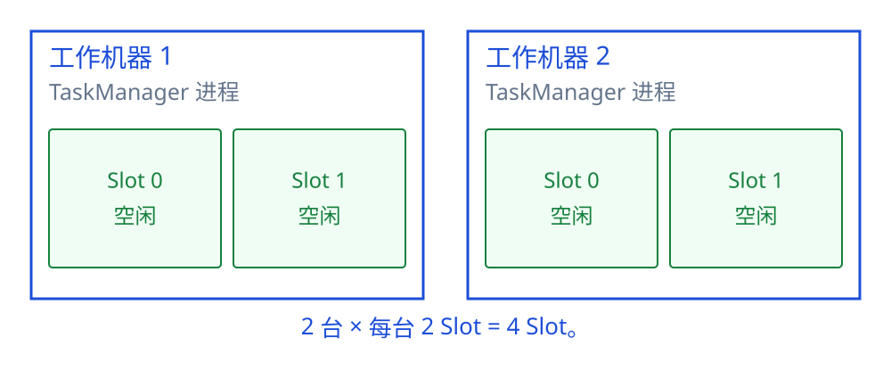</figure>

<strong>集群规模</strong>：2 台机器 × 每台 1 个 TaskManager × 2 个 Slot = <strong>4 个 Slot</strong>

<strong>共享前提</strong>：作业所有任务同属一个共享组，且单 Slot 容量满足运行需求

<!--
先把物理资源画出来。两台服务器各启动一个 TaskManager 进程，每个进程配置两个空 Slot，全集群一共有四个 Slot。在允许同一作业跨阶段共享的前提下，4 个 Slot 恰好够容纳我们最高并行度为 4 的流水线。如果以后为了稳定把某个重算子放进独立共享组，就得另算 Slot。

[Sources]
- https://nightlies.apache.org/flink/flink-docs-release-2.3/docs/concepts/flink-architecture/
-->

---
class: course story-course
---
## 八个 Task 的一个可行放置

<figure class="story-figure">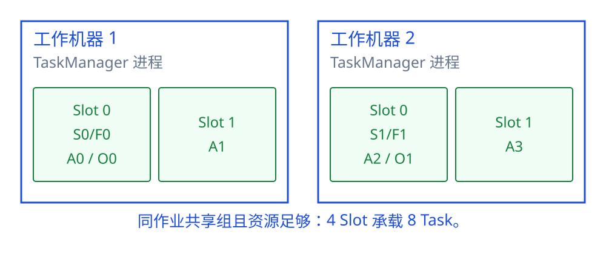</figure>

<strong>累计任务</strong>：4 个累计实例各占 1 个 Slot（A0–A3）

<strong>共享复用</strong>：Source/Filter 链与 Sink 共用这 4 个 Slot

<strong>网络路由</strong>：同键记录按 keyBy 跨节点发送，不受放置影响

<!--
把 8 个 Task 稳稳放进 4 个 Slot：机器一的 Slot 1 放 S0/F0、A0、O0，Slot 2 放 A1；机器二同理放 S1/F1、A2、O1 和 A3。大家注意一个容易混淆的点：机器一上的 S0/F0 旁边就躺着 A0，这不代表 S0 产出的记录全留给 A0！如果 S0 读到一笔属于用户 B 的支付，keyBy 依然会通过跨机器网络把它发去机器二上的 A2。物理放置决定计算跑在哪，keyBy 决定逻辑归属谁，两条规则各管各的。

[Sources]
- https://nightlies.apache.org/flink/flink-docs-release-2.3/docs/concepts/flink-architecture/
-->

---
class: course story-course
---
## 共享组改变后要重新估算资源

<figure class="story-figure">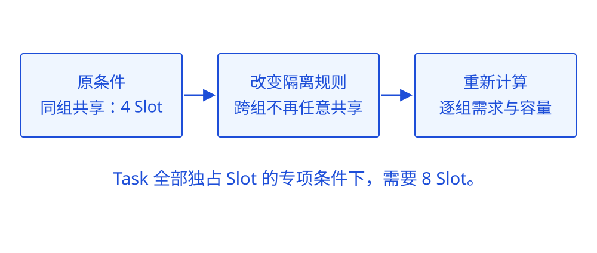</figure>

<strong>默认共享</strong>：同组复用槽位，本作业仅需 <strong>4 个 Slot</strong>

<strong>独立隔离</strong>：划出独立共享组后，各组最高并行度相加

<strong>禁止共享</strong>：若每 Task 独占 1 Slot，共需 <strong>8 个 Slot</strong>

<!--
为什么前面反复强调“同组共享”这个前提？因为一旦某个算子特别吃内存或需要隔离故障影响，工程师把它放进另一个共享组后，原本共用 Slot 的算子就得拆开。比方说把 Aggregate 单独隔离，或者干脆要求每个 Task 独占一个 Slot，那么刚才只需要 4 个 Slot 的作业，瞬间就需要 8 个 Slot。做容量评估时，必须把共享组策略写清楚。

[Sources]
- https://nightlies.apache.org/flink/flink-docs-release-2.3/docs/concepts/flink-architecture/
-->

---
class: course story-course
---
## 部署图画机器与执行环境

<figure class="story-figure">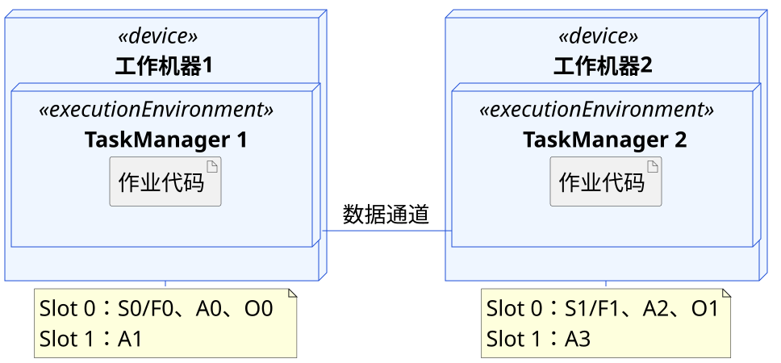</figure>

<strong>设备（device）</strong>：最外层物理节点（2 台工作机器）

<strong>环境与制品</strong>：内嵌 TaskManager 进程、部署包、Slot 布局及通信线

<!--
把刚才的部署格局画成标准的 UML 部署图。最外层立体方框 `device` 是物理机器，嵌套在内的 `executionEnvironment` 是运行中的 TaskManager 进程，`artifact` 是部署上去的作业代码包，连线标明协调控制通道和跨节点网络数据交换。跟前面的组件图相比，组件图只看模块间谁调谁，部署图则把代码和进程钉死到物理节点边界上。

[Sources]
- https://nightlies.apache.org/flink/flink-docs-release-2.3/docs/concepts/flink-architecture/
- https://www.omg.org/spec/UML/2.5.1/PDF
-->

---
class: course story-course
---
## 部署图的绘制步骤

<figure class="story-figure"></figure>

<strong>由外向内</strong>：先画物理机，再画 TaskManager 进程与部署包，最后填 Slot

<strong>三项核对</strong>：Task 不重不漏、单机资源不超限、跨节点通道连通

<!--
自己动笔画部署图时遵循“从外往内”的顺序：先摆几台机器，再在机器里画 TaskManager 进程和部署包，最后填进 Slot 和 Task，并连上跨机网络线。画完之后随便挑一笔支付走一遍：从哪个机器进来、在哪个 Slot 算、万一跨机走哪条网络线出去，都能一路指出来才算完整。

[Sources]
- https://www.omg.org/spec/UML/2.5.1/PDF
- https://nightlies.apache.org/flink/flink-docs-release-2.3/docs/concepts/flink-architecture/
-->

---
class: course story-course
---
## 部署练习：增加节点会自动加速吗

<strong>初始条件</strong>：累计并行度 4，占满 4 个 Slot；现扩容 1 台机器增加 2 个空闲 Slot

> 问题：并行度与任务放置不变时，新增的 2 个 Slot 会自动提升吞吐吗？

<strong>设计要求</strong>：画出调整后的部署方案，并写出使吞吐真正提升的前提

<!--
运维同学帮忙多加了一台服务器、多了两个空 Slot，可老板看了一眼监控发现吞吐一动不动，为什么？请同学们结合刚才的架构先判断：保持并行度 4 和原放置不变时，新机器是不是在纯晒太阳？然后重新画一份调整方案，讲清楚靠什么手段才能把新机器用起来，又要警惕什么陷阱。

[Sources]
- https://nightlies.apache.org/flink/flink-docs-release-2.3/docs/concepts/flink-architecture/
-->

---
class: course story-course
---
## 部署答案：资源与执行规模分别调整

<figure class="story-figure">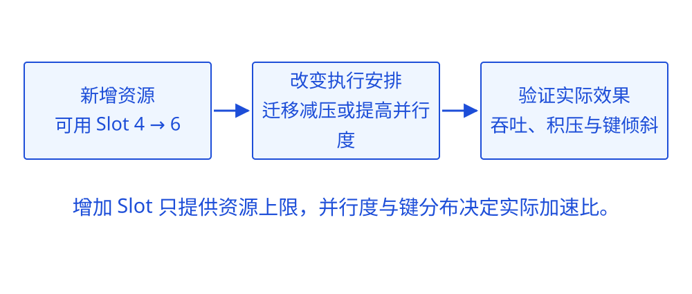</figure>

<strong>保持不变</strong>：并行度与放置不改，新 Slot 闲置，吞吐不变

<strong>迁移减压</strong>：原节点 CPU/内存打满时，迁出部分 Task 减负

<strong>扩并发提速</strong>：调高并行度占满新 Slot（前提：<strong>键分布均匀</strong>）

<!--
答案分成两种情况。如果原机器是 CPU 或内存跑满导致任务互相争抢，保持并行度 4 不变，把一部分 Task 匀到新机器的两个空闲 Slot 上，确实能缓解单机资源竞争；如果是算子本身算不过来，光加机器加 Slot 没用，必须把累计并行度也调上去（比如扩到 6）并在新 Slot 里起新实例。但千万别忘了：要是业务键严重倾斜（比如一个大商户占八成流量），加到 6 个实例也还是那一个实例累死，吞吐照样不随机器数线性增长。

[Sources]
- https://nightlies.apache.org/flink/flink-docs-release-2.3/docs/concepts/flink-architecture/
-->

---
class: course story-course
layout: section
---
## 4 · 瓶颈、积压与方案设计

<ol class="outline"><li>运行进程与职责</li><li>并行子任务与数据交换</li><li>资源分配与部署</li><li class="current">瓶颈、积压与方案设计</li></ol>

<!--
现在集群已经能跑起来了，我们把视角切到性能与容量上。判断流水线能不能扛住业务高峰，不能凭感觉，要把每秒记录条数当统一刻度沿线排开，找出最慢的那一段，定量算出积压速度，看穿反压是怎样一步步憋回源头的，以及热点键如何让一半机器闲着干瞪眼。

[Sources]
- https://nightlies.apache.org/flink/flink-docs-release-2.3/docs/concepts/stateful-stream-processing/
-->

---
class: course story-course
---
## 流水线的给定处理能力

<figure class="story-figure"></figure>

<strong>原始输入</strong>：Source 读取 6000 条/s，经 Filter（75% 通过率）进入累计 <strong>4500 条/s</strong>

<strong>处理上限</strong>：累计 4 实例 × 1000 = <strong>4000 条/s</strong>；下游 Sink 上限 <strong>5000 条/s</strong>

<!--
先把整条流水线各段的稳定处理能力摆在同一个坐标系里。Source 每秒吐出 6000 条原始记录，但经过 Filter 筛掉 25% 失败和取消后，真正送给累计阶段的输入速率是 4500 条/s。四个累计实例每人每秒稳稳消化 1000 条，总能力 4000 条/s；最右边的 Sink 每秒能写 5000 条。请特别注意过滤比率：不能直接拿 6000 去跟 4000 比，而要拿进入累计的 4500 来比。

[Sources]
- https://nightlies.apache.org/flink/flink-docs-release-2.3/docs/concepts/flink-architecture/
- 教学构造数据：course/data/cases.json；金额单位为分。特定示例在页面注明参数。
-->

---
class: course story-course
---
## 最慢阶段限制持续完成速率

<figure class="story-figure"></figure>

<strong>木桶短板</strong>：到达累计 4500 条/s > 完成上限 4000 条/s，每秒净积压 <strong>500 条</strong>

<strong>下游闲置</strong>：Sink 虽有 5000 条/s 能力，实际仅收到 4000 条/s，扩容 Sink 无效

<!--
同学们看这根木桶短板效应。累计阶段每秒最多吞下 4000 条，可上游每时每刻都在送来 4500 条，多出来的 500 条既消不掉也丢不得，只能每秒往队列里多攒 500 条。这时候下游 Sink 明明有 5000 条/s 的胃口，实际也只能收到 4000 条/s，空转了 1000 的余量。遇到这种局面，花钱去给 Sink 扩容纯属白费力气，必须对准累计这个短板动手。

[Sources]
- https://nightlies.apache.org/flink/flink-docs-release-2.3/docs/concepts/flink-architecture/
- 教学构造数据：course/data/cases.json；金额单位为分。特定示例在页面注明参数。
-->

---
class: course story-course
---
## 积压是速度差随时间累积的结果

<figure class="story-figure">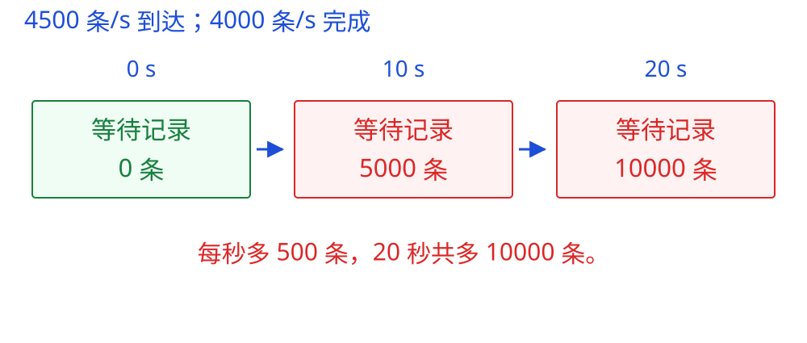</figure>

<strong>计算公式</strong>：积压量 =（到达速率 − 完成速率）× 持续时间

<strong>数值推演</strong>：每秒净增 500 条，10 s 积压 <strong>5000 条</strong>，20 s 积压 <strong>10000 条</strong>

<!--
每隔十秒看一眼累计算子门前的排队长度：0 秒时干干净净，10 秒时每秒少消化 500 条，攒了 5000 条；20 秒时直接膨胀到 10000 条。只要输入速度高于最慢阶段的处理上限，这个队伍就会随时间线性长高，直到把内存和磁盘全塞爆。只有把到达速率和完成速率之间的负差额扭正，积压才会停止增长。

[Sources]
- https://nightlies.apache.org/flink/flink-docs-release-2.3/docs/concepts/flink-architecture/
- 教学构造数据：course/data/cases.json；金额单位为分。特定示例在页面注明参数。
-->

---
class: course story-course
---
## 清空积压取决于输入是否继续

<figure class="story-figure"></figure>

<strong>彻底断流</strong>：输入停为 0 时，10000 ÷ 4000 = <strong>2.5 s</strong>

<strong>保持原流</strong>：输入仍 4500 > 4000，积压持续扩大

<strong>带流扩容</strong>：能力升至 5000，净清空 500/s，需 <strong>20 s</strong>

<!--
排障时大家最常算错的一笔账就是估算恢复时间：很多人习惯拿 10000 条积压直接除以总处理能力 4000，算出 2.5 秒完事。这只有在源头彻底断流停产时才成立！如果业务流量还在以 4500 条/s 源源不断涌进来，哪怕把累计扩到 5000 条/s，算子每秒先得拿 4500 去伺候新来的流量，只剩 500 条/s 的余力去啃老积压，10000 条整整要 20 秒才能啃完。算恢复窗口时，永远要扣掉新进来的流量。

[Sources]
- https://nightlies.apache.org/flink/flink-docs-release-2.3/docs/concepts/flink-architecture/
- 教学构造数据：course/data/cases.json；金额单位为分。特定示例在页面注明参数。
-->

---
class: course story-course
---
## 反压沿满缓冲向上游传导

<figure class="story-figure"></figure>

<strong>传导路径</strong>：累计满载 → 缓冲队列填满 → Filter 阻塞 → Source 放慢拉取

<strong>排查口诀</strong>：顺着告警往下找，<strong>最后一个高忙碌且未被下游反压</strong>的节点才是真瓶颈

<!--
现实系统不可能让队列无限长下去，每段通道的缓冲区大小都是有限的。当累计阶段吃不动，它面前的缓冲很快填满，上游 Filter 想发也发不出去，被迫停下来干等；Filter 停下来后，它自己的输入缓冲也满，最终一路传到 Source 放慢从 Kafka 拉数据的速度。这就叫反压。排障时看到 Source 和 Filter 都在告警反压，不要傻乎乎去给 Source 加机器，因为真正憋死整条线的，往往是顺着红色警告往下找、**最后一个自己很忙却没有被下游反压**的那个节点。

[Sources]
- https://nightlies.apache.org/flink/flink-docs-release-2.3/docs/concepts/flink-architecture/
- https://nightlies.apache.org/flink/flink-docs-release-2.3/docs/ops/monitoring/back_pressure/
-->

---
class: course story-course
---
## 热点键让总能力无法充分使用

<figure class="story-figure">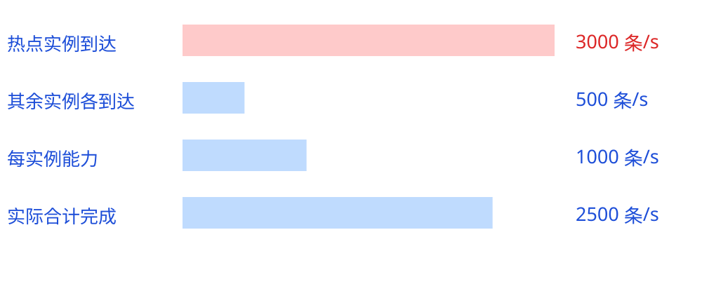</figure>

<strong>流量倾斜</strong>：4 个累计实例各收 3000、500、500、500 条/s（单实例上限 1000 条/s）

<strong>实际产出</strong>：1000 + 500 + 500 + 500 = <strong>2500 条/s</strong>（理论 4000）；热点实例每秒积压 <strong>2000 条</strong>

<!--
再看一个更隐蔽的杀手：数据倾斜。4 个累计实例理论总能力依然是 4000 条/s，可偏偏有一位大商户每秒发来 3000 笔支付，其余所有用户加起来才 1500。在 keyBy 的铁律下，大商户的 3000 笔只能全塞进同一个实例里！这个热点实例满头大汗只能吞下 1000 条，每秒暴涨 2000 条积压；而旁边另外三个实例每个只分到 500 条，天天吃一半留一半。整条流水线理论 4000、实际只跑出 2500，全卡在了一个热点键上。

[Sources]
- https://nightlies.apache.org/flink/flink-docs-release-2.3/docs/concepts/flink-architecture/
- 教学构造数据：course/data/cases.json；金额单位为分。特定示例在页面注明参数。
-->

---
class: course story-course
---
## 可合并聚合可以先局部再合并

<figure class="story-figure"></figure>

<strong>两阶段聚合</strong>：对求和、计数等结合律运算，先加随机盐分片局部聚合，再按 userId 汇总

<strong>语义前提</strong>：第一层输出须采用不重叠增量或分片最新值，防止二次合并算重

<!--
怎么把那 3000 条的热点拆开？如果算的是求和或者计数这种满足结合律的运算，工程上常用“两阶段聚合（加盐打散）”：先给热点键随机拼上一个分片编号 `(userId, shard)`，让 4 个实例一起并行做局部预聚合，把每秒 3000 条原始流水压缩成几条部分和；再剥掉分片编号，按真正的 `userId` 送进第二层合并出用户总额。但注意合并语义：千万不能每隔一秒吐一次局部累计值然后第二层又傻傻相加，必须传递不重叠增量或按分片保存最新值。

[Sources]
- https://nightlies.apache.org/flink/flink-docs-release-2.3/docs/concepts/flink-architecture/
- https://nightlies.apache.org/flink/flink-docs-release-2.3/docs/concepts/stateful-stream-processing/
- 教学构造数据：course/data/cases.json；金额单位为分。特定示例在页面注明参数。
-->

---
class: course story-course
---
## 从子任务指标定位瓶颈

<figure class="story-figure"></figure>

<strong>核心指标</strong>：按子任务对照输入率、输出率、忙碌度（Busy）与反压比率

<strong>倾斜特征</strong>：多数实例空闲、单个实例长期 100% 满载，优先排查热点键

<!--
上线以后面对监控大盘怎么断案？记住这组组合拳：沿着 DAG 从下游往上游倒查各子任务的忙碌度与反压状态。如果下游所有实例都很闲、上游某一个实例忙碌度接近 100% 且没有反压，那就是纯计算瓶颈或热点倾斜；如果上游个个显示高反压、唯独下游某算子忙碌度 100%，说明那个下游算子就是全线堵点。每项调优假设都要落实到对应子任务的监控曲线上。

[Sources]
- https://nightlies.apache.org/flink/flink-docs-release-2.3/docs/concepts/flink-architecture/
- https://nightlies.apache.org/flink/flink-docs-release-2.3/docs/ops/monitoring/back_pressure/
-->

---
class: course story-course
---
## 部署方案示范：均匀键的累计作业

<figure class="story-figure">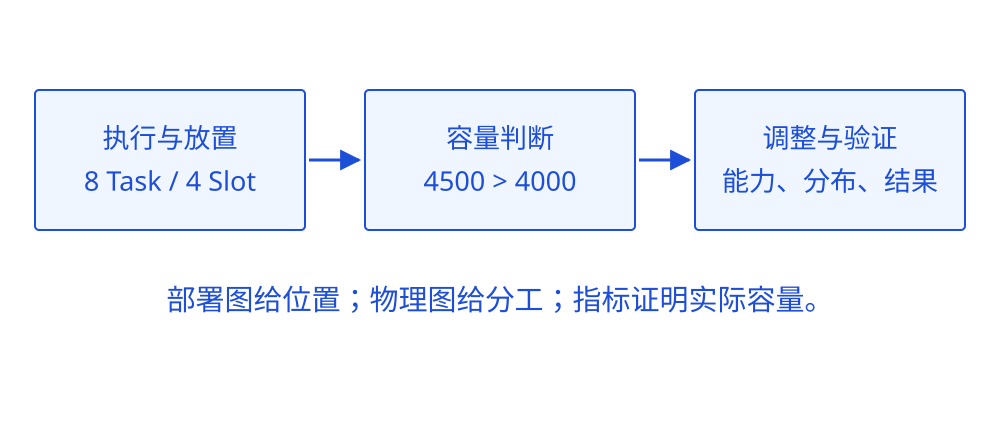</figure>

<strong>部署格局</strong>：2 台 TM 共 4 Slot，同共享组容纳 8 个 Task

<strong>瓶颈改造</strong>：4500 > 4000 须扩大累计并行度，并验证键均匀、积压清零与账目一致

<!--
把物理执行图、Slot 放置和速率核算整合成一份完整的部署方案。先交待清楚 8 个 Task 如何共享 4 个 Slot 且单机资源不超限；再算出累计阶段只有 4000 能力接不住 4500 流量，明确提出扩容累计实例并核查新资源；最后约定上线验收不仅要看积压归零，还得拿同一批样本核对用户金额不重不漏。

[Sources]
- https://nightlies.apache.org/flink/flink-docs-release-2.3/docs/concepts/flink-architecture/
- 教学构造数据：course/data/cases.json；金额单位为分。特定示例在页面注明参数。
-->

---
class: course story-course
---
## 独立练习：积压与扩容方案

<strong>场景参数</strong>：进入累计 3600 条/s；累计 3 实例 × 1000 条/s；初始无积压，持续 15 s

<strong>定量计算</strong>：求 15 s 后积压；分别计算断流后，以及扩至 4 实例且输入继续时的清空耗时

<strong>方案设计</strong>：写出执行规模、Slot 前提与热点核查，画出调整前后对比

<!--
请同学们独立算一算这组扩容题。三个实例总能力 3000，输入 3600，先算 15 秒积累了多少等待记录；再分别计算“彻底停流”和“扩到 4 实例但 3600 流量照常涌入”两种情况下的清空时间。算完数字后，补全资源前提和扩容后需要盯哪些监控指标。

[Sources]
- https://nightlies.apache.org/flink/flink-docs-release-2.3/docs/concepts/flink-architecture/
- 教学构造数据：course/data/cases.json；金额单位为分。特定示例在页面注明参数。
-->

---
class: course story-course
---
## 练习答案：9000 条与两种清空时间

<figure class="story-figure"></figure>

<strong>积压量</strong>：(3600 − 3000) × 15 = <strong>9000 条</strong>

<strong>清空耗时</strong>：断流 <strong>3 s</strong>；扩至 4000 且输入继续需 <strong>22.5 s</strong>

<strong>成立前提</strong>：新实例有空闲 Slot、键无倾斜且 Sink 不成瓶颈

<!--
核对这两组清空时间。每秒少算 600 条，15 秒刚好攒下 9000 条。断流暂停时，3000 能力全用于消肿，3 秒就能清空；但如果保持 3600 进水、能力提到 4000，净抽水速度只有 400 条/s，要足足 22.5 秒才能抽干。这个答案还暗含着两条工程前提：4 个实例对应的 Slot 资源必须足够，而且不能出现新热点键或者下游 Sink 变成新瓶颈。

[Sources]
- https://nightlies.apache.org/flink/flink-docs-release-2.3/docs/concepts/flink-architecture/
- 教学构造数据：course/data/cases.json；金额单位为分。特定示例在页面注明参数。
-->

---
class: course story-course
---
## 独立方案练习：一个用户占三千条每秒

<strong>倾斜场景</strong>：总输入 4500 条/s（单一热点用户 3000 条/s，其余合计 1500 条/s）

<strong>实例上限</strong>：每个累计实例最多处理 1000 条/s；给出改造方案与合并语义

> 问题：为什么单纯把累计并行度从 4 扩到 8，依然救不了这个热点用户？

<!--
这道题专治“遇事不决加机器”的思路。已知一个大客户自己就占了每秒 3000 条，请先说透为什么把并行度从 4 扩成 8 甚至 16，这个客户还是会卡死在同一个实例里；然后再用两阶段局部聚合或提升单实例吞吐的思路给出可落地的方案，重点写清楚中间结果怎么发才不会把钱算重。

[Sources]
- https://nightlies.apache.org/flink/flink-docs-release-2.3/docs/concepts/flink-architecture/
- 教学构造数据：course/data/cases.json；金额单位为分。特定示例在页面注明参数。
-->

---
class: course story-course
---
## 热点方案答案：减少最终阶段消息压力

<figure class="story-figure">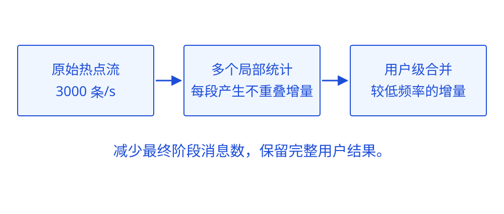</figure>

<strong>局部降频</strong>：先按（用户，分片）对不重叠区间算局部增量，再按 userId 汇总

<strong>验证要点</strong>：事件去重须在打散前完成，并核查最终汇总层跟得上合并消息频率

<!--
参考做法是加盐分片两阶段聚合：前面先按 `(userId, shard)` 把 3000 条/s 拆散到多个分片上，在互不重叠的微时间窗或计数批里算出增量，再把大幅降频后的增量消息按 `userId` 送入最终层汇总。注意两点：去重最好在打散前按 `eventId` 做完（或保持同一事件进同一分片），中间发出的必须是互不重叠的增量，避免第二层把历史加爆。

[Sources]
- https://nightlies.apache.org/flink/flink-docs-release-2.3/docs/concepts/flink-architecture/
- 教学构造数据：course/data/cases.json；金额单位为分。特定示例在页面注明参数。
-->

---
class: course story-course
---
## 本讲的执行层次

<figure class="story-figure"></figure>

<strong>六层映射</strong>：算子 → 并行子任务 → Task（算子链）与线程 → Slot → TaskManager → 机器

<strong>性能真相</strong>：持续吞吐取决于最慢瓶颈与键分布，而不是只看集群机器总数

<!--
把今天拆开的系统层次从内到外串一遍：逻辑算子决定计算规则，并行度展开成子任务，算子链把窄依赖焊进同一个 Task 线程以省掉序列化，Slot 给 Task 切分托管内存，TaskManager 进程和物理机负责承载运行。一旦线上跑慢了，先看反压停在哪个下游算子，再查是不是数据倾斜惹的祸。下一讲我们把镜头转向时间维度：就算机器足够快，一条迟到几秒的小票又怎样改写已经发出去的营业额？

[Sources]
- https://nightlies.apache.org/flink/flink-docs-release-2.3/docs/concepts/flink-architecture/
-->

---
class: course story-course
---
## 附录：独立部署与资源平台

<figure class="story-figure">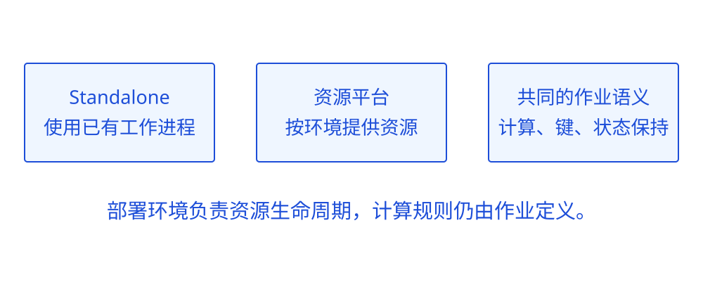</figure>

<strong>Standalone</strong>：静态启动的常驻 TaskManager 集群

<strong>YARN / K8s</strong>：按作业资源需求动态申请与回收容器

<strong>语义不变</strong>：部署平台只管进程周期，不改 DAG 与状态语义

<!--
最后看部署模式的区别。Standalone 像包了一批常驻机器，TaskManager 事先起好等人提交；而跑在 YARN 或 Kubernetes 上时，ResourceManager 可以根据作业需要动态向资源平台拉起容器、作业结束再释放掉。部署方式解决的是进程谁来拉起、挂了谁来补，里面的过滤、keyBy 和算子链逻辑完全不变。

[Sources]
- https://nightlies.apache.org/flink/flink-docs-release-2.3/docs/concepts/flink-architecture/
-->

---
class: course story-course
---
## 附录：网络交换也有成本

<figure class="story-figure">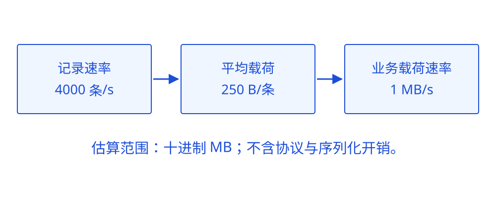</figure>

<strong>载荷估算</strong>：4000 条/s × 250 B/条 = 1,000,000 B/s（约 <strong>1 MB/s</strong> 纯业务载荷）

<strong>实际带宽</strong>：须额外计入序列化、协议缓冲与跨节点比例（Broadcast 更须乘倍）

<!--
做集群规划时别漏了网络带宽。假如 keyBy 后每秒跨节点发送 4000 条事件，每条纯业务字段 250 字节，每秒净载荷就是 1 MB/s；再算上序列化头、缓冲区帧和网络协议，实际流量还要再放大一些。算子链尽量把上下游留在同线程免传输，而遇到 Broadcast 广播大表时更要先算好总带宽乘法。

[Sources]
- https://nightlies.apache.org/flink/flink-docs-release-2.3/docs/concepts/flink-architecture/
- 教学构造数据：course/data/cases.json；金额单位为分。特定示例在页面注明参数。
-->
