# 主从架构与并行执行

> 第 2 次课 · 分布式实时计算

把计算展开为能运行、能观测的系统

<!--
同学们，上一讲我们把支付记录变成了可核对的用户累计额。现在门店越来越多，一位统计员处理不过来，能不能把工作分给两台机器？我们要说明谁接收作业、谁决定分工、同一用户怎样找到自己的历史，以及处理较慢的阶段怎样影响整条线。今天我们从逻辑图一步步展开到子任务、线程、进程和机器，最后根据具体吞吐数据写出一份能运行、能观测的部署方案。

[Sources]
- https://nightlies.apache.org/flink/flink-docs-release-2.3/docs/concepts/flink-architecture/
- 教学构造数据：course/data/cases.json；金额单位为分。专项场景在页面注明参数。
-->

---
class: course story-course
---
## 同一作业的逻辑、执行与放置

<figure class="story-figure">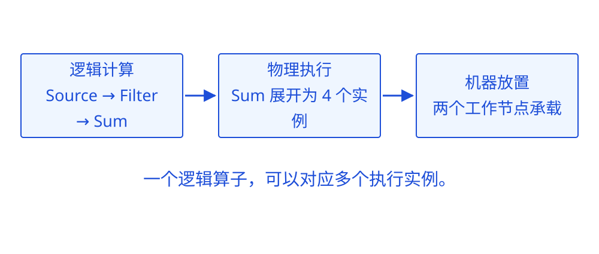</figure>

- 逻辑图说明算什么；物理图说明几个实例怎样交换数据；部署图说明放在哪里。
- 本讲并行专项输入已按事件身份去重，保留过滤与按用户累计。

<!--
大家看同一份作业的三个镜头。最上层是过滤后累计这件事，中间把累计展开成四个同时工作的实例，最下层再把实例安排到两台机器。这三个视角描述同一业务的计算逻辑、并行分工和运行位置。本讲的并行专项采用已按事件身份去重的输入，任务计数覆盖Source、Filter、Aggregate和Sink。以后看到架构图，请先判断它画的是计算关系、执行连接，还是实际放置，再解释一个框究竟是什么对象。

[Sources]
- https://nightlies.apache.org/flink/flink-docs-release-2.3/docs/concepts/flink-architecture/
- 教学构造数据：course/data/cases.json；金额单位为分。专项场景在页面注明参数。
-->

---
class: course story-course
---
## 程序、进程、线程与机器

<figure class="story-figure"></figure>

- <strong>进程</strong>是运行中的程序及其资源；<strong>线程</strong>是进程内执行工作的一条路径。
- 一台机器可运行多个进程；一个 TaskManager 进程内可有多个执行线程。

<!--
我们先把几个容易混在一起的词放稳。程序是写好的工作规则，进程是它在机器上真正运行起来的一份实例，拥有自己的工作内存。进程里面还可以有多条执行路径，叫线程。图中一台工作机器运行一个TaskManager进程，进程里有多条执行任务的线程。请大家依次指机器、进程、线程和Slot的边界，分别说出承载程序、运行程序、执行任务和分配资源的作用。后面每当我们数方框，都先说清数的是哪一层。

[Sources]
- https://nightlies.apache.org/flink/flink-docs-release-2.3/docs/concepts/flink-architecture/
-->

---
class: course story-course
layout: section
---
## 1 · 运行进程与职责

<ol class="outline"><li class="current">运行进程与职责</li><li>并行子任务与数据交换</li><li>资源分配与部署</li><li>瓶颈、积压与方案设计</li></ol>

<!--
接下来先认识谁负责组织、谁真正处理记录。大家沿两种不同箭头看：一类提交计划、分配任务和报告状态，另一类搬运支付记录。沿控制路径看谁组织执行，沿数据路径看谁处理金额；再按职责判断各组件故障时的影响范围。

[Sources]
- https://nightlies.apache.org/flink/flink-docs-release-2.3/docs/concepts/stateful-stream-processing/
-->

---
class: course story-course
---
## Client 提交，协调器安排，工作进程执行

<figure class="story-figure"></figure>

- Client 准备并提交作业；JobManager <strong>协调调度、检查点与恢复</strong>。
- TaskManager 执行任务，缓冲并交换记录；业务数据沿工作任务流动。

<!--
请大家顺着上面的提交箭头走，Client把作业计划交给JobManager。接下来JobManager安排由哪些工作进程执行各个任务，并组织后续检查点与故障恢复。真正一条条读取、判断和相加的是下面的TaskManager。看业务记录那条线，它沿工作任务之间的数据通道流动。遇到性能问题时，我们就能按职责检查：任务处理能力看TaskManager上的执行，调度与恢复看JobManager。

[Sources]
- https://nightlies.apache.org/flink/flink-docs-release-2.3/docs/concepts/flink-architecture/
-->

---
class: course story-course
---
## 提交作业之后，Client 可以断开

<figure class="story-figure"></figure>

- Client 提供计算计划；作业提交成功后，集群负责后续运行。
- 分离模式下 Client 退出，已提交作业仍由集群执行。

<!--
假设老师在笔记本上提交了统计作业，随后把笔记本合上，门店营业额会不会立即停止计算？在分离提交的模式下，作业由集群持续运行，Client完成提交后可以退出。它已经把计划交给集群，TaskManager仍在执行。请大家把“提交工具”和“运行系统”区分开。这里的前提是分离模式提交到集群；本机运行时，任务生命周期由本机进程决定。

[Sources]
- https://nightlies.apache.org/flink/flink-docs-release-2.3/docs/concepts/flink-architecture/
-->

---
class: course story-course
---
## 协调职责为什么需要全局视角

<figure class="story-figure"></figure>

- 调度决定任务与可用资源的对应；恢复决定相关任务从何处继续。
- 检查点需要组织多个参与者形成<strong>对应的恢复边界</strong>。

<!--
大家想一想，两台工作机器能各自随便挑一半记录就开始吗？它们还需要共同知道哪些子任务已经启动，哪一份资源可用，哪次检查点已经成功。如果其中一个失败，相关任务需要按对应的状态和输入边界恢复。这些决定跨越多个任务，所以由协调角色组织。协调维护整个作业的执行关系，各任务继续负责自己的记录处理。第五讲会详细画检查点，今天先把“谁组织这件事”放在架构中的正确位置。

[Sources]
- https://nightlies.apache.org/flink/flink-docs-release-2.3/docs/concepts/flink-architecture/
-->

---
class: course story-course
---
## JobManager 内部的管理角色

<figure class="story-figure">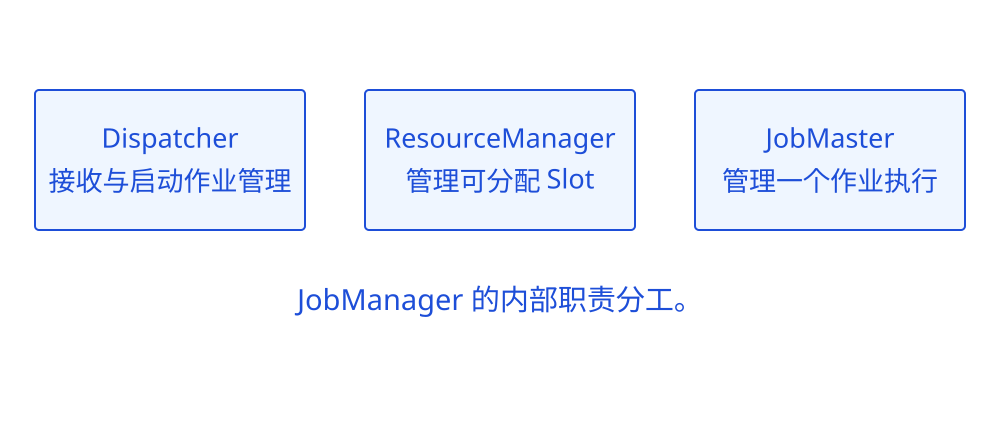</figure>

- Dispatcher 接收作业；ResourceManager 管理 Slot 资源。
- 每个 JobMaster 管理一个作业；这些角色位于 JobManager 内部。

<!--
我们把JobManager这个协调进程放大，看见三类职责。Dispatcher负责接收作业并为它启动管理者；ResourceManager关心可用的Slot资源；每个作业的JobMaster跟踪这份作业的执行。这三个名称对应JobManager内部的管理角色，机器与进程边界见部署图。比如同时有两份作业，就可能有分别管理它们的JobMaster。理解名称时，把它们各自负责什么放在第一位，再去看具体部署怎样组织这些角色。

[Sources]
- https://nightlies.apache.org/flink/flink-docs-release-2.3/docs/concepts/flink-architecture/
-->

---
class: course story-course
---
## TaskManager 的工作现场

<figure class="story-figure">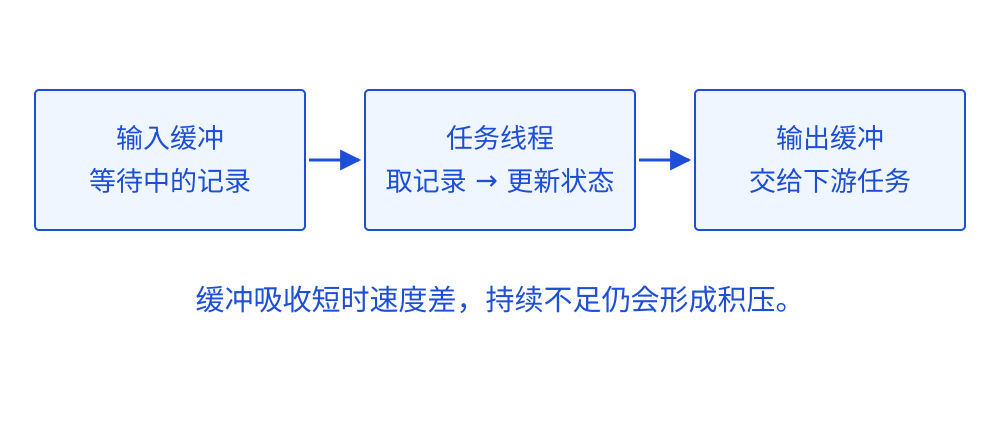</figure>

- 执行任务读取输入、更新本地工作状态，并把输出送往下游。
- 数据暂时处理不过来时，先占用通道缓冲，随后可能传导反压。

<!--
现在看真正干活的一侧。输入记录先进入缓冲，任务线程取出记录，执行过滤或累计，再把输出交给下游。每次加法的当前值由执行任务使用的状态后端保存；JobManager负责协调检查点与恢复。请问，输入突然快很多，记录会立刻消失吗？通常先在队伍和缓冲中等待；如果下游持续吃不动，等待就会反过来影响上游发送。我们后面会用每秒条数与积压把这条因果链算出来。

[Sources]
- https://nightlies.apache.org/flink/flink-docs-release-2.3/docs/concepts/flink-architecture/
-->

---
class: course story-course
---
## 控制流与数据流走不同路径

<figure class="story-figure">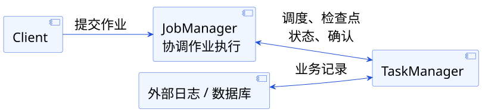</figure>

- 提交、调度与确认属于控制交互；支付记录属于数据交换。
- 组件图分别标注控制、数据与持久化箭头，按图例读各条连线。

<!--
请大家看标准UML组件图。带组件标记的矩形说明系统由哪些模块组成，旁边的箭头说明模块之间有什么依赖或交互。Client到协调器的箭头写提交作业，工作进程和协调器之间写调度、状态与确认，外部日志和工作进程之间才是业务记录。我们不让一根没有说明的箭头同时承担三种含义。请沿数据流找一次支付从哪里进入，再沿控制流找谁决定任务启动，就能读出同一系统的两类关系。

[Sources]
- https://nightlies.apache.org/flink/flink-docs-release-2.3/docs/concepts/flink-architecture/
- https://www.omg.org/spec/UML/2.5.1/PDF
-->

---
class: course story-course
---
## 组件图的符号与绘制步骤

<figure class="story-figure"></figure>

- 组件画模块职责；依赖箭头从使用方指向所依赖方，标注依赖内容。
- 先列职责，再连交互；部署在哪台机器留到部署图说明。

<!--
画组件图时，先列接入、计算、输出和协调管理模块，再连接它们提供或使用的接口。第二步说明谁调用谁、谁依赖谁，再用有文字的连线表达。标准依赖箭头指向被依赖的一方，而通信图中双向交互也要写明各方向的含义。请大家拿自己的图反问一句：删掉某根箭头的文字，别人会不会误以为这条线在传支付金额？若会，就把动作标清楚。组件图让职责边界清晰，部署图再解决实际位置。

[Sources]
- https://www.omg.org/spec/UML/2.5.1/PDF
- https://nightlies.apache.org/flink/flink-docs-release-2.3/docs/concepts/flink-architecture/
-->

---
class: course story-course
---
## 组件图练习：加入日志与结果库

- 业务输入来自 Kafka，用户结果写到 MySQL。
- 画 Client、JobManager、TaskManager、Kafka、MySQL 五类组件。
- 分别标出提交、调度、读支付、写结果；指出金额经过哪条路径。

<!--
现在请大家把外部系统拆成两个具体模块。Kafka保存待处理日志，MySQL保存供查询的结果，不能用一个含糊的数据库方框代替两种职责。画完以后，先拿一笔支付沿读写箭头走一遍，再拿一次任务启动沿控制箭头走一遍。请特别检查有没有把支付记录绕到JobManager中计算。如果有，说明控制关系和业务数据关系混在一起了。组件图说明模块依赖，下一部分的部署图再安排机器数量与运行位置。

[Sources]
- https://nightlies.apache.org/flink/flink-docs-release-2.3/docs/concepts/flink-architecture/
- https://www.omg.org/spec/UML/2.5.1/PDF
-->

---
class: course story-course
---
## 组件图答案：记录沿工作进程计算

<figure class="story-figure"></figure>

- Kafka→TaskManager→MySQL 是本例业务记录路径。
- Client→JobManager 提交；JobManager 与 TaskManager 协调任务。

<!--
答案图中有两条可以分别读出的链。第一条是业务数据，从Kafka进入执行任务，经过计算再写MySQL；第二条是控制，Client提交，协调器调度，工作进程回报状态。大家现在遮住说明文字，请同桌凭图分别复述一次。如果某根线无法判断用途，就需要补标注。还要记住，Kafka和MySQL在这里是系统职责的例子，不表示任何接入它们的写法就自动具有精确一次，输出协议要到第五讲再完整设计。

[Sources]
- https://nightlies.apache.org/flink/flink-docs-release-2.3/docs/concepts/flink-architecture/
- https://www.omg.org/spec/UML/2.5.1/PDF
-->

---
class: course story-course
layout: section
---
## 2 · 并行子任务与数据交换

<ol class="outline"><li>运行进程与职责</li><li class="current">并行子任务与数据交换</li><li>资源分配与部署</li><li>瓶颈、积压与方案设计</li></ol>

<!--
角色清楚以后，我们让同一算子同时开工。请大家保持业务规则不变，只改变执行实例数量。关键问题是：同一个用户的不同事件能否找到同一份状态？如果画出四个累计方框，却让相同用户随机进入不同方框，虽然并行了，结果却已经被拆散。接下来沿路由箭头检查这个条件。

[Sources]
- https://nightlies.apache.org/flink/flink-docs-release-2.3/docs/concepts/stateful-stream-processing/
-->

---
class: course story-course
---
## 并行度决定算子展开几个实例

<figure class="story-figure">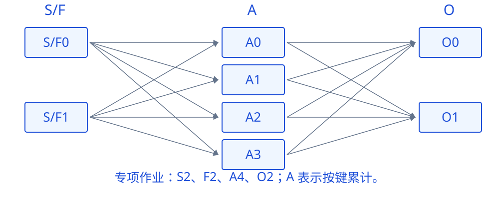</figure>

- <strong>并行度（Parallelism）</strong>是一个算子的并行子任务数量。
- Sum 并行度 4：A0、A1、A2、A3 各处理分到自己的键。

<!--
一个逻辑Sum算子，现在展开成四个执行实例。它们执行相同的累计规则，但各自处理不同的一部分业务键。并行度四表示该算子展开为四个子任务；每个用户的记录仍归属于其中一个累计子任务。图里把Sum名字写在列顶，下面是四个编号实例，帮助大家把“同一种计算”与“执行它的几个实例”分开。接下来我们会给前后算子也指定并行度，再数整份作业到底有几个子任务。

[Sources]
- https://nightlies.apache.org/flink/flink-docs-release-2.3/docs/concepts/flink-architecture/
-->

---
class: course story-course
---
## 逻辑图展开为十个算子子任务

<figure class="story-figure">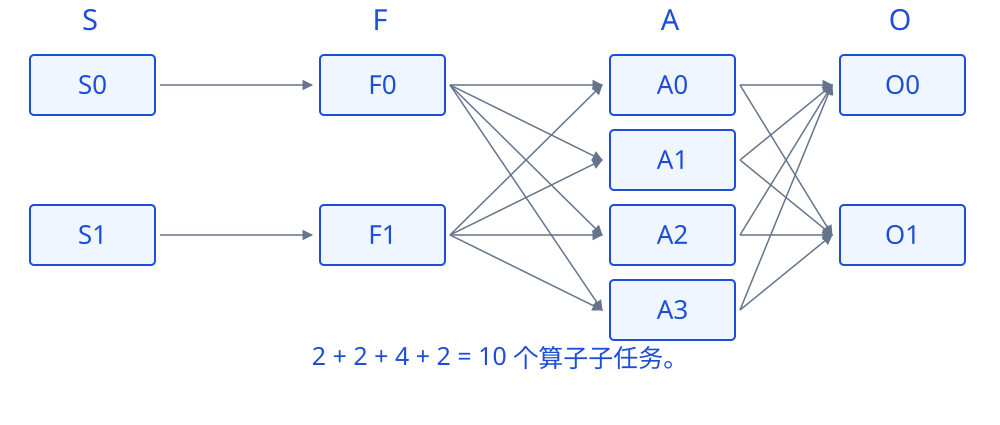</figure>

- Source 2、Filter 2、Aggregate 4、Sink 2，共 <strong>10 个算子子任务</strong>。
- 物理图的边还要说明一对一连接或重新分区。

<!--
请大家按列数：Source两个、Filter两个、累计四个、输出两个，加起来十个。这个数字只回答算子子任务数量，后面形成算子链以后，执行线程数量可能更少。先看相邻两列，源和过滤并行度相同，可以一对一向下传；过滤到累计则要按用户键重新决定目的实例。物理执行图将算子展开为子任务，并标出子任务间实际的数据连接。

[Sources]
- https://nightlies.apache.org/flink/flink-docs-release-2.3/docs/concepts/flink-architecture/
-->

---
class: course story-course
---
## keyBy 让同键记录进入同一份状态

<figure class="story-figure">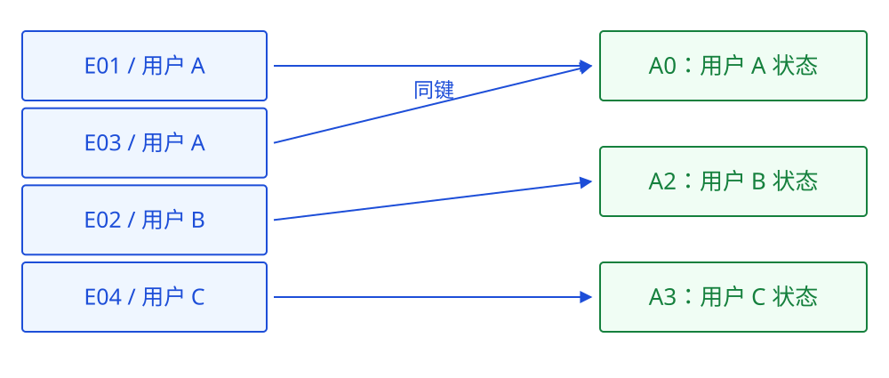</figure>

- <strong>keyBy</strong>按键重新分区；本例示意路由 A→A0，B→A2，C→A3。
- 相同键必须保持一致路由；具体编号由分区规则决定。

<!--
大家沿A的两条记录看，它们来自不同上游，也必须送到同一个累计实例A0，否则各自只知道一部分金额。B送A2，C送A3，这些编号是本页给定的示意映射，真实系统用固定的分区规则决定。关键条件是同一个键在当前执行布局下进入同一份历史。请再问，keyBy是否把A的所有记录按事件时间排好？没有，它解决分区归属，时间排序和乱序仍要另行处理。

[Sources]
- https://nightlies.apache.org/flink/flink-docs-release-2.3/docs/concepts/flink-architecture/
- https://nightlies.apache.org/flink/flink-docs-release-2.3/docs/dev/datastream/fault-tolerance/state/
-->

---
class: course story-course
---
## 随机分发会拆散同一用户的累计

<figure class="story-figure">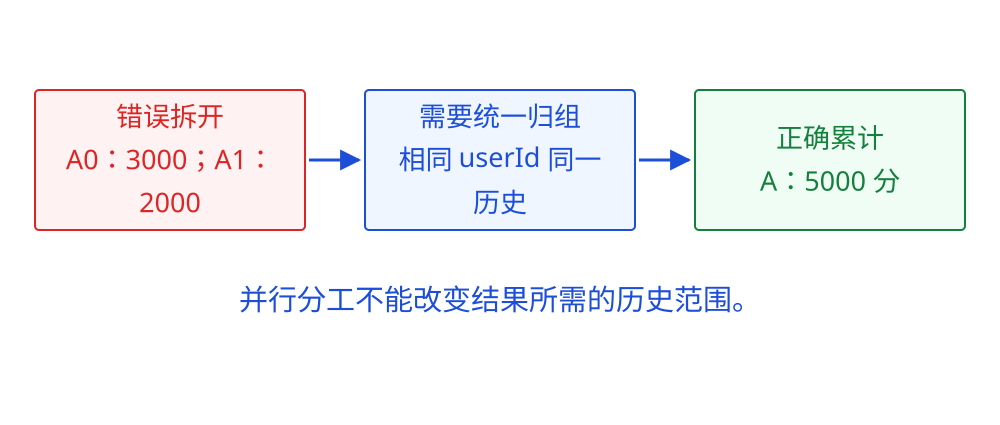</figure>

- 反例：A 的 3000 进入 A0，2000 进入 A1，两边各自只见局部。
- 按键路由后，两条在同一份状态中得到 <strong>5000 分</strong>。

<!--
我们故意画一条错误路线。A的第一笔3000进入A0，第二笔2000进入A1，如果两边都直接对外声称自己就是用户A的完整累计额，就会得到两个不完整答案。错误来自同一组的历史分散到了不同累计实例。若要先局部再合并，必须明确增加一个按A重新汇总的阶段，不能把随机分散当作最终结果。keyBy让直接的按键状态计算有清晰归属，这是并行执行保持业务语义的重要条件。

[Sources]
- https://nightlies.apache.org/flink/flink-docs-release-2.3/docs/concepts/flink-architecture/
- https://nightlies.apache.org/flink/flink-docs-release-2.3/docs/dev/datastream/fault-tolerance/state/
-->

---
class: course story-course
---
## 数据交换策略对应不同分发目的

<figure class="story-figure">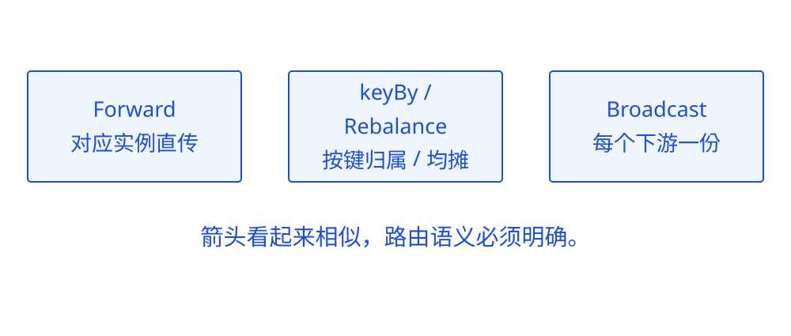</figure>

- Forward 一对一传递；keyBy 按键；Rebalance 均摊记录；Broadcast 复制给所有下游。
- 使用按键状态前，要保证分发策略满足同键归属。

<!--
四种分发方式都可以画成箭头，但目的不同。一对一省去重新分发，适合上下游对应实例；按键把相同业务对象送到一起；均摊让记录轮流分散，适合不依赖同键历史的负载分配；广播则把一条配置复制给每个下游。请用一笔A支付测试，如果轮流均摊就可能拆开A的账，因此不能直接替代keyBy。所有实例都要使用的风控配置适合广播；支付明细则按键发送到负责该用户的累计实例。

[Sources]
- https://nightlies.apache.org/flink/flink-docs-release-2.3/docs/concepts/flink-architecture/
- https://nightlies.apache.org/flink/flink-docs-release-2.3/docs/dev/datastream/operators/overview/
-->

---
class: course story-course
---
## 算子链把可相连子任务放入同一 Task

<figure class="story-figure">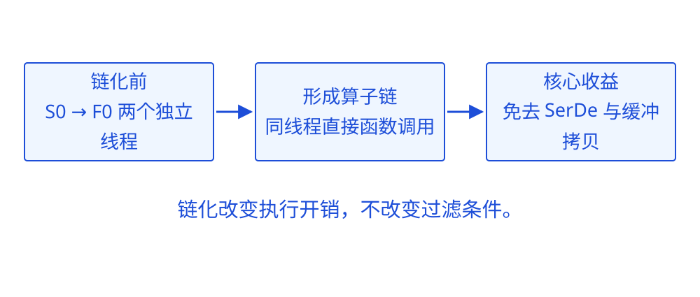</figure>

- 本例 Source 与 Filter 并行度同为 2，满足链化条件，合为 S0/F0、S1/F1。
- 链内直接交接，减少线程间交接和缓冲开销；keyBy 处仍需交换。

<!--
大家把源和过滤两列合起来看。相同编号的两个子任务若满足链化条件，可以在同一个Task中连续执行，源读出一条就交给过滤，少一次线程间搬运。这叫算子链，并没有删除过滤逻辑，也没有把两笔支付合成一笔。到了keyBy处，记录可能需要送往别的累计实例，所以这个重新分区边界不能随意抹掉。请大家比较链化前后，业务规则没变，执行交接的组织方式变了。

[Sources]
- https://nightlies.apache.org/flink/flink-docs-release-2.3/docs/concepts/flink-architecture/
-->

---
class: course story-course
---
## 十个算子子任务形成八个 Task

<figure class="story-figure">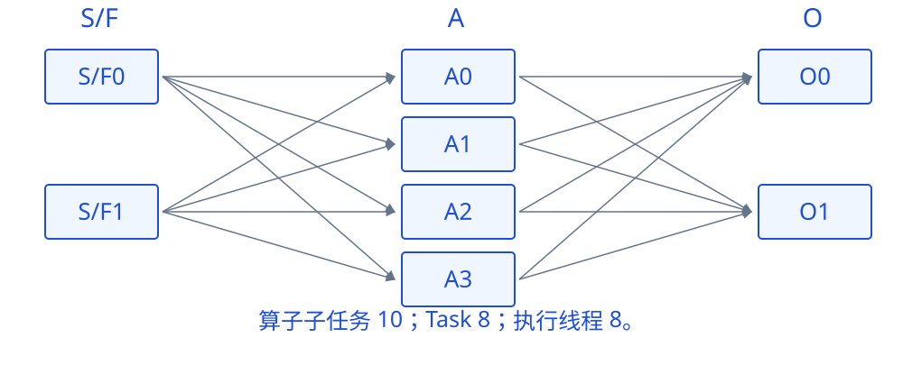</figure>

- 2 条 Source/Filter 链 + 4 个累计 Task + 2 个输出 Task = <strong>8 个 Task</strong>。
- 本例每个 Task 由一个执行线程运行；子任务、Task 与线程要分别计数。

<!--
现在重新数。逻辑层仍有十个算子子任务，其中源与过滤按编号组成两条链，于是这两列只形成两个Task。再加四个累计Task和两个输出Task，总共八个Task。本例每个Task由一条线程执行，所以有八条执行线程。接下来分别数Task线程和Slot资源份额，看看八个Task怎样共享四个Slot。Slot负责资源分配，允许一定条件下的任务共享；线程才是具体执行路径。我们下一部分会把八个Task放进四个Slot。

[Sources]
- https://nightlies.apache.org/flink/flink-docs-release-2.3/docs/concepts/flink-architecture/
-->

---
class: course story-course
---
## 链化与并行度是两种调整

<figure class="story-figure"></figure>

- 链化减少交接；增加并行度增加执行实例；两者对业务口径均应保持一致。
- 验证算子链时，同时核对吞吐、同键历史和输出协议。

<!--
大家先说清两个旋钮。把Source和Filter连成链，是减少它们之间的搬运；把Sum从两份增加到四份，是增加同时处理不同键的实例。前者不自动创造四倍处理能力，后者也不保证每个用户的工作都能拆成四份。判断调整是否成功，除了每秒条数，还要核对用户金额、键归属与输出含义。A的完整累计历史是正确性条件，吞吐测试应与用户结果核对一起进行。

[Sources]
- https://nightlies.apache.org/flink/flink-docs-release-2.3/docs/concepts/flink-architecture/
- 教学构造数据：course/data/cases.json；金额单位为分。专项场景在页面注明参数。
-->

---
class: course story-course
---
## 物理图练习：重新计数

- Source 2、Filter 2、Aggregate 3、Sink 1；Source/Filter 满足链化条件。
- 分别数算子子任务、Task、执行线程；画 keyBy 前后的连接。
- 说明：是否能由 Task 数直接推出所需机器数？

<!--
请大家给一个新作业画物理图，先把四列展开，再按编号圈出两条源过滤链。请在纸上分三行列出算子子任务、合链后的Task和所需Slot。计算机器数量还需给出每台的资源与Slot，以及各Task的内存等需求，再按放置约束核算。图先让执行关系可见，具体资源安排还需要下一部分的条件。

[Sources]
- https://nightlies.apache.org/flink/flink-docs-release-2.3/docs/concepts/flink-architecture/
-->

---
class: course story-course
---
## 计数答案：八个子任务，六个 Task

<figure class="story-figure"></figure>

- 算子子任务：2+2+3+1=8；Task 与线程：2+3+1=6。
- 同作业同 Slot Sharing Group 且资源可容纳时，最高并行度 3 对应 3 个 Slot。

<!--
答案中两条源过滤链形成两个Task，累计三个，输出一个，总共六条执行线程。若同一作业使用同一Slot共享组，且资源确实容得下，可以用最高并行度三来推导这个例子至少需要的Slot数量。请把后半句条件一起读，不能把“所有作业都是三个Slot”当结论。机器数还取决于每台提供多少可用Slot以及资源容量；执行图提供任务关系，部署图把这些条件补完整。

[Sources]
- https://nightlies.apache.org/flink/flink-docs-release-2.3/docs/concepts/flink-architecture/
-->

---
class: course story-course
layout: section
---
## 3 · 资源分配与部署

<ol class="outline"><li>运行进程与职责</li><li>并行子任务与数据交换</li><li class="current">资源分配与部署</li><li>瓶颈、积压与方案设计</li></ol>

<!--
现在我们有八个Task，准备放到两台机器上。请大家先读条件：每台一个TaskManager、每个两个Slot，同一作业允许共享，而且资源足够。没有这些条件，图上随便把方框塞进去不能叫可行部署。我们会逐一看每个Slot容纳哪些任务，并用标准部署图记录机器和进程的边界。

[Sources]
- https://nightlies.apache.org/flink/flink-docs-release-2.3/docs/concepts/stateful-stream-processing/
-->

---
class: course story-course
---
## Slot 是资源调度单位

<figure class="story-figure">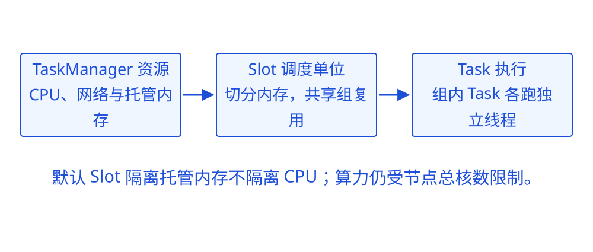</figure>

- <strong>Slot</strong>表示 TaskManager 可分配的一份资源，提供任务放置的调度单位。
- Slot 按资源份额分配；线程数与 CPU 隔离需分别确认。

<!--
Slot表示TaskManager提供的一份可分配资源；Task线程在获得资源后执行计算。TaskManager用Slot控制可以接纳的工作，并分配相应管理内存等资源。默认Slot机制提供资源分配，CPU独占需要额外的隔离机制。图里同一个Slot可以放来自同一作业共享组的多个Task，它们各有自己的执行线程。请分别数图中的Slot和Task线程，再用机器实际CPU资源判断可用计算能力。

[Sources]
- https://nightlies.apache.org/flink/flink-docs-release-2.3/docs/concepts/flink-architecture/
-->

---
class: course story-course
---
## 两台工作机器提供四个 Slot

<figure class="story-figure"></figure>

- 题设：每台 1 个 TaskManager，每个 2 Slot，共 4 Slot。
- 本作业同一共享组；每个 Slot 的 CPU、内存与网络需求均可容纳。

<!--
在这个专项部署里，两台机器各运行一个工作进程，每个工作进程报告两个可用Slot，总共四个。我们明确规定所有任务属于同一个允许共享的组，而且资源估算能够容纳图中组合。为什么要写资源条件？共享后的各Task还要共同满足内存、网络等资源需求。接下来给出八个Task共享四个Slot的摆法，每个累计实例各占一个Slot位置。

[Sources]
- https://nightlies.apache.org/flink/flink-docs-release-2.3/docs/concepts/flink-architecture/
-->

---
class: course story-course
---
## 八个 Task 的一个可行放置

<figure class="story-figure"></figure>

- 四个累计 Task 分居四个 Slot；其余源过滤链与输出 Task 按组共享。
- 放置不改变数据路由：跨机器同键记录仍需到对应累计实例。

<!--
现在把任务摆进去。机器一的第一个Slot放源过滤链S0/F0、累计A0和输出O0，第二个Slot放A1；机器二相应放S1/F1、A2、O1和A3。请大家把所有Task各圈一次，确认没有丢掉或重复。这个摆法同时说明共享不会取消网络交换：S0产生的某条B记录仍可能要去机器二的A2，不会因为身边有A0就随便加进去。放置负责在哪里运行，keyBy负责记录归谁，两条规则要同时成立。

[Sources]
- https://nightlies.apache.org/flink/flink-docs-release-2.3/docs/concepts/flink-architecture/
-->

---
class: course story-course
---
## 共享组改变后要重新估算资源

<figure class="story-figure"></figure>

- 累计与其他阶段分属不同共享组时，分别计算各组需求，再相加。
- 各组最高并行度给出所需 Slot 数，资源容量决定放置可行性。

<!--
刚才的四个Slot结论依赖同一共享组。现在假设把累计阶段和输入输出隔离，原来的共享组合就不一定允许。按各组的并行度与资源约束重新分配；若再规定每个Task独占Slot，这个作业就需要八个Slot。所需Slot数取决于各算子并行度和共享组划分。请在方案中先写共享与隔离前提，再给数量，读者才知道怎样验证你的部署。

[Sources]
- https://nightlies.apache.org/flink/flink-docs-release-2.3/docs/concepts/flink-architecture/
-->

---
class: course story-course
---
## 部署图画机器与执行环境

<figure class="story-figure"></figure>

- UML 节点表示设备（device）或执行环境；嵌套表示承载，通信线表示连接。
- 本图：2 台工作机器，各 1 个 TaskManager 进程，内含作业制品与任务放置。

<!--
这次用标准UML部署图把位置画清楚。最外层device（设备）节点是物理工作机器，里面executionEnvironment（执行环境）节点是运行作业的进程环境，artifact（制品）表示部署的作业代码。连线说明协调交互或数据通道，旁边的说明给Slot与Task的摆放。大家比较组件图，它关心模块职责，而部署图关心模块和代码被哪个环境承载。请先找机器边界，再找进程边界，最后读具体Slot内容，就不会把一个作业代码制品误认为另一台服务器。

[Sources]
- https://nightlies.apache.org/flink/flink-docs-release-2.3/docs/concepts/flink-architecture/
- https://www.omg.org/spec/UML/2.5.1/PDF
-->

---
class: course story-course
---
## 部署图的绘制步骤

<figure class="story-figure">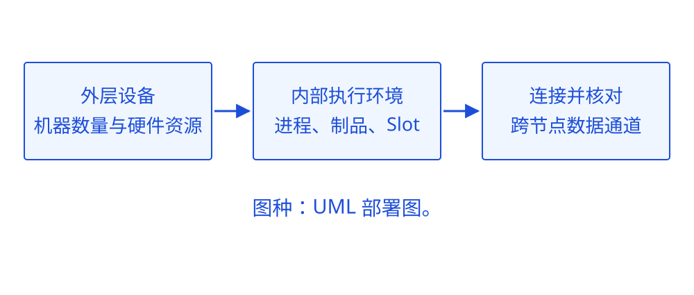</figure>

- 先画设备，再画执行环境和制品；把通信与资源标在对应边界上。
- 核对任务只放一次、资源能容纳、连接支持物理数据路径。

<!--
大家动笔时从外向内画。先决定几台机器，再给每台画TaskManager进程，把相应作业代码和任务放到进程内部。之后连接协调交互与工作节点之间的数据通道，最后标明Slot和资源前提。先画机器、进程与Slot边界，再放入Task并核对每个Slot承载的资源需求。部署图应当能支持一次完整试走：记录进入哪个机器、在哪个Task更新、跨机器时沿哪条通道发送。

[Sources]
- https://www.omg.org/spec/UML/2.5.1/PDF
- https://nightlies.apache.org/flink/flink-docs-release-2.3/docs/concepts/flink-architecture/
-->

---
class: course story-course
---
## 部署练习：增加节点会自动加速吗

- 原作业累计并行度 4，已有 4 Slot；新增一台机器提供 2 Slot。
- 保持并行度与任务放置不变：指出新增资源是否必然得到使用。
- 画一个调整后的部署，并写需要同步修改与观察的条件。

<!--
运营同学又送来一台机器，请先检查当前四个累计实例的放置是否变化。当前作业仍有四个累计实例且放置不变，新增Slot可供后续调度使用。请你画一个利用新增资源的方案，说明是迁移任务减轻共享压力，还是增加并行度、重新分配键。两种操作的效果和条件不同。最后用各子任务的吞吐、忙碌度与积压变化验证加速效果。

[Sources]
- https://nightlies.apache.org/flink/flink-docs-release-2.3/docs/concepts/flink-architecture/
-->

---
class: course story-course
---
## 部署答案：资源与执行规模分别调整

<figure class="story-figure"></figure>

- 新增机器提供可用资源；调整并行度或任务放置后，作业才可能利用它。
- 扩容后核对各键状态与吞吐；单热点键可能仍由一个实例承担。

<!--
合理答案可以有两种。其一保持四个累计实例，把共享较重的Task迁到新增机器，观察资源竞争是否下降；其二在业务键足够分散且资源支持时增加并行度，再恢复和重分配状态。两种都要对比调整前后的指标，不能承诺只要加机器就线性加速。尤其当一个用户占大多数记录时，同键历史仍集中到一个实例，新增节点可能帮不了这处瓶颈。我们下一部分就用具体每秒条数把这个限制看出来。

[Sources]
- https://nightlies.apache.org/flink/flink-docs-release-2.3/docs/concepts/flink-architecture/
-->

---
class: course story-course
layout: section
---
## 4 · 瓶颈、积压与方案设计

<ol class="outline"><li>运行进程与职责</li><li>并行子任务与数据交换</li><li>资源分配与部署</li><li class="current">瓶颈、积压与方案设计</li></ol>

<!--
现在任务已经能运行，接下来判断它跟不跟得上输入。大家把每秒条数当作同一单位沿线比较，找到最慢阶段，再看等待记录怎样累积。算完总能力以后，还要逐个核对键负载和子任务容量，找出热点位置。

[Sources]
- https://nightlies.apache.org/flink/flink-docs-release-2.3/docs/concepts/stateful-stream-processing/
-->

---
class: course story-course
---
## 流水线的给定处理能力

<figure class="story-figure">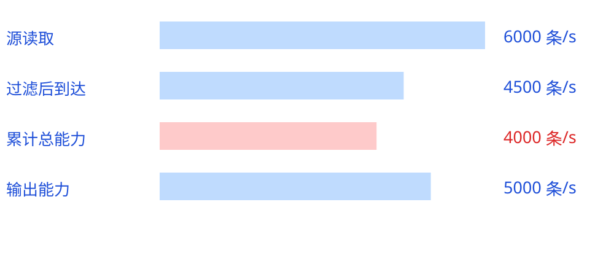</figure>

- 专项题设：源 6000 条/s，75% 通过过滤，进入累计 4500 条/s。
- 累计 4 实例×1000=4000 条/s；输出阶段能力 5000 条/s。

<!--
请大家先统一比较的范围。源每秒六千是原始记录，其中百分之七十五通过，真正进入累计的是四千五百。四个累计实例每个能稳定处理一千，假定键均匀分布，总共四千；输出能处理五千。不能直接拿六千和四千比较积压，因为中间已经过滤掉一部分记录。图中全部是本题构造的稳定能力，真实部署要用测量确认。下面我们先在这些条件下推导哪一段会形成等待。

[Sources]
- https://nightlies.apache.org/flink/flink-docs-release-2.3/docs/concepts/flink-architecture/
- 教学构造数据：course/data/cases.json；金额单位为分。专项场景在页面注明参数。
-->

---
class: course story-course
---
## 最慢阶段限制持续完成速率

<figure class="story-figure">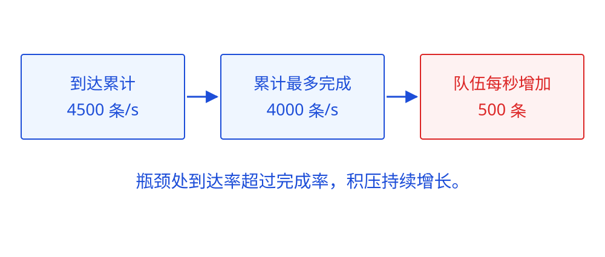</figure>

- 进入累计 4500，最多完成 4000：每秒有 <strong>500 条</strong>留下等待。
- 累计阶段以 4000 条/s 限制整条线；Sink 尚有 1000 条/s 余量。

<!--
我们把瓶颈固定在累计阶段。每秒四千五百条来到门口，最多四千条离开，多出的五百只能等着。右边Sink每秒能处理五千条，实际只收到累计阶段送来的四千条；瓶颈位于中间阶段。请问，若把输出扩到一万，等待会减少吗？在当前条件下不会，累计仍每秒少处理五百。本例应优先提高累计阶段容量，再核对新的全链路瓶颈。

[Sources]
- https://nightlies.apache.org/flink/flink-docs-release-2.3/docs/concepts/flink-architecture/
- 教学构造数据：course/data/cases.json；金额单位为分。专项场景在页面注明参数。
-->

---
class: course story-course
---
## 积压是速度差随时间累积的结果

<figure class="story-figure"></figure>

- 初始无积压、速率恒定：10 s 等待 5000 条，20 s 等待 10000 条。
- <strong>积压 =（到达率 − 完成率）×持续时间</strong>，单位为条。

<!--
请大家每隔十秒给队伍拍一次照片。开始零条，十秒时每秒少处理五百，总共五千；再过十秒变成一万。这一万条积压来自每秒五百条的持续能力差，累计了二十秒。现在把公式中的单位消掉：每秒条数乘秒，结果是条。只要输入速度一直不降而能力不变，这个等待就不会自行消失。反过来，如果队伍只短暂增加后又下降，可能是瞬时波动，需要结合时间曲线判断。

[Sources]
- https://nightlies.apache.org/flink/flink-docs-release-2.3/docs/concepts/flink-architecture/
- 教学构造数据：course/data/cases.json；金额单位为分。专项场景在页面注明参数。
-->

---
class: course story-course
---
## 清空积压取决于输入是否继续

<figure class="story-figure">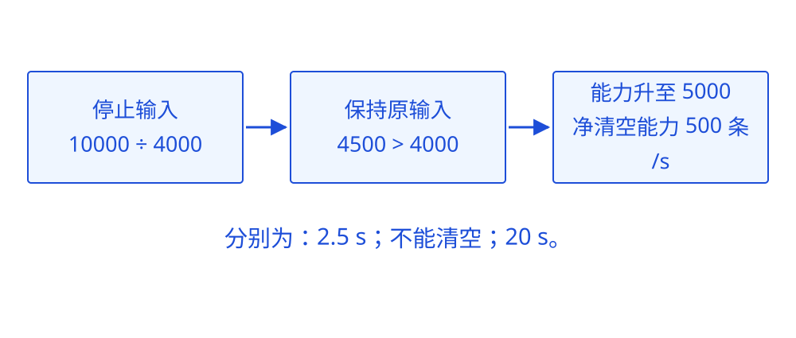</figure>

- 停止新输入：10000÷4000=2.5 s 清空；继续 4500 条/s 时不会清空。
- 若扩至 5000 条/s且输入仍4500，净清空能力500，需20 s。

<!--
大家常见的错误是把积压除以总能力，却忘了新记录仍在不断加入。若源真的暂停，四千每秒全部用于旧队伍，一万条需要两点五秒；若输入仍四千五百，旧队伍不但清不掉，还继续增长。现在假设累计扩到五千，输入仍四千五百，只有剩余五百每秒能消化旧积压，所以需要二十秒。请把这三个条件都写在图旁，清空时间离不开未来输入这一前提。

[Sources]
- https://nightlies.apache.org/flink/flink-docs-release-2.3/docs/concepts/flink-architecture/
- 教学构造数据：course/data/cases.json；金额单位为分。专项场景在页面注明参数。
-->

---
class: course story-course
---
## 反压沿满缓冲向上游传导

<figure class="story-figure">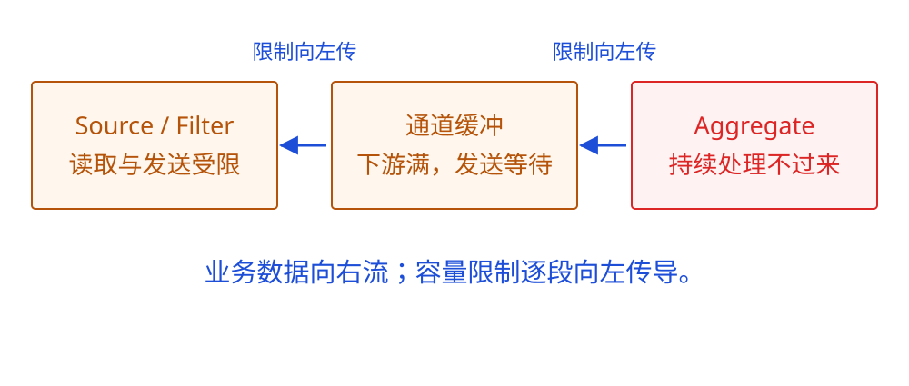</figure>

- <strong>反压（Backpressure）</strong>：下游接纳受限，使上游发送或处理受阻。
- 累计吃不动→通道缓冲变满→过滤难以发送→源读取受限。

<!--
大家把记录当作真正排队的对象看。累计每秒只能拿四千，前面的通道缓冲先逐渐占满；过滤想再发送时没有位置，只能等待；它等得多了，源读进来的速度也会受限制。反压将下游处理限制沿缓冲与发送路径传向上游，使上游降低发送速度。请问观察到源忙碌度低，就能说源是瓶颈吗？不能，它可能是被后面的累计卡住，所以要沿反压路径往下游找真正持续忙碌的阶段。

[Sources]
- https://nightlies.apache.org/flink/flink-docs-release-2.3/docs/concepts/flink-architecture/
- https://nightlies.apache.org/flink/flink-docs-release-2.3/docs/ops/monitoring/back_pressure/
-->

---
class: course story-course
---
## 热点键让总能力无法充分使用

<figure class="story-figure"></figure>

- 四实例输入分别 3000、500、500、500；每实例能力均 1000 条/s。
- 实际完成 1000+500+500+500=2500；热点实例每秒积压 <strong>2000</strong>。

<!--
刚才假定键均匀，现在把一个用户变成热点，占每秒三千条。它的所有记录必须进同一份累计历史，该实例只能完成一千，于是自己每秒多等两千。其他三个实例各只有五百输入，虽然还有空闲，也不会自动抢走热点键的一半状态。四个实例实际完成一千加三个五百，共两千五百条每秒，低于合计四千的名义能力。调优时因此必须看子任务与键分布，单看全作业总CPU会掩盖这处拥堵。

[Sources]
- https://nightlies.apache.org/flink/flink-docs-release-2.3/docs/concepts/flink-architecture/
- 教学构造数据：course/data/cases.json；金额单位为分。专项场景在页面注明参数。
-->

---
class: course story-course
---
## 可合并聚合可以先局部再合并

<figure class="story-figure">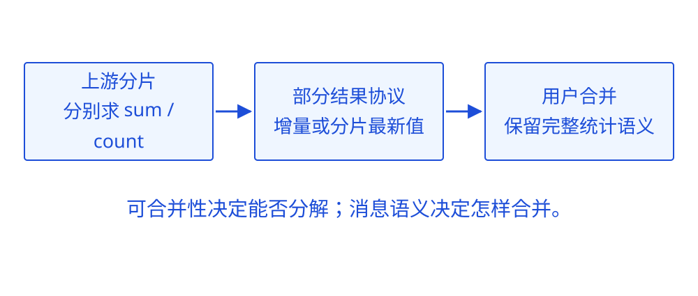</figure>

- 对求和、计数可先按（用户，分片）局部聚合，再按用户合并。
- 分片结果须约定窗口、版本或增量语义，下游按对应规则合并。

<!--
怎样减轻热点？对于可合并的求和与计数，可以先让不同分片分别形成部分结果，再由同一用户的合并阶段组合。这样能减少最终阶段接收的消息频率，但最后仍有用户级合并工作。请特别检查局部输出的含义：如果每秒报累计值三千、六千，最终不能把两次累计又相加。需要约定不重复的增量，或按分片保存最新值再重算。这里能用这种结构，是因为求和、计数允许分解合并，不能把任意有顺序依赖的业务状态都照搬拆开。

[Sources]
- https://nightlies.apache.org/flink/flink-docs-release-2.3/docs/concepts/flink-architecture/
- https://nightlies.apache.org/flink/flink-docs-release-2.3/docs/concepts/stateful-stream-processing/
- 教学构造数据：course/data/cases.json；金额单位为分。专项场景在页面注明参数。
-->

---
class: course story-course
---
## 从子任务指标定位瓶颈

<figure class="story-figure">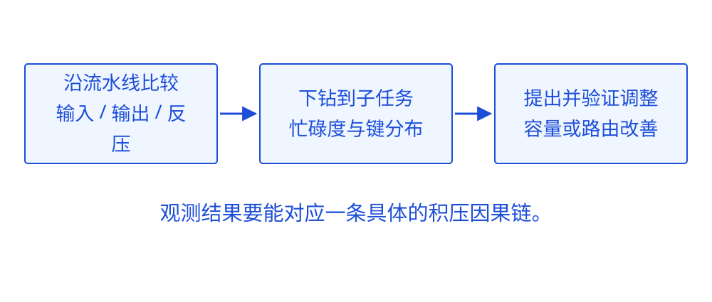</figure>

- 一起看输入率、输出率、忙碌度、反压与积压，按子任务比较。
- 大多数实例空闲而一个持续满载，应先检查热点与路由。

<!--
现在把指标当作刚才图的证据。输入率高于输出率，并且积压持续增长，说明某处能力没有跟上；上游等待、下游忙碌，帮助我们沿线定位；若只有一个累计实例忙，其余空闲，就回看键分布。将CPU、网络、缓冲和输出延迟放到同一路径上看，定位实际限制发送或处理的阶段。方案中要先提出“哪一处限制了什么”的假设，再选择指标验证，调整后仍需核对业务结果与等待是否改善。

[Sources]
- https://nightlies.apache.org/flink/flink-docs-release-2.3/docs/concepts/flink-architecture/
- https://nightlies.apache.org/flink/flink-docs-release-2.3/docs/ops/monitoring/back_pressure/
-->

---
class: course story-course
---
## 部署方案示范：均匀键的累计作业

<figure class="story-figure"></figure>

- 两台 TM 各 2 Slot；S/F 两条链、累计4、Sink2，同组且容量足够。
- 4500 条/s 到达超过4000能力：提升累计能力并验证分布、积压及结果。

<!--
我们把执行图、资源和速率合成方案。先给出两台机器四个Slot的共享放置，明确资源能容纳；再写输入与每阶段能力，发现累计四千不足以接住四千五百。调整时可以增加并行实例或提高单实例能力，但必须实际测到新的稳定能力，并检查键是否均匀。最后用同一组支付核对用户结果，观察积压是否下降。这样一份方案既能回答“放在哪里”，也能解释“为什么现在不够，以及怎样证明改好”。

[Sources]
- https://nightlies.apache.org/flink/flink-docs-release-2.3/docs/concepts/flink-architecture/
- 教学构造数据：course/data/cases.json；金额单位为分。专项场景在页面注明参数。
-->

---
class: course story-course
---
## 独立练习：积压与扩容方案

- 专项输入3600条/s；累计3实例×1000；初始无积压，持续15s。
- 计算积压；源暂停后需多久清空？扩成4实例、输入继续时又需多久？
- 写执行规模、资源前提与热点检查，并画调整前后图。

<!--
请大家独立处理这一组新的数字。先用输入率与累计总能力求出每秒差，再乘十五秒。然后分别处理两个情境：完全暂停新输入，或者扩容后保持原输入。请分别标明“停止输入”与“持续输入”两个条件，写出各自的净清空速率。扩容方案写明累计实例数量、资源容量和键分布，再给出验证吞吐与积压的指标。图中每条箭头都应能解释某个数值为什么出现。

[Sources]
- https://nightlies.apache.org/flink/flink-docs-release-2.3/docs/concepts/flink-architecture/
- 教学构造数据：course/data/cases.json；金额单位为分。专项场景在页面注明参数。
-->

---
class: course story-course
---
## 练习答案：9000 条与两种清空时间

<figure class="story-figure">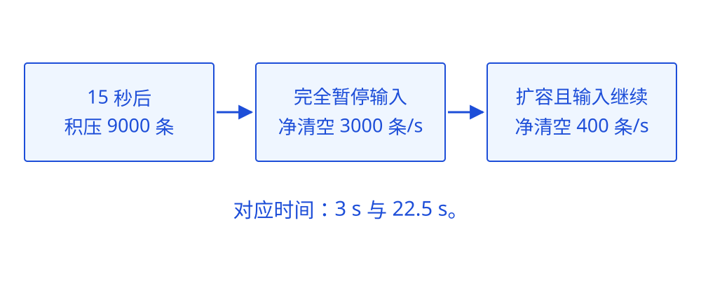</figure>

- 积压（3600−3000）×15=9000；暂停输入后9000÷3000=3s。
- 扩为4000能力且输入继续3600：9000÷400=22.5s；前提是无热点等新瓶颈。

<!--
我们先找差额，每秒少处理六百条，十五秒就是九千。若完全暂停输入，三千能力全用来清旧队伍，所以三秒；若扩为四千而输入继续三千六百，只剩四百清旧队伍，需要二十二点五秒。请大家把条件写在每条算式旁边，并画出新输入仍在进来的箭头。合理扩容方案还要说明四个实例能否真正分摊键、Slot和资源是否容纳，以及输出端是否变成新的限制。数字推演因此直接检验了方案的因果关系。

[Sources]
- https://nightlies.apache.org/flink/flink-docs-release-2.3/docs/concepts/flink-architecture/
- 教学构造数据：course/data/cases.json；金额单位为分。专项场景在页面注明参数。
-->

---
class: course story-course
---
## 独立方案练习：一个用户占三千条每秒

- 总输入4500条/s；一个用户3000，其余合计1500。
- 每个按键累计实例能力1000；提出方案并说明可合并性与输出规则。
- 写清为何单纯增加实例不保证消除这个用户的积压。

<!--
这道题不只求一个数字，请把热点的历史归属画出来。将四个累计实例扩为八个后，同一用户仍归一个实例，热点用户每秒三千条的负载仍由该实例承担。你可以为求和提出局部与最终合并，也可以说明提高单实例能力等其他选择，但每种都要给出条件。尤其是分片输出到底是增量还是累计，要写清最后一层怎样合并，防止把性能问题改成重复统计问题。

[Sources]
- https://nightlies.apache.org/flink/flink-docs-release-2.3/docs/concepts/flink-architecture/
- 教学构造数据：course/data/cases.json；金额单位为分。专项场景在页面注明参数。
-->

---
class: course story-course
---
## 热点方案答案：减少最终阶段消息压力

<figure class="story-figure"></figure>

- 可先按（用户，分片）求非重叠区间增量，再按用户汇总增量。
- 给出发布频率与合并能力，验证最终阶段跟得上；原始事件仍需唯一语义。

<!--
一种可行设计是把热点用户分成多个局部统计分片，在明确的不重叠时间段内产生增量，再由用户级合并阶段接收这些较少的增量消息。这里要保证每个事件只进入一个局部贡献，区间边界明确，后续重试也不会重复计入。局部聚合降低最终层收到的消息数；最终层仍维护用户完整状态，需要按合并后的负载测容量。大家可以提出别的方案，只要能沿图说明压力降低在哪里、哪些规则保证结果正确，并用输入与输出数据验证。

[Sources]
- https://nightlies.apache.org/flink/flink-docs-release-2.3/docs/concepts/flink-architecture/
- 教学构造数据：course/data/cases.json；金额单位为分。专项场景在页面注明参数。
-->

---
class: course story-course
---
## 本讲的执行层次

<figure class="story-figure">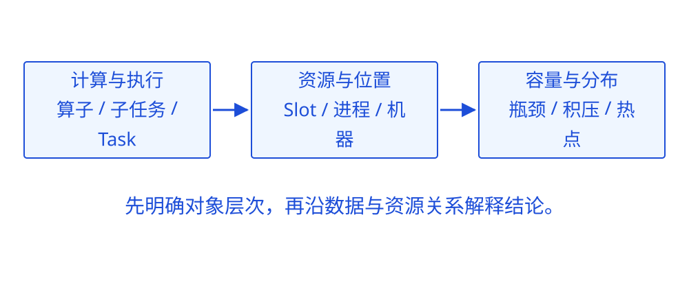</figure>

- 算子→并行子任务→Task与线程→Slot→TaskManager进程→机器。
- 每一层回答不同问题；性能结论要同时看容量与负载分布。

<!--
今天请大家把这条层次链指着读一遍。逻辑算子说明规则，子任务说明执行实例，Task与线程说明怎样连续执行，Slot说明资源分配，TaskManager进程和机器说明承载边界。再把记录沿keyBy路由到同一份历史，核对八个Task在四个Slot上的共享条件。最后，四千能力与四千五百输入解释积压，热点解释为什么总能力还可能闲置。下一讲我们保持这套执行模型，转向事件时间进度：机器已经运行，为什么一条晚到记录仍可能改变之前发布的结果？

[Sources]
- https://nightlies.apache.org/flink/flink-docs-release-2.3/docs/concepts/flink-architecture/
-->

---
class: course story-course
---
## 附录：独立部署与资源平台

<figure class="story-figure"></figure>

- Standalone 使用已有工作进程；Kubernetes、YARN 等可提供资源管理能力。
- 运行位置改变，作业的逻辑与按键语义仍需保持。

<!--
图中列出不同资源环境，是为了说明谁提供运行所需的工作进程。在独立部署中，Flink使用已经启动的TaskManager；在资源平台上，可以由平台按部署方式提供相应资源。平台提供运行与资源管理，过滤、分组和累计仍按同一份业务规则执行。无论放在哪个环境，源过滤链、按键累计与输出协议仍要清楚，资源也必须满足实际需求。方案中先选定运行环境，再写出实例放置、资源需求与容量验证条件。

[Sources]
- https://nightlies.apache.org/flink/flink-docs-release-2.3/docs/concepts/flink-architecture/
-->

---
class: course story-course
---
## 附录：网络交换也有成本

<figure class="story-figure"></figure>

- 专项估算：4000条/s×250B/条=1,000,000B/s，约1MB/s业务载荷。
- 实际还包含序列化、缓冲和协议成本；跨节点比例决定网络负载。

<!--
最后看一项可以独立估算的成本。每秒四千条，每条业务载荷二百五十字节，相乘是一百万字节每秒，按十进制约一MB每秒。这个数字只描述业务数据，不包括协议与序列化等开销。如果大部分记录留在本机，跨节点网络需求会不同；如果发生广播，复制数量也会改变负载。先写清消息大小和交换范围，再用实测吞吐与网络指标校正估算。

[Sources]
- https://nightlies.apache.org/flink/flink-docs-release-2.3/docs/concepts/flink-architecture/
- 教学构造数据：course/data/cases.json；金额单位为分。专项场景在页面注明参数。
-->
