# 时间、窗口与结果修正

> 第 3 次课 · 分布式实时计算

沿时间轴解释每次输出与修正

<!--
同学们，门店希望每十秒显示一次营业额。九秒发生的支付先到，七秒发生的却后到，屏幕该先显示多少？已经发布的十秒结果，还能不能改？今天我们始终沿着同一根时间轴看记录进入哪扇窗口、进度走到哪里、哪些历史还保留。我们会亲手把首窗口从14000修正到16500，再解释为什么另一条1000分进入补核路径，最后把时间选择和输出规则写成一份完整方案。

[Sources]
- https://nightlies.apache.org/flink/flink-docs-release-2.3/docs/concepts/time/
- https://nightlies.apache.org/flink/flink-docs-release-2.3/docs/dev/datastream/operators/windows/
- https://research.google/pubs/the-dataflow-model-a-practical-approach-to-balancing-correctness-latency-and-cost-in-massive-scale-unbounded-out-of-order-data-processing/
-->

---
class: course story-course
---
## 十秒营业额需要四项明确约定

<figure class="story-figure">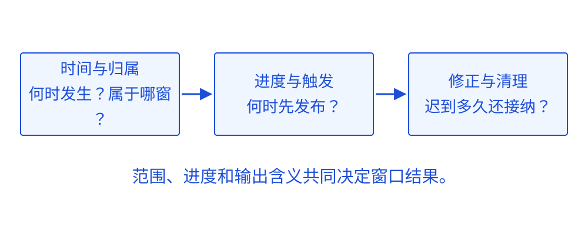</figure>

- 先确定用哪种时间、事件归哪扇窗，再确定何时输出、何时停止修正。
- 同一支付可能晚到；到达时刻不改变它原本的业务发生时刻。

<!--
大家看一笔七秒支付，它在系统十一秒时才被处理。若按业务发生时间，它属于零到十秒；若按处理时间，则落在十到二十秒。接下来即使选择了事件时间，还要回答旧窗口是否已经发布、是否仍保留、输出怎样更新。四项决定把“十秒统计”落实为计算对象、归属范围、发布时间和结果修正规则。请大家后面每看到一个数，都指出它由哪一种时间、哪一个窗口和哪一次输出产生。

[Sources]
- https://nightlies.apache.org/flink/flink-docs-release-2.3/docs/concepts/time/
- https://nightlies.apache.org/flink/flink-docs-release-2.3/docs/dev/datastream/operators/windows/
- https://research.google/pubs/the-dataflow-model-a-practical-approach-to-balancing-correctness-latency-and-cost-in-massive-scale-unbounded-out-of-order-data-processing/
-->

---
class: course story-course
---
## 事件时间与处理时间

<figure class="story-figure">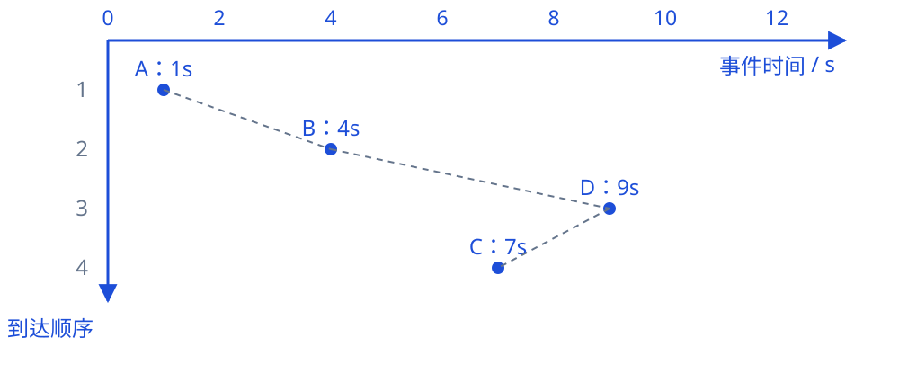</figure>

- <strong>事件时间</strong>是业务发生时间；<strong>处理时间</strong>是执行任务处理该记录的机器时间。
- 专项例：C 在7s发生，11s处理；网络等待使两者不同。

<!--
大家沿图的横轴看业务时间，纵向看收到的先后。A在一秒发生，B在四秒，D在九秒，最后到的C却发生在七秒。处理时间由运行系统当时的机器时钟给出，事件时间来自记录所描述的业务。等待、重试或链路延迟都会让处理时间晚于事件时间；金额仍由支付记录给出。请指着C说两遍：用事件时间判断它属于哪段营业，用处理时间判断系统何时处理它。选择哪一种，取决于业务要回答的问题。

[Sources]
- https://nightlies.apache.org/flink/flink-docs-release-2.3/docs/concepts/time/
- 教学构造数据：course/data/cases.json；金额单位为分。专项场景在页面注明参数。
-->

---
class: course story-course
---
## 同一记录的两种归窗结果

<figure class="story-figure"></figure>

- C：事件时间7s→[0,10s)；处理时间11s→[10,20s)。
- <strong>按业务发生时间统计</strong>时，要保留事件时间并处理乱序。

<!--
同样一笔C，我们把它放到两种时间口径下比较。按照七秒的业务时间，它属于第一扇十秒窗；按照十一秒的处理时刻，它进入第二扇。两种结果都可以由清晰规则得到，但回答不同问题：前者反映当时发生了多少支付，后者反映系统当时处理了多少记录。今天门店关心业务营业额，所以后续选事件时间。请在方案开头写明采用的时间口径，后续归窗与核对都按这一口径执行。

[Sources]
- https://nightlies.apache.org/flink/flink-docs-release-2.3/docs/concepts/time/
- https://nightlies.apache.org/flink/flink-docs-release-2.3/docs/dev/datastream/operators/windows/
- 教学构造数据：course/data/cases.json；金额单位为分。专项场景在页面注明参数。
-->

---
class: course story-course
layout: section
---
## 1 · 时间与窗口归属

<ol class="outline"><li class="current">时间与窗口归属</li><li>水位线与触发</li><li>迟到与结果修正</li><li>输出协议与方案设计</li></ol>

<!--
接下来先确定每条记录的窗口归属。我们用左闭右开的区间画清边界，再比较滚动、滑动和会话三种窗口。请把七秒与十秒两条记录分别放入区间，说明边界的读法。归属确定后，再看水位线怎样推动输出与清理。

[Sources]
- https://nightlies.apache.org/flink/flink-docs-release-2.3/docs/concepts/stateful-stream-processing/
-->

---
class: course story-course
---
## 窗口专项输入与金额

<figure class="story-figure">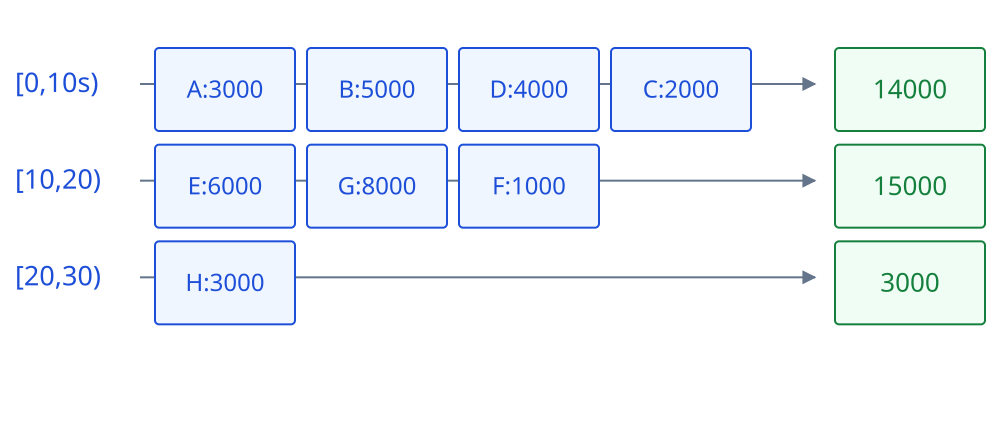</figure>

- 专项数据均为唯一成功事件：A1s/3000、B4s/5000、D9s/4000、C7s/2000。
- 后续 E12s/6000、G18s/8000、F16s/1000、H23s/3000；基础合计32000分。

<!--
这组记录保留了前面八笔金额，但使用A到H的短编号，让时间轴更容易读。请沿到达顺序读A、B、D、C，再读E、G、F、H，并比较相邻记录的事件时间。它们全部规定为不同身份的成功支付，今天只研究时间行为，不再混入失败过滤与重复去重。图中先按区间把基础事件排开，第一段四笔共14000，第二段三笔共15000，第三段一笔3000。下面会另加两条专门构造的迟到记录。

[Sources]
- https://nightlies.apache.org/flink/flink-docs-release-2.3/docs/dev/datastream/operators/windows/
- 教学构造数据：course/data/cases.json；金额单位为分。专项场景在页面注明参数。
-->

---
class: course story-course
---
## 两条迟到专项记录

<figure class="story-figure">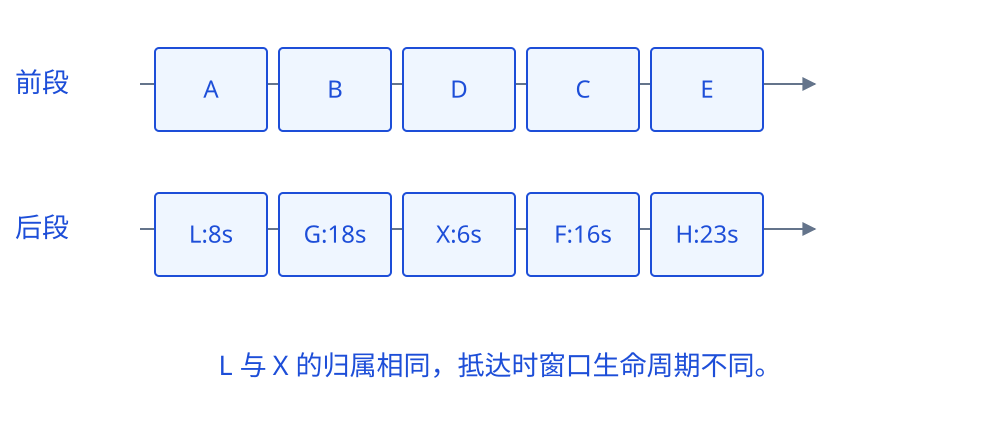</figure>

- E之后到 L：事件时间8s、2500分；G之后到 X：事件时间6s、1000分。
- 完整到达次序：<strong>A B D C E L G X F H</strong>；均为教学构造的唯一成功事件。

<!--
现在加入L和X。L发生在八秒，但要到十二秒的E之后才收到；X发生在六秒，却等十八秒的G之后才来。本专项的L和X均为唯一成功支付，分别用于观察迟到接纳与超出接纳边界的处理。我们刻意让它们处在不同的进度位置，看看同属零到十秒窗，为什么一条能修正，另一条要进入补核路径。请把这十个字母顺序抄下来，后面始终按这一顺序推进，不临时重排输入。

[Sources]
- https://nightlies.apache.org/flink/flink-docs-release-2.3/docs/dev/datastream/operators/windows/
- 教学构造数据：course/data/cases.json；金额单位为分。专项场景在页面注明参数。
-->

---
class: course story-course
---
## 滚动窗口使用左闭右开区间

<figure class="story-figure"></figure>

- <strong>滚动窗口</strong>大小10s，区间为[0,10)、[10,20)、[20,30)。
- 边界10s属于第二窗；每条事件属于一扇滚动窗口。

<!--
大家看窗口左边的方括号表示包含起点，右边的圆括号表示不包含终点。十秒恰好落在第二扇，不在第一扇；这样边界事件不会被两边同时统计，也不会被两边一起漏掉。零到十秒这一段可以记成零到一万毫秒，最大可包含时间戳是9999毫秒。这个一毫秒的细节稍后决定默认事件时间触发器怎样比较水位线。现在先沿轴把七秒和十秒各归一次窗。

[Sources]
- https://nightlies.apache.org/flink/flink-docs-release-2.3/docs/dev/datastream/operators/windows/
-->

---
class: course story-course
---
## 滚动窗口先列成员再求和

<figure class="story-figure">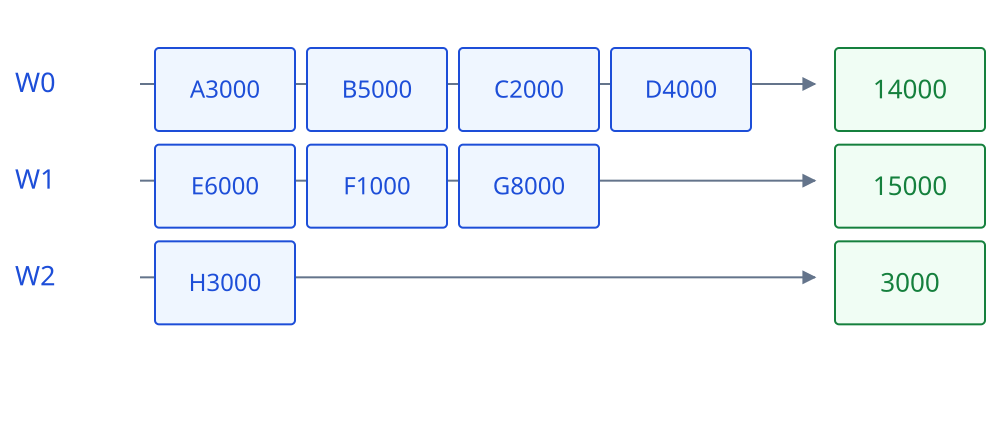</figure>

- W0={A,B,C,D}→14000；W1={E,F,G}→15000；W2={H}→3000。
- 本页输入为八条基础事件，按事件时间确定成员并计算各窗金额。

<!--
请先按事件时间找出每个窗口的成员，再相加核对金额。A、B、C、D都发生在十秒之前，所以第一窗14000；E十二秒、F十六秒、G十八秒属于第二窗15000；H二十三秒属于第三窗3000。这一页先用八条基础输入推演窗口分配，后面再加入L和X观察迟到处理。即使这些基础事件按不同顺序到来，只要被接纳，它们的区间归属不会改变。等下一部分有了进度，我们再决定哪一刻输出这些和。

[Sources]
- https://nightlies.apache.org/flink/flink-docs-release-2.3/docs/dev/datastream/operators/windows/
- 教学构造数据：course/data/cases.json；金额单位为分。专项场景在页面注明参数。
-->

---
class: course story-course
---
## 滑动窗口同时给出大小与步长

<figure class="story-figure"></figure>

- <strong>滑动窗口</strong>大小10s、步长5s；相邻窗口重叠5s。
- 事件7s同时属于[0,10)与[5,15)，同一事件可进入多扇窗。

<!--
如果业务希望每五秒看最近十秒，就把窗口起点每次向右移五秒。图中三条长条分别从零、五、十开始，彼此重叠。拿七秒事件沿竖线看，它同时穿过第一和第二条，所以会参与两份不同窗口的计算。滑动窗口允许同一事件贡献给多个重叠区间，每个区间各自形成结果。输出时必须用窗口边界区分结果，不能把相邻滑动窗金额当作不重叠营业额随意相加。

[Sources]
- https://nightlies.apache.org/flink/flink-docs-release-2.3/docs/dev/datastream/operators/windows/
-->

---
class: course story-course
---
## 滑动窗口的五个结果

<figure class="story-figure">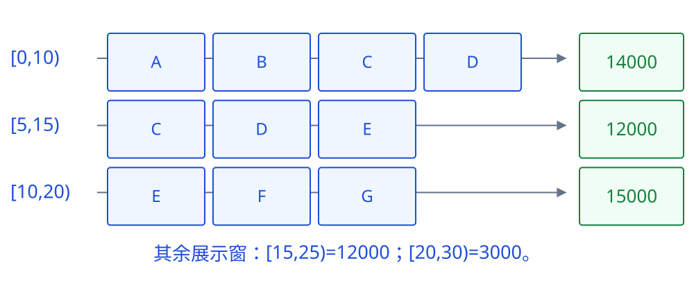</figure>

- 起点≥0的基础窗口：[0,10)14000，[5,15)12000，[10,20)15000。
- [15,25)12000，[20,30)3000；不同结果共享部分事件。

<!--
我们逐窗核对，五到十五秒包含七秒C、九秒D、十二秒E，金额二千加四千加六千是一万二；十五到二十五秒包含F、G、H，也是一万二，但成员不同。两个金额对应不同窗口，请分别标明窗口起止和成员。每个窗口都有自己的起止边界，本页只展示起点非负的几扇窗，更早起点可能形成的窗口没有列入这张结果清单。因此窗口起止属于结果身份，金额相同的两扇窗仍分别保存。

[Sources]
- https://nightlies.apache.org/flink/flink-docs-release-2.3/docs/dev/datastream/operators/windows/
- 教学构造数据：course/data/cases.json；金额单位为分。专项场景在页面注明参数。
-->

---
class: course story-course
---
## 会话窗口根据不活跃间隔形成

<figure class="story-figure">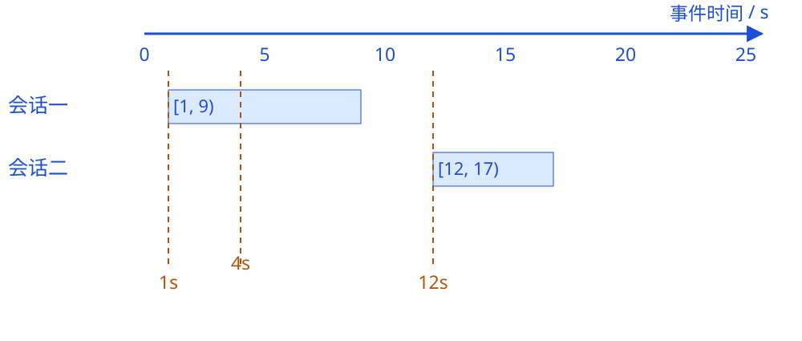</figure>

- <strong>会话窗口</strong>以5s间隔判断活动是否连续，边界随事件形成。
- 专项：1s与4s先合为[1,9)；12s形成另一段[12,17)。

<!--
识别一次连续访问时，可以按相邻事件的间隔划分会话。会话窗口先给每个事件一个持续五秒的候选区间，再把相交的区间合并。图中一秒事件给出一到六，四秒事件给出四到九，两者相交，形成一到九；十二秒给出十二到十七，与前面分开。会话起止由事件时间和间隔共同决定，边界随成员变化。我们这一组时间故意避开恰好相隔五秒的边界，重点观察合并机制。

[Sources]
- https://nightlies.apache.org/flink/flink-docs-release-2.3/docs/dev/datastream/operators/windows/
- 教学构造数据：course/data/cases.json；金额单位为分。专项场景在页面注明参数。
-->

---
class: course story-course
---
## 后到的事件可以连接两段会话

<figure class="story-figure">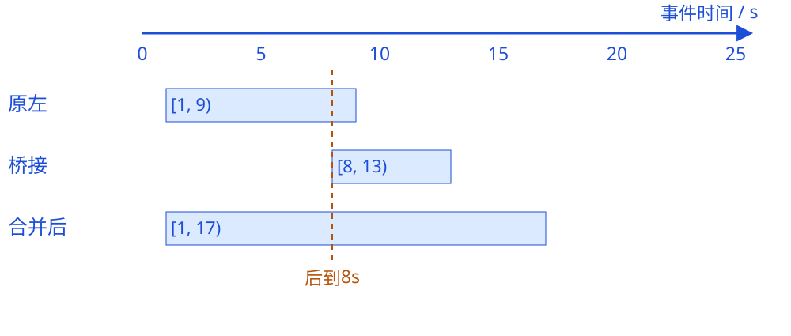</figure>

- 后到8s事件形成[8,13)，同时连接[1,9)与[12,17)。
- 三段合并为[1,17)；仍须满足窗口状态未清理等接纳条件。

<!--
现在八秒的事件后到了，它自己的候选区间是八到十三。请沿这条橙色竖线和新增区间看：左边碰到原来一到九，右边碰到十二到十七，于是两段原本分开的会话被连成一段。合并的前提是相关会话仍可接纳，所需历史状态尚未清理。若旧结果已经对外发布，合并还会影响结果身份和修正，所以下游必须理解更新协议。会话窗口因此比固定窗口多了“范围本身也会变化”这一层关系。

[Sources]
- https://nightlies.apache.org/flink/flink-docs-release-2.3/docs/dev/datastream/operators/windows/
- 教学构造数据：course/data/cases.json；金额单位为分。专项场景在页面注明参数。
-->

---
class: course story-course
---
## 归窗练习：边界与重叠

- 专项事件：10s/2000分，14s/3000分；均接纳。
- 滚动大小10s：列各自所属窗；滑动大小10s、步长5s：列共同参与的窗。
- 只讨论起点≥0的窗口；按窗口分别求和，不合加重叠结果。

<!--
现在请大家在纸上画零、五、十、十五、二十这些刻度。第一条正好十秒，按左闭右开归入起点十秒的滚动窗；第二条是十四秒。先做滚动分配，再做滑动分配，把每条事件属于的窗口列出来，最后才求金额。请分别写出各滑动窗口的成员与金额，标明同一事件贡献给了哪些结果。画完后用竖线穿过窗口条，看自己有没有漏掉一扇重叠窗。

[Sources]
- https://nightlies.apache.org/flink/flink-docs-release-2.3/docs/dev/datastream/operators/windows/
- 教学构造数据：course/data/cases.json；金额单位为分。专项场景在页面注明参数。
-->

---
class: course story-course
---
## 归窗答案：两个滑动窗各得五千

<figure class="story-figure">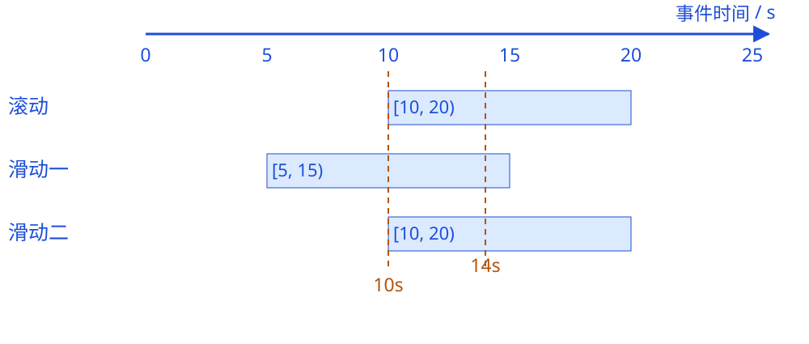</figure>

- 滚动：[10,20)得到5000；[0,10)不含10s。
- 滑动：[5,15)与[10,20)均含两条，各5000；这是两个不同范围。

<!--
十秒在零到十的右边界，被排除；它进入十到二十。十四秒也在同一滚动窗，因此五千。滑动时，五到十五与十到二十都包含这两条，所以各有五千。请问把两窗相加得到一万，能不能说总共收到一万元？不能，因为同样的两条被按需求放进两份范围重叠的结果。请在答案旁写出每个结果的区间，这一项比只写数值更能证明你理解了窗口的计算对象。

[Sources]
- https://nightlies.apache.org/flink/flink-docs-release-2.3/docs/dev/datastream/operators/windows/
- 教学构造数据：course/data/cases.json；金额单位为分。专项场景在页面注明参数。
-->

---
class: course story-course
layout: section
---
## 2 · 水位线与触发

<ol class="outline"><li>时间与窗口归属</li><li class="current">水位线与触发</li><li>迟到与结果修正</li><li>输出协议与方案设计</li></ol>

<!--
我们现在知道每条事件属于哪一窗，但输入没有自然结束。系统需要用一个单调前进的事件时间进度，决定什么时候先发布结果。这就是水位线。水位线是按生成规则作出的事件时间进度判断；之后到达的旧记录按迟到策略处理。接下来每一步都同时显示窗口状态、水位线和输出。

[Sources]
- https://nightlies.apache.org/flink/flink-docs-release-2.3/docs/concepts/stateful-stream-processing/
-->

---
class: course story-course
---
## 水位线表示事件时间处理进度

<figure class="story-figure"></figure>

- <strong>水位线（Watermark）</strong>是流中的事件时间进度标记，沿计算传播且不倒退。
- 它允许算子推进事件时间定时器；更早事件仍可能随后到达。

<!--
图中红线以毫秒标出算子的事件时间进度，向右表示进度推进。窗口根据这条进度判断是否到达触发时刻。请大家问一个关键问题：红线过了十秒，八秒事件是不是物理上就不可能到来？仍可能，网络排队或输入恢复都可能让它后来才到。水位线让系统在完整性和等待之间作出明确判断，后到记录再按允许迟到和补核规则处理。

[Sources]
- https://nightlies.apache.org/flink/flink-docs-release-2.3/docs/dev/datastream/event-time/generating_watermarks/
- https://nightlies.apache.org/flink/flink-docs-release-2.3/docs/dev/datastream/operators/windows/
-->

---
class: course story-course
---
## 有界乱序水位线的计算条件

<figure class="story-figure">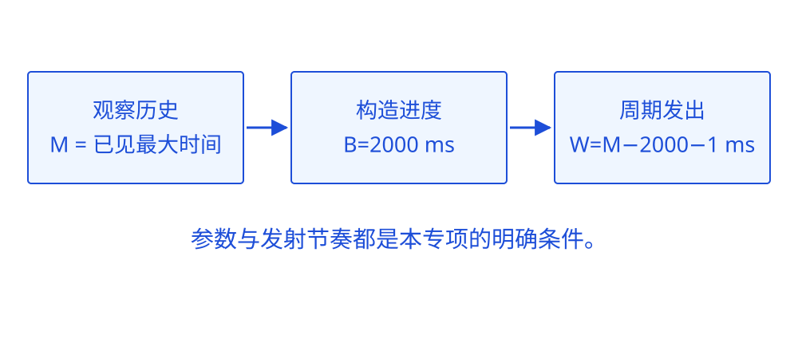</figure>

- 专项：观察最大事件时间M；乱序界B=2000ms，周期水位线W=M−B−1ms。
- 为便于逐步演算，本例每处理一条记录后立即执行一次周期发射。

<!--
我们选用Flink有界乱序生成器的规则。它记住目前看到的最大事件时间M，再减去设定的两秒乱序界和一毫秒，得到周期发出的水位线。本例为逐条推演，在每条记录后安排一次周期发射；实际周期由生成器配置决定。这个两秒参数控制水位线相对已见最大事件时间的滞后；更老的后到记录交给迟到策略处理。M只增不减，因此后到七秒不会把已经由九秒建立的进度拉回去。

[Sources]
- https://nightlies.apache.org/flink/flink-docs-release-2.3/docs/dev/datastream/event-time/generating_watermarks/
- https://nightlies.apache.org/flink/flink-docs-release-2.3/docs/../api/java/org/apache/flink/api/common/eventtime/BoundedOutOfOrdernessWatermarks.html
- 教学构造数据：course/data/cases.json；金额单位为分。专项场景在页面注明参数。
-->

---
class: course story-course
---
## 窗口触发与水位线比较最大时间戳

<figure class="story-figure">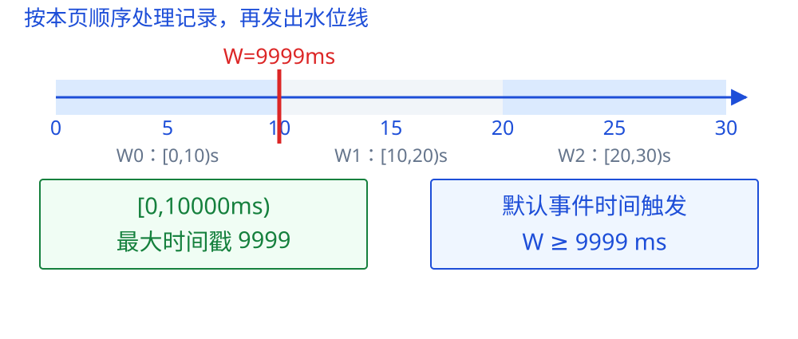</figure>

- [0,10000ms)最大时间戳9999ms；默认事件时间触发器在W≥9999时触发。
- <strong>触发</strong>决定输出；是否清理状态还取决于窗口生命周期。

<!--
第一扇窗右端是一万毫秒但不包含它，所以最后可包含的毫秒是9999。默认事件时间触发器等水位线到达这个最大时间戳，就发出窗口结果。请大家在图上分别标出输出和清理：窗口先发布结果，允许迟到期间继续保留状态供修正。我们先画第一次触发，下一部分再画清理。请在图上写出触发点9999和清理点14999，分别说明它们控制的动作。

[Sources]
- https://nightlies.apache.org/flink/flink-docs-release-2.3/docs/dev/datastream/operators/windows/
-->

---
class: course story-course
---
## 步骤一：A 到达，状态先增加

<figure class="story-figure"></figure>

- A：1000ms、3000分；M=1000，W=−1001ms。
- W0=3000；进度尚未到9999，暂不输出。

<!--
我们从第一条开始。A属于首窗口，先把它的三千放进窗口状态；然后按本例约定发周期水位线，最大事件时间一千，减两千再减一，得到负一千零一。这里的负数表示进度还在课堂时间起点之前，单位仍是毫秒。请分别指出输入A、窗口里的三千分和红色水位线，说出这次输入怎样改变状态与进度。

[Sources]
- https://nightlies.apache.org/flink/flink-docs-release-2.3/docs/dev/datastream/event-time/generating_watermarks/
- https://nightlies.apache.org/flink/flink-docs-release-2.3/docs/dev/datastream/operators/windows/
- 教学构造数据：course/data/cases.json；金额单位为分。专项场景在页面注明参数。
-->

---
class: course story-course
---
## 步骤二：B 到达，先得到八千

<figure class="story-figure"></figure>

- B：4000ms、5000分；W0=8000，M=4000，W=1999ms。
- 本例主流程仍等待事件时间触发；提前输出另页比较。

<!--
B带来五千分，窗口从三千到八千。最大事件时间推进到四千，周期水位线到一千九百九十九，还远没到首窗的触发点。本页采用默认事件时间触发器，两条记录先更新窗口状态，达到主触发点时再发布。业务如果希望先看一个临时数，可以另设提前触发策略，但那是另一项明确选择。我们稍后会在完全相同输入上比较提前8000、准时14000与迟到16500。

[Sources]
- https://nightlies.apache.org/flink/flink-docs-release-2.3/docs/dev/datastream/event-time/generating_watermarks/
- https://nightlies.apache.org/flink/flink-docs-release-2.3/docs/dev/datastream/operators/windows/
- 教学构造数据：course/data/cases.json；金额单位为分。专项场景在页面注明参数。
-->

---
class: course story-course
---
## 步骤三：D 先到，C 后到

<figure class="story-figure"></figure>

- D9s使M=9000、W=6999；随后C7s把状态12000→14000。
- C 比已见最大时间早，但没有早于当前进度；水位线保持6999ms。

<!--
先收到九秒D，状态八千加四千到一万二，进度到6999毫秒。再收到七秒C，它比九秒早，所以是乱序，但七千毫秒仍在当前水位线之后，窗口可以接纳。C再加两千得到一万四，最大时间仍九千，红线也保持6999。乱序相对已见最大事件时间判断，迟到相对当前水位线判断；C的七千毫秒仍在当前水位线之后。图中两个数字一起看，才知道这条记录处于什么位置。

[Sources]
- https://nightlies.apache.org/flink/flink-docs-release-2.3/docs/dev/datastream/event-time/generating_watermarks/
- https://nightlies.apache.org/flink/flink-docs-release-2.3/docs/dev/datastream/operators/windows/
- 教学构造数据：course/data/cases.json；金额单位为分。专项场景在页面注明参数。
-->

---
class: course story-course
---
## 步骤四：E 推动首窗口输出

<figure class="story-figure"></figure>

- E12s/6000属于第二窗；M=12000，随后W=9999ms。
- W0默认触发输出<strong>14000分</strong>；W1已保存6000分。

<!--
E的六千进入第二窗，同时把已见最大时间推进到十二秒，从而推动第一窗触发。紧接着发出的9999毫秒水位线恰好达到首窗最大时间戳，于是首窗输出一万四。请大家指出这条因果链：E更新的是第二窗，它带来的进度却让第一窗发布。若只看输入金额与输出金额，会误以为六千怎么突然变一万四；把状态和水位线分开画，就能知道输出来自早已保存的首窗历史。

[Sources]
- https://nightlies.apache.org/flink/flink-docs-release-2.3/docs/dev/datastream/event-time/generating_watermarks/
- https://nightlies.apache.org/flink/flink-docs-release-2.3/docs/dev/datastream/operators/windows/
- 教学构造数据：course/data/cases.json；金额单位为分。专项场景在页面注明参数。
-->

---
class: course story-course
---
## 双输入进度取活跃输入的最小值

<figure class="story-figure"></figure>

- A进度12000ms，B进度7000ms；双输入算子进度为7000ms。
- 取最小值使算子进度同时受各活跃输入约束。

<!--
现在把一条输入变成两条。A已经到十二秒，B只到七秒，算子能直接用十二秒触发所有旧窗口吗？不能，因为B还没有提供相应进度。算子对活跃输入取最小值，所以当前是七秒。请沿两条箭头看，它们在同一个算子处汇合，最终进度受到较慢一侧限制。请分别标出各输入通道进度与汇合后的算子进度，汇合值由活跃输入的最小值决定。

[Sources]
- https://nightlies.apache.org/flink/flink-docs-release-2.3/docs/dev/datastream/event-time/generating_watermarks/
- https://nightlies.apache.org/flink/flink-docs-release-2.3/docs/concepts/time/
-->

---
class: course story-course
---
## 空闲输入可以暂时退出最小值计算

<figure class="story-figure"></figure>

- B长时间无记录且被判为空闲；A=12000时，算子可推进到12000ms。
- 空闲阈值按实际输入特征设置；恢复后的旧记录按迟到策略处理。

<!--
B长期无业务时，它的七秒进度会持续限制最小值。满足配置的空闲超时后，系统将B移出活跃输入，算子进度便可跟随A到十二秒。请大家比较阈值过短的情况：一次短暂停顿就被判为空闲，恢复侧的旧记录可能落后于已推进的水位线。因此方案需同时给出空闲阈值，以及恢复后旧记录的接纳或补核规则。

[Sources]
- https://nightlies.apache.org/flink/flink-docs-release-2.3/docs/dev/datastream/event-time/generating_watermarks/
-->

---
class: course story-course
---
## 空闲输入恢复不让进度倒退

<figure class="story-figure"></figure>

- 算子已到12000；B恢复时报告9000，算子仍保持12000。
- 待A=16000、B=14000，汇合进度可继续到14000ms。

<!--
B恢复以后，第一份进度可能还只有九秒。算子已经发出过十二秒，不能再把过去告诉下游的进度撤回，所以保持十二秒，等待恢复侧赶上。随后A十六、B十四，最小值十四超过之前十二，算子再继续推进。请问此时B送来六秒事件会怎样？它不会把自己的事件时间改成十二秒，要按所归窗口的保留与迟到规则处理。这样我们同时保留了两条事实：进度不倒退，旧记录仍可能回来。

[Sources]
- https://nightlies.apache.org/flink/flink-docs-release-2.3/docs/dev/datastream/event-time/generating_watermarks/
- https://nightlies.apache.org/flink/flink-docs-release-2.3/docs/concepts/time/
-->

---
class: course story-course
---
## 多输入练习：哪一步能触发首窗

- 首窗最大时间戳9999ms；A=13000、B=8000，均活跃。
- 随后B推进到10000；分别写算子进度及首窗是否触发。
- 另问：若B被合法判为空闲而A仍13000，会怎样？

<!--
请大家画两条输入和一条汇合后的红线。先取活跃输入最小值八千，判断是否达到9999；再让B前进到一万，重新比较。最后单独标出B被判空闲的条件，再按新的活跃输入集合计算。答案写出活跃输入集合、取最小值的过程，以及结果是否达到触发点。请同桌沿你的箭头说明哪一侧提供了推进所需的证据。

[Sources]
- https://nightlies.apache.org/flink/flink-docs-release-2.3/docs/dev/datastream/event-time/generating_watermarks/
- https://nightlies.apache.org/flink/flink-docs-release-2.3/docs/dev/datastream/operators/windows/
-->

---
class: course story-course
---
## 多输入答案：先等慢输入，再推进

<figure class="story-figure"></figure>

- min(13000,8000)=8000，不触发；B到10000后算子到10000，触发。
- 若B已判空闲，仅按活跃A可到13000；恢复后仍不倒退。

<!--
我们核对第一步，八千没有到9999，所以窗口继续等。第二步B到一万，两条活跃输入都越过了首窗最大时间戳，算子可到一万并触发。空闲是第三种条件，如果B已经被合法排除，进度可跟随A到一万三。请大家把答案中每一种推进的依据圈出来：要么慢输入真正前进，要么空闲判定改变参与集合。它们都不能由最快分区单方面宣称完成所有输入历史。

[Sources]
- https://nightlies.apache.org/flink/flink-docs-release-2.3/docs/dev/datastream/event-time/generating_watermarks/
- https://nightlies.apache.org/flink/flink-docs-release-2.3/docs/dev/datastream/operators/windows/
-->

---
class: course story-course
layout: section
---
## 3 · 迟到与结果修正

<ol class="outline"><li>时间与窗口归属</li><li>水位线与触发</li><li class="current">迟到与结果修正</li><li>输出协议与方案设计</li></ol>

<!--
第一窗已经发布一万四，但故事还没有结束。我们会让八秒的L后到，再让更旧的X更晚出现。两条都属于首窗，区别在于它们到来时状态是否还保留。请大家一直跟着红色进度线与绿色窗口状态看，理解发布、修正和清理分别发生在哪一步。

[Sources]
- https://nightlies.apache.org/flink/flink-docs-release-2.3/docs/concepts/stateful-stream-processing/
-->

---
class: course story-course
---
## 允许迟到决定窗口保留多久

<figure class="story-figure"></figure>

- 首窗maxTimestamp=9999ms；允许迟到5000ms，清理点14999ms。
- 默认事件时间触发后保留状态；<strong>W≥14999时清理</strong>该窗。

<!--
我们给第一窗多保留五秒事件时间的修正机会。首次触发点9999，再加5000，清理点是14999毫秒。这五秒加在窗口最大时间戳上，清理由水位线达到14999毫秒触发。只要进度没到清理点，后到但属于本窗的事件还有机会进入保存的历史。请大家在时间轴标两条边界：先发布，再清理。把这两处合成一个“窗口关闭”会掩盖迟到修正为什么还能成立。

[Sources]
- https://nightlies.apache.org/flink/flink-docs-release-2.3/docs/dev/datastream/operators/windows/
-->

---
class: course story-course
---
## 步骤五：L 使首窗从一万四到一万六千五

<figure class="story-figure"></figure>

- L：8000ms、2500分；到来时W=9999<14999，窗口仍在。
- 状态14000→16500；默认事件时间触发器产生迟到更新 <strong>16500分</strong>。

<!--
现在L进来，它发生在八秒，落后于当前9999毫秒进度，但第一窗还没有清理，所以可以加到保存的一万四上，得到一万六千五百。默认事件时间触发器看到这个窗口已过主触发点，会再发一次结果。这次输出是同一窗口的新累计值16500，下游用它替换旧值14000。真正新增的业务贡献只有2500。我们后面选择输出协议时，就要让数据库知道这条消息怎样修正同一个结果。

[Sources]
- https://nightlies.apache.org/flink/flink-docs-release-2.3/docs/dev/datastream/operators/windows/
- 教学构造数据：course/data/cases.json；金额单位为分。专项场景在页面注明参数。
-->

---
class: course story-course
---
## 步骤六：G 推动进度并清理首窗

<figure class="story-figure">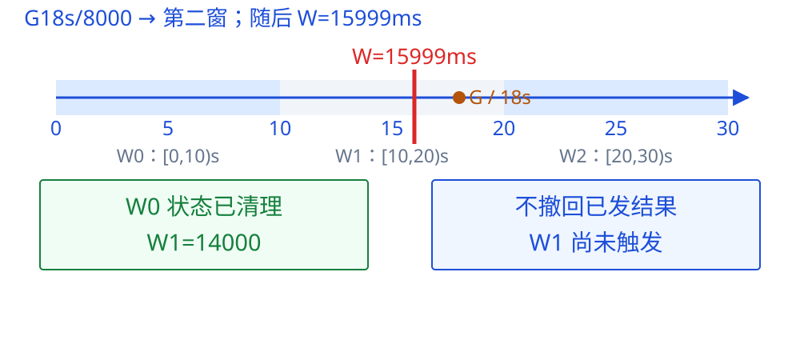</figure>

- G18s/8000进入第二窗；M=18000，随后W=15999ms。
- 15999≥14999：删除首窗状态；第二窗此时14000分。

<!--
G的八千进入第二窗，那里原有E的六千，所以状态到一万四。G随后把进度推进到15999，已经超过首窗14999清理点，系统删除首窗为迟到修正保留的历史。清理删除在线窗口状态，已经发布的16500继续保留在结果端。第二窗还没达到19999触发点，所以此时不输出它。每个窗口都有自己的触发与清理边界，不能看到一次进度推进就把所有窗口一起处理成同一状态。

[Sources]
- https://nightlies.apache.org/flink/flink-docs-release-2.3/docs/dev/datastream/operators/windows/
- 教学构造数据：course/data/cases.json；金额单位为分。专项场景在页面注明参数。
-->

---
class: course story-course
---
## 步骤七：X 无法再更新已清理窗口

<figure class="story-figure"></figure>

- X：6000ms、1000分；到来时W=15999，首窗状态已清理。
- 本例配置迟到侧输出：X进入补核流，在线首窗仍为16500分。

<!--
X现在才到，六秒仍归首窗，但我们已经没有为它保留首窗状态。配置迟到侧输出后，X保留原有事件时间和窗口归属，进入单独的补核路径。请大家在图上圈出X的一千分：它是成功支付，因超过在线窗口接纳边界而进入补核。业务若要求后续账务完整，就要用补核流与归档重算形成对应修正，不能把侧输出当作自动解决了对账。

[Sources]
- https://nightlies.apache.org/flink/flink-docs-release-2.3/docs/dev/datastream/operators/windows/
- 教学构造数据：course/data/cases.json；金额单位为分。专项场景在页面注明参数。
-->

---
class: course story-course
---
## 步骤八：F、H 与有界输入结束

<figure class="story-figure">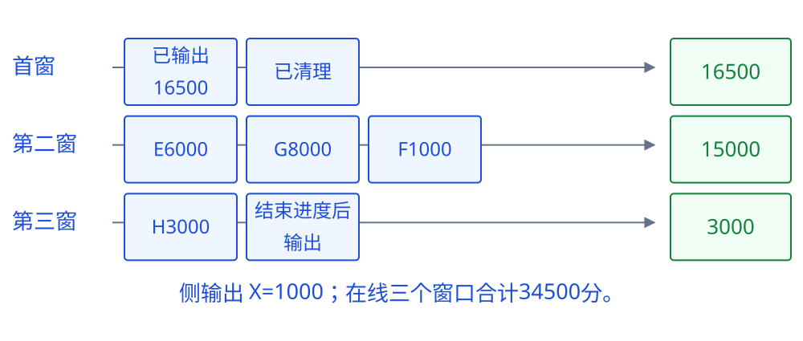</figure>

- F16s补入第二窗到15000；H23s使W=20999，第二窗输出15000。
- 本专项有界输入结束后发出最终水位线，第三窗输出 3000 分。

<!--
最后F虽然晚于G到达，但十六秒仍被第二窗接纳，一千加进去得到一万五。H发生在二十三秒，三千进入第三窗，随后水位线20999使第二窗发布一万五。第三窗还要等更后面的进度；本题作为有界专项演算，在输入结束时发最终水位线，才把它的三千发出来。持续订阅的无界输入需等待后续水位线推进；空闲检测按配置处理。现在我们已经解释完十条输入的每一种去向。

[Sources]
- https://nightlies.apache.org/flink/flink-docs-release-2.3/docs/dev/datastream/operators/windows/
- 教学构造数据：course/data/cases.json；金额单位为分。专项场景在页面注明参数。
-->

---
class: course story-course
---
## 在线结果与完整归档相差哪一笔

<figure class="story-figure">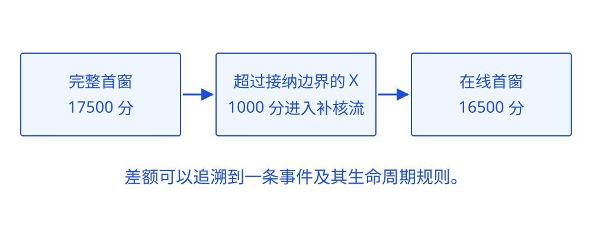</figure>

- 完整首窗：A+B+C+D+L+X=17500；在线首窗16500，差X的1000。
- 完整全部35500；在线34500，另有侧输出1000，可用于补核。

<!--
请大家把完整归档与在线接纳结果并排。两者都承认X是一笔成功支付，但在线窗口为有限等待设了清理边界，X到来太晚，因此没有进入首窗16500。完整归档重新按事件时间计算，则首窗17500，总额35500。差额恰好是侧输出X的一千，这让业务能追溯和补核。核对差额时，将在线已接纳集合与完整归档集合并列，X正是两者相差的那条记录。

[Sources]
- https://nightlies.apache.org/flink/flink-docs-release-2.3/docs/dev/datastream/operators/windows/
- 教学构造数据：course/data/cases.json；金额单位为分。专项场景在页面注明参数。
-->

---
class: course story-course
---
## 迟到练习：把保留期延长到八秒

- 保持同一到达序列，只把允许迟到从5000改成8000ms。
- 计算首窗新清理点；判断X到来时能否接纳及首窗新输出。
- 说明代价：哪份状态需要保留更久？

<!--
先标出参数变化影响的清理点，再检查X到达时原窗口状态是否仍在。首窗触发点不变，改变的是它的清理点。用9999加8000，再和X到来前的15999比较，决定那一千现在走哪条路。更长接纳期让旧窗口状态保留更久，需要更多状态存储。请在图上同时修改边界和X的箭头，证明你知道规则变化具体影响了什么。

[Sources]
- https://nightlies.apache.org/flink/flink-docs-release-2.3/docs/dev/datastream/operators/windows/
- 教学构造数据：course/data/cases.json；金额单位为分。专项场景在页面注明参数。
-->

---
class: course story-course
---
## 迟到答案：清理点17999，X进入修正

<figure class="story-figure"></figure>

- 9999+8000=17999；X到来时15999<17999，首窗状态仍在。
- 16500+1000=17500；之后进度到20999才清理，保留状态更久。

<!--
答案是X可以接纳，首窗从16500修正到17500。依据是X到来前水位线15999尚未达到清理点17999，原状态仍可使用。等H把水位线推到20999，首窗才清理。第一次准时输出仍为14000，L后修正为16500；延长保留期后，X还可继续修正到17500。我们据此能清楚解释结果变更，也能估算需要保留更多历史的资源代价。

[Sources]
- https://nightlies.apache.org/flink/flink-docs-release-2.3/docs/dev/datastream/operators/windows/
- 教学构造数据：course/data/cases.json；金额单位为分。专项场景在页面注明参数。
-->

---
class: course story-course
layout: section
---
## 4 · 输出协议与方案设计

<ol class="outline"><li>时间与窗口归属</li><li>水位线与触发</li><li>迟到与结果修正</li><li class="current">输出协议与方案设计</li></ol>

<!--
窗口不只可能输出一次。接下来我们让同一份结果先临时发布、再准时发布、再迟到修正，重点看每条输出究竟代表什么。下游到底相加、替换还是撤回旧值，必须和上游约定一致。最后把时间参数与这些输出规则一起写成方案。

[Sources]
- https://nightlies.apache.org/flink/flink-docs-release-2.3/docs/concepts/stateful-stream-processing/
-->

---
class: course story-course
---
## 提前、准时与迟到是输出时机

<figure class="story-figure">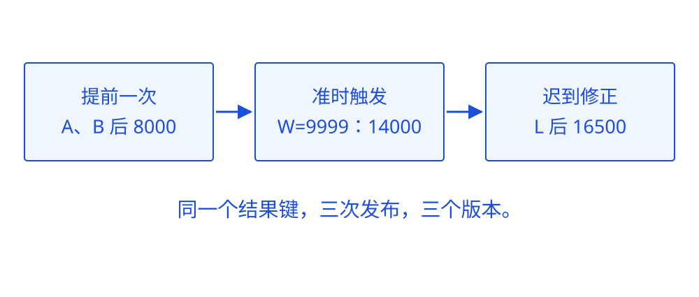</figure>

- 专项提前策略：仅在A、B之后提前一次8000；准时14000；L之后16500。
- 提前输出需扩展触发逻辑；默认事件时间触发器按水位线触发。

<!--
为了让业务更早看到趋势，我们可以另外规定只在前两条A、B后提前输出一次八千。等事件时间进度到首窗边界，准时输出一万四；L后再给一万六千五。Flink实现需扩展触发逻辑以支持这次提前输出，并保留事件时间主触发和迟到更新。这里“准时”指进度达到窗口主触发点。三个数对应同一用户与同一窗口的不同版本，下游按结果键更新版本。

[Sources]
- https://research.google/pubs/the-dataflow-model-a-practical-approach-to-balancing-correctness-latency-and-cost-in-massive-scale-unbounded-out-of-order-data-processing/
- https://nightlies.apache.org/flink/flink-docs-release-2.3/docs/dev/datastream/operators/windows/
- 教学构造数据：course/data/cases.json；金额单位为分。专项场景在页面注明参数。
-->

---
class: course story-course
---
## 丢弃式输出只表达新增部分

<figure class="story-figure"></figure>

- Dataflow丢弃式累积：已输出部分不再累入下一窗格输出。
- 对应贡献依次8000、6000、2500，下游按同一结果键相加得16500。

<!--
我们先看Dataflow中的丢弃式累积思路，重点是每次窗格输出什么。第一次报八千，后面的C、D形成新增六千，L再带来两千五，下游把这些互不重复的贡献加起来得到16500。丢弃式累积在每次输出后清除该窗格的计算贡献，窗口生命周期信息按规则保留。Flink实现需配合触发器与状态逻辑表达这一语义。先把消息语义说清楚，再讨论实现。

[Sources]
- https://research.google/pubs/the-dataflow-model-a-practical-approach-to-balancing-correctness-latency-and-cost-in-massive-scale-unbounded-out-of-order-data-processing/
- https://nightlies.apache.org/flink/flink-docs-release-2.3/docs/dev/datastream/operators/windows/
- 教学构造数据：course/data/cases.json；金额单位为分。专项场景在页面注明参数。
-->

---
class: course story-course
---
## 累积式输出表达当前完整值

<figure class="story-figure"></figure>

- 输出8000、14000、16500，分别是当时的全部已接纳贡献。
- 下游按（业务键，窗口）覆盖旧版本，保存最新累计值。

<!--
同样输入也可以每次报完整累计值。第一次八千，第二次包含原来八千和新增六千，因此是一万四；最后再包含L，得到一万六千五。请大家把第一份八千在第二份里圈出来，就能看出两次输出共享了历史。如果下游按结果键覆盖，最后就是16500；如果当成三笔新增营业额相加，就把旧贡献重复计入。输出格式中带上结果身份与更新语义，才有办法让两个系统合作。

[Sources]
- https://research.google/pubs/the-dataflow-model-a-practical-approach-to-balancing-correctness-latency-and-cost-in-massive-scale-unbounded-out-of-order-data-processing/
- https://nightlies.apache.org/flink/flink-docs-release-2.3/docs/dev/table/concepts/dynamic_tables/
- 教学构造数据：course/data/cases.json；金额单位为分。专项场景在页面注明参数。
-->

---
class: course story-course
---
## 把累计输出相加会多算二万二千

<figure class="story-figure">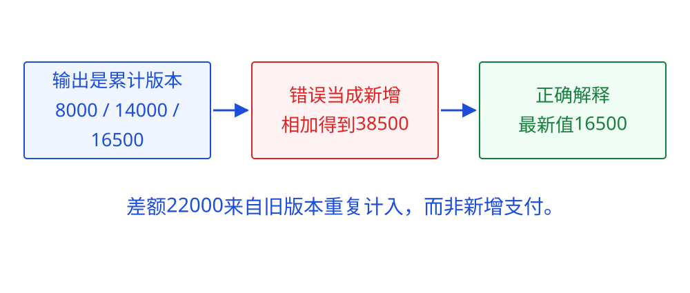</figure>

- 错误追加求和：8000+14000+16500=38500；正确最新值为16500。
- 多出的22000正是前两个版本被再次计入的贡献。

<!--
现在故意让下游把每个累计结果都当成新增金额。八千加一万四再加一万六千五，得到三万八千五。这个结果多出的两万二千，恰好来自前两份旧版本的再次计入。这里的多算来自输出版本重叠：上游每个事件只接纳一次，下游却重复累计了旧版本的贡献。因此方案需分别定义输入事件身份、结果身份和版本修正规则。

[Sources]
- https://research.google/pubs/the-dataflow-model-a-practical-approach-to-balancing-correctness-latency-and-cost-in-massive-scale-unbounded-out-of-order-data-processing/
- https://nightlies.apache.org/flink/flink-docs-release-2.3/docs/dev/table/concepts/dynamic_tables/
- 教学构造数据：course/data/cases.json；金额单位为分。专项场景在页面注明参数。
-->

---
class: course story-course
---
## 撤回旧值，再给出新值

<figure class="story-figure"></figure>

- 模型序列：+8000，−8000，+14000，−14000，+16500。
- 带符号贡献合计16500；撤回必须指向相同结果对象。

<!--
还有一种表达，是先撤回旧结果再发布新结果。图中第一次加八千，更新时先减八千再加一万四，下一次先减一万四再加一万六千五。这里的负号表示撤回先前结果；业务退款应通过独立退款事件表达。两者若混淆，业务账本会把系统更新误当成真实交易。实现里会用变更消息类型说明插入、删除或更新；第四讲我们进一步把这些消息如何改变动态表画出来。

[Sources]
- https://research.google/pubs/the-dataflow-model-a-practical-approach-to-balancing-correctness-latency-and-cost-in-massive-scale-unbounded-out-of-order-data-processing/
- https://nightlies.apache.org/flink/flink-docs-release-2.3/docs/dev/table/concepts/dynamic_tables/
- 教学构造数据：course/data/cases.json；金额单位为分。专项场景在页面注明参数。
-->

---
class: course story-course
---
## Flink 的触发、状态与输出协议

<figure class="story-figure"></figure>

- 窗口分配确定成员；Trigger确定输出时机；状态函数确定累计内容。
- 下游写法确定修正如何落地；Dataflow模型与Flink机制逐项对应。

<!--
我们把抽象模型落到Flink。窗口分配器决定一条事件属于哪一窗，Trigger决定什么时候请求计算与输出，聚合状态保存已经接纳的贡献，Sink再按约定保存结果。默认事件时间触发器与允许迟到可以产生主输出和迟到更新，但自定义提前策略需要自己明确实现。方案需写清触发策略、状态保留和Sink的版本更新规则。请沿这四个位置解释8000、14000、16500分别由哪项规则控制，才能写出可实现的方案。

[Sources]
- https://nightlies.apache.org/flink/flink-docs-release-2.3/docs/dev/datastream/operators/windows/
- https://research.google/pubs/the-dataflow-model-a-practical-approach-to-balancing-correctness-latency-and-cost-in-massive-scale-unbounded-out-of-order-data-processing/
- https://nightlies.apache.org/flink/flink-docs-release-2.3/docs/dev/table/concepts/dynamic_tables/
-->

---
class: course story-course
---
## 时间推演图的绘制步骤

<figure class="story-figure"></figure>

- 先画事件时间轴与窗口，再标到达次序、水位线和状态变化。
- 输出箭头旁写结果键、数值与版本；清理处画状态退出边界。

<!--
大家画时间机制时，先固定横轴与单位，画窗口区间；再按到达顺序逐步加入记录，每一步标当前水位线。窗口状态用同一位置展示，变动时只突出新增贡献。最后在触发和清理位置分别加符号，输出处写清是完整值还是增量。这样别人沿图就能回答一条八秒消息为什么在这一刻还接纳、在另一刻却进入侧输出。这类图称为时间与输出演进图，横轴表达事件时间或进度。

[Sources]
- https://nightlies.apache.org/flink/flink-docs-release-2.3/docs/concepts/time/
- https://nightlies.apache.org/flink/flink-docs-release-2.3/docs/dev/datastream/operators/windows/
- 教学构造数据：course/data/cases.json；金额单位为分。专项场景在页面注明参数。
-->

---
class: course story-course
---
## 窗口方案示范：十秒门店营业额

<figure class="story-figure">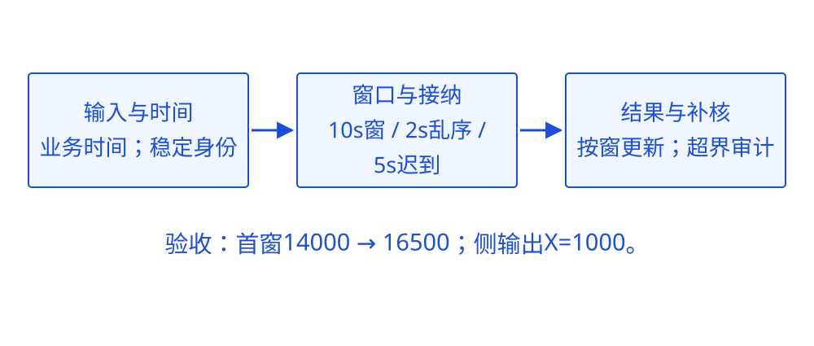</figure>

- 事件时间滚动10s；乱序界2s；允许迟到5s；超界记录进补核流。
- 结果键（storeId,windowStart）；每次输出覆盖该窗累计值，另保留窗口终点。

<!--
我们为门店写一份完整方案。用支付业务发生时间，按店和十秒区间统计唯一成功支付；进度规则用两秒乱序界，首次事件时间触发后再保留五秒接纳期，太晚的记录进入补核。结果按店和窗口起点覆盖最新累计，同时保留窗口终点供核对。验收样本先看到首窗14000，L后16500，X进入补核。业务要求最终对账时，补核流程需按结果键将归档重算值与在线版本对齐。

[Sources]
- https://nightlies.apache.org/flink/flink-docs-release-2.3/docs/dev/datastream/operators/windows/
- https://nightlies.apache.org/flink/flink-docs-release-2.3/docs/dev/datastream/event-time/generating_watermarks/
- https://nightlies.apache.org/flink/flink-docs-release-2.3/docs/dev/table/concepts/dynamic_tables/
- 教学构造数据：course/data/cases.json；金额单位为分。专项场景在页面注明参数。
-->

---
class: course story-course
---
## 独立方案练习：临时看板与最终核对

- 同一专项输入；业务要先看趋势，并能追查所有成功支付。
- 设计一次提前输出、准时输出、迟到边界和补核路径。
- 写明下游如何解释8000、14000、16500，以及X的1000最终去向。

<!--
这道题要把今天分开的决定重新连起来。先给临时看板安排何时提前看见八千，再规定事件时间主输出和迟到修正。接着决定下游按键替换还是接收增量，用例中的三个版本检查会不会多算。最后给X一条有责任人的补核路径，说明如何从完整归档得到首窗17500，并把它与在线版本对应。方案分别定义临时营业额的接纳范围，以及最终核对结果覆盖的归档范围。

[Sources]
- https://research.google/pubs/the-dataflow-model-a-practical-approach-to-balancing-correctness-latency-and-cost-in-massive-scale-unbounded-out-of-order-data-processing/
- https://nightlies.apache.org/flink/flink-docs-release-2.3/docs/dev/datastream/operators/windows/
- https://nightlies.apache.org/flink/flink-docs-release-2.3/docs/dev/table/concepts/dynamic_tables/
- 教学构造数据：course/data/cases.json；金额单位为分。专项场景在页面注明参数。
-->

---
class: course story-course
---
## 方案答案：版本更新与补核形成闭环

<figure class="story-figure">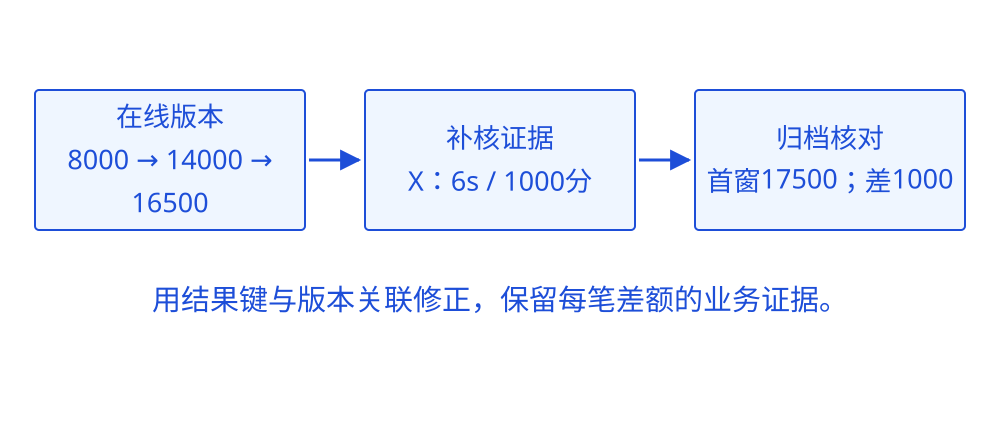</figure>

- 临时8000→准时14000→迟到16500，按同一窗口键替换。
- X保留在补核流；完整归档首窗17500，以明确对账版本修正或审计差额1000。

<!--
示范答案把三次在线发布视作同一结果的版本变化，最后在线值16500。超过接纳边界的X保留身份、时间和金额，供归档重算得到17500，再以明确的对账版本更新或保留差额审计。具体业务可以选择何时让看板采用对账值，但这个决定必须写出来。请大家检查自己的方案是否能解释每笔钱在哪里：已在在线结果，仍在可修正状态，还是进入补核。能把三处对应起来，才形成从记录到结果的闭环。

[Sources]
- https://nightlies.apache.org/flink/flink-docs-release-2.3/docs/dev/datastream/operators/windows/
- https://nightlies.apache.org/flink/flink-docs-release-2.3/docs/dev/table/concepts/dynamic_tables/
- 教学构造数据：course/data/cases.json；金额单位为分。专项场景在页面注明参数。
-->

---
class: course story-course
---
## 本讲的时间与结果关系

<figure class="story-figure">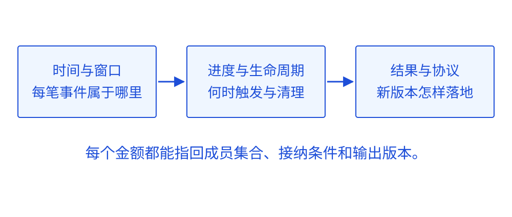</figure>

- 事件时间决定归属；水位线决定进度；接纳期决定历史保留边界。
- 触发决定何时发；输出协议决定新结果怎样修正旧结果。

<!--
今天我们用同一条记录区分了发生与处理，又让首窗经历建立、主触发、迟到修正和清理。L的两千五能加入，是因为状态还在；X的一千进入补核，是因为在线接纳边界已经过去。再看输出，一万四和一万六千五是两个完整版本，不能当两笔支付相加。请大家指着时间轴，把归属、进度、保留和发布各讲一句，最后用具体数值解释规则改变会影响哪笔记录。下一讲我们把状态打开，研究订单等待、定时器、查询更新与扩容。

[Sources]
- https://nightlies.apache.org/flink/flink-docs-release-2.3/docs/concepts/time/
- https://nightlies.apache.org/flink/flink-docs-release-2.3/docs/dev/datastream/operators/windows/
- https://research.google/pubs/the-dataflow-model-a-practical-approach-to-balancing-correctness-latency-and-cost-in-massive-scale-unbounded-out-of-order-data-processing/
-->

---
class: course story-course
---
## 附录：乱序界与允许迟到分别作用于哪里

<figure class="story-figure">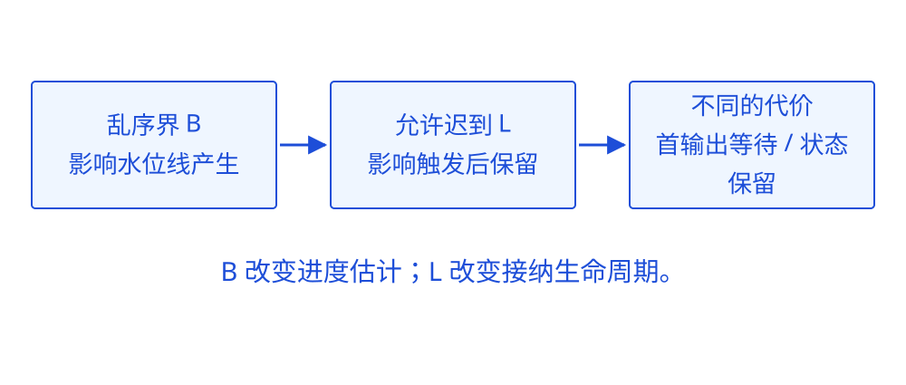</figure>

- 增大乱序界B会让同一M产生更靠后的等待、即更小水位线。
- 增大允许迟到延长已触发窗口的保留；不会改变M或首次触发规则。

<!--
两个参数都可能让系统接纳更多晚来历史，但作用位置不同。乱序界放在水位线生成处，M相同而B更大，W更小，主触发会更晚。允许迟到放在窗口生命周期处，主输出之后状态保留更久，等待修正的空间增加。请用首窗分别画出水位线滞后和迟到保留期，并标出触发点与清理点。两个参数分别控制进度估计和状态保留，调整后用实际乱序分布、首结果延迟和状态大小衡量效果。

[Sources]
- https://nightlies.apache.org/flink/flink-docs-release-2.3/docs/dev/datastream/event-time/generating_watermarks/
- https://nightlies.apache.org/flink/flink-docs-release-2.3/docs/dev/datastream/operators/windows/
-->

---
class: course story-course
---
## 附录：窗口输出仍需保留身份

<figure class="story-figure"></figure>

- Flink窗口结果的事件时间戳通常为该窗最大时间戳，如9999ms。
- 结果用（用户或门店键，窗口边界）识别，时间戳供后续事件时间处理。

<!--
Flink窗口输出携带窗口最大时间戳，零到一万毫秒这一窗就是9999毫秒，供后续事件时间处理。同一时间窗内还可能有多位用户或多个门店，所以结果身份由业务键和窗口边界共同确定。若结果会修正，再约定版本或变更类型。请在图上给A和B各画一条首窗结果：两条的输出时间戳相同，业务键不同。

[Sources]
- https://nightlies.apache.org/flink/flink-docs-release-2.3/docs/dev/datastream/operators/windows/
- https://nightlies.apache.org/flink/flink-docs-release-2.3/docs/dev/table/concepts/dynamic_tables/
-->
