# 时间、窗口与结果修正

> 第 3 次课 · 分布式实时计算

沿时间轴解释每次输出与修正

<!--
同学们，门店希望每十秒在看板上刷新一次营业额。可现实网络里消息会排队、会重传：九秒发生的支付先到，七秒发生的却在十一秒才到，大屏幕该先显示多少？已经公布出去的十秒营业额，后来又冒出一笔漏网小票还能不能改？这节课我们始终盯紧同一根事件时间轴，看清楚数据归哪扇窗、水位线怎么在完整性与低延迟之间做取舍，再亲手把首窗口从 14000 修正到 16500、把超界的 1000 分送进补核流。

[Sources]
- https://nightlies.apache.org/flink/flink-docs-release-2.3/docs/concepts/time/
- https://nightlies.apache.org/flink/flink-docs-release-2.3/docs/dev/datastream/operators/windows/
- https://research.google/pubs/the-dataflow-model-a-practical-approach-to-balancing-correctness-latency-and-cost-in-massive-scale-unbounded-out-of-order-data-processing/
-->

---
class: course story-course
---
## 十秒营业额需要四项明确约定

<figure class="story-figure"></figure>

<strong>时间与归窗</strong>：采用哪种时间坐标，事件落入哪一扇窗口

<strong>触发与修正</strong>：何时先发布，迟到多久还更新、多久后改走补核

<!--
大家看这笔发生在第 7 秒的支付，因为网络拥塞，直到第 11 秒才被算子读到。如果按处理时间统计，它就跑进了 10 到 20 秒那一栏；如果按业务发生时间统计，它就属于 0 到 10 秒。即便确定了按事件时间算，后面还有三个躲不开的问题：旧窗口先不先发？发了以后要不要留着状态等迟到记录？新版本发出去时下游怎么改旧账？这一讲的所有算式，都是在回答这四个问题。

[Sources]
- https://nightlies.apache.org/flink/flink-docs-release-2.3/docs/concepts/time/
- https://nightlies.apache.org/flink/flink-docs-release-2.3/docs/dev/datastream/operators/windows/
- https://research.google/pubs/the-dataflow-model-a-practical-approach-to-balancing-correctness-latency-and-cost-in-massive-scale-unbounded-out-of-order-data-processing/
-->

---
class: course story-course
---
## 事件时间与处理时间

<figure class="story-figure"></figure>

<strong>事件时间</strong>：业务真实发生的时刻（刻在记录本身）

<strong>处理时间</strong>：算子执行当时的机器时钟（随负载与重跑变化）

<strong>时间差</strong>：C 发生于 7 s、处理于 11 s，网络传输拉开两条时间线

<!--
沿图的横轴看业务发生时间，纵轴看记录走进系统的先后次序。A 发生在 1 秒、B 在 4 秒、D 在 9 秒，最后到达的 C 却发生在 7 秒。处理时间是任务节点当时的物理时钟，随着重跑或机器负载会随时变化；事件时间则刻在支付小票上，重放十遍依然还是 7 秒。工程里做实时监控、算机器 QPS 用处理时间很省心，但凡是要按业务账期对账，几乎都必须用事件时间。

[Sources]
- https://nightlies.apache.org/flink/flink-docs-release-2.3/docs/concepts/time/
- 教学构造数据：course/data/cases.json；金额单位为分。特定示例在页面注明参数。
-->

---
class: course story-course
---
## 同一记录的两种归窗结果

<figure class="story-figure"></figure>

<strong>按事件时间（7 s）</strong>：归入 `[0, 10 s)` 窗口

<strong>按处理时间（11 s）</strong>：归入 `[10, 20 s)` 窗口

> 问题：为什么业务营收统计几乎总选事件时间？

<!--
把同一条 C 放进两套时间坐标系里对比结果立刻就分叉了：按事件时间算 7 秒落进第一窗，按处理时间算 11 秒掉进第二窗。两条路都能算出自洽的数，但业务含义完全不同：前者回答“第 0 到 10 秒实际收了多少钱”，后者回答“系统第 10 到 20 秒吞进了多少钱”。门店要核对每个十分钟或每十秒的真实营收，必须选事件时间。

[Sources]
- https://nightlies.apache.org/flink/flink-docs-release-2.3/docs/concepts/time/
- https://nightlies.apache.org/flink/flink-docs-release-2.3/docs/dev/datastream/operators/windows/
- 教学构造数据：course/data/cases.json；金额单位为分。特定示例在页面注明参数。
-->

---
class: course story-course
layout: section
---
## 1 · 时间与窗口归属

<ol class="outline"><li class="current">时间与窗口归属</li><li>水位线与触发</li><li>迟到与结果修正</li><li>输出协议与方案设计</li></ol>

<!--
时间口径选定以后，先把每条记录到底归哪一扇窗口说清楚。我们用左闭右开的数学区间消掉边界二义性，再比较滚动、滑动和会话三种常见切法。把窗口归属钉死，后面才轮到水位线决定何时把算好的数字放出去。

[Sources]
- https://nightlies.apache.org/flink/flink-docs-release-2.3/docs/concepts/stateful-stream-processing/
-->

---
class: course story-course
---
## 窗口演进的八条基础输入

<figure class="story-figure"></figure>

<strong>前段（0—10 s）</strong>：A(1s, 3000)、B(4s, 5000)、D(9s, 4000)、C(7s, 2000)

<strong>后段（10—30 s）</strong>：E(12s, 6000)、G(18s, 8000)、F(16s, 1000)、H(23s, 3000)

<strong>全量核对</strong>：8 个唯一成功事件，合计 <strong>32000 分</strong>

<!--
这八条记录沿用了前面熟悉的金额，但换成了 A 到 H 的单字母编号，方便在时间轴上连线追踪。按照到达顺序读是 A、B、D、C、E、G、F、H，我们假设这一讲的输入已经完成了失败过滤和身份去重。先心算一下三段的总数：第一段 0 到 10 秒四笔合计 14000 分，第二段 10 到 20 秒三笔合计 15000 分，第三段 20 到 30 秒一笔 3000 分。接下来还要往里面塞两条迟到记录。

[Sources]
- https://nightlies.apache.org/flink/flink-docs-release-2.3/docs/dev/datastream/operators/windows/
- 教学构造数据：course/data/cases.json；金额单位为分。特定示例在页面注明参数。
-->

---
class: course story-course
---
## 两条迟到对比记录

<figure class="story-figure"></figure>

<strong>L（8 s, 2500 分）</strong>：在 12 s 的 E 之后到达，赶上在线修正

<strong>X（6 s, 1000 分）</strong>：在 18 s 的 G 之后到达，已超清理界转入补核

<strong>到达序列</strong>：`A B D C E L G X F H`

<!--
现在故意请出两位“迟到嘉宾” L 和 X。L 发生在第 8 秒，却等到 12 秒的 E 走完后才露面；X 发生得更早（第 6 秒），偏偏等到 18 秒的 G 之后才挤进来。两条记录本来都该算进 0 到 10 秒首窗口，但它们抵达时首窗口的生命周期已经完全不一样了：待会儿大家会亲眼看见 L 被成功补进了线上结果，而 X 被挡在门外送去了补核流。

[Sources]
- https://nightlies.apache.org/flink/flink-docs-release-2.3/docs/dev/datastream/operators/windows/
- 教学构造数据：course/data/cases.json；金额单位为分。特定示例在页面注明参数。
-->

---
class: course story-course
---
## 滚动窗口使用左闭右开区间

<figure class="story-figure">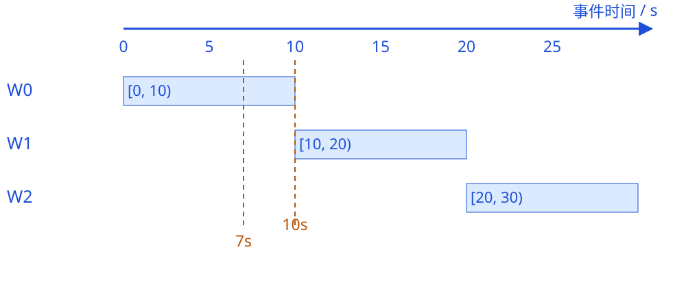</figure>

<strong>滚动窗口（10 s）</strong>：互不重叠地切分为 `[0, 10)`、`[10, 20)`、`[20, 30)`

<strong>边界规则</strong>：左闭右开，10 s 整进入 `[10, 20)`；`W0` 最大时间戳为 <strong>9999 ms</strong>

<!--
注意看区间两端的括号：左边方括号包含起点，右边圆括号不含终点。这样刚好落在第 10 秒的事件会自动进第二窗，既不会两头都算一遍，也不会两头都漏掉。落到毫秒精度上，`[0, 10000 ms)` 这扇窗能包含的最大时间戳就是 **9999 ms**。请大家记住 9999 这个边界数，后面的默认触发器全靠它拍板。

[Sources]
- https://nightlies.apache.org/flink/flink-docs-release-2.3/docs/dev/datastream/operators/windows/
-->

---
class: course story-course
---
## 滚动窗口先列成员再求和

<figure class="story-figure"></figure>

<strong>各窗求和</strong>：W0=`14000`、W1=`15000`、W2=`3000` 分

<strong>次序无关</strong>：成员按事件时间确定后，窗内求和与到达先后无关

<!--
先把八条基础事件按事件时间对号入座：A、B、C、D 全部小于 10 秒，归 W0 共 14000 分；E、F、G 归 W1 共 15000 分；H 归 W2 共 3000 分。只要数据在窗口关闭前被接纳，D 先到还是 C 先到都不会改变 W0 的总额。至于什么时候把 14000 分亮到屏幕上，要等下一节加上水位线才能决定。

[Sources]
- https://nightlies.apache.org/flink/flink-docs-release-2.3/docs/dev/datastream/operators/windows/
- 教学构造数据：course/data/cases.json；金额单位为分。特定示例在页面注明参数。
-->

---
class: course story-course
---
## 滑动窗口同时给出大小与步长

<figure class="story-figure">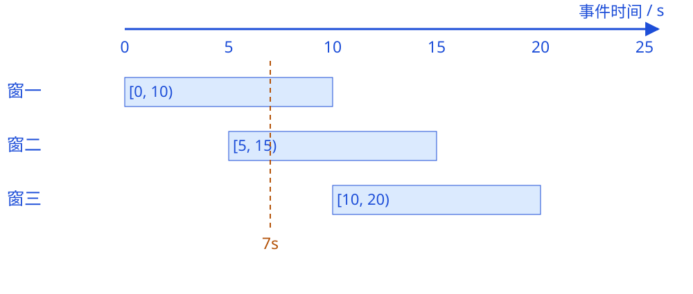</figure>

<strong>滑动窗口</strong>：窗口大小 10 s、步长 5 s，相邻窗口重叠 5 s

<strong>一事件多归属</strong>：7 s 事件同时落入 `[0, 10)` 与 `[5, 15)` 两扇窗口

<!--
业务上常看“每隔 5 秒刷新一次最近 10 秒的走势”，这就是滑动窗口。把窗口长度设成 10 秒、滑动步长设成 5 秒，每条 7 秒的支付就像画了一根竖线同时穿过 `[0, 10)` 和 `[5, 15)` 两条长条，会同时计入两扇窗的状态里。正因为存在重叠，下游绝对不能把相邻两个滑动窗口的营业额直接加起来当总营收。

[Sources]
- https://nightlies.apache.org/flink/flink-docs-release-2.3/docs/dev/datastream/operators/windows/
-->

---
class: course story-course
---
## 滑动窗口的五个结果

<figure class="story-figure"></figure>

<strong>五窗金额</strong>：`[0,10)` <strong>14000</strong>、`[5,15)` <strong>12000</strong>、`[10,20)` <strong>15000</strong>

<strong>其余两窗</strong>：`[15,25)` <strong>12000</strong>、`[20,30)` <strong>3000</strong>

<strong>主键要求</strong>：输出主键须含窗口起止时间，以区分成员不同的等额窗口

<!--
逐一核对这五扇滑动窗的成员：`[5, 15)` 挑出了 7 秒的 C、9 秒的 D 和 12 秒的 E，凑成 12000 分；`[15, 25)` 挑出了 F、G、H，凑巧也等于 12000 分。虽然金额碰巧相等，但成员完全不同，所以结果主键里必须带上窗口起止时间，才能把这两行 12000 分开存好。

[Sources]
- https://nightlies.apache.org/flink/flink-docs-release-2.3/docs/dev/datastream/operators/windows/
- 教学构造数据：course/data/cases.json；金额单位为分。特定示例在页面注明参数。
-->

---
class: course story-course
---
## 会话窗口根据不活跃间隔形成

<figure class="story-figure"></figure>

<strong>会话窗口</strong>：按不活跃间隔（Gap=5 s）动态划分，无固定起止边界

<strong>区间合并</strong>：1 s 与 4 s 间隔 3 s < 5 s 合并为 `[1, 9)`；12 s 独立为 `[12, 17)`

<!--
如果是统计用户在 App 里的单次逛店行为，固定按整点切窗就会把一次连续操作硬生生劈成两半。会话窗口改用不活跃间隔（Gap=5 秒）来划分：每个事件先给自己撑开一段 5 秒长的候选区间，只要区间碰头就合并。1 秒的区间 `[1, 6)` 和 4 秒的区间 `[4, 9)` 重叠，于是合成为 `[1, 9)`；12 秒离 4 秒超过 5 秒，独立成段 `[12, 17)`。

[Sources]
- https://nightlies.apache.org/flink/flink-docs-release-2.3/docs/dev/datastream/operators/windows/
- 教学构造数据：course/data/cases.json；金额单位为分。特定示例在页面注明参数。
-->

---
class: course story-course
---
## 后到的事件可以连接两段会话

<figure class="story-figure"></figure>

<strong>桥接效应</strong>：后到的 8 s 事件撑开 `[8, 13)`，左右搭上 `[1, 9)` 与 `[12, 17)`

<strong>合并结果</strong>：三段合为单一会话 `[1, 17)`（前提：旧会话状态尚未销毁）

> 问题：旧会话若已提前输出，桥接合并后下游怎么修正？

<!--
会话窗口有个非常有趣也最考验工程实现的现象：乱序桥接。假如刚才中间漏了一笔发生在第 8 秒的事件，现在才迟迟送到，它自己的 5 秒区间 `[8, 13)` 往左搭上 `[1, 9)`、往右够着 `[12, 17)`，瞬间把原本断开的两段会话拼成了一条连续的 `[1, 17)`。这也意味着如果旧会话已经提前发过输出，后面不仅金额会改，连窗口的起止范围本身都会变，下游输出协议必须能处理旧区间撤回。

[Sources]
- https://nightlies.apache.org/flink/flink-docs-release-2.3/docs/dev/datastream/operators/windows/
- 教学构造数据：course/data/cases.json；金额单位为分。特定示例在页面注明参数。
-->

---
class: course story-course
---
## 归窗练习：边界与重叠

<strong>给定事件</strong>：10 s / 2000 分，14 s / 3000 分（均已被接纳）

<strong>计算目标</strong>：列出滚动（10 s）与滑动（大小 10 s、步长 5 s）起点 ≥ 0 的窗口结果

> 问题：为什么相邻滑动窗口的结果不能直接相加当总营业额？

<!--
拿笔在纸上画好 0、5、10、15、20 的时间刻度，练一遍边界归属。第一笔刚好踩在 10 秒整点上，第二笔在 14 秒。先判滚动窗口，再判滑动窗口，看清哪一扇窗同时框住了这两笔钱、哪一扇只框住了一笔还是零笔，写明各窗口的成员与总和。

[Sources]
- https://nightlies.apache.org/flink/flink-docs-release-2.3/docs/dev/datastream/operators/windows/
- 教学构造数据：course/data/cases.json；金额单位为分。特定示例在页面注明参数。
-->

---
class: course story-course
---
## 归窗答案：两个滑动窗各得五千

<figure class="story-figure"></figure>

<strong>滚动窗口</strong>：`[10, 20)` 得 <strong>5000 分</strong>（10 s 不落入右开的 `[0, 10)`）

<strong>滑动窗口</strong>：`[5, 15)` 与 `[10, 20)` 均包含这两笔，各自报 <strong>5000 分</strong>

<!--
核对答案：10 秒整踩在 `[0, 10)` 的开区间右边界外，跟 14 秒一起落进滚动窗 `[10, 20)` 得 5000 分。而在步长为 5 秒的滑动窗口下，`[5, 15)` 和 `[10, 20)` 两扇窗的区间同时覆盖了 10 秒和 14 秒，所以两个窗分别报出 5000 分。记住千万别把这两扇窗加出 10000 分，它们只是同一笔 5000 元流水在不同时间视角下的重叠投影。

[Sources]
- https://nightlies.apache.org/flink/flink-docs-release-2.3/docs/dev/datastream/operators/windows/
- 教学构造数据：course/data/cases.json；金额单位为分。特定示例在页面注明参数。
-->

---
class: course story-course
layout: section
---
## 2 · 水位线与触发

<ol class="outline"><li>时间与窗口归属</li><li class="current">水位线与触发</li><li>迟到与结果修正</li><li>输出协议与方案设计</li></ol>

<!--
每条事件属于哪扇窗已经明了，可实时流没有结束时刻，算子怎么敢确定“0 到 10 秒的支付大概齐了、可以往外发了”？这就需要引入流计算最核心的进度标尺：水位线（Watermark）。它本质上是在结果完整性与输出延迟之间做显式权衡的启发式时钟。

[Sources]
- https://nightlies.apache.org/flink/flink-docs-release-2.3/docs/concepts/stateful-stream-processing/
-->

---
class: course story-course
---
## 水位线表示事件时间处理进度

<figure class="story-figure">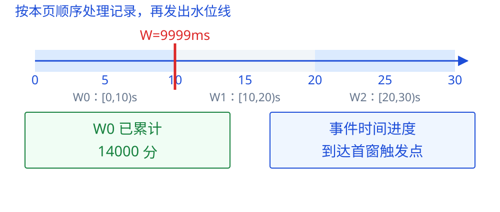</figure>

<strong>水位线（Watermark）</strong>：事件时间的单调启发式时钟，声明 `≤ W` 的数据基本到齐

<strong>工程权衡</strong>：W 跑太快会漏迟到数据，跑太慢则推高端到端延迟

<!--
同学们可以把水位线理解成流计算里的“单调事件时钟”，它声明：“按照经验判断，时间早于 W 的数据大概率已经到齐了。”大家一定要看透背后的工程权衡：水位线只是一种启发式进度断言，也是完整性与延迟之间的妥协开关。如果激进地让水位线紧贴最新事件跑，窗口关得飞快、延迟很低，但网络稍微抖一抖数据就迟到了；如果保守地把水位线拖得很慢，数据倒是不容易漏，可大屏幕得傻等半天才出数。

[Sources]
- https://nightlies.apache.org/flink/flink-docs-release-2.3/docs/dev/datastream/event-time/generating_watermarks/
- https://nightlies.apache.org/flink/flink-docs-release-2.3/docs/dev/datastream/operators/windows/
-->

---
class: course story-course
---
## 有界乱序水位线的计算条件

<figure class="story-figure"></figure>

<strong>生成公式</strong>：`W = M − B − 1 ms`（`M` 为已见最大事件时间，乱序界 `B=2000 ms`）

<strong>单调保证</strong>：`M` 只增不减，水位线绝不倒退

<strong>步进约定</strong>：本讲为逐条观察变化，约定每条记录后刷新一次 W

<!--
工程中最常用的是 Flink 内置的有界乱序水位线生成器。算子默默记下到目前为止见过的最大事件时间 M，往后退一个乱序容忍界 B（本例取 2000 ms），再减 1 ms，算出当前水位线 W。为什么要减 1 ms？因为 10 秒整的记录产生 9999 ms 水位线正好精准跨过 `[0, 10000)` 窗口的最后 1 ms 边界（生产环境通常每隔比如 200 ms 周期性发出一次，本讲为了单步推演方便，每读一条就刷新一次）。由于 M 只增不减，W 绝不会因为后面来了条旧数据而倒退。

[Sources]
- https://nightlies.apache.org/flink/flink-docs-release-2.3/docs/dev/datastream/event-time/generating_watermarks/
- https://nightlies.apache.org/flink/flink-docs-release-2.3/docs/../api/java/org/apache/flink/api/common/eventtime/BoundedOutOfOrdernessWatermarks.html
- 教学构造数据：course/data/cases.json；金额单位为分。特定示例在页面注明参数。
-->

---
class: course story-course
---
## 窗口触发与水位线比较最大时间戳

<figure class="story-figure"></figure>

<strong>触发判据</strong>：`[0, 10000 ms)` 最大时间戳为 <strong>9999</strong>，当 `W ≥ 9999` 时触发

<strong>生命周期</strong>：<strong>首次触发输出</strong>与<strong>最终清理状态</strong>分属两道独立闸门

<!--
记住这个关键判定：窗口 `[0, 10000)` 里能包含的最后一个合法时间戳是 9999 ms，所以只要到达算子的水位线 W ≥ 9999，默认事件时间触发器就会把窗口里的 14000 分往外吐一次。很多初学者容易把“窗口触发”和“窗口销毁”混成一件事，其实先触发发布、再保留状态等一段迟到修正、最后再彻底删状态，是两道独立的生命周期闸门。

[Sources]
- https://nightlies.apache.org/flink/flink-docs-release-2.3/docs/dev/datastream/operators/windows/
-->

---
class: course story-course
---
## 步骤一：A 到达，状态先增加

<figure class="story-figure">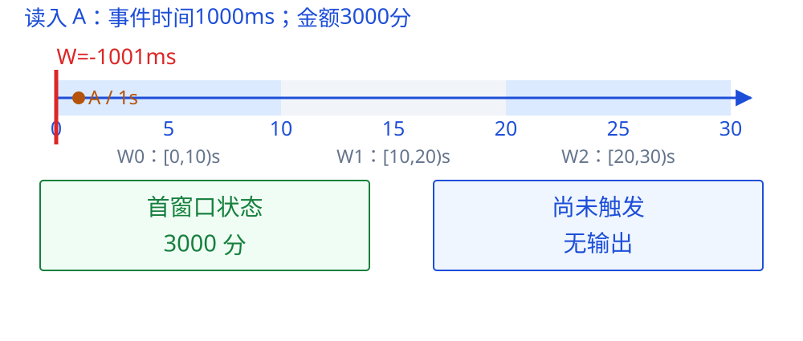</figure>

<strong>输入 A（1 s, 3000）</strong>：W0 更新为 3000，`M = 1000`，`W = −1001 ms`

<strong>输出动作</strong>：`−1001 < 9999`，首窗口继续攒数、暂不输出

<!--
推演正式起步。第一条 A 在 1000 ms 带来了 3000 分，先放进 W0 的状态里。随后按公式刷新水位线：M 是 1000，减去 2001 得到 −1001 ms（负数只是因为起点设在 0 毫秒附近，代表时钟刚起步）。−1001 离首窗口触发点 9999 还差得远，所以此时屏幕上静悄悄的，没有任何输出。

[Sources]
- https://nightlies.apache.org/flink/flink-docs-release-2.3/docs/dev/datastream/event-time/generating_watermarks/
- https://nightlies.apache.org/flink/flink-docs-release-2.3/docs/dev/datastream/operators/windows/
- 教学构造数据：course/data/cases.json；金额单位为分。特定示例在页面注明参数。
-->

---
class: course story-course
---
## 步骤二：B 到达，先得到八千

<figure class="story-figure">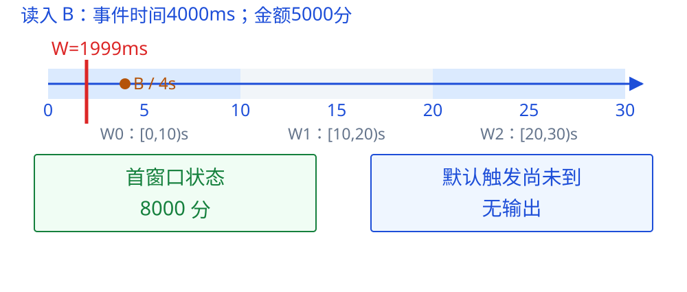</figure>

<strong>输入 B（4 s, 5000）</strong>：W0 累加至 8000，`M = 4000`，`W = 1999 ms`

<strong>输出动作</strong>：默认触发器继续等待 9999（提前播报须另配 Trigger）

<!--
第二条 B 在 4000 ms 带来 5000 分，W0 的内部状态涨到 8000 分，M 刷新为 4000，W 跟着推进到 1999 ms。因为本流程现在使用的是默认事件时间触发器，不到 9999 绝不开口，所以 8000 分安安静静躺在算子状态里。第四节我们会对比“等不及 9999 就先提前发一次 8000 出来看看”会发生什么。

[Sources]
- https://nightlies.apache.org/flink/flink-docs-release-2.3/docs/dev/datastream/event-time/generating_watermarks/
- https://nightlies.apache.org/flink/flink-docs-release-2.3/docs/dev/datastream/operators/windows/
- 教学构造数据：course/data/cases.json；金额单位为分。特定示例在页面注明参数。
-->

---
class: course story-course
---
## 步骤三：D 先到，C 后到

<figure class="story-figure">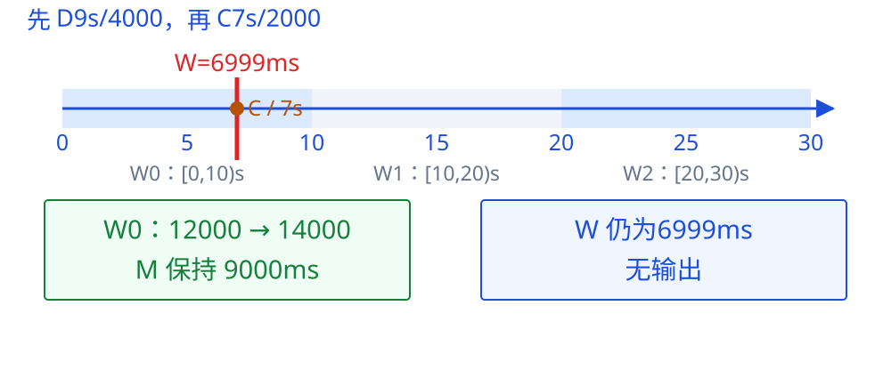</figure>

<strong>D 先到（9 s, 4000）</strong>：`M = 9000`，`W = 6999 ms`，W0 升至 12000

<strong>C 后到（7 s, 2000）</strong>：`7000 > W(6999)` 乱序但未迟到，正常并入至 <strong>14000</strong>

<!--
接着看乱序但未迟到的经典一幕。9 秒的 D 先到，把状态推到 12000、M 推到 9000、W 推到 6999 ms；紧接着 7 秒的 C 才珊珊来迟。请大家把“乱序”和“迟到”这两个词彻底分清：C 比 M（9000）小，所以它是乱序到达；但它的 7000 ms 依然大于当前水位线 W（6999 ms），说明乱序界 B 刚好把它兜住了！所以 C 顺利进入首窗口凑出 14000 分，同时 M 和 W 依然停在 9000 和 6999 不倒退。

[Sources]
- https://nightlies.apache.org/flink/flink-docs-release-2.3/docs/dev/datastream/event-time/generating_watermarks/
- https://nightlies.apache.org/flink/flink-docs-release-2.3/docs/dev/datastream/operators/windows/
- 教学构造数据：course/data/cases.json；金额单位为分。特定示例在页面注明参数。
-->

---
class: course story-course
---
## 步骤四：E 推动首窗口输出

<figure class="story-figure">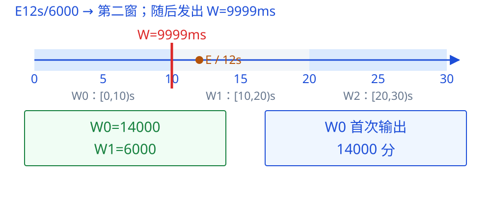</figure>

<strong>输入 E（12 s, 6000）</strong>：写入第二窗 W1，同时推高 `M = 12000`、`W = 9999 ms`

<strong>首窗触发</strong>：`W ≥ 9999` 推动 W0 首次输出 <strong>14000 分</strong>（W1 内部存 6000）

<!--
第 12 秒的 E 进来了，这笔 6000 分自己走进了第二扇窗 W1，但它的另一项副作用却引爆了第一扇窗：E 把最大时间 M 推到了 12000 ms，减掉 2001 正好算出 W = 9999 ms！红线一跨过 9999，W0 就触发把蓄满的 14000 分发布了出去。记住这条重要直觉：**推高水位线并触发旧窗口的，往往是属于下一扇窗口的新事件**。

[Sources]
- https://nightlies.apache.org/flink/flink-docs-release-2.3/docs/dev/datastream/event-time/generating_watermarks/
- https://nightlies.apache.org/flink/flink-docs-release-2.3/docs/dev/datastream/operators/windows/
- 教学构造数据：course/data/cases.json；金额单位为分。特定示例在页面注明参数。
-->

---
class: course story-course
---
## 双输入进度取活跃输入的最小值

<figure class="story-figure">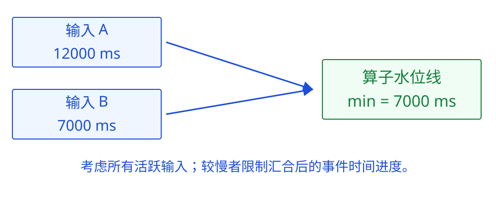</figure>

<strong>木桶效应</strong>：通道 A 进度 12000 ms、通道 B 为 7000 ms，算子取 <strong>min = 7000 ms</strong>

<strong>多分区约束</strong>：任何未声明空闲的慢分区都会限制下游窗口的触发进度

<!--
真实集群里往往有多条上游通道同时喂给同一个下游算子。比如分区 A 已经跑到 12 秒，分区 B 才走到 7 秒，下游算子能跟着 A 直接把水位线拉到 12 秒吗？绝对不能！否则 B 里还在路上的 8 秒数据一到就会全被判定迟到丢弃。所以多输入算子内部为每条活跃通道记一个水位线，取所有活跃通道的**最小值**作为自己的当前水位线（木桶效应）。

[Sources]
- https://nightlies.apache.org/flink/flink-docs-release-2.3/docs/dev/datastream/event-time/generating_watermarks/
- https://nightlies.apache.org/flink/flink-docs-release-2.3/docs/concepts/time/
-->

---
class: course story-course
---
## 空闲输入可以暂时退出最小值计算

<figure class="story-figure">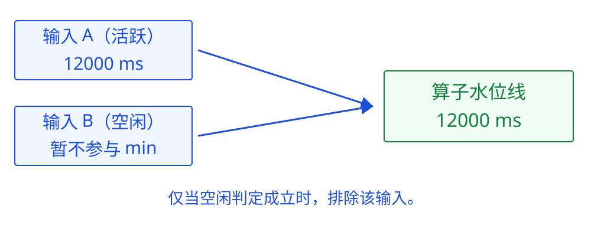</figure>

<strong>空闲检测（withIdleness）</strong>：B 静默超时后暂退出 min 计算，进度随 A 升至 <strong>12000 ms</strong>

<strong>参数权衡</strong>：空闲阈值过短会误判短暂抖动，导致 B 恢复后的旧数据迟到

<!--
多分区木桶效应有个工程大坑：万一业务里某个冷门省份的 Kafka 分区半夜根本没订单，它的水位线一直卡在 7000 ms，那整个大盘的窗口岂不是全被它一个人锁死了？解法是配置空闲数据源检测（Idle Source）：超过设定阈值没收到数据，就把 B 临时标记为空闲、移出最小值计算，让下游跟着活跃的 A 推进到 12000 ms。当然阈值不能设得太急，万一只是短暂抖动就标成空闲，恢复后来的数据就全迟到了。

[Sources]
- https://nightlies.apache.org/flink/flink-docs-release-2.3/docs/dev/datastream/event-time/generating_watermarks/
-->

---
class: course story-course
---
## 空闲输入恢复不让进度倒退

<figure class="story-figure">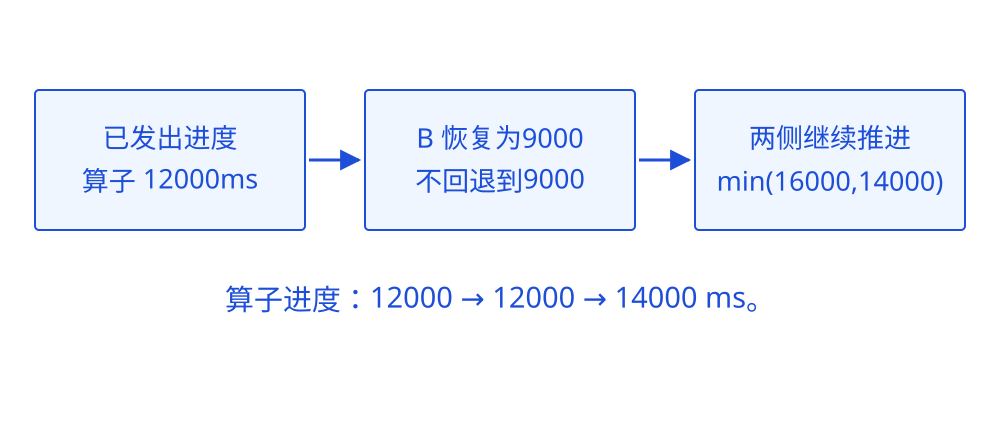</figure>

<strong>单调不回退</strong>：算子已推进至 12000 ms，B 恢复上报 9000 ms 时仍保持 <strong>12000 ms</strong>

<strong>继续推进</strong>：直至 A=16000、B=14000，`min = 14000 > 12000` 后才继续前进

<!--
刚才停掉的 B 终于恢复来数了，它上报的本地进度只有 9000 ms，可算子刚才已经向所有下游发过 12000 ms 的水位线通知、甚至可能已经清理过旧窗口了。时钟绝不能倒流，算子会牢牢守住 12000 ms，直到 B 追到 14000 ms、A 跑到 16000 ms，两者的最小值越过 12000 ms 后才继续前进。至于 B 在 9000 期间夹带的更早事件，只能老老实实走后续的迟到修正或侧输出策略。

[Sources]
- https://nightlies.apache.org/flink/flink-docs-release-2.3/docs/dev/datastream/event-time/generating_watermarks/
- https://nightlies.apache.org/flink/flink-docs-release-2.3/docs/concepts/time/
-->

---
class: course story-course
---
## 多输入练习：哪一步能触发首窗

<strong>初始状态</strong>：首窗触发点 9999 ms；活跃输入 A=13000、B=8000

<strong>两问</strong>：① B 推进到 10000 前后，首窗何时触发？② 若初始 B 即合法空闲，结果如何？

<!--
在纸上画出两条汇合到同一算子的箭头，练一遍多输入推进。先看第一步 min(13000, 8000) 能不能触发 9999？再看 B 追到 10000 后算子进度变多少？最后考虑如果一上来 B 就长期没数被判为空闲，算子能不能跟着 A 提前把首窗放行？

[Sources]
- https://nightlies.apache.org/flink/flink-docs-release-2.3/docs/dev/datastream/event-time/generating_watermarks/
- https://nightlies.apache.org/flink/flink-docs-release-2.3/docs/dev/datastream/operators/windows/
-->

---
class: course story-course
---
## 多输入答案：先等慢输入，再推进

<figure class="story-figure">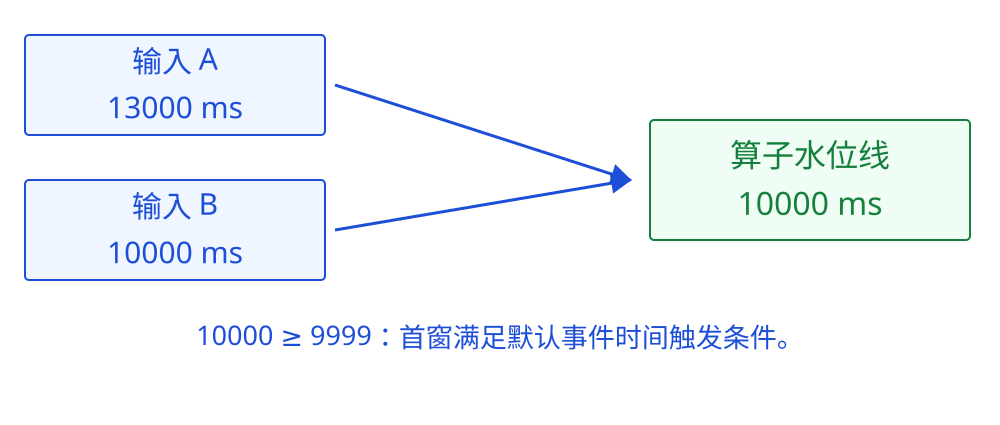</figure>

<strong>未空闲时</strong>：先 `min(13000, 8000) = 8000` 不触发；B 到 10000 后 `min = 10000 ≥ 9999` 触发

<strong>B 空闲时</strong>：仅按活跃输入 A 取值直接升至 <strong>13000 ms</strong>，立即触发首窗

<!--
核对三步判断：第一步虽然 A 早就 13000 了，但只要 B 还是活跃输入且停在 8000，算子就得等在 8000，首窗按兵不动；第二步 B 跨到 10000，min 变成 10000，首窗立刻触发；第三步若 B 满足空闲超时退出竞争，A 的 13000 就能直接拉动触发。多分区水位线的逻辑就两条铁律：活跃取最小，空闲不拖累，恢复不倒退。

[Sources]
- https://nightlies.apache.org/flink/flink-docs-release-2.3/docs/dev/datastream/event-time/generating_watermarks/
- https://nightlies.apache.org/flink/flink-docs-release-2.3/docs/dev/datastream/operators/windows/
-->

---
class: course story-course
layout: section
---
## 3 · 迟到与结果修正

<ol class="outline"><li>时间与窗口归属</li><li>水位线与触发</li><li class="current">迟到与结果修正</li><li>输出协议与方案设计</li></ol>

<!--
首窗 W0 虽然在 9999 ms 准时发出了 14000 分，可故事还没完。紧接着 8 秒的 L 和 6 秒的 X 先后迟到了，它们都归属首窗，为什么 L 还能把结果改成 16500，而 X 却只能走侧输出补核？盯紧水位线与允许迟到（Allowed Lateness）划出的两道门限。

[Sources]
- https://nightlies.apache.org/flink/flink-docs-release-2.3/docs/concepts/stateful-stream-processing/
-->

---
class: course story-course
---
## 允许迟到决定窗口保留多久

<figure class="story-figure">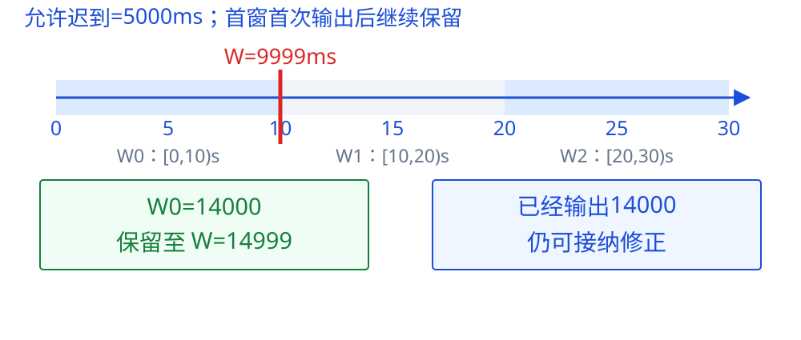</figure>

<strong>清理时刻</strong>：`maxTimestamp(9999) + allowedLateness(5000) = 14999 ms`

<strong>保留状态</strong>：9999 首次发榜后不立刻删状态，直到 `W ≥ 14999 ms` 才彻底销毁

<!--
为了给迟到数据留一扇活门，我们给窗口配置 5000 ms 的允许迟到期（Allowed Lateness）。9999 ms 时首窗只是“首次发榜”，并不撕毁账本，而是把 14000 分的状态继续保留到水位线跨过 9999 + 5000 = 14999 ms 为止。请大家在时间轴上清楚标出两个坐标：9999 是主触发点，14999 是状态销毁点。

[Sources]
- https://nightlies.apache.org/flink/flink-docs-release-2.3/docs/dev/datastream/operators/windows/
-->

---
class: course story-course
---
## 步骤五：L 使首窗从一万四到一万六千五

<figure class="story-figure">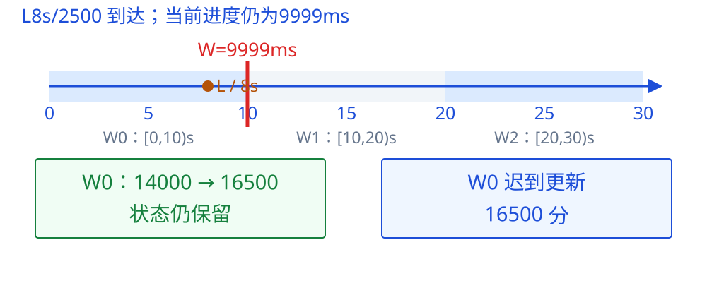</figure>

<strong>L 到达（8 s, 2500）</strong>：此时 `W = 9999 < 14999`，首窗状态仍在保留期

<strong>迟到修正</strong>：W0 累加至 16500 并再次触发，向下游输出新版 <strong>16500 分</strong>

<!--
8 秒的 L 终于赶到了。先比对水位线：它发生在 8000 ms，比当前 W（9999 ms）早，说明确实迟到了；但它赶在销毁点 14999 ms 之前到达，首窗状态还活着！于是算子把 2500 分直接累加到原有 14000 分上，得到 16500 分，并立刻再次触发输出一条更新消息“16500 分”。注意，真正新进来的业务增量是 2500 分，发出的 16500 是最新完整累计值。

[Sources]
- https://nightlies.apache.org/flink/flink-docs-release-2.3/docs/dev/datastream/operators/windows/
- 教学构造数据：course/data/cases.json；金额单位为分。特定示例在页面注明参数。
-->

---
class: course story-course
---
## 步骤六：G 推动进度并清理首窗

<figure class="story-figure"></figure>

<strong>输入 G（18 s, 8000）</strong>：W1 升至 14000，水位线推高至 <strong>15999 ms</strong>

<strong>状态销毁</strong>：`15999 ≥ 14999` 触发清理 W0 内部状态（不撤回已发出的 16500）

<!--
第 18 秒的 G 一来，先把自己 8000 分放进第二窗 W1（凑出 14000 分），更重要的是它把最大时间推到了 18000 ms、水位线跃升至 15999 ms。15999 一举跨过了首窗的销毁点 14999 ms，Flink 立刻把首窗 W0 保存在内存/磁盘里的窗口状态彻底清理掉，腾出空间。注意：清理的是引擎内部状态，已经发给下游结果库的 16500 分并不会被撤回。

[Sources]
- https://nightlies.apache.org/flink/flink-docs-release-2.3/docs/dev/datastream/operators/windows/
- 教学构造数据：course/data/cases.json；金额单位为分。特定示例在页面注明参数。
-->

---
class: course story-course
---
## 步骤七：X 无法再更新已清理窗口

<figure class="story-figure">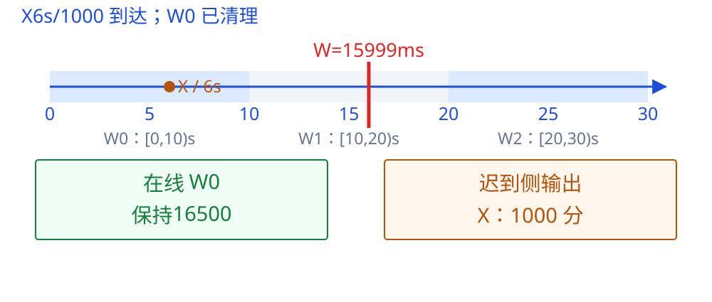</figure>

<strong>X 到达（6 s, 1000）</strong>：此时 `W = 15999 ≥ 14999`，首窗 W0 状态早已销毁

<strong>侧输出兜底</strong>：X 转入专门的迟到旁路（Side Output）补核，在线 W0 保持 16500

<!--
最后 6 秒的 X 才迟迟进场。虽然它业务上也属于首窗，但此时水位线早已走到 15999，首窗状态已经被清理得干干净净，如果放任不管就只能丢弃。在工程上配置了迟到侧输出（Side Output）后，算子会把 X 完整转发进一条独立旁路，保留它的原始事件时间和金额，留给离线或异步对账流程去补核修正，避免账目凭空消失。

[Sources]
- https://nightlies.apache.org/flink/flink-docs-release-2.3/docs/dev/datastream/operators/windows/
- 教学构造数据：course/data/cases.json；金额单位为分。特定示例在页面注明参数。
-->

---
class: course story-course
---
## 步骤八：F、H 与有界输入结束

<figure class="story-figure"></figure>

<strong>F（16 s, 1000）</strong>：补入 W1 至 <strong>15000</strong>；<strong>H（23 s, 3000）</strong> 推至 W=20999 触发 W1

<strong>结束收尾</strong>：有界样本末尾发射最大水位线，推动 W2 输出 <strong>3000 分</strong>

<!--
把最后两条记录走到底：16 秒的 F 落在 W1 窗口里且没过期，把 W1 补齐到 15000 分；23 秒的 H 进到第三窗 W2，同时把水位线推到 20999 ms，顺利触发 W1 输出 15000 分。因为今天这组演示是有界样本，全部十条读完后流引擎会发出一条无限大水位线收尾，推动 W2 输出最后的 3000 分；真实无界流则会继续等着后续数据推进水位线。

[Sources]
- https://nightlies.apache.org/flink/flink-docs-release-2.3/docs/dev/datastream/operators/windows/
- 教学构造数据：course/data/cases.json；金额单位为分。特定示例在页面注明参数。
-->

---
class: course story-course
---
## 在线结果与完整归档相差哪一笔

<figure class="story-figure"></figure>

<strong>完整归档首窗</strong>：A+B+C+D+L+X = <strong>17500 分</strong>；在线首窗为 <strong>16500 分</strong>

<strong>账目守恒</strong>：全量 <strong>35500 分</strong> = 在线三窗（34500） + 迟到侧输出 X（1000）

<!--
拿完整历史重跑的归档账本跟刚才在线输出的结果对一下账：离线重跑第一窗是 17500 分、总计 35500 分；在线跑第一窗停在 16500 分、总计 34500 分。差出来的那 1000 分上哪找？正好躺在刚才那条侧输出流里，连事件编号和时间戳都在！这就是带侧输出的实时计算为什么能跟财务对上账：在线结果设了有限等待边界以保证状态不爆，超界长尾由侧输出兜底可追溯。

[Sources]
- https://nightlies.apache.org/flink/flink-docs-release-2.3/docs/dev/datastream/operators/windows/
- 教学构造数据：course/data/cases.json；金额单位为分。特定示例在页面注明参数。
-->

---
class: course story-course
---
## 迟到练习：把保留期延长到八秒

<strong>调整参数</strong>：到达序列不变，仅将允许迟到从 5000 ms 延长为 <strong>8000 ms</strong>

<strong>计算目标</strong>：求新清理点、X（6 s, 1000 分）到达时是否接纳及首窗新输出

> 思考：保留期越长在线越准，工程上要付出什么代价？

<!--
试着改一个参数体会下系统行为的变化。其他一切保持原样，只把 Allowed Lateness 从 5000 ms 加大到 8000 ms。请同学们重新算一遍首窗的销毁点，看 G 推进到 15999 ms 之后，X 赶到时首窗还在不在？再对比一下多保留这 3 秒在系统资源上要付出什么代价。

[Sources]
- https://nightlies.apache.org/flink/flink-docs-release-2.3/docs/dev/datastream/operators/windows/
- 教学构造数据：course/data/cases.json；金额单位为分。特定示例在页面注明参数。
-->

---
class: course story-course
---
## 迟到答案：清理点17999，X进入修正

<figure class="story-figure">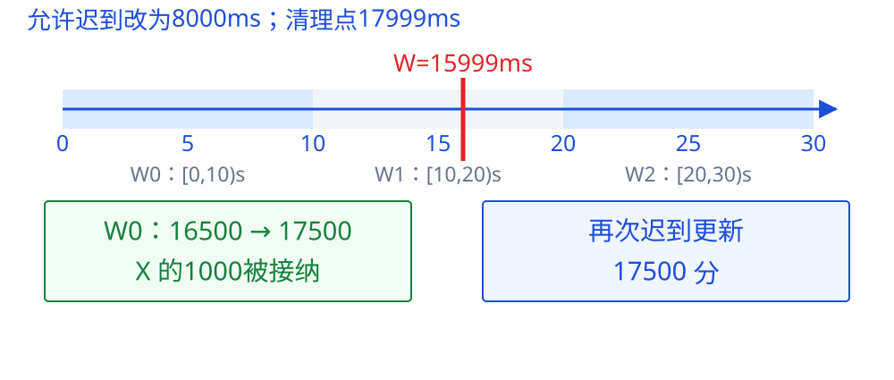</figure>

<strong>新清理点</strong>：`9999 + 8000 = 17999 ms`（X 到达时 `W=15999 < 17999`，状态仍在）

<strong>输出与销毁</strong>：X 并入首窗输出 <strong>17500 分</strong>；直至 H 推高 W 至 20999 才销毁

<!--
核对结果：清理点推后到 17999 ms，X 到达时水位线还停在 15999 ms，赶上了末班车！X 的 1000 分顺利并入首窗，发出第三次版本更新 17500 分，等 H 把水位线推到 20999 ms 时首窗才销毁。可见允许迟到拉得越长，在线结果越接近完整归档，但代价是大量历史窗口的状态得在内存/RocksDB 里多蹲好几秒甚至几小时，状态体积直接成比例上涨。

[Sources]
- https://nightlies.apache.org/flink/flink-docs-release-2.3/docs/dev/datastream/operators/windows/
- 教学构造数据：course/data/cases.json；金额单位为分。特定示例在页面注明参数。
-->

---
class: course story-course
layout: section
---
## 4 · 输出协议与方案设计

<ol class="outline"><li>时间与窗口归属</li><li>水位线与触发</li><li>迟到与结果修正</li><li class="current">输出协议与方案设计</li></ol>

<!--
一旦允许提前播报或迟到修正，同一扇窗口就不再只吐一次数字。下面我们借用 Dataflow 模型的“How（如何修正）”维度，看清楚连续三次输出 8000、14000、16500 在下游到底代表新增贡献、完整覆盖还是先撤后发。这一步一旦协议没对齐，下游大盘就会多算出几万块。

[Sources]
- https://nightlies.apache.org/flink/flink-docs-release-2.3/docs/concepts/stateful-stream-processing/
-->

---
class: course story-course
---
## 提前、准时与迟到是输出时机

<figure class="story-figure"></figure>

<strong>三次发布</strong>：A、B 后提前报 `8000` → 准时（W=9999）报 `14000` → L 后报 `16500`

<strong>实现方式</strong>：默认仅水位线触发，提前播报需在 Trigger 中显式扩展

<!--
为了直观对比三种触发时机（When），我们给首窗加上一条规则：A、B 两条进来后等不及了，先提前报一次 8000 分；水位线到达 9999 ms 时准时触发 14000 分；L 迟到后再补发一次 16500 分。这里“准时”指的是水位线跨过窗口边界，而不是机器物理时间。同一个窗口吐出了三次消息，下面三种累积模式决定了每次吐出来的内容到底写啥。

[Sources]
- https://research.google/pubs/the-dataflow-model-a-practical-approach-to-balancing-correctness-latency-and-cost-in-massive-scale-unbounded-out-of-order-data-processing/
- https://nightlies.apache.org/flink/flink-docs-release-2.3/docs/dev/datastream/operators/windows/
- 教学构造数据：course/data/cases.json；金额单位为分。特定示例在页面注明参数。
-->

---
class: course story-course
---
## 丢弃式输出只表达新增部分

<figure class="story-figure">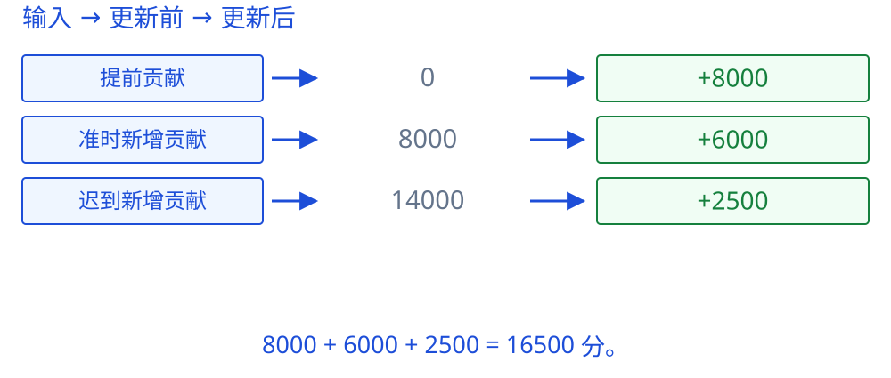</figure>

<strong>丢弃式（Discarding）</strong>：每次仅发出自上次触发以来的<strong>新增增量</strong>

<strong>输出序列</strong>：`+8000`、`+6000`、`+2500`，下游直接累加即得 <strong>16500 分</strong>

<!--
先看第一种模式，丢弃式（Discarding）。算子每次触发输出后，就把已经吐出去的贡献从当前累计值里“清掉”，下次只吐新攒出来的增量：第一次报 8000，C 和 D 来了以后再报新增长的 6000，L 来了报 2500。这种模式最适合下游是个只做增量累加或计数器的系统（比如直接往日志流或加减计数器里写），下游把 8000 + 6000 + 2500 相加正好得 16500。但它的局限是不适合做平均值、去重 UV 等不可简单拆分的指标，而且要求下游不能弄丢任何一次输出。

[Sources]
- https://research.google/pubs/the-dataflow-model-a-practical-approach-to-balancing-correctness-latency-and-cost-in-massive-scale-unbounded-out-of-order-data-processing/
- https://nightlies.apache.org/flink/flink-docs-release-2.3/docs/dev/datastream/operators/windows/
- 教学构造数据：course/data/cases.json；金额单位为分。特定示例在页面注明参数。
-->

---
class: course story-course
---
## 累积式输出表达当前完整值

<figure class="story-figure">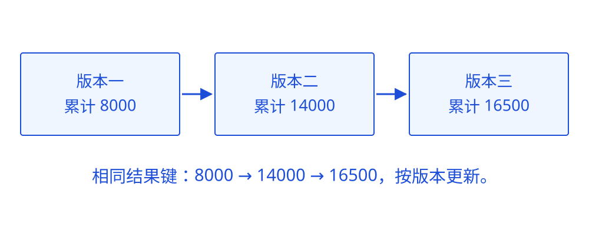</figure>

<strong>累积式（Accumulating）</strong>：每次触发均发出截至当前窗口的<strong>完整累计值</strong>

<strong>输出序列</strong>：`8000`、`14000`、`16500`，下游须按 `(键, 窗口)` 覆盖旧值

<!--
第二种是工程里最常用的累积式（Accumulating）。算子始终把窗内全部历史留着，每次触发直接把最新完整总额吐出来：8000、14000、16500。请大家把第一次的 8000 圈进第二次的 14000 里，前后两版消息其实是重叠包含的关系！如果下游直接连接数据库或 Redis 看板，用 `(storeId, windowStart)` 当主键直接 Upsert 覆盖，最终页面稳稳停在 16500；但假如中间还有第二层聚合算子，这种模式就会引发下面的“多算灾难”。

[Sources]
- https://research.google/pubs/the-dataflow-model-a-practical-approach-to-balancing-correctness-latency-and-cost-in-massive-scale-unbounded-out-of-order-data-processing/
- https://nightlies.apache.org/flink/flink-docs-release-2.3/docs/dev/table/concepts/dynamic_tables/
- 教学构造数据：course/data/cases.json；金额单位为分。特定示例在页面注明参数。
-->

---
class: course story-course
---
## 把累计输出相加会多算二万二千

<figure class="story-figure"></figure>

<strong>协议错配</strong>：把累积序列当增量相加 `8000 + 14000 + 16500 = 38500 分`

<strong>差额根源</strong>：多出的 <strong>22000 分</strong>来自前两版旧值被重复计入

> 问题：下游还要接着做二次 SUM 时，怎么安全修正旧版输出？

<!--
这就是上游发累积值、下游却当成增量去 SUM 时闹出的大乌龙：8000 + 14000 + 16500 直接算出了 38500 分，平白多出 22000 分！原因不在计算引擎，而在于上下游对消息语义的契约没对齐。如果上游是累积更新，下游想要继续做二次汇总（例如把各门店各 10 秒窗加总成全公司总营收），靠单纯的累加是不行的，必须引入第三种模式：撤回式（Retracting）。

[Sources]
- https://research.google/pubs/the-dataflow-model-a-practical-approach-to-balancing-correctness-latency-and-cost-in-massive-scale-unbounded-out-of-order-data-processing/
- https://nightlies.apache.org/flink/flink-docs-release-2.3/docs/dev/table/concepts/dynamic_tables/
- 教学构造数据：course/data/cases.json；金额单位为分。特定示例在页面注明参数。
-->

---
class: course story-course
---
## 撤回旧值，再给出新值

<figure class="story-figure">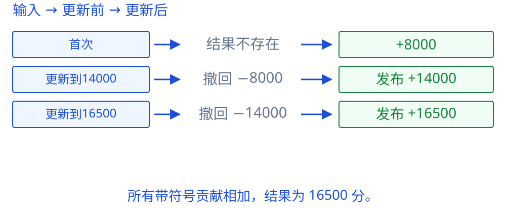</figure>

<strong>撤回式（Retracting）</strong>：更新时先发负向撤回抵消旧版，再发新版结果

<strong>序列示例</strong>：`+8000`、`−8000`、`+14000`、`−14000`、`+16500`（代数和 = <strong>16500</strong>）

<!--
对照 *Streaming 102* 的经典设计看撤回式（Accumulating & Retracting）是怎么拯救下游二次聚合的：第一次吐 `+8000`；准时更新到 14000 时，先吐一条 `-8000` 让下游把刚才那笔减掉，再吐 `+14000`；迟到更新到 16500 时，再吐 `-14000` 和 `+16500`。这样不管下游隔了多少层算子、或是做了多少次 `SUM` 和 `AVG` 级联，只要支持处理撤回消息（Changelog 里的 `-U` / `+U`），所有中间层就能自动把旧数抹掉、换上新数。注意这跟真实业务退款不同，`-8000` 只是协议层面的状态纠偏。

[Sources]
- https://research.google/pubs/the-dataflow-model-a-practical-approach-to-balancing-correctness-latency-and-cost-in-massive-scale-unbounded-out-of-order-data-processing/
- https://nightlies.apache.org/flink/flink-docs-release-2.3/docs/dev/table/concepts/dynamic_tables/
- 教学构造数据：course/data/cases.json；金额单位为分。特定示例在页面注明参数。
-->

---
class: course story-course
---
## Flink 的触发、状态与输出协议

<figure class="story-figure">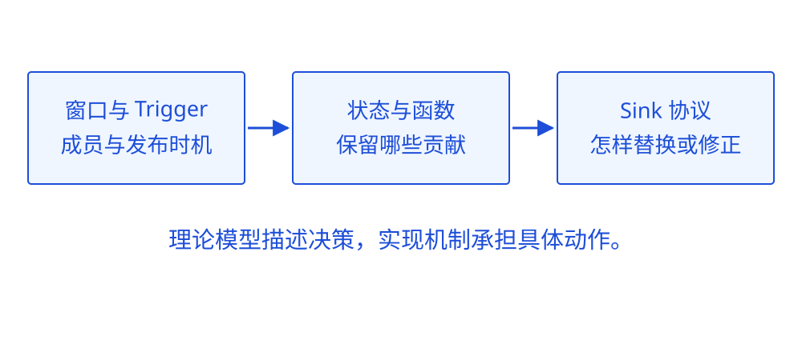</figure>

<strong>四维映射</strong>：`WindowAssigner`（Where）→ `Trigger`（When）→ `State` → `Sink`（How）

<strong>工程落点</strong>：写窗口设计时按这四环逐项敲定，避免边界遗漏

<!--
把刚才抽象的理论术语全部映射回 Flink 编程组件：WindowAssigner（滚动/滑动/会话）负责 Where（哪扇窗）；Trigger 负责 When（提前、准时或迟到触发）；WindowState 负责保存窗内计算状态；而下游的 Changelog 流与 Sink 写入规则决定了 How（是直接 Upsert 覆盖，还是传递撤回流）。写技术设计文档时，沿着这四环往下填，绝不会漏掉边界。

[Sources]
- https://nightlies.apache.org/flink/flink-docs-release-2.3/docs/dev/datastream/operators/windows/
- https://research.google/pubs/the-dataflow-model-a-practical-approach-to-balancing-correctness-latency-and-cost-in-massive-scale-unbounded-out-of-order-data-processing/
- https://nightlies.apache.org/flink/flink-docs-release-2.3/docs/dev/table/concepts/dynamic_tables/
-->

---
class: course story-course
---
## 时间推演图的绘制步骤

<figure class="story-figure">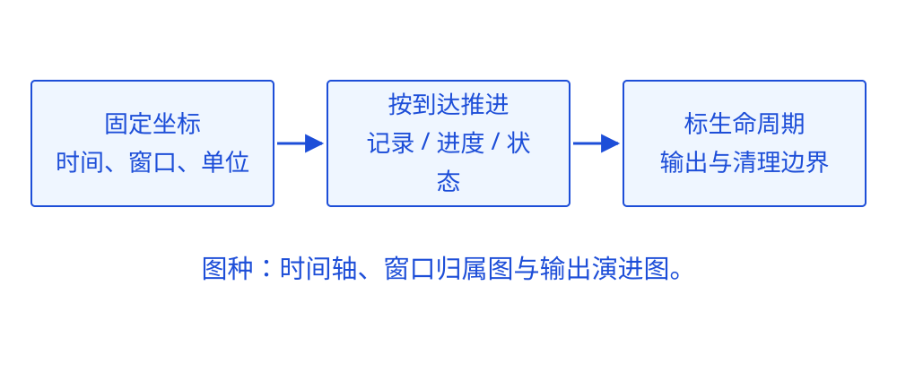</figure>

<strong>三步画法</strong>：定时间轴与窗口 → 按到达顺推进 W 与状态 → 标触发与销毁点

<strong>箭头标注</strong>：在输出箭头旁注明版本主键与增量/累计/撤回语义

<!--
大家在黑板或白板上画时间机制推演图时，记住三步走：先画水平事件时间轴和窗口矩形框；再按数据到达顺序一行行往下推演，每进一条记清最新的水位线红线位置和窗口累加值；最后把主触发点、状态销毁点以及输出消息是完整值还是增量标到箭头旁边。这样任何一位同事看图都能一秒定位：某条 6 秒的记录为什么进不去窗口、跑去了哪条侧输出。

[Sources]
- https://nightlies.apache.org/flink/flink-docs-release-2.3/docs/concepts/time/
- https://nightlies.apache.org/flink/flink-docs-release-2.3/docs/dev/datastream/operators/windows/
- 教学构造数据：course/data/cases.json；金额单位为分。特定示例在页面注明参数。
-->

---
class: course story-course
---
## 窗口方案示范：十秒门店营业额

<figure class="story-figure"></figure>

<strong>窗口配置</strong>：事件时间 10 s 滚动窗、乱序界 2 s、允许迟到 5 s、超界转侧输出

<strong>输出落库</strong>：以 `(storeId, windowStart)` 为主键按完整累计值覆盖刷新

<!--
看一份可以直接拿去做代码评审的窗口方案。首先确定事件时间 10 秒滚动窗口，设置 2 秒有界乱序水位线，保证绝大多数网络抖动都能兜住；触发后再保留 5 秒允许迟到，超时遗漏的记录统一进侧输出流。输出端用 `(storeId, windowStart)` 做联合主键执行 Upsert 覆盖（附带 windowEnd 便于查询），这样无论是首窗准时发布的 14000，还是 L 迟到修正后的 16500，看板上始终只显示当前最准的一条。

[Sources]
- https://nightlies.apache.org/flink/flink-docs-release-2.3/docs/dev/datastream/operators/windows/
- https://nightlies.apache.org/flink/flink-docs-release-2.3/docs/dev/datastream/event-time/generating_watermarks/
- https://nightlies.apache.org/flink/flink-docs-release-2.3/docs/dev/table/concepts/dynamic_tables/
- 教学构造数据：course/data/cases.json；金额单位为分。特定示例在页面注明参数。
-->

---
class: course story-course
---
## 独立方案练习：临时看板与最终核对

<strong>需求目标</strong>：大屏先看趋势，同时可追查每笔迟到修正与超界补核明细

<strong>设计要点</strong>：写出提前/准时/迟到边界、侧输出路径与 `8000/14000/16500` 更新规则

> 检验：离线归档算出首窗 17500 后，如何与在线 16500 对平 X 的 1000 分？

<!--
这道独立练习需要把今天四个章节的决定全部连起来。假设运营既想提前看到 8000 的趋势，又不能因为连续播报把大屏总额加爆，还要在第二天对账时把漏网的 X（1000 分）追回来算出 17500。请你明确写出各阶段的触发条件、下游主键覆盖还是撤回规则，以及归档对账结果与在线版本的核对口径。

[Sources]
- https://research.google/pubs/the-dataflow-model-a-practical-approach-to-balancing-correctness-latency-and-cost-in-massive-scale-unbounded-out-of-order-data-processing/
- https://nightlies.apache.org/flink/flink-docs-release-2.3/docs/dev/datastream/operators/windows/
- https://nightlies.apache.org/flink/flink-docs-release-2.3/docs/dev/table/concepts/dynamic_tables/
- 教学构造数据：course/data/cases.json；金额单位为分。特定示例在页面注明参数。
-->

---
class: course story-course
---
## 方案答案：版本更新与补核协同核对

<figure class="story-figure"></figure>

<strong>在线更新</strong>：`8000 → 14000 → 16500` 按 `(storeId, windowStart)` 主键覆盖刷新

<strong>离线对平</strong>：X 留存侧输出补核流；归档重算首窗得 <strong>17500</strong>，审计对齐差额 <strong>1000</strong>

<!--
核对这份参考方案。在线看板直接展示最新状态，所以采用累积式输出：8000、14000、16500 都挂在同一个 `(storeId, 0)` 主键下覆盖刷新，最终稳定停在 16500。超界的 X 带着原始身份和时间戳进入侧输出补核流，夜晚归档批任务重算首窗得到完整的 17500 后，通过标注对账版本号刷新看板或记入 1000 分差额审计日志。整套链路里，在线有低延迟、离线有完整账、每一分钱都找得到出处。

[Sources]
- https://nightlies.apache.org/flink/flink-docs-release-2.3/docs/dev/datastream/operators/windows/
- https://nightlies.apache.org/flink/flink-docs-release-2.3/docs/dev/table/concepts/dynamic_tables/
- 教学构造数据：course/data/cases.json；金额单位为分。特定示例在页面注明参数。
-->

---
class: course story-course
---
## 本讲的时间与结果关系

<figure class="story-figure"></figure>

<strong>时间与进度</strong>：事件时间定归属，水位线权衡完整性与延迟，允许迟到定销毁点

<strong>触发与协议</strong>：Trigger 决定何时发布，增量 / 累积 / 撤回协议决定下游怎样消化

<!--
用一条时间线总结第三讲的核心逻辑：业务时间把记录锁进对应窗口，水位线作为启发式时钟推动窗口准时发榜，多分区取活跃最小与空闲超时防止整条流水线被卡死；主触发后由允许迟到决定内存状态还能再等几秒（L 因此修正为 16500），过期之后交给侧输出补核（兜住 X 的 1000 分）；下游则按增量、累积或撤回协议消化这几次输出。下一讲我们打开算子内部的状态箱子，看订单生命周期、定时器、动态表和在线扩容是怎么协同的。

[Sources]
- https://nightlies.apache.org/flink/flink-docs-release-2.3/docs/concepts/time/
- https://nightlies.apache.org/flink/flink-docs-release-2.3/docs/dev/datastream/operators/windows/
- https://research.google/pubs/the-dataflow-model-a-practical-approach-to-balancing-correctness-latency-and-cost-in-massive-scale-unbounded-out-of-order-data-processing/
-->

---
class: course story-course
---
## 附录：乱序界与允许迟到分别作用于哪里

<figure class="story-figure"></figure>

<strong>乱序界 B</strong>：站在源头水位线生成器，调大 B 会<strong>推迟首次触发</strong>与全局延迟

<strong>允许迟到 L</strong>：站在窗口算子内部，调大 L 不改首触时间，只<strong>延长状态保留期</strong>

<!--
工程调优时大家经常搞混 B 和 L 这两个延迟参数，看它们各自站在哪个位置起作用。乱序界 B 站在源头水位线生成器里：把 B 从 2 秒改成 5 秒，首窗第一次报 14000 就要多等 3 秒才放榜，所有下游窗口全跟着晚 3 秒出数；而允许迟到 L 站在窗口算子内部：该 9999 发榜还是 9999 发榜，只是把发榜后的状态在后端里多留几秒，多占一些状态存储，让后续迟到数据有机会发更新版。一个是推迟首秀，一个是延长售后，调参前必须想清楚代价在哪。

[Sources]
- https://nightlies.apache.org/flink/flink-docs-release-2.3/docs/dev/datastream/event-time/generating_watermarks/
- https://nightlies.apache.org/flink/flink-docs-release-2.3/docs/dev/datastream/operators/windows/
-->

---
class: course story-course
---
## 附录：窗口输出仍需保留身份

<figure class="story-figure">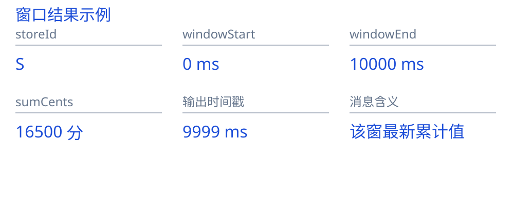</figure>

<strong>输出时间戳</strong>：窗口输出记录通常携带窗内最大时间戳（如 `[0, 10000)` 为 9999 ms）

<strong>联合主键</strong>：结果须同时保留 `storeId`、`windowStart` 与 `windowEnd` 供下游识别

<!--
最后留意一个级联窗口的细节：当 10 秒窗口算出 16500 分往下游发时，这条聚合结果本身的事件时间戳会被 Flink 自动打成该窗口允许的最大时间戳（比如 9999 ms）。如果下游还要接着按 1 分钟再卷一次大窗口，它正好稳稳落在 `[0, 60000)` 里面！同时输出结构上要把 `storeId` 和 `windowStart`、`windowEnd` 一起作为联合主键，否则下一扇窗的结果就会把上一扇窗覆盖掉。

[Sources]
- https://nightlies.apache.org/flink/flink-docs-release-2.3/docs/dev/datastream/operators/windows/
- https://nightlies.apache.org/flink/flink-docs-release-2.3/docs/dev/table/concepts/dynamic_tables/
-->
