# 状态与流式查询


> 第 4 次课 · 分布式实时计算

让业务历史参与判断、查询与扩容

<!--
同学们，一笔订单创建以后，系统要等五秒钟看顾客付没付钱。要是支付消息跑在创建之前到达，或者五秒到了还没见着支付，甚至上线两个月后需要扩容成双倍机器，算子靠什么稳稳把账算对？秘密在于把历史状态交给流引擎作为“一等公民”来托管，再用定时器推进时间检查、用动态表和 Changelog 解释连续查询，最后借助 Key Group 把每个订单的记忆完整搬到新实例上。

[Sources]
- https://nightlies.apache.org/flink/flink-docs-release-2.3/docs/dev/datastream/fault-tolerance/state/
- https://nightlies.apache.org/flink/flink-docs-release-2.3/docs/dev/table/concepts/dynamic_tables/
- 教学构造数据：course/data/cases.json；金额单位为分。特定示例在页面注明参数。
-->


---
class: course story-course
---
## 状态让后来的输入能解释过去

<figure class="story-figure"></figure>

<strong>托管状态（State）</strong>：算子交由引擎长期管理的历史记忆

<strong>核心区别</strong>：引擎托管才支持异步快照、故障恢复与扩容迁键

> 问题：为什么不在算子里直接 `new HashMap()` 存订单创建时间？

<!--
大家想一个工程问题：为什么不在算子代码里自己 `new` 一个 Java `HashMap` 来记订单创建时间，非要用 Flink 的托管状态？两件事会把自建 `HashMap` 打趴下：第一，进程崩了以后引擎不知道怎么给你的私有内存打一致快照；第二，扩容把机器从 2 台变成 4 台时，私有 `HashMap` 根本没法按订单键自动拆走。把状态交给引擎托管，才谈得上故障恢复和弹性扩缩容。

[Sources]
- https://nightlies.apache.org/flink/flink-docs-release-2.3/docs/dev/datastream/fault-tolerance/state/
- 教学构造数据：course/data/cases.json；金额单位为分。特定示例在页面注明参数。
-->


---
class: course story-course
---
## Keyed State 按业务键隔离历史

<figure class="story-figure"></figure>

<strong>Keyed State</strong>：严格绑定到每个 `(算子, 业务键)` 单元

<strong>隔离效果</strong>：O1 支付到来时仅读写 O1 状态槽，与 O2 互不干扰

<!--
在 `keyBy(orderId)` 之后，每个订单号在算子内部都有自己独立的一格托管存储。O1 创建于 1 秒，O2 创建于 3 秒，当 4 秒时 O1 的支付到来，Flink 先把上下文自动切换到 O1 的命名空间，算子代码只需直接读取“当前键的创建时间”，读完拿到的就一定是 O1 的 1 秒，绝对不会串台读到 O2 的 3 秒。keyBy 保证同键去往同一实例，Keyed State 则保证同一实例内部不同键之间井水不犯河水。

[Sources]
- https://nightlies.apache.org/flink/flink-docs-release-2.3/docs/dev/datastream/fault-tolerance/state/
-->


---
class: course story-course
---
## 按需要选择状态结构

<figure class="story-figure">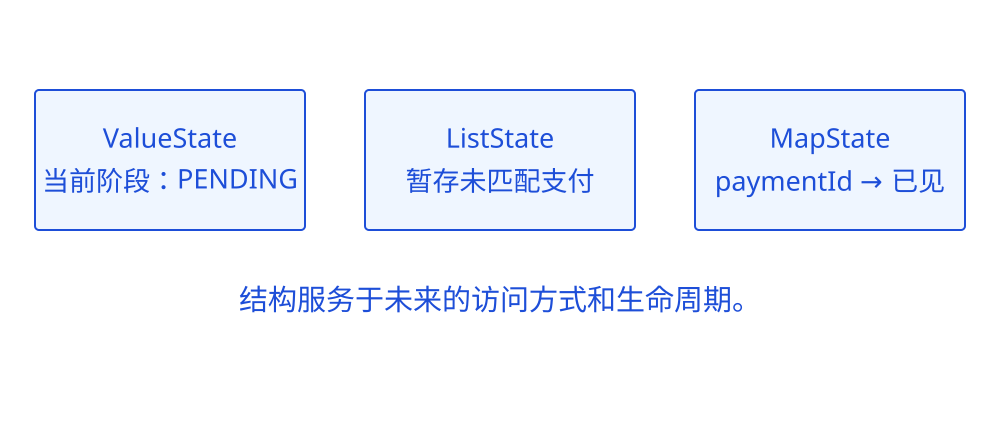</figure>

<strong>`ValueState`</strong>：存单值属性（如订单当前阶段 `PENDING`）

<strong>`ListState`</strong>：存有序列表（如暂存提前到达的待匹配支付）

<strong>`MapState`</strong>：存键值映射（如 `paymentId` 已见集合，支持 O(1) 检索）

<!--
Flink 给了几种开箱即用的状态原语，按未来的读写方式来挑就行。每次只需要读写“当前状态是不是 PENDING”这种单一属性，选 `ValueState` 最省事；要缓存还没等来创建的几条待匹配消息，用 `ListState` 顺序追加；而判断某笔支付 `paymentId` 以前见没见过，用 `MapState` 按键做 $O(1)$ 查找，而且在使用 RocksDB 后端时还能避免把整张表全反序列化出来。

[Sources]
- https://nightlies.apache.org/flink/flink-docs-release-2.3/docs/dev/datastream/fault-tolerance/state/
-->


---
class: course story-course
---
## Operator State 与实例关联

<figure class="story-figure">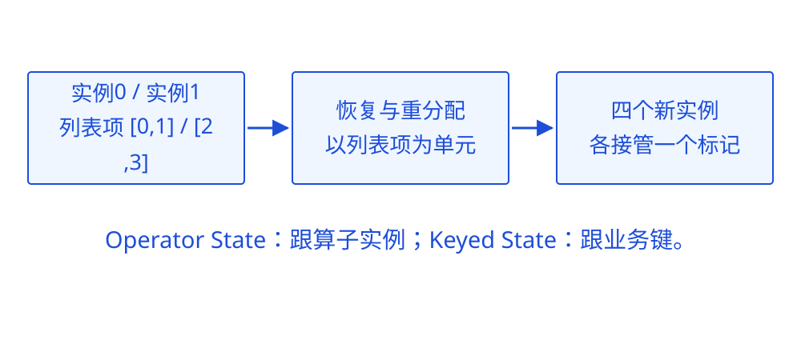</figure>

<strong>Operator State</strong>：绑定到并行算子实例，常用于 Source 分区读取位点

<strong>扩缩重分配</strong>：实例 `[0, 1]` 与 `[2, 3]` 扩容后按列表项均匀分发给 4 个实例

<!--
不是所有状态都能找到业务键，比如 Kafka Source 在消费前还不知道消息里的订单号是什么，它只需要记住自己正在拉取哪些分区的偏移量，这就是 Operator State（算子状态）。示例里两个实例分别管着 `[0, 1]` 和 `[2, 3]` 四个分区标记，扩容成四个实例后，引擎按“可重分配列表”策略自动给每个新实例发一个标记。至于用户订单历史，绝对不能拿算子状态乱拆，必须用 Keyed State 跟着键走。

[Sources]
- https://nightlies.apache.org/flink/flink-docs-release-2.3/docs/dev/datastream/fault-tolerance/state/
- https://nightlies.apache.org/flink/flink-docs-release-2.3/docs/concepts/stateful-stream-processing/
-->


---
class: course story-course
---
## 工作状态、后端与检查点存储

<figure class="story-figure"></figure>

<strong>工作状态</strong>：算子运行期实时读写的内存/盘中当前数据

<strong>状态后端</strong>：管运行期本地读写性能（堆内存 vs RocksDB）

<strong>检查点存储</strong>：管远端共享持久化恢复，防止单机故障丢失本地状态

<!--
初学者常把三个位置搅在一起，指出来就明白了：算子正在更新的那份历史叫工作状态；**状态后端**管这份工作状态是放 JVM 堆内存还是放本地 RocksDB 盘；而**检查点存储**（比如 HDFS 或 S3）专门保存脱离工作节点的持久恢复快照。千万别把本地磁盘目录当成容错快照，因为整台服务器故障后，新节点可拿不到旧机器的本地盘。

[Sources]
- https://nightlies.apache.org/flink/flink-docs-release-2.3/docs/dev/datastream/fault-tolerance/state/
- https://nightlies.apache.org/flink/flink-docs-release-2.3/docs/ops/state/state_backends/
-->


---
class: course story-course
---
## 状态容量先从业务对象估算

<figure class="story-figure">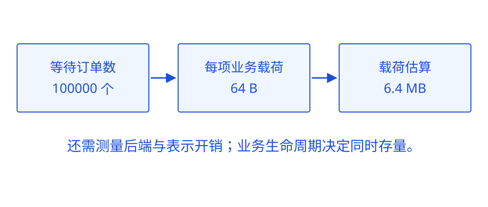</figure>

<strong>载荷估算</strong>：100,000 个未决订单 × 64 B = <strong>6.4 MB</strong> 纯业务载荷

<strong>真实开销</strong>：须计入对象头、索引膨胀；<strong>状态退出机制</strong>决定长期上限

<!--
来算一笔容量账：同时有十万个订单在等支付，每个订单记 64 字节业务字段，纯载荷是 6.4 MB。但生产上不能照着 6.4 MB 配内存，JVM 对象头、哈希索引或序列化字节通常还要放大几倍。比单条大小更致命的是“存量会不会无限长”：如果已经付完钱或过期的订单一直留在状态里不清理，再大的硬盘迟早也会被撑爆。设计状态的第一天就必须同步定好清理规则。

[Sources]
- https://nightlies.apache.org/flink/flink-docs-release-2.3/docs/dev/datastream/fault-tolerance/state/
- https://nightlies.apache.org/flink/flink-docs-release-2.3/docs/ops/state/state_backends/
- 教学构造数据：course/data/cases.json；金额单位为分。特定示例在页面注明参数。
-->


---
class: course story-course
layout: section
---
## 1 · 状态与订单生命周期

<ol class="outline"><li class="current">状态与订单生命周期</li><li>定时器与去重边界</li><li>流式查询与变更消息</li><li>状态扩容与方案设计</li></ol>

<!--
清理之前，先看清订单在五秒窗口期里要经历哪些阶段：正常在期限内付款、到期没付触发超时、以及超时以后又冒出一笔迟到支付。只有把状态机每条边的触发事件、前置条件和副作用写死，定时器、状态和下游输出才不会互相打架。

[Sources]
- https://nightlies.apache.org/flink/flink-docs-release-2.3/docs/concepts/stateful-stream-processing/
-->


---
class: course story-course
---
## 订单等待支付的判定规则

<figure class="story-figure"></figure>

<strong>匹配条件</strong>：按 `orderId` 关联，且 `0 ≤ 支付时间 − 创建时间 ≤ 5000 ms`

<strong>状态分支</strong>：按时支付转 `PAID`；到期未付转 `EXPIRED`；终态后支付转补核

<!--
先把订单业务口径钉在黑板上：创建和支付必须对上同一个订单号，业务时间差落在 `[0, 5000 ms]` 闭区间内才算有效。同时规定在线状态机原则：**超时一旦判定并对外宣布，哪怕事后又飘来一笔迟到支付，也不偷偷反悔撤销原来的超时消息，而是把它送进补核流留痕处理**。只有把这种边界政策摆在明面上，后面的定时器设计才不会自相矛盾。

[Sources]
- https://nightlies.apache.org/flink/flink-docs-release-2.3/docs/dev/datastream/fault-tolerance/state/
- 教学构造数据：course/data/cases.json；金额单位为分。特定示例在页面注明参数。
-->


---
class: course story-course
---
## 四个订单与三个支付

<figure class="story-figure">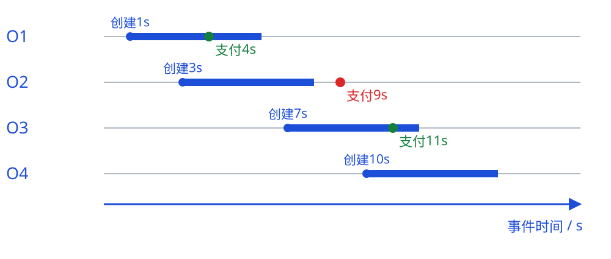</figure>

<strong>样本序列</strong>：创建 O1(1s)、O2(3s)、O3(7s)、O4(10s)；支付 O1(4s, 3000)、O2(9s, 5000)、O3(11s, 2000)

<strong>推演标记</strong>：在 O2 支付前注入 `W=8001 ms`，末尾注入 `W=15001 ms` 触发定时

<!--
来看推演用的四个典型订单：O1 创建于 1 秒、支付于 4 秒（差 3 秒有效）；O2 创建于 3 秒、支付于 9 秒（差 6 秒已超期）；O3 创建于 7 秒、支付于 11 秒（差 4 秒有效）；O4 干脆一直没支付。为了让定时器的触发过程清清楚楚，我们特意在 O2 支付到达之前注入一条 `W=8001 ms` 的水位线，最后再注入一条 `W=15001 ms`。接下来一格一格追踪它们的状态变化。

[Sources]
- https://nightlies.apache.org/flink/flink-docs-release-2.3/docs/dev/datastream/fault-tolerance/state/
- 教学构造数据：course/data/cases.json；金额单位为分。特定示例在页面注明参数。
-->


---
class: course story-course
---
## UML 状态机画订单的阶段变化

<figure class="story-figure">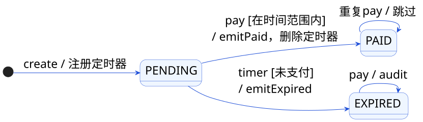</figure>

<strong>图形要素</strong>：圆角框画状态阶段，有向边画事件、守卫条件与动作

<strong>三条主线</strong>：创建 → `PENDING`；有效支付 → `PAID`；到期未付 → `EXPIRED`

<!--
用标准的 UML 状态机把订单一生的流转画成一张图。黑色实心圆起点一进来，创建事件把订单推进 `PENDING`；如果有效支付先赶到，状态转成 `PAID` 并立刻删掉定时器；如果定时器先响了且当时还在 `PENDING`，状态转成 `EXPIRED` 并报超时。进入终态以后再来的重复支付直接跳过，超期晚到的支付送去补核。每个订单独立拥有这样一份状态机实例。

[Sources]
- https://www.omg.org/spec/UML/2.5.1/PDF
- https://nightlies.apache.org/flink/flink-docs-release-2.3/docs/dev/datastream/fault-tolerance/state/
- 教学构造数据：course/data/cases.json；金额单位为分。特定示例在页面注明参数。
-->


---
class: course story-course
---
## 状态机转移写成事件、条件和动作

<figure class="story-figure">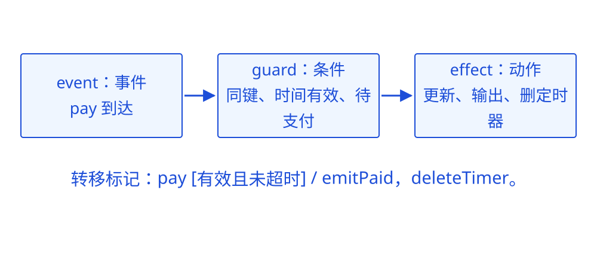</figure>

<strong>标准语法</strong>：`event [guard] / effect`（触发事件 [守卫条件] / 副作用动作）

<strong>示例</strong>：`pay [有效且尚在 PENDING] / 转 PAID、输出支付、删定时器`

<!--
大家学会读箭头上的标准三段式 `event [guard] / effect`：`event` 是来了什么消息（如 `pay`）；中括号里的 `[guard]` 是允许走这条线的条件（如时间差 ≤ 5 秒且当前仍为 `PENDING`）；斜线后的 `/ effect` 是顺便要做的动作（更新状态、发出 3000 分结果、注销定时器）。把条件和副作用写进中括号和斜线后面，就不会出现“改了状态却忘了删定时器”的漏网 Bug。

[Sources]
- https://www.omg.org/spec/UML/2.5.1/PDF
- https://nightlies.apache.org/flink/flink-docs-release-2.3/docs/dev/datastream/fault-tolerance/state/
-->


---
class: course story-course
---
## 状态机的绘制步骤

<figure class="story-figure"></figure>

<strong>三步画法</strong>：列阶段方块 → 连输入事件 → 补全 `[条件]` 与 `/ 动作`

<strong>四路校验</strong>：拿正常支付、超时未付、重复投递、支付先到逐路试走

<!--
自己画状态机时先定出阶段方块（PENDING、PAID、EXPIRED），再把创建、支付和定时器三条外部驱动连上去。画完别停笔，用四条真实剧本逐路试走：正常支付、到期未付、重复投递、以及支付比创建早到（比如 O5 先缓冲待匹配支付再等创建到达）。每条分支都能自洽走完，图才算画实。

[Sources]
- https://www.omg.org/spec/UML/2.5.1/PDF
- https://nightlies.apache.org/flink/flink-docs-release-2.3/docs/dev/datastream/fault-tolerance/state/
-->


---
class: course story-course
---
## 事件时间定时器由水位线推进

<figure class="story-figure">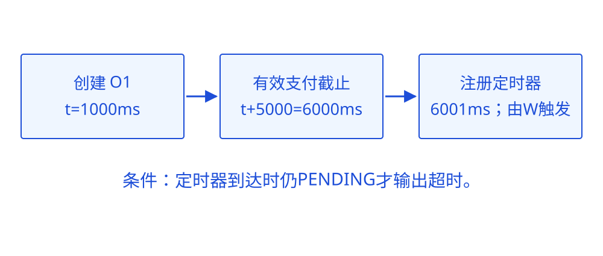</figure>

<strong>事件时间定时器</strong>：绑定到业务键与未来时间戳，由水位线跨越时回调 `onTimer`

<strong>闹钟时刻</strong>：因允许第 5000 ms 边界有效，创建于 `t` 的订单登记 `t + 5001 ms`

<!--
为什么要引入定时器？因为如果一位顾客下单后直接关掉 App 再也不付款，根本不会有任何后续“支付消息”来唤醒算子！定时器就像算子给自己设了一个闹钟：当 `O1` 在 1000 ms 创建时，由于 6000 ms 整那 1 毫秒还算有效，算子向 Flink 登记一个 `6001 ms` 的事件时间闹钟。只要以后水位线走到 6001 ms（哪怕 O1 再也没来任何消息），Flink 就会准时把算子的 `onTimer` 函数叫醒去查账。

[Sources]
- https://nightlies.apache.org/flink/flink-docs-release-2.3/docs/dev/datastream/fault-tolerance/state/
- https://nightlies.apache.org/flink/flink-docs-release-2.3/docs/dev/datastream/operators/process_function/
- 教学构造数据：course/data/cases.json；金额单位为分。特定示例在页面注明参数。
-->


---
class: course story-course
---
## 创建先建立状态，再登记检查

<figure class="story-figure">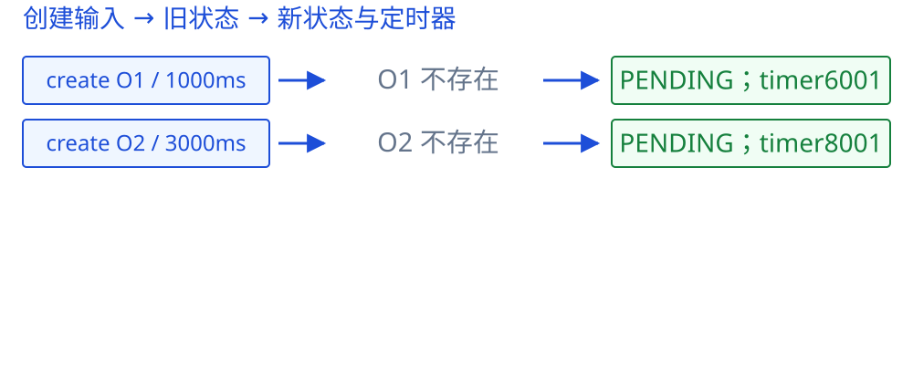</figure>

<strong>O1（1000 ms 创建）</strong>：记 `createdAt=1000, stage=PENDING`，注册 `6001 ms` 闹钟

<strong>O2（3000 ms 创建）</strong>：记 `createdAt=3000, stage=PENDING`，注册 `8001 ms` 闹钟

<!--
演练开场两笔创建。1 秒时 O1 落盘为 PENDING 并定好 6001 ms 的闹钟；3 秒时 O2 在自己的键空间里写下 PENDING 并定好 8001 ms 的闹钟。注意，闹钟也是跟着键走的：如果同一订单重投了一次创建，要注意幂等保护，别把原来的创建时间和闹钟弄乱。此时系统里同时挂着两份独立记忆和两个倒计时闹钟。

[Sources]
- https://nightlies.apache.org/flink/flink-docs-release-2.3/docs/dev/datastream/fault-tolerance/state/
- 教学构造数据：course/data/cases.json；金额单位为分。特定示例在页面注明参数。
-->


---
class: course story-course
---
## 步骤一：O1 按时支付

<figure class="story-figure"></figure>

<strong>O1 支付（4 s, 3000 分）</strong>：`4000 − 1000 = 3000 ms ≤ 5000`，且尚在 PENDING

<strong>动作执行</strong>：转为 `PAID`，输出 <strong>3000 分</strong>成交，并注销 `6001 ms` 定时器

<!--
4 秒时 O1 的支付到达。算子顺着 keyBy 找到 O1 的创建时间 1000 ms，相减得 3000 ms 落在有效期里，且当前还是 PENDING。于是立刻把阶段改成 PAID，向下游输出 3000 分成交，同时顺手把先前登记的 6001 ms 定时器删掉。虽然 `onTimer` 里一般还会再复查一次阶段，但主动删除无用定时器能省下大量后台队列内存和无效唤醒。

[Sources]
- https://nightlies.apache.org/flink/flink-docs-release-2.3/docs/dev/datastream/fault-tolerance/state/
- 教学构造数据：course/data/cases.json；金额单位为分。特定示例在页面注明参数。
-->


---
class: course story-course
---
## 步骤二：O2 尚未支付，进度先到截止后

<figure class="story-figure">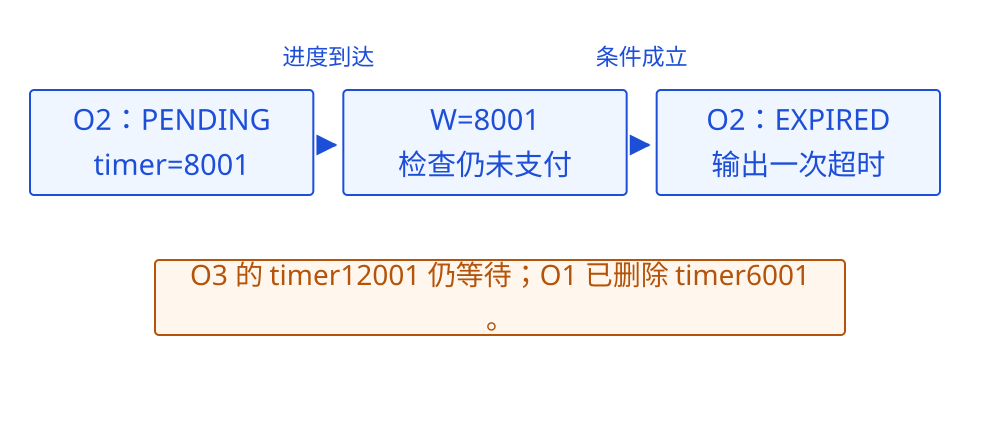</figure>

<strong>O3 创建（7 s）</strong>：登记 `12001 ms` 闹钟；随后水位线推进至 <strong>8001 ms</strong>

<strong>O2 超时</strong>：8001 ms 闹钟响起时 O2 仍为 PENDING → 转 `EXPIRED` 并报超时

<!--
7 秒时 O3 创建并定好 12001 ms 闹钟。紧接着水位线跨到了 8001 ms，正好踩响 O2 的闹钟！系统唤醒 O2 的 `onTimer`，一看 O2 果然还在 PENDING，立刻把阶段改写为 EXPIRED 并向外报出“O2 超时”。此时 O1 的闹钟早被删了，O3 的闹钟要到 12001 ms 才响，互不串扰。

[Sources]
- https://nightlies.apache.org/flink/flink-docs-release-2.3/docs/dev/datastream/fault-tolerance/state/
- 教学构造数据：course/data/cases.json；金额单位为分。特定示例在页面注明参数。
-->


---
class: course story-course
---
## 步骤三：O2 的支付进入补核

<figure class="story-figure"></figure>

<strong>O2 支付（9 s, 5000 分）</strong>：`9000 − 3000 = 6000 ms` 业务超期且在线已转 `EXPIRED`

<strong>处理规则</strong>：维持 `EXPIRED` 不撤回超时通知，5000 分转入旁路补核对账

<!--
9 秒时 O2 的 5000 分支付终于露面了。算子一查 O2 的状态，一方面 9000 减 3000 等于 6000 ms，本来就已经超出了 5 秒业务有效期；另一方面在线状态早已变成 EXPIRED。遵照前面定好的边界政策，这里绝对不去偷偷篡改已发出去的超时记录，而是把这笔 5000 分送去旁路补核留底。注意分清两个判断：6000 ms 是业务超期，而 9000 ms 并不落后于 8001 ms 水位线。

[Sources]
- https://nightlies.apache.org/flink/flink-docs-release-2.3/docs/dev/datastream/fault-tolerance/state/
- 教学构造数据：course/data/cases.json；金额单位为分。特定示例在页面注明参数。
-->


---
class: course story-course
---
## 步骤四：O3 支付，O4 超时

<figure class="story-figure"></figure>

<strong>O3 成交</strong>：O3 支付（`11000 − 7000 = 4000 ms`）转 PAID 输出 <strong>2000 分</strong>

<strong>O4 超时</strong>：O4 创建（10 s）于末尾 `W=15001` 转 EXPIRED；在线成交 <strong>5000 分</strong>

<!--
把最后两步走完：10 秒 O4 创建并设好 15001 ms 闹钟；11 秒 O3 支付到达，比 7 秒晚 4 秒，顺利成交 2000 分并取消 12001 闹钟；最后水位线推进到 15001 ms，O4 毫无音讯，闹钟响起转 EXPIRED。盘点全盘：O1（3000）和 O3（2000）合计 5000 分有效成交，O2 和 O4 超时，O2 那笔超期 5000 分在补核流里静静躺着，每一分都有交代。

[Sources]
- https://nightlies.apache.org/flink/flink-docs-release-2.3/docs/dev/datastream/fault-tolerance/state/
- 教学构造数据：course/data/cases.json；金额单位为分。特定示例在页面注明参数。
-->


---
class: course story-course
---
## 支付先于创建到达时保留待匹配项

<figure class="story-figure">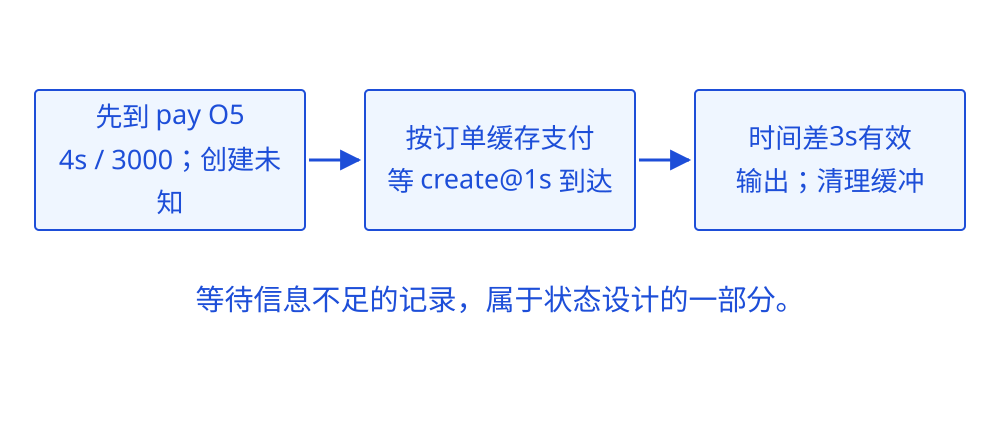</figure>

<strong>乱序到达</strong>：O5 支付（4 s, 3000 分）早于创建（1 s）到达算子

<strong>缓冲匹配</strong>：`ListState` 暂存支付；待创建到达核对差 3 s 有效，输出并清理缓冲

<!--
分布式系统里常常发生“钱先到、单后到”：O5 的 4 秒支付居然比 1 秒的创建消息早走进算子！这时候系统不能傻傻报错，也不能直接放行，而是先在 `ListState` 里把这笔待匹配支付存下来，同时也可登记清理定时器防永久孤儿；等 1 秒的创建姗姗来迟，立刻掏出缓存一算 4 − 1 = 3 秒在期限内，成交并清掉缓存。状态不仅记得住“过去”，也能缓冲“提前敲门的未来”。

[Sources]
- https://nightlies.apache.org/flink/flink-docs-release-2.3/docs/dev/datastream/fault-tolerance/state/
- 教学构造数据：course/data/cases.json；金额单位为分。特定示例在页面注明参数。
-->


---
class: course story-course
---
## 水位线停滞，事件时间定时器也等待

<figure class="story-figure">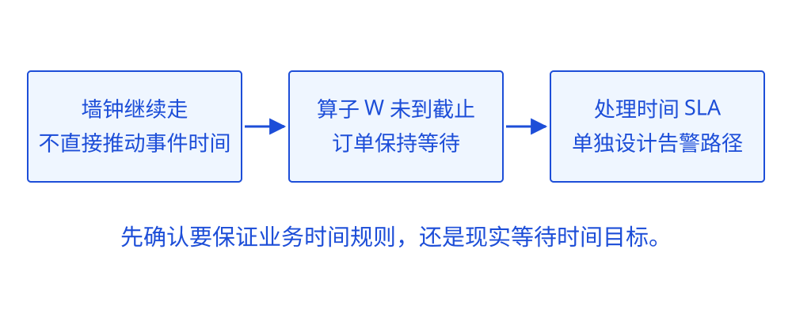</figure>

<strong>时钟特性</strong>：只要算子水位线未越过截止点，哪怕墙钟已过很久，事件时间闹钟也不响

<strong>运维 SLA</strong>：若要求真实物理时间 5 s 必报警，须额外搭配处理时间定时器

<!--
线上经常收到这样的告警求助：“客户下单都过去一分钟了，为什么五秒超时还没触发？”原因往往是某条上游分区卡住了，算子水位线一直不动，事件时间闹钟根本没被推进。请大家分清业务语义和运维 SLA：事件时间闹钟忠于业务发生时间，如果业务强要求“不管上游卡没卡，真实墙钟过 5 秒没动静就必须立刻兜底报警”，那就得配一个处理时间定时器专门干这个活，别把两套时钟混着写。

[Sources]
- https://nightlies.apache.org/flink/flink-docs-release-2.3/docs/dev/datastream/fault-tolerance/state/
- https://nightlies.apache.org/flink/flink-docs-release-2.3/docs/concepts/time/
- https://nightlies.apache.org/flink/flink-docs-release-2.3/docs/dev/datastream/event-time/generating_watermarks/
-->


---
class: course story-course
---
## 边界练习：恰好五秒与后到支付

<strong>边界条件</strong>：O6 创建于 1000 ms，支付时间 6000 ms（压线 5 s），闹钟定在 <strong>6001 ms</strong>

<strong>两种情境</strong>：情境甲支付先于 `W=6001` 到达；情境乙 `W=6001` 先触发

> 问题：情境乙中，后到的 6000 ms 支付能否撤回已经发出的超时通知？

<!--
做一道边界辨析题巩固刚才的规则。O6 的支付时间恰好卡在 6000 ms，减去 1000 ms 刚好等于 5000 ms 上限，但它的到达顺序跟 `W=6001` 打了个时间差。请分别判断甲、乙两条路走到哪，并回答在本文边界政策下，情境乙的超时能不能被后续支付默默撤回。

[Sources]
- https://nightlies.apache.org/flink/flink-docs-release-2.3/docs/dev/datastream/fault-tolerance/state/
- 教学构造数据：course/data/cases.json；金额单位为分。特定示例在页面注明参数。
-->


---
class: course story-course
---
## 边界答案：有效范围还需配合生命周期

<figure class="story-figure"></figure>

<strong>情境甲（支付先到）</strong>：时间差 5000 ms 有效且尚在 `PENDING` → 转 `PAID` 并删闹钟

<strong>情境乙（闹钟先响）</strong>：`W=6001` 先转 `EXPIRED`；后到支付进补核流，不撤回超时

<!--
核对这两条分叉路：虽然业务时间差都是合法的 5000 ms，但在情境甲里支付赶在闹钟响前进了门，顺利转为 PAID；到了情境乙，6001 ms 闹钟先响一步，订单早已落定为 EXPIRED 并对外发出了关单通知，随后才赶到的支付就只能遵照终态原则送往补核流对账，而不能把已经关掉的订单暗自复活。业务有效范围和在线接纳生命周期，必须合在一起才能唯一确定结果。

[Sources]
- https://nightlies.apache.org/flink/flink-docs-release-2.3/docs/dev/datastream/fault-tolerance/state/
- 教学构造数据：course/data/cases.json；金额单位为分。特定示例在页面注明参数。
-->


---
class: course story-course
layout: section
---
## 2 · 定时器与去重边界

<ol class="outline"><li>状态与订单生命周期</li><li class="current">定时器与去重边界</li><li>流式查询与变更消息</li><li>状态扩容与方案设计</li></ol>

<!--
单子做完以后，状态能全删光吗？万一一个小时后消息队列又把刚才那笔支付重投了一遍怎么办？这一节我们把“业务超时定时器”和“状态存储 TTL（存活时间）”这两把完全不同的剪刀区分清楚，定下各自该什么时候剪、剪完以后怎么兜底。

[Sources]
- https://nightlies.apache.org/flink/flink-docs-release-2.3/docs/concepts/stateful-stream-processing/
-->


---
class: course story-course
---
## 重复事件需要保留身份历史

<figure class="story-figure"></figure>

<strong>身份留存</strong>：P1 生效后记入 `Seen[P1]`，后续重投查见即跳过

<strong>常见陷阱</strong>：若随订单结单清空 `Seen`，稍后的重投就会穿透成“新支付”

<!--
看这个线上常踩的坑：刚才第一讲用 `Seen` 防重，现在订单成交了，有同学顺手就把这个订单下所有的状态（包括 `Seen[P1]`）全 `clear()` 掉了。结果十分钟后上游 Kafka 抖动重投了一次 P1，算子翻了翻空空如也的 `Seen`，惊喜地以为来了一笔新钱，又多算了一遍！所以身份记录要活得比订单交易期长，或者干脆依赖下游数据库的唯一主键来做永久防重。

[Sources]
- https://nightlies.apache.org/flink/flink-docs-release-2.3/docs/dev/datastream/fault-tolerance/state/
- 教学构造数据：course/data/cases.json；金额单位为分。特定示例在页面注明参数。
-->


---
class: course story-course
---
## TTL 控制状态可用期限

<figure class="story-figure">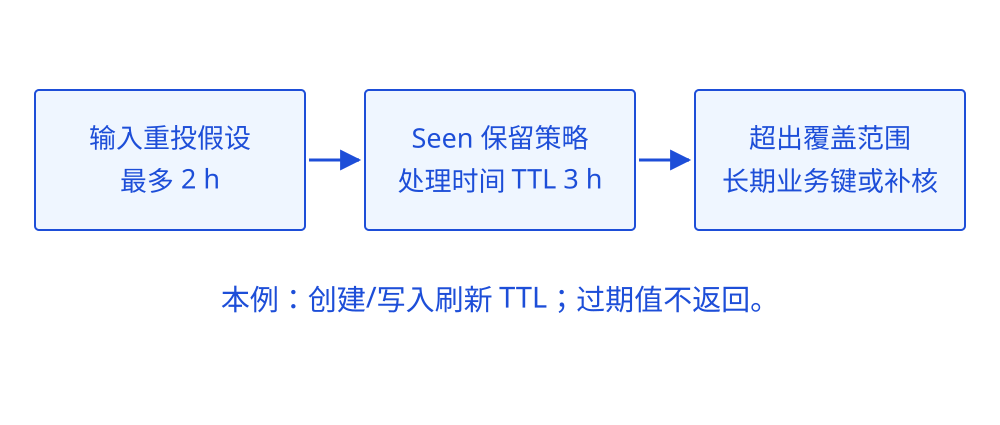</figure>

<strong>TTL（存活时间）</strong>：按<strong>处理时间</strong>自动清理超期状态，防止存储无限膨胀

<strong>示例策略</strong>：若上游最多 2 h 内重投，给 `Seen` 配 <strong>3 h</strong> TTL；更长重投交下游主键兜底

<!--
如果不能无限保留去重集合，工程上就给状态挂上 TTL（存活时间）。注意 Flink 托管状态的 TTL 用的是机器的处理时间而非事件时间。假定上游协议保证同一消息最多在 2 小时内重投，我们可以给 `Seen` 配 3 小时的 TTL（设成创建或写入时刷新、过期即不返回）。超过 3 小时以后的极罕见重投，交给下游结果库的唯一主键约束去兜底。

[Sources]
- https://nightlies.apache.org/flink/flink-docs-release-2.3/docs/dev/datastream/fault-tolerance/state/
-->


---
class: course story-course
---
## TTL 清理与业务定时器的职责

<figure class="story-figure"></figure>

<strong>事件时间定时器</strong>：由水位线推进，精准执行超时判断并触发业务输出

<strong>TTL 清理</strong>：由后台存储驱动，默默淘汰冷状态以控制容量（不发业务事件）

<!--
一定要把这两个机制的职责彻底划清！业务超时的判定、发出 `EXPIRED` 事件必须交给事件时间定时器，因为它精准跟着业务时间走且必须发得出下游通知；而 TTL 只是存储层的“过期垃圾清理工”，静悄悄地把过期条目从后端抹掉以防状态膨胀，绝对不能指望拿 TTL 过期来触发业务超时告警。

[Sources]
- https://nightlies.apache.org/flink/flink-docs-release-2.3/docs/dev/datastream/fault-tolerance/state/
-->


---
class: course story-course
layout: section
---
## 3 · 流式查询与变更消息

<ol class="outline"><li>状态与订单生命周期</li><li>定时器与去重边界</li><li class="current">流式查询与变更消息</li><li>状态扩容与方案设计</li></ol>

<!--
前面我们手写了订单和支付的双流关联状态机。其实在 Flink 里，这种按时间和键把两条流凑成对的需求非常常见，Flink DataStream 提供了专门的 Interval Join，而 Table API / SQL 更直接用“动态表 + Changelog”把流式计算还原成了大家熟悉的关系查询。

[Sources]
- https://nightlies.apache.org/flink/flink-docs-release-2.3/docs/concepts/stateful-stream-processing/
-->


---
class: course story-course
---
## 双流 Join 保留尚未匹配的历史

<figure class="story-figure">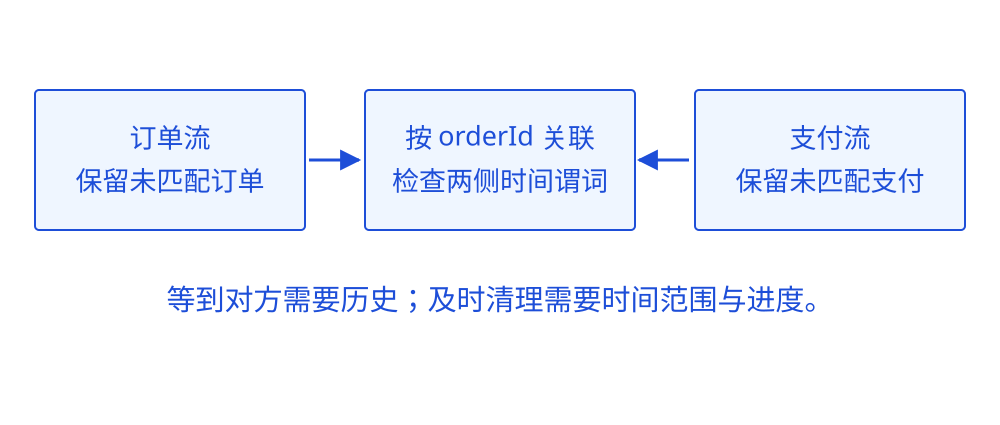</figure>

<strong>双流缓冲</strong>：两条流均需在状态中缓存未匹配记录，等待对方抵达后校验条件

<strong>Regular Join</strong>：保留全历史易撑爆状态；<strong>Interval Join</strong> 划定时间窗自动清过期状态

<!--
两条流做关联，谁先到谁就得先蹲在状态里等对方。这里有一条选型分水岭：如果你写的是 SQL 里的普通双流关联（Regular Join），引擎不知道两条流什么时候才能彻底绝交，只好把左右两边所有历史全留在状态里，时间一长状态直接膨胀到爆（除非硬配 TTL）；而如果业务像订单配支付那样明确有“下单后 5 秒内”的时间窗，就应该用 **Interval Join**，引擎一看到水位线走过 5 秒上限，就会自动把过期单子清出内存。

[Sources]
- https://nightlies.apache.org/flink/flink-docs-release-2.3/docs/dev/datastream/operators/joining/
- https://nightlies.apache.org/flink/flink-docs-release-2.3/docs/dev/datastream/fault-tolerance/state/
- 教学构造数据：course/data/cases.json；金额单位为分。特定示例在页面注明参数。
-->


---
class: course story-course
---
## Interval Join 以键和时间谓词匹配

<figure class="story-figure"></figure>

<strong>双条件谓词</strong>：`orderId` 相等，且 `0 ≤ payTime − createTime ≤ 5000 ms`

<strong>语义边界</strong>：属<strong>正匹配过滤</strong>，只输出配对成功的订单，不自动发超时告警

<!--
看懂这张区间匹配图：O1、O2、O3、O4 各自向右拉出一条 5 秒长的蓝色有效区。Interval Join 内部帮我们干了前面手写的双流缓冲和过期清理，专门盯着有没有落在蓝色区间的同键支付。注意它的语义特点：它是一次纯粹的**正匹配过滤器**，只负责把配对成功的 O1 和 O3 放出来；至于没配上的 O2 和 O4 要不要发超时告警，Interval Join 本身并不管，需要另外配合外连接或前面讲的状态机。

[Sources]
- https://nightlies.apache.org/flink/flink-docs-release-2.3/docs/dev/datastream/operators/joining/
- 教学构造数据：course/data/cases.json；金额单位为分。特定示例在页面注明参数。
-->


---
class: course story-course
---
## 逐对检查得到两条匹配结果

<figure class="story-figure">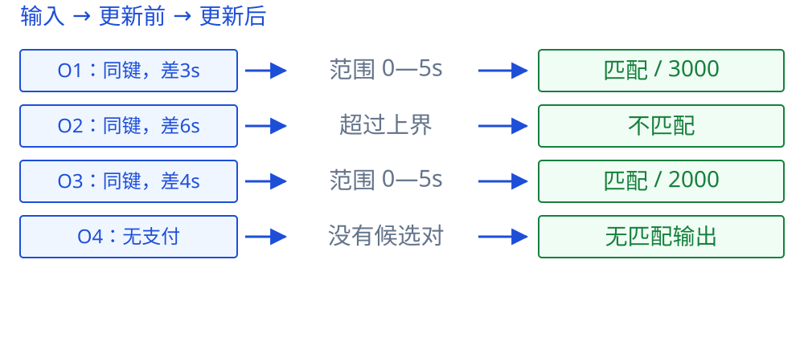</figure>

<strong>匹配成交</strong>：O1（差 3 s）输出 <strong>3000</strong>；O3（差 4 s）输出 <strong>2000</strong>（合计 5000 分）

<strong>未匹配静默</strong>：O2（差 6 s 超界）与 O4（无支付）均不产生任何输出

<!--
拿四张单子逐对验证 Interval Join 的产出：O1 差 3 秒命中，吐出 3000 分；O2 差 6 秒越出蓝色范围，直接被过滤掉不发任何输出；O3 差 4 秒命中，吐出 2000 分；O4 一直干等，到期被清理后静默退出。把这结果跟前面的订单状态机对比就能立刻明白两者的分工：要“精准匹配对”找 Interval Join，要“到期没匹配到也要发超时单”还得上状态机（`KeyedCoProcessFunction`）。

[Sources]
- https://nightlies.apache.org/flink/flink-docs-release-2.3/docs/dev/datastream/operators/joining/
- 教学构造数据：course/data/cases.json；金额单位为分。特定示例在页面注明参数。
-->


---
class: course story-course
---
## Join 绘图练习：同键与边界

<strong>条件</strong>：O7 创建于 10 s；候选支付 O7@15s(2000)、O8@12s(3000)、O7@16s(1000)

<strong>绘制要求</strong>：按闭区间 `[0, 5 s]` 画出匹配窗，逐条判断能否输出及原因

<!--
练手巩固 Interval Join 的双条件判定：O7 在 10 秒创建，有效期到 15 秒。来了三笔候选支付，分别故意设了一个踩边界、一个错订单号、一个超时 1 秒。请画图指出哪一条最终放行、哪两条分别栽在了哪个条件上。

[Sources]
- https://nightlies.apache.org/flink/flink-docs-release-2.3/docs/dev/datastream/operators/joining/
- 教学构造数据：course/data/cases.json；金额单位为分。特定示例在页面注明参数。
-->


---
class: course story-course
---
## Join 答案：只有 O7@15s 匹配

<figure class="story-figure"></figure>

<strong>O7@15s</strong>：同键且差 5 s 落在闭区间 `[0, 5 s]` 内，匹配输出 <strong>2000 分</strong>

<strong>排除项</strong>：O8@12s 因订单键不符排除；O7@16s 因差 6 s 超时间上界排除

<!--
核对三条候选：第一条 O7@15s 虽然压线，但闭区间包含 5 秒边界，同键也对，匹配成功输出 2000 分；第二条 O8@12s 时间明明在范围内，但订单号是 O8 不是 O7，键条件不过关；第三条 O7@16s 键对了，时间差 6 秒越过红线，一样被刷掉。关联判定必须“业务键相等”和“时间差落区间”同时成立。

[Sources]
- https://nightlies.apache.org/flink/flink-docs-release-2.3/docs/dev/datastream/operators/joining/
- 教学构造数据：course/data/cases.json；金额单位为分。特定示例在页面注明参数。
-->


---
class: course story-course
---
## 动态表是随输入持续变化的关系

<figure class="story-figure"></figure>

<strong>动态表（Dynamic Table）</strong>：随流式输入不断演变的逻辑关系表

<strong>流表二象性</strong>：流 → 动态表 → 连续 SQL 查询 → 结果动态表 → Changelog 流

<!--
把视角切到 Flink SQL 的核心抽象：流表二象性。传统数据库里一张表定格在磁盘上不动，查一次出一次结果；而在流计算里，如果把每条进来的支付流看成对一张**动态表**的不断插入，那么跑在这张动态表上的 `GROUP BY userId` 就是一条永远不停的连续查询：E01 来，用户 A 那行显示 3000；E03 来，同一行原位更新成 5000；E06 来，再更新成 6000。流变成了会动的表，查询变成了会推变化的流。

[Sources]
- https://nightlies.apache.org/flink/flink-docs-release-2.3/docs/dev/table/concepts/dynamic_tables/
- 教学构造数据：course/data/cases.json；金额单位为分。特定示例在页面注明参数。
-->


---
class: course story-course
---
## Changelog 描述表的变化

<figure class="story-figure"></figure>

<strong>行变更类型</strong>：`+I`（插入）、`−U`（撤回旧值）、`+U`（写入新值）、`−D`（删除）

<strong>更新序列</strong>：`+I(A, 3000)` → `−U(A, 3000)` → `+U(A, 5000)`

<!--
动态表在内部改了数，怎么把这种修改传给下游算子或者外部存储？靠的就是 Changelog 变更流。看图里这三行消息：`+I` 表示第一次新增用户 A 的行（3000）；当 E03 把 A 改成 5000 时，先发一条 `−U` 告诉下游“把刚才那版 3000 撤回”，紧接着发一条 `+U` 告诉下游“换成最新值 5000”。这跟第三讲学过的 Retracting 撤回模型是一脉相承的：正是有了 `-U`/`+U`，SQL 才敢把复杂聚合一层套一层地往后接。

[Sources]
- https://nightlies.apache.org/flink/flink-docs-release-2.3/docs/dev/table/concepts/dynamic_tables/
-->


---
class: course story-course
---
## Upsert 按键替换结果行

<figure class="story-figure"></figure>

<strong>Upsert 语义</strong>：按结果唯一键直接覆写，`A=3000 → 5000 → 6000` 始终仅留一行

<strong>错加警告</strong>：若下游将连续推送的完整状态误作增量相加，会错算为 <strong>14000 分</strong>

<!--
如果下游本来就是 MySQL、Redis 或 Upsert Kafka 这种支持按主键原位覆写的存储，就可以跳过 `-U` 撤回消息，直接走 Upsert 模式：拿 `userId` 当主键，依次用 3000、5000、6000 盖掉同一行，表里干干净净只剩一行 6000。这里顺手避一个老坑：如果是按窗口统计，千万记得把窗口边界也放进 Upsert 主键，否则下一扇窗一来就会把上一扇窗覆盖没了。

[Sources]
- https://nightlies.apache.org/flink/flink-docs-release-2.3/docs/dev/table/concepts/dynamic_tables/
- 教学构造数据：course/data/cases.json；金额单位为分。特定示例在页面注明参数。
-->


---
class: course story-course
---
## SQL 分组累计对应同一份状态

<figure class="story-figure">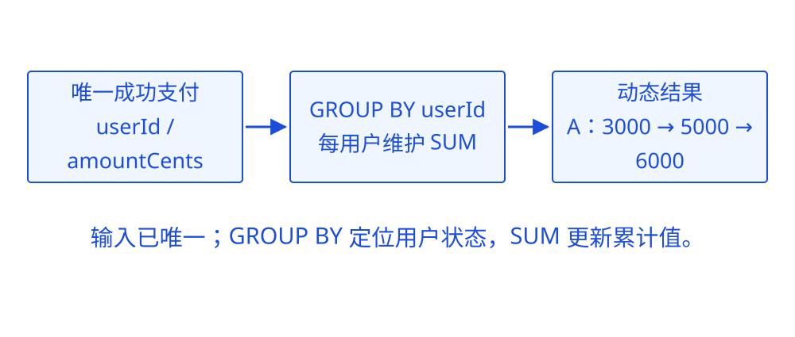</figure>

<strong>物理映射</strong>：`GROUP BY userId` 编译为按键分组，`SUM()` 编译为托管状态更新

<strong>隐含约束</strong>：声明式 SQL 同样占用 Keyed State，仍须治理状态大小与 TTL

<!--
同学们写 SQL 时千万别以为没写 `ValueState` 引擎就不用状态了。看这段简单的 SQL：`FROM UniquePaid` 进来以后，`GROUP BY userId` 在物理执行计划里就自动翻译成 `keyBy(userId)`，而 `SUM(amountCents)` 就在后台悄悄开辟着每人的托管状态，每来一条就改写一次并往下游推 Changelog。声明式 SQL 把状态管理藏在了优化器后面，但底层的状态体积、TTL 清理要求跟 DataStream 一分不少。

[Sources]
- https://nightlies.apache.org/flink/flink-docs-release-2.3/docs/dev/table/sql/queries/overview/
- https://nightlies.apache.org/flink/flink-docs-release-2.3/docs/dev/table/concepts/dynamic_tables/
- 教学构造数据：course/data/cases.json；金额单位为分。特定示例在页面注明参数。
-->


---
class: course story-course
---
## SQL 分组累计的查询语句

```sql
SELECT userId,
       SUM(amountCents) AS sumCents,
       COUNT(*) AS paidCount
FROM UniquePaid
GROUP BY userId;
```

- **输入表 `UniquePaid`**：已完成成功过滤与身份去重，每条代表一笔唯一成功支付
- **分组与聚合**：`userId` 标识输出主键；`SUM` 累计整数分，`COUNT` 累计笔数

<!--
对着这几行 SQL 逐字往下读：`SELECT` 选出输出列，其中 `SUM` 与 `COUNT` 持续累计金额与笔数；`FROM` 接入已经滤除失败并做过身份去重的输入表；`GROUP BY userId` 告诉引擎为每个用户单独维护一份累计状态。顺便记住 SQL 里末尾的分号只是声明语句语法的结束符，在无界动态表上，这条查询会一直不停歇地持续运行并推送更新。

[Sources]
- https://nightlies.apache.org/flink/flink-docs-release-2.3/docs/dev/table/sql/queries/overview/
- https://nightlies.apache.org/flink/flink-docs-release-2.3/docs/dev/table/concepts/dynamic_tables/
- 教学构造数据：course/data/cases.json；金额单位为分。特定示例在页面注明参数。
-->


---
class: course story-course
---
## SQL 窗口需要事件时间属性

<figure class="story-figure">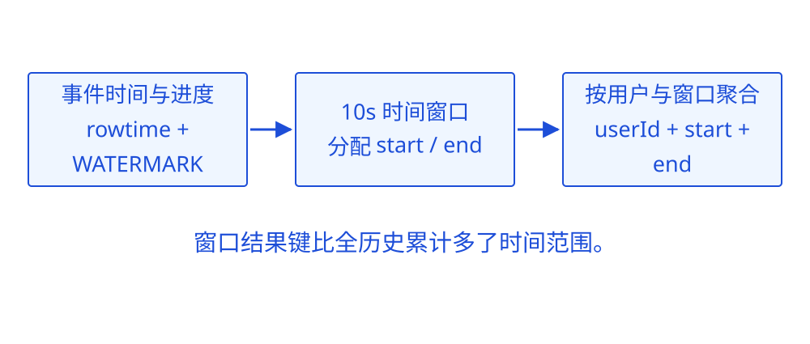</figure>

<strong>时间声明</strong>：在 DDL 中用 `WATERMARK` 指定事件时间列 `rowtime` 与推进策略

<strong>窗口分组</strong>：使用 `TUMBLE` 窗口表值函数后，`GROUP BY` 须带上 `window_start/end`

<!--
要在 SQL 里按十秒窗口统计营业额，第一步是在建表 DDL 里把哪一列当事件时间、水位线滞后几秒（`WATERMARK FOR rowtime AS rowtime - INTERVAL '2' SECOND`）交代清楚；第二步是用 `TUMBLE` 窗口表值函数给每行贴上 `window_start` 和 `window_end`；第三步在 `GROUP BY` 里同时带上 `userId` 和窗口起止边界。前面第三讲的所有时间概念，全浓缩进了这几行声明里。

[Sources]
- https://nightlies.apache.org/flink/flink-docs-release-2.3/docs/dev/table/sql/queries/overview/
- https://nightlies.apache.org/flink/flink-docs-release-2.3/docs/dev/table/sql/queries/window-tvf/
-->


---
class: course story-course
---
## SQL 与 DataStream 共同表达数据依赖


<strong>SQL / Table API</strong>：声明式表达关系结果，由优化器自动生成执行计划

<strong>DataStream</strong>：显式编排算子、精细控制定时器、旁路侧输出与底层状态

<strong>共同底座</strong>：底层运行在同一个引擎，均须界定键、时间、状态清理与输出协议

<!--
经常有同学问：“做项目到底该用 Flink SQL 还是 DataStream？”看这张共同的物理流图就明白了：SQL 胜在开发快、自带优化器，适合规则化的统计和关联；DataStream 掌控力极强，碰到复杂订单超时闹钟、自定义旁路补核和精细状态控制还得上 ProcessFunction。在运行层面，两者最终都编译成相同的 Task DAG、用相同的状态后端和水位线机制。

[Sources]
- https://nightlies.apache.org/flink/flink-docs-release-2.3/docs/dev/table/concepts/dynamic_tables/
- https://nightlies.apache.org/flink/flink-docs-release-2.3/docs/dev/table/sql/queries/overview/
- https://nightlies.apache.org/flink/flink-docs-release-2.3/docs/concepts/flink-architecture/
-->


---
class: course story-course
---
## CEP 描述事件之间的顺序模式

<figure class="story-figure">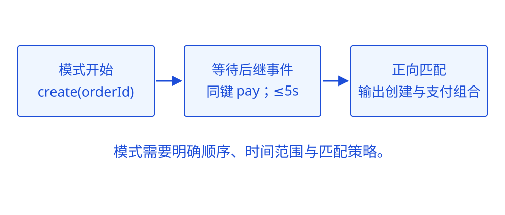</figure>

<strong>复杂事件处理（CEP）</strong>：按既定先后顺序、连续性与时间约束匹配事件序列

<strong>示例模式</strong>：同一订单先发生 `create`、后发生 `pay`，且事件时间差 `≤ 5 s`

<!--
除了一对一 Join 和 SQL 查询，风控和监控场景还有一类经典需求：抓出一连串按顺序发生的特定行为模式，比如“创建订单后 5 秒内接着发生支付”，或者“同一张卡连续三次密码错误后紧接着异地大额消费”。Flink CEP 用非确定有限自动机（NFA）来描述这类跨事件的顺序匹配，除了前后顺序和时间上限，还要明确定好相邻事件之间允不允许插进别的杂音事件（严格连续还是宽松连续）。

[Sources]
- https://nightlies.apache.org/flink/flink-docs-release-2.3/docs/libs/cep/
- 教学构造数据：course/data/cases.json；金额单位为分。特定示例在页面注明参数。
-->


---
class: course story-course
---
## CEP 逐条保留部分匹配

<figure class="story-figure"></figure>

<strong>O8 命中</strong>：`create@1s` 保留部分匹配 → `pay@4s`（差 3 s）完成匹配输出

<strong>O9 淘汰</strong>：`create@3s` → `pay@9s`（差 6 s > 5 s）超出模式时间窗，清理失效

<!--
沿着这两组输入看 CEP 算子里面是怎么存状态的。O8 在 1 秒 `create` 时，NFA 状态机往前跨进第一格，在内存里留下一个“正在等 O8 pay”的部分匹配；4 秒 `pay` 来了，时间差 3 秒没超时，整串模式匹配完成输出！而 O9 3 秒 `create`、9 秒才 `pay`，差 6 秒超过了 5 秒窗口，这个部分匹配被清理失效。写复杂 CEP 模式时务必注意：部分匹配分支越多、时间窗越长，NFA 占用的状态空间增长越快。

[Sources]
- https://nightlies.apache.org/flink/flink-docs-release-2.3/docs/libs/cep/
- 教学构造数据：course/data/cases.json；金额单位为分。特定示例在页面注明参数。
-->


---
class: course story-course
layout: section
---
## 4 · 状态扩容与方案设计

<ol class="outline"><li>状态与订单生命周期</li><li>定时器与去重边界</li><li>流式查询与变更消息</li><li class="current">状态扩容与方案设计</li></ol>

<!--
最后我们来看生产运维中最刺激的一关：在线扩容。假如双十一前夕，我们要把累计作业的并行度从 2 扩到 4。机器和进程翻倍了，原来存着几千万订单和用户记忆的 Keyed State 怎么跟着一起搬过去，才能做到不丢、不重、而且每个用户的新老状态无缝衔接？

[Sources]
- https://nightlies.apache.org/flink/flink-docs-release-2.3/docs/concepts/stateful-stream-processing/
-->


---
class: course story-course
---
## 状态后端按工作负载选择

<figure class="story-figure"></figure>

<strong>`HashMapStateBackend`</strong>：存 JVM 堆内存，微秒级低延迟但受 RAM 与 GC 限制

<strong>`EmbeddedRocksDBStateBackend`</strong>：落本地盘 LSM-Tree，撑 TB 级大状态与增量快照

<!--
选型状态后端不能拍脑袋，直接对照 Flink 两大主流后端的硬核取舍：**`HashMapStateBackend`** 把状态对象直接养在 TaskManager 的 JVM 堆内存里，读取修改就像查普通 Java 哈希表一样飞快，但状态一旦上几十 GB 就容易把内存撑爆或诱发长 GC 停顿；**`EmbeddedRocksDBStateBackend`** 把状态序列化成字节写进本地磁盘的 LSM-Tree 引擎，靠操作系统的页缓存和异步压实轻松撑起单机百 GB 乃至集群 TB 级大状态，还支持超快的增量检查点，代价是每次读写状态都要经过一次序列化与反序列化。状态小追求极致低延迟选前者，状态大求稳选后者。

[Sources]
- https://nightlies.apache.org/flink/flink-docs-release-2.3/docs/ops/state/state_backends/
- https://nightlies.apache.org/flink/flink-docs-release-2.3/docs/dev/datastream/fault-tolerance/state/
-->


---
class: course story-course
---
## Key Group 是按键状态重分配单元

<figure class="story-figure"></figure>

<strong>Key Group</strong>：扩容重分配 Keyed State 的最小原子桶（数量由最大并行度固定）

<strong>两级映射</strong>：业务键哈希映射到组 `0—7`，运行实例按当前并行度接管连续组段

> 问题：为什么不直接用 `hash(key) % 当前并行度` 划分状态？

<!--
想明白一个难题：如果直接拿 `hash(key) % 当前并行度` 来分片，并行度从 2 扩到 4 时，几乎所有键的取模结果全变了，恢复快照时根本不知道去哪找旧状态！Flink 的巧思是在键和实例之间插入一层固定不变的中间桶，即 **Key Group**（数量由不可轻易改动的最大并行度决定，本例取 8 个组 0—7）。业务键永远稳定落进同一个桶里，扩容时引擎只需要按连续区间把桶重新分给新实例（比如原 0 号实例管的 `[0,1,2,3]` 拆成 `[0,1]` 和 `[2,3]`），状态搬迁干净又高效。

[Sources]
- https://nightlies.apache.org/flink/flink-docs-release-2.3/docs/concepts/stateful-stream-processing/
- https://nightlies.apache.org/flink/flink-docs-release-2.3/docs/dev/datastream/fault-tolerance/state/
- 教学构造数据：course/data/cases.json；金额单位为分。特定示例在页面注明参数。
-->


---
class: course story-course
---
## 扩容前：两个实例各管四组

<figure class="story-figure">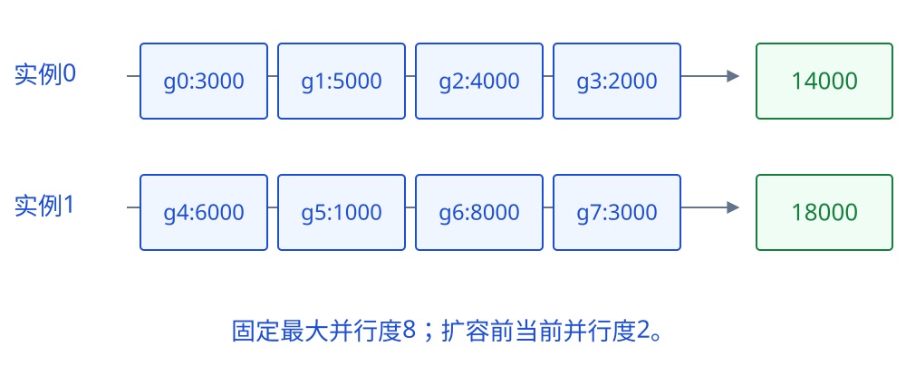</figure>

<strong>组配置</strong>：最大并行度 8（组 `0—7`），金额依次为 `3000/5000/4000/2000/6000/1000/8000/3000`

<strong>扩容前（并行度 2）</strong>：实例 0 管 `0—3`（14000 分）；实例 1 管 `4—7`（18000 分）

<!--
先拍一张扩容前的全家福。最大并行度设为 8，所以有 0 到 7 共八个 Key Group，里面装的金额总计 32000 分。现在跑着 2 个实例：实例 0 手里握着 `[0, 1, 2, 3]` 四个组共 14000 分；实例 1 握着 `[4, 5, 6, 7]` 四个组共 18000 分。现在我们触发 Savepoint 或恢复式扩容，准备把并行度拉到 4。

[Sources]
- https://nightlies.apache.org/flink/flink-docs-release-2.3/docs/concepts/stateful-stream-processing/
- https://nightlies.apache.org/flink/flink-docs-release-2.3/docs/dev/datastream/fault-tolerance/state/
- 教学构造数据：course/data/cases.json；金额单位为分。特定示例在页面注明参数。
-->


---
class: course story-course
---
## 扩容后：四个实例各接管两组

<figure class="story-figure"></figure>

<strong>扩容后（并行度 4）</strong>：四个新实例分别接管 `[0,1]`、`[2,3]`、`[4,5]`、`[6,7]`

<strong>无损衔接</strong>：各新实例同步恢复对应的输入位点与所属 Key Group 状态

<!--
新作业以并行度 4 从刚才的恢复点拉起来了。看连线：原实例 0 的四个组干净利落地一分为二，`[0, 1]` 交给新实例 0，`[2, 3]` 交给新实例 1；原实例 1 的四个组拆成 `[4, 5]` 和 `[6, 7]` 交给新实例 2 和 3。每个新实例只需从共享持久存储里拉取自己那两个组的状态文件，同时 Source 从配套的偏移量接着往下读，全过程不用重新扫一遍全量历史。

[Sources]
- https://nightlies.apache.org/flink/flink-docs-release-2.3/docs/concepts/stateful-stream-processing/
- https://nightlies.apache.org/flink/flink-docs-release-2.3/docs/dev/datastream/fault-tolerance/state/
- 教学构造数据：course/data/cases.json；金额单位为分。特定示例在页面注明参数。
-->


---
class: course story-course
---
## 用组集合与金额共同核对扩容

<figure class="story-figure">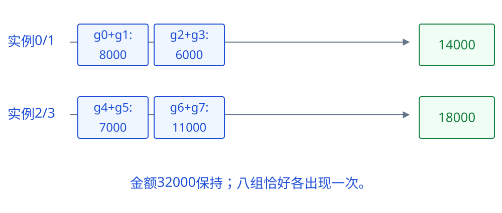</figure>

<strong>四实例金额</strong>：分别承接 `8000`、`6000`、`7000`、`11000` 分，合计仍 <strong>32000 分</strong>

<strong>双项验收</strong>：组集合 `0—7` 不重不漏，且各组原始金额严格守恒

<!--
核对一下搬家后的账本：新实例 0 拿走 g0+g1 = 8000 分，新实例 1 拿走 6000 分，新实例 2 拿走 7000 分，新实例 3 拿走 11000 分，加起来一分不少依然是 32000 分。工程上验收状态迁移不能只看“总额加起来对不对”，万一某个组丢了又刚好有另一个组被重复加载，总额可能侥幸抵消！必须同时检查组集合是不是完整覆盖 `0—7` 且每个组只出现了一次。

[Sources]
- https://nightlies.apache.org/flink/flink-docs-release-2.3/docs/concepts/stateful-stream-processing/
- https://nightlies.apache.org/flink/flink-docs-release-2.3/docs/dev/datastream/fault-tolerance/state/
- 教学构造数据：course/data/cases.json；金额单位为分。特定示例在页面注明参数。
-->


---
class: course story-course
---
## 状态方案需要同时写用途与退出条件

<figure class="story-figure">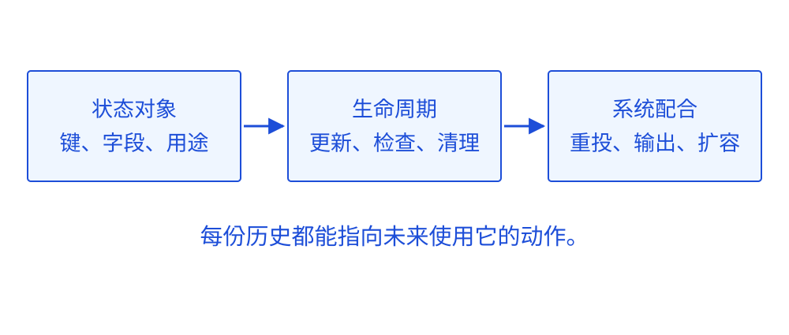</figure>

<strong>状态四问</strong>：用什么键隔离、存什么结构、何时更新、何时用定时器或 TTL 清理

<strong>协同要素</strong>：同步写清状态后端选型、防重策略、超期补核与 Key Group 扩容

<!--
画一张完整的状态方案评审清单。任何一份状态一写进方案里，就要回答四个灵魂问题：用什么键隔离？存了哪些字段（用单值、列表还是映射）？谁来更新它？什么时候靠定时器或 TTL 把它安全送走？再补上状态后端选型（堆内还是 RocksDB）、超期流去哪补核、以及最大并行度预留多少给将来 Key Group 扩容。把这份清单填满，状态系统就不会跑着跑着突然 OOM。

[Sources]
- https://nightlies.apache.org/flink/flink-docs-release-2.3/docs/dev/datastream/fault-tolerance/state/
- https://nightlies.apache.org/flink/flink-docs-release-2.3/docs/dev/table/concepts/dynamic_tables/
- https://nightlies.apache.org/flink/flink-docs-release-2.3/docs/concepts/stateful-stream-processing/
-->


---
class: course story-course
---
## 方案示范：等待支付与超时补核

<figure class="story-figure">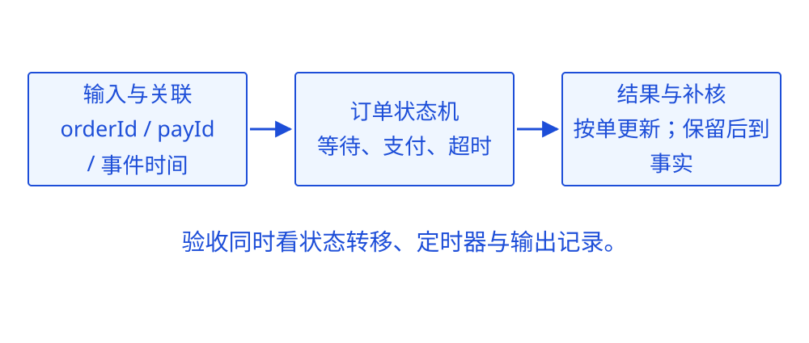</figure>

<strong>订单核心</strong>：`orderId` 托管阶段、创建时间与缓冲；事件时间闹钟判 5 s 超时

<strong>防重与落地</strong>：`payId` 在线 3 h TTL 去重 + 库唯一键兜底；超期走补核，结果按单 Upsert

<!--
把前面那家门店的订单系统写一份可落地的方案示范。内部用 `orderId` 当 Keyed State 主键，托管状态阶段、创建时间戳和乱序缓冲；创建时间一落定就登记 `t+5001 ms` 事件时间闹钟；在线去重集 `Seen` 按重投窗口设 3 小时 TTL，长周期防重交给下游数据库唯一键；超期或超时后到的支付统一进补核流；结果库按 `orderId` Upsert 刷新。最后拿 O1 到 O4 的全量样本一跑，5000 分成交、2 单超时、1 笔补核严丝合缝。

[Sources]
- https://nightlies.apache.org/flink/flink-docs-release-2.3/docs/dev/datastream/fault-tolerance/state/
- https://nightlies.apache.org/flink/flink-docs-release-2.3/docs/dev/table/concepts/dynamic_tables/
- 教学构造数据：course/data/cases.json；金额单位为分。特定示例在页面注明参数。
-->


---
class: course story-course
---
## 独立方案练习：重复、超时与扩容

<strong>订单题目</strong>：O10 创建于 2 s，P10(6 s, 4500 分) 到达并重投一次；O11 创建于 3 s 未付

<strong>触发要求</strong>：`W` 推进至 8001 ms，按闭区间 `[0, 5 s]` 写出两单状态与输出

<strong>扩容题目</strong>：将 8 个 Key Group 从并行度 2 扩至 4，写出各新实例组区间、金额及前提

<!--
最后做一道串联全讲的综合练习。前半段考订单生命周期和去重：O10 间隔 4 秒支付有效，怎么挡住重复投递的 P10？O11 3 秒创建、8 秒到期，水位线走到 8001 ms 时怎么响闹钟？后半段考状态扩容：把刚才 0—7 八个组从 2 实例扩到 4 实例，交待清楚每个实例接手哪几个组、多少钱，以及需要满足哪些恢复前提。

[Sources]
- https://nightlies.apache.org/flink/flink-docs-release-2.3/docs/dev/datastream/fault-tolerance/state/
- https://nightlies.apache.org/flink/flink-docs-release-2.3/docs/concepts/stateful-stream-processing/
- 教学构造数据：course/data/cases.json；金额单位为分。特定示例在页面注明参数。
-->


---
class: course story-course
---
## 方案答案：业务结果与状态归属各自核对

<figure class="story-figure">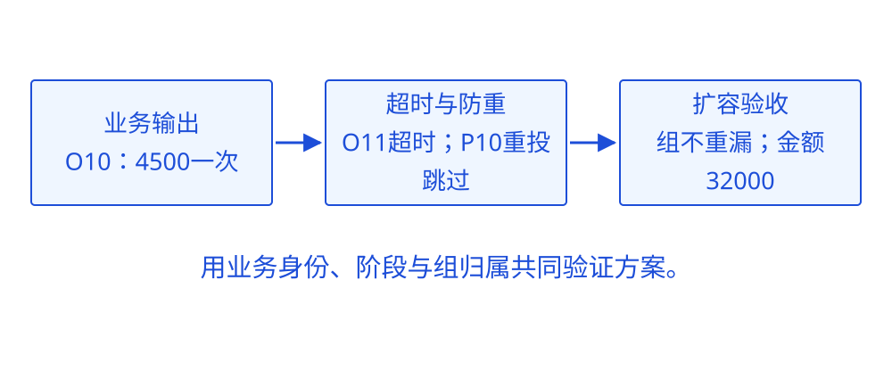</figure>

<strong>订单结果</strong>：O10 间隔 4 s 输出 <strong>4500 分</strong>（重投跳过）；O11 于 W=8001 ms 输出超时

<strong>扩容结果</strong>：四实例接管 `[0,1]`、`[2,3]`、`[4,5]`、`[6,7]`（8000/6000/7000/11000 分）

<!--
核对这份综合答案：O10 在第 6 秒支付，差 4 秒落进有效期且赶在 7001 闹钟之前，转为 PAID 输出一次 4500 分并删掉闹钟；第二次 P10 重投过来被 `Seen` 拦截。O11 闹钟定在 8001 ms，水位线一到直接转 EXPIRED 报超时。扩容部分四个新实例稳稳接走连续两组（共 32000 分），前提是最大并行度保持不变、算子恢复标识匹配，并且从包含完整输入位点的一致恢复点拉起。

[Sources]
- https://nightlies.apache.org/flink/flink-docs-release-2.3/docs/dev/datastream/fault-tolerance/state/
- https://nightlies.apache.org/flink/flink-docs-release-2.3/docs/concepts/stateful-stream-processing/
- 教学构造数据：course/data/cases.json；金额单位为分。特定示例在页面注明参数。
-->


---
class: course story-course
---
## 本讲的状态与查询关系

<figure class="story-figure">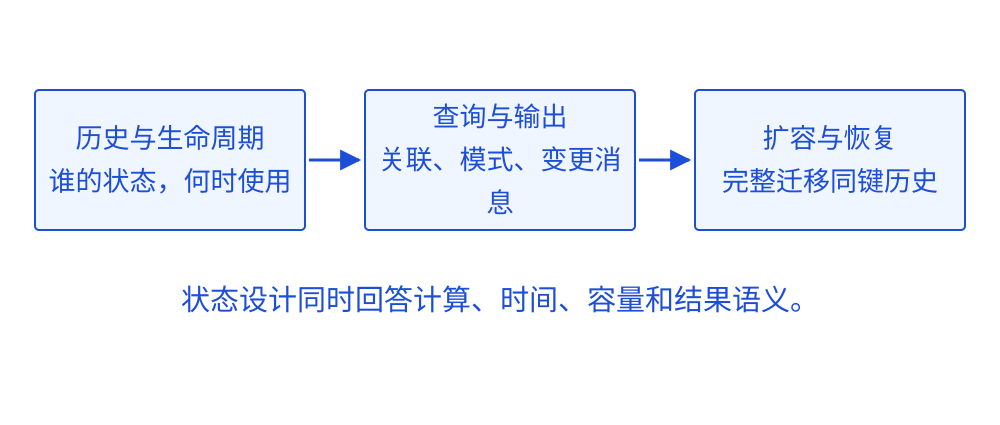</figure>

<strong>状态与清理</strong>：托管状态支撑状态机、Join 与 CEP；定时器推业务，TTL 控存储

<strong>查询与扩容</strong>：动态表与 Changelog 贯通 SQL；Key Group 保障状态无损弹性迁键

<!--
把第四讲的核心图景拼在一起：为了跨事件记住上下文并支持容错迁移，我们把状态交给引擎托管（HashMap 求低延迟，RocksDB 扛 TB 级大状态）；靠事件时间定时器推进超时判断，靠 TTL 控制存储膨胀；向上用 Interval Join、CEP 和动态表 Changelog 承接复杂的流式查询；扩容时靠 Key Group 整组搬迁状态不丢不重。最后一讲（第 5 讲），我们把这些散落在集群各节点的状态快照下来，彻底讲透“突然断电重启，到底怎么一分钱都不错”。

[Sources]
- https://nightlies.apache.org/flink/flink-docs-release-2.3/docs/dev/datastream/fault-tolerance/state/
- https://nightlies.apache.org/flink/flink-docs-release-2.3/docs/dev/table/concepts/dynamic_tables/
- https://nightlies.apache.org/flink/flink-docs-release-2.3/docs/concepts/stateful-stream-processing/
-->


---
class: course story-course
---
## 附录：SQL 事件时间与窗口语法

```sql
SELECT userId, window_start, window_end,
       SUM(amountCents) AS sumCents
FROM TABLE(TUMBLE(TABLE UniquePaid,
     DESCRIPTOR(rowtime), INTERVAL '10' SECOND))
GROUP BY userId, window_start, window_end;
```

<strong>时间声明</strong>：`rowtime` 由业务时间列声明而来，`WATERMARK` 定义事件时间推进规则

<strong>窗口键</strong>：`GROUP BY` 须同时包含 `userId`、`window_start` 与 `window_end`

<!--
留一页真实的 Flink SQL 10 秒滚动窗口代码供大家课后查阅。`FROM TABLE(TUMBLE(...))` 把每条支付贴上 `window_start` 和 `window_end` 两个时间边框，`GROUP BY` 则把人名和边框一起编进状态主键。虽然只写了短短几行声明式 SQL，但背后运行的照样是前四讲拆解过的水位线推进、状态托管和窗口触发。

[Sources]
- https://nightlies.apache.org/flink/flink-docs-release-2.3/docs/dev/table/sql/queries/overview/
- https://nightlies.apache.org/flink/flink-docs-release-2.3/docs/dev/table/sql/queries/window-tvf/
-->


---
class: course story-course
---
## 附录：平均值保留可合并的部分状态

<figure class="story-figure"></figure>

<strong>充分统计量</strong>：状态须存 `(sum, count)`，`(3000,1)` 与 `(3000,2)` 合并得 `(6000,3)` → <strong>2000 分</strong>

<strong>常见误区</strong>：直接对局部平均值再求平均，会算出错误的 <strong>2250 分</strong>

<!--
最后用求平均数检验大家对状态抽象的理解。如果想在并行分支里求平均客单价，状态里能不能只存一个孤零零的“当前平均值”？不行，否则新来一笔时你根本不知道前面已经分摊过多少笔，没法合并！必须存下充分统计量 `(sum, count)` 二元组：分片一存 `(3000, 1)`，分片二存 `(3000, 2)`，合并成 `(6000, 3)` 后再除，才得准确的 2000 分（而不是错误二次平均算出的 2250 分）。

[Sources]
- https://nightlies.apache.org/flink/flink-docs-release-2.3/docs/dev/datastream/fault-tolerance/state/
- 教学构造数据：course/data/cases.json；金额单位为分。特定示例在页面注明参数。
-->
