# 状态与流式查询


> 第 4 次课 · 分布式实时计算

让业务历史参与判断、查询与扩容

<!--
同学们，一笔订单创建以后，系统要等它五秒，看有没有支付。如果支付先来，或者消息重复，或者五秒到了却没有新记录，系统凭什么作出正确判断？答案在于保留历史，并为未来的条件安排检查。今天我们把每个订单的工作状态画出来，沿创建、支付、水位线与定时器一步步推进；再看查询结果为什么会更新，以及扩容时这份历史怎样跟着键搬到新的实例。最后写一份从状态到输出都能核对的订单方案。

[Sources]
- https://nightlies.apache.org/flink/flink-docs-release-2.3/docs/dev/datastream/fault-tolerance/state/
- https://nightlies.apache.org/flink/flink-docs-release-2.3/docs/dev/table/concepts/dynamic_tables/
- 教学构造数据：course/data/cases.json；金额单位为分。专项场景在页面注明参数。
-->


---
class: course story-course
---
## 状态让后来的输入能解释过去

<figure class="story-figure">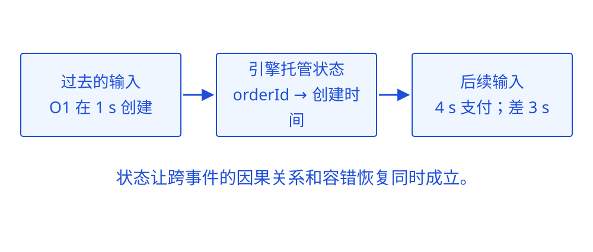</figure>

- <strong>状态</strong>是算子为处理后续输入而保留的历史信息。
- 等待订单需记住创建时间；去重需记住身份；累计需记住旧金额。

<!--
大家先看订单O1。创建消息走过以后，如果什么也不记，四秒的支付到来时，系统就不知道订单何时创建，更无从判断是否在五秒内。保留创建时间以后，后面的支付才能与它比较。类似地，Seen帮助认出重复，累计值帮助继续求和。请大家对每一份状态都问同一句：哪一种未来输入或时间条件要用到它？状态保留到最后一次需要它的判断结束，再按明确规则清理。

[Sources]
- https://nightlies.apache.org/flink/flink-docs-release-2.3/docs/dev/datastream/fault-tolerance/state/
- 教学构造数据：course/data/cases.json；金额单位为分。专项场景在页面注明参数。
-->


---
class: course story-course
---
## Keyed State 按业务键隔离历史

<figure class="story-figure">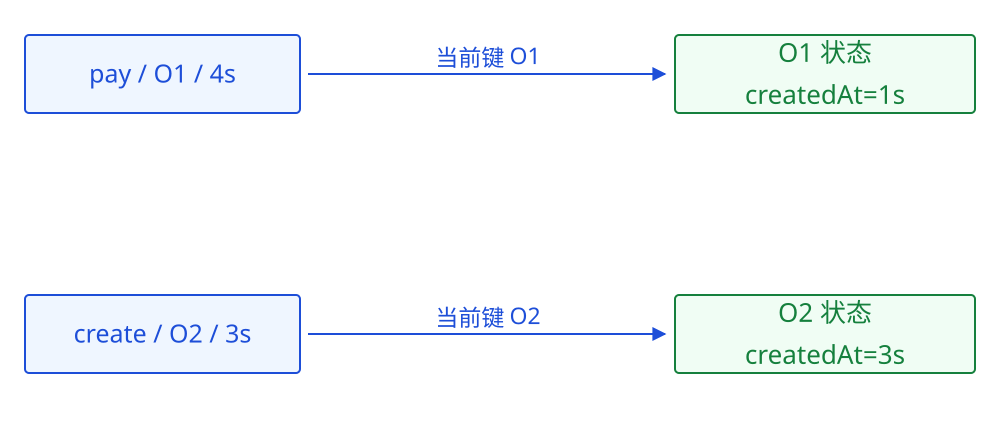</figure>

- <strong>Keyed State</strong>属于按键流上的每个键；订单匹配用orderId作键。
- O1支付只读写O1历史；O2等待状态保持不变。

<!--
我们把状态按订单编号分开放。O1创建于一秒，O2创建于三秒，支付O1到来时，只能访问O1那份历史，不能因为O2刚刚到达就拿三秒当O1创建时间。keyBy之后的Keyed State正是为当前键隔离历史。请大家指着两行状态说明，当前记录的键怎样决定读哪一格。第二讲说相同键去同一执行实例，今天再向里看，这个实例内部仍保存着不同键各自的状态。

[Sources]
- https://nightlies.apache.org/flink/flink-docs-release-2.3/docs/dev/datastream/fault-tolerance/state/
-->


---
class: course story-course
---
## 按需要选择状态结构

<figure class="story-figure"></figure>

- ValueState保存一个值；ListState保存列表；MapState保存键值映射。
- 专项：订单当前阶段用单值，待匹配支付用列表，已见事件用身份映射。

<!--
这些名称先按后续动作理解。读取订单当前阶段，用单值状态；遍历尚待匹配的支付，用列表状态；按支付身份查是否已见，用映射状态。请分别指出图中保存的值，再给每一种结构配一条后续输入：它会读取什么、更新什么？状态类型的选择由这些访问动作决定。

[Sources]
- https://nightlies.apache.org/flink/flink-docs-release-2.3/docs/dev/datastream/fault-tolerance/state/
-->


---
class: course story-course
---
## Operator State 与实例关联

<figure class="story-figure"></figure>

- <strong>Operator State</strong>与并行算子实例关联，不按业务键自动隔离。
- 专项列表状态含标记[0,1,2,3]；可重分配列表项扩容后由各实例接管。

<!--
Keyed State跟着业务键，Operator State则与算子实例关联。我们给一个自定义算子保存四个管理标记的列表，原来两个实例各保留一部分；扩容后可以按已定义的重分配规则，把列表项交给新实例。这里不能拿用户A的累计额也随便当列表切开，因为它属于一个业务键的完整历史。实际数据源如何管理分片还取决于连接器设计，本页专项只讨论可重分配列表项，目的在于看清状态归属不同，恢复分配规则也不同。

[Sources]
- https://nightlies.apache.org/flink/flink-docs-release-2.3/docs/dev/datastream/fault-tolerance/state/
- https://nightlies.apache.org/flink/flink-docs-release-2.3/docs/concepts/stateful-stream-processing/
-->


---
class: course story-course
---
## 工作状态、后端与检查点存储

<figure class="story-figure">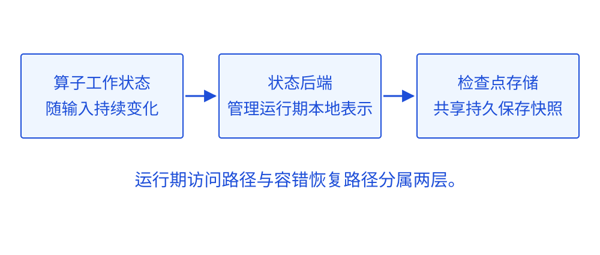</figure>

- <strong>状态后端</strong>管理运行中的状态访问；<strong>检查点存储</strong>保存恢复快照。
- 进程内工作历史会变化；持久快照用于故障后重新建立历史。

<!--
大家把三个位置分别指出来。算子当前正在使用的历史叫工作状态；状态后端负责怎样存放与读取这份历史，可以涉及堆内存或本地存储；检查点存储则保存可恢复快照，通常要能在工作进程故障后仍找到。不能把“本地还有一个目录”直接当成整个故障恢复方案。第五讲会把快照怎样形成与输入位置怎样配套画清楚，今天先明确运行时访问和恢复持久化是两个职责。

[Sources]
- https://nightlies.apache.org/flink/flink-docs-release-2.3/docs/dev/datastream/fault-tolerance/state/
- https://nightlies.apache.org/flink/flink-docs-release-2.3/docs/ops/state/state_backends/
-->


---
class: course story-course
---
## 状态容量先从业务对象估算

<figure class="story-figure"></figure>

- 专项：同时等待100000个订单，每项有效载荷64B，载荷合计6.4MB。
- 实际还需对象、索引、序列化与后端开销；清理规则决定存量。

<!--
假设十万个未决订单，每个保存的业务字段一共六十四字节，先得到六百四十万字节，按十进制是六点四MB。这个数字是有效载荷下限，配置机器内存时还需计入表示、索引等开销。更重要的是存量怎样形成：若订单处理完永远不清理，数量会持续累积。设计状态时所以要同时写“每个键存什么”和“什么时候可以删除”，容量估算才能和业务生命周期连起来。

[Sources]
- https://nightlies.apache.org/flink/flink-docs-release-2.3/docs/dev/datastream/fault-tolerance/state/
- https://nightlies.apache.org/flink/flink-docs-release-2.3/docs/ops/state/state_backends/
- 教学构造数据：course/data/cases.json；金额单位为分。专项场景在页面注明参数。
-->


---
class: course story-course
layout: section
---
## 1 · 状态与订单生命周期

<ol class="outline"><li class="current">状态与订单生命周期</li><li>定时器与去重边界</li><li>流式查询与变更消息</li><li>状态扩容与方案设计</li></ol>

<!--
接下来我们给订单规定明确的生命周期。先看订单创建以后可能发生什么：有效支付、到期仍未支付，或者已经结束后又收到一条重复或超期消息。每条路径都要有业务决定，才能让状态、定时器和输出对应起来。

[Sources]
- https://nightlies.apache.org/flink/flink-docs-release-2.3/docs/concepts/stateful-stream-processing/
-->


---
class: course story-course
---
## 订单等待支付的判定规则

<figure class="story-figure">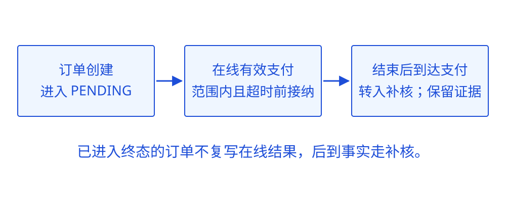</figure>

- 按orderId关联；业务有效范围0≤支付时间−创建时间≤5000ms。
- 定时器前接纳的有效支付进入PAID；未支付超时进入EXPIRED，结束后支付进入补核。

<!--
我们把题目的业务约定先写出来。支付必须属于同一订单，业务时间差从零到五秒，边界五秒也有效；但在线状态机只对超时判定前接纳的有效支付转成已支付。超时已经对外发出后再收到的支付，无论它声称何时发生，都进入补核，不自动偷偷改回。这样规则就覆盖了消息来晚与重复的情况。本题采用终态后补核的在线政策；业务若采用可撤回超时，需要同时定义修正输出。

[Sources]
- https://nightlies.apache.org/flink/flink-docs-release-2.3/docs/dev/datastream/fault-tolerance/state/
- 教学构造数据：course/data/cases.json；金额单位为分。专项场景在页面注明参数。
-->


---
class: course story-course
---
## 四个订单与三个支付

<figure class="story-figure"></figure>

- 创建：O1/1s、O2/3s、O3/7s、O4/10s。支付：O1/4s/3000、O2/9s/5000、O3/11s/2000。
- 本专项在O2支付前送入W=8001ms，末尾送入W=15001ms。

<!--
这次输入分两种消息，创建和支付都带订单编号和事件时间。O1相差三秒，O2相差六秒，O3相差四秒，O4没有支付。为了把定时器因果单独看清，本专项把水位线作为显式输入给出：在O2支付前推进到8001，最后推进到15001。本题按图中单独给出的水位线顺序推演。接下来每一页都依据这组明确到达与进度条件，判断哪份订单状态改变，哪一个定时器触发。

[Sources]
- https://nightlies.apache.org/flink/flink-docs-release-2.3/docs/dev/datastream/fault-tolerance/state/
- 教学构造数据：course/data/cases.json；金额单位为分。专项场景在页面注明参数。
-->


---
class: course story-course
---
## UML 状态机画订单的阶段变化

<figure class="story-figure"></figure>

- 圆角状态框表示阶段；箭头标记事件、条件与动作。
- 创建进入PENDING；有效支付到PAID；未支付的定时器到EXPIRED。

<!--
大家从黑色起点看创建箭头，它把订单带入等待支付PENDING。每次按到达事件与转移条件选择路径：有效支付到来，更新为PAID并取消定时器；定时器到来且仍未支付，则转EXPIRED。已支付再收到重复支付，只跳过；结束后出现超期或后到支付，留给补核。每个订单独立运行一份状态机，O1支付后只更新O1的阶段。

[Sources]
- https://www.omg.org/spec/UML/2.5.1/PDF
- https://nightlies.apache.org/flink/flink-docs-release-2.3/docs/dev/datastream/fault-tolerance/state/
- 教学构造数据：course/data/cases.json；金额单位为分。专项场景在页面注明参数。
-->


---
class: course story-course
---
## 状态机转移写成事件、条件和动作

<figure class="story-figure"></figure>

- 标准读法：event [guard] / effect，即事件[成立条件]/执行动作。
- pay[有效且未超时] / 更新阶段、输出已支付、删除定时器。

<!--
这条箭头上的三个部分要分开读。pay说发生了什么，方括号中的条件说什么时候允许沿它走，斜线后的动作说走过去同时要完成什么。若只画一条从等待到支付的线，没有条件，就看不出超期支付该怎么办；若只改阶段不删除定时器或检查当前阶段，又可能稍后重复报超时。请大家拿O1试读这条转移，把每个符号对应到一个具体判断或更新，这样标准图就成为可执行规则的说明。

[Sources]
- https://www.omg.org/spec/UML/2.5.1/PDF
- https://nightlies.apache.org/flink/flink-docs-release-2.3/docs/dev/datastream/fault-tolerance/state/
-->


---
class: course story-course
---
## 状态机的绘制步骤

<figure class="story-figure">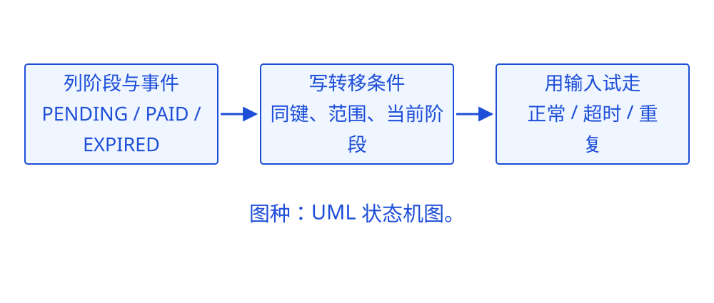</figure>

- 先列阶段，再列事件；为每条转移写条件和副作用。
- 用正常支付、超时、重复、支付先到四条路径检查完整性。

<!--
请大家先写等待、已支付、已超时三种阶段，再把创建、支付和定时器列出来。每条箭头都补条件与动作，特别是进入终态后的后到消息该往哪里走。画好后，分别用有效支付、超时、重复支付和终态后支付验证四条路径。支付先到时，另存待匹配消息，等创建时间到达后再检查业务时间差；后面用O5的缓冲步骤展开这条路径。

[Sources]
- https://www.omg.org/spec/UML/2.5.1/PDF
- https://nightlies.apache.org/flink/flink-docs-release-2.3/docs/dev/datastream/fault-tolerance/state/
-->


---
class: course story-course
---
## 事件时间定时器由水位线推进

<figure class="story-figure"></figure>

- <strong>事件时间定时器</strong>在算子水位线到达注册时间时回调；没有新业务记录也能检查。
- 本题有效期包含末毫秒，创建t时注册t+5000+1ms。

<!--
定时器向系统登记一个未来要检查的时间条件，到达条件时调用对应检查。事件时间定时器由水位线推进触发，处理时间定时器则按机器时钟触发。我们允许创建后第五秒那个毫秒的支付仍有效，所以把超时检查注册在截止时间后一毫秒。以O1一千毫秒创建为例，最后有效支付时间六千，检查时间六千零一。时间点与业务闭区间对应，不能把五秒条件和定时器边界写成互相矛盾。

[Sources]
- https://nightlies.apache.org/flink/flink-docs-release-2.3/docs/dev/datastream/fault-tolerance/state/
- https://nightlies.apache.org/flink/flink-docs-release-2.3/docs/dev/datastream/operators/process_function/
- 教学构造数据：course/data/cases.json；金额单位为分。专项场景在页面注明参数。
-->


---
class: course story-course
---
## 创建先建立状态，再登记检查

<figure class="story-figure"></figure>

- O1创建：保存createdAt=1000、stage=PENDING，注册6001ms。
- O2创建：保存createdAt=3000、stage=PENDING，注册8001ms。

<!--
我们执行最前面两条创建。系统按订单键分别写入创建时间和等待阶段，再登记对应事件时间定时器。现在即使没有下一条业务输入，只要后续水位线继续前进，这两个等待也能被检查。请分别圈出O1与O2的创建时间和截止时间，每个订单维护自己的值。当前有两份状态和两个条件，它们都属于各自订单，后面的支付会选择其中一份来读写。

[Sources]
- https://nightlies.apache.org/flink/flink-docs-release-2.3/docs/dev/datastream/fault-tolerance/state/
- 教学构造数据：course/data/cases.json；金额单位为分。专项场景在页面注明参数。
-->


---
class: course story-course
---
## 步骤一：O1 按时支付

<figure class="story-figure">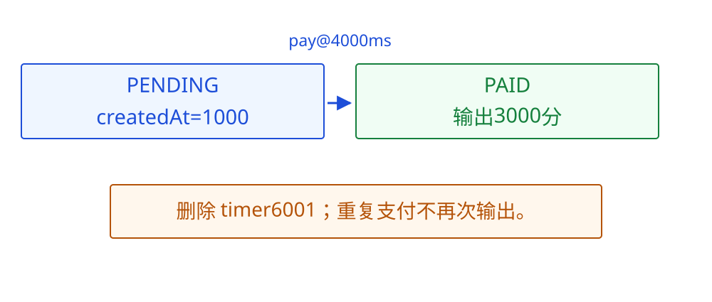</figure>

- O1支付4000−创建1000=3000ms，范围内且超时前接纳。
- PENDING→PAID，输出3000分已支付，删除6001ms定时器。

<!--
现在O1支付到达，先按orderId找到一秒创建的那份历史，再算时间差三千毫秒，满足零到五千。由于还在等待阶段，转为已支付，输出这笔三千分，并删除原来的6001检查。请问如果没有删除，是否一定会错误报超时？如果回调仍检查阶段，也可以避免误报，但保留无用定时器会增加开销。本题把两件事都明确写出：更新阶段、取消不再需要的检查，让生命周期干净地结束。

[Sources]
- https://nightlies.apache.org/flink/flink-docs-release-2.3/docs/dev/datastream/fault-tolerance/state/
- 教学构造数据：course/data/cases.json；金额单位为分。专项场景在页面注明参数。
-->


---
class: course story-course
---
## 步骤二：O2 尚未支付，进度先到截止后

<figure class="story-figure"></figure>

- O3已在7000ms创建并注册12001；随后W推进到8001ms。
- O2仍PENDING：8001定时器触发，转EXPIRED并输出超时。

<!--
在推进到8001之前，O3已经于七秒创建，保存了另一份等待状态。现在水位线到8001，O2的检查条件成立，而O3的12001还没到。系统查O2仍未支付，于是输出超时并转为EXPIRED。O1早已支付且定时器已删除，不会再报一次。请在图中同时圈出“进度到点”和“当前仍等待”，两项条件共同决定超时输出。

[Sources]
- https://nightlies.apache.org/flink/flink-docs-release-2.3/docs/dev/datastream/fault-tolerance/state/
- 教学构造数据：course/data/cases.json；金额单位为分。专项场景在页面注明参数。
-->


---
class: course story-course
---
## 步骤三：O2 的支付进入补核

<figure class="story-figure">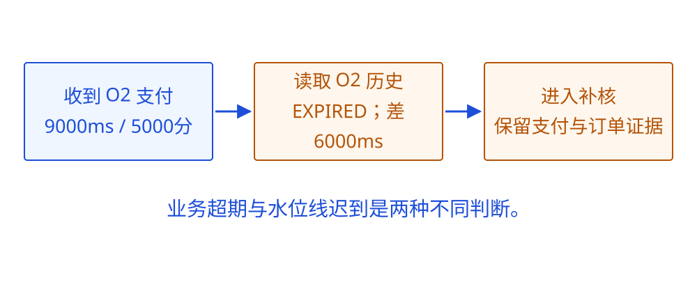</figure>

- O2支付时间9000，较创建3000晚6000ms，已超过业务有效范围。
- 状态已EXPIRED，不重复改在线结果；保留5000分支付证据供补核。

<!--
O2的支付终于到来。它的业务时间九秒，本来就比三秒创建晚六秒，超过允许范围；而在线状态也已经超时。我们保留这条五千分支付到补核路径，不再把O2直接改成已支付来掩盖先前超时。这里有两个时间比较：9000超过订单的业务支付截止，但仍在当前水位线8001之后。术语准确以后，就能分别设计业务超期和输入迟到的处理规则。

[Sources]
- https://nightlies.apache.org/flink/flink-docs-release-2.3/docs/dev/datastream/fault-tolerance/state/
- 教学构造数据：course/data/cases.json；金额单位为分。专项场景在页面注明参数。
-->


---
class: course story-course
---
## 步骤四：O3 支付，O4 超时

<figure class="story-figure">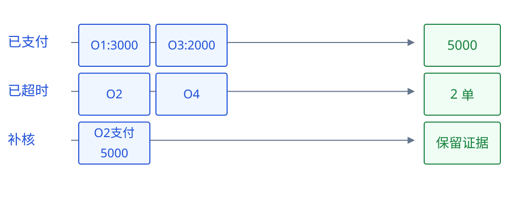</figure>

- O4在10000ms创建，timer15001；O3支付11000−7000=4000ms，进入PAID。
- 末尾W=15001：O4未支付转EXPIRED；有效支付合计3000+2000=5000分。

<!--
我们把剩下输入走完。先创建O4，注册15001检查；随后O3十一秒的支付到达，与七秒创建相差四秒，转为已支付并删除12001定时器。最后水位线到15001，O4仍等待，所以输出超时。请大家核对四个订单：O1、O3已支付，共五千分；O2、O4超时，O2另有补核支付证据。这个终态清单来自明确的创建、支付和进度步骤，没有把未匹配或超期金额偷偷算进有效支付。

[Sources]
- https://nightlies.apache.org/flink/flink-docs-release-2.3/docs/dev/datastream/fault-tolerance/state/
- 教学构造数据：course/data/cases.json；金额单位为分。专项场景在页面注明参数。
-->


---
class: course story-course
---
## 支付先于创建到达时保留待匹配项

<figure class="story-figure"></figure>

- 专项：先到O5支付4s/3000，后到O5创建1s；到达乱序不改变时间差3s。
- 先缓存支付身份、时间和金额；创建到来后判断，匹配成功再清理缓冲。

<!--
换一组专项输入，同样的O5支付先走到系统，创建还在路上。没有创建时间时不能把支付直接当作无效，也不能凭空说它在期限内。先按订单键保留支付的身份、时间和金额，等创建到来后再计算四秒减一秒，得到有效的三秒，随后输出并清理待匹配项。待匹配缓冲也要定义保留边界，创建持续缺失时，按进度与补核政策移出并清理。这里状态让乱序的两种消息重新接上关系。

[Sources]
- https://nightlies.apache.org/flink/flink-docs-release-2.3/docs/dev/datastream/fault-tolerance/state/
- 教学构造数据：course/data/cases.json；金额单位为分。专项场景在页面注明参数。
-->


---
class: course story-course
---
## 水位线停滞，事件时间定时器也等待

<figure class="story-figure"></figure>

- 订单截止已过墙钟时间，但若算子水位线未到注册点，事件时间定时器不触发。
- 检查输入进度与空闲判定；需要墙钟SLA时另行设计处理时间告警。

<!--
大家看一块墙钟已经过去很久，为什么订单还没报超时？因为我们选择的是事件时间定时器，它依赖流的水位线。如果某个输入进度不前进，回调仍会等待。此时沿第三讲的多输入与空闲机制检查水位线停滞的来源，订单状态按既定生命周期保留。若业务同时要求“系统接到订单后五秒内必须有一个运维告警”，那是处理时间目标，可以另设告警，但要与业务事件时间的支付判定分开表达。两种时间承担不同承诺，方案里不能混写。

[Sources]
- https://nightlies.apache.org/flink/flink-docs-release-2.3/docs/dev/datastream/fault-tolerance/state/
- https://nightlies.apache.org/flink/flink-docs-release-2.3/docs/concepts/time/
- https://nightlies.apache.org/flink/flink-docs-release-2.3/docs/dev/datastream/event-time/generating_watermarks/
-->


---
class: course story-course
---
## 边界练习：恰好五秒与后到支付

- O6创建1000ms，支付业务时间6000ms，定时器6001ms。
- 情境甲：支付先于W6001到达；情境乙：W6001先到且仍未支付。
- 分别画转移；说明乙中后到支付是否自动撤回已发超时。

<!--
这次两种情境的业务时间完全一样，只改变到达与进度的先后。请先检查六千减一千等于五千，属于题目允许的闭区间；再看支付到来时订单是否仍在等待。情境乙不能偷偷改用另一套规则，我们已经约定结束后支付进入补核。请把这个选择画在状态图中，并解释它如何保留后到事实。能把业务时间条件和在线接纳生命周期一起考虑，才说明你理解了这个边界。

[Sources]
- https://nightlies.apache.org/flink/flink-docs-release-2.3/docs/dev/datastream/fault-tolerance/state/
- 教学构造数据：course/data/cases.json；金额单位为分。专项场景在页面注明参数。
-->


---
class: course story-course
---
## 边界答案：有效范围还需配合生命周期

<figure class="story-figure">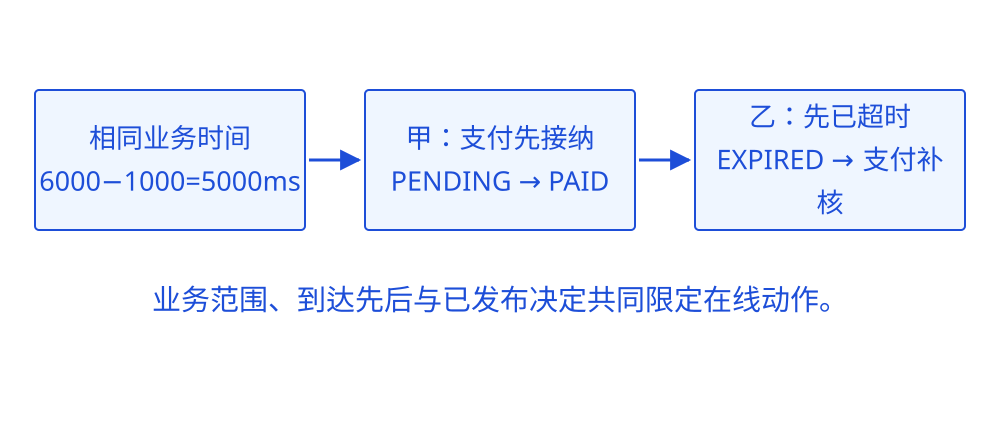</figure>

- 甲：有效且仍PENDING→PAID，删除定时器。
- 乙：W6001时PENDING→EXPIRED；后到支付进入补核，本题不自动撤回超时。

<!--
情境甲直接得到已支付，因为五秒边界被包含且在线尚未超时。情境乙先由定时器输出超时，之后支付虽然业务时间满足范围，也按约定送补核。乙仍是一笔业务支付；按本题终态后补核的政策，它进入审计或补偿流程。若企业希望自动修正超时，可以再设计一套带撤回消息的状态机，但要相应修改状态保留与出口协议。这里我们的答案始终依据页面明示的规则。

[Sources]
- https://nightlies.apache.org/flink/flink-docs-release-2.3/docs/dev/datastream/fault-tolerance/state/
- 教学构造数据：course/data/cases.json；金额单位为分。专项场景在页面注明参数。
-->


---
class: course story-course
layout: section
---
## 2 · 定时器与去重边界

<ol class="outline"><li>状态与订单生命周期</li><li class="current">定时器与去重边界</li><li>流式查询与变更消息</li><li>状态扩容与方案设计</li></ol>

<!--
订单处理完以后，哪些历史可以删除，哪些还要用来识别重复？业务定时器负责到期判断，TTL负责状态保留。请设想同一支付在一小时后再次投递，指出去重需要读取哪份身份历史。接下来据此确定保留期限，再检查过期后消息的处理路径。

[Sources]
- https://nightlies.apache.org/flink/flink-docs-release-2.3/docs/concepts/stateful-stream-processing/
-->


---
class: course story-course
---
## 重复事件需要保留身份历史

<figure class="story-figure">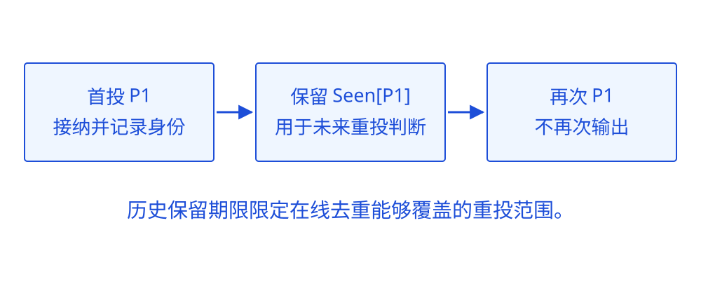</figure>

- 第一次payId=P1通过后记录Seen[P1]；再次P1到达不重复输出。
- 订单结束后若立即删除全部身份，重投可能再次产生业务效果。

<!--
请看同一笔支付P1。第一次确认后，我们记住它已经产生过结果；第二次即便日志位置不同，身份仍然相同，所以跳过。如果订单一完成就把所有身份都删光，后来的P1可能再次看起来像第一次。订单结束后，后到消息仍可能需要身份历史作去重与审计；清理时点应覆盖这些用途。设计时要先知道输入可能重投多长时间，再决定身份保留，或者让下游业务主键承担长期防重责任。

[Sources]
- https://nightlies.apache.org/flink/flink-docs-release-2.3/docs/dev/datastream/fault-tolerance/state/
- 教学构造数据：course/data/cases.json；金额单位为分。专项场景在页面注明参数。
-->


---
class: course story-course
---
## TTL 控制状态可用期限

<figure class="story-figure"></figure>

- <strong>TTL（存活时间）</strong>按配置规则令状态过期；本课Flink状态TTL使用处理时间。
- 专项：重投最多2h；TTL=3h，创建/写入刷新，过期不返回；超界另需约束。

<!--
TTL为状态规定一段可用期限。我们明确用处理时间来计算本课Flink状态TTL，它不同于刚才由水位线推动的事件时间超时。假设输入承诺旧支付最多两小时内重投，给Seen保留三小时并留余量，就为这项承诺提供了覆盖。若实际重投可晚至一天后，身份历史需要覆盖该时间范围。还要指定何时刷新TTL：创建、后续写入或读取会按配置影响期限，选择应与业务重投范围一起写明。

[Sources]
- https://nightlies.apache.org/flink/flink-docs-release-2.3/docs/dev/datastream/fault-tolerance/state/
-->


---
class: course story-course
---
## TTL 清理与业务定时器的职责

<figure class="story-figure">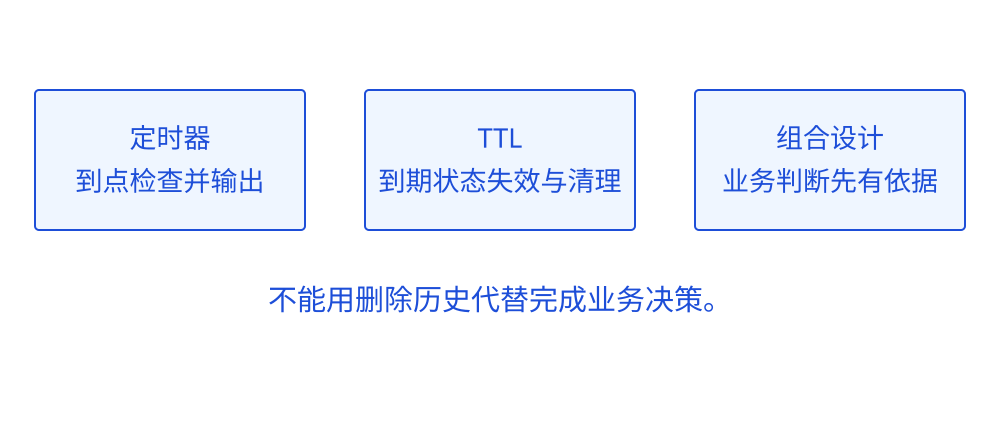</figure>

- 事件时间定时器：进度到点后执行业务判断与输出。
- TTL：按保留规则管理状态过期；订单超时输出由业务定时器负责。

<!--
把两个动作并排。定时器的目的是在某个条件成立时主动执行判断，比如订单仍未支付就发超时；TTL的目的是让历史过期并按后端策略清理。若只设置五秒TTL，系统不会自动写出“订单超时”的业务结果，甚至可能在需要判断时已经没有创建时间。请大家先画业务生命周期，再把容量管理的清理策略放在适当位置。过期值的可见性由配置控制，物理清理由后端策略执行；容量以实际后端占用为准。

[Sources]
- https://nightlies.apache.org/flink/flink-docs-release-2.3/docs/dev/datastream/fault-tolerance/state/
-->


---
class: course story-course
layout: section
---
## 3 · 流式查询与变更消息

<ol class="outline"><li>状态与订单生命周期</li><li>定时器与去重边界</li><li class="current">流式查询与变更消息</li><li>状态扩容与方案设计</li></ol>

<!--
现在用同样的状态思想理解流式查询。两个输入必须等待匹配，分组表会随新事件改变，输出则是一串描述表变化的消息。我们把插入、替换和撤回逐次画到结果行上，再用SQL和模式描述对应的处理。

[Sources]
- https://nightlies.apache.org/flink/flink-docs-release-2.3/docs/concepts/stateful-stream-processing/
-->


---
class: course story-course
---
## 双流 Join 保留尚未匹配的历史

<figure class="story-figure"></figure>

- <strong>Join（关联）</strong>把满足键与时间条件的两侧记录组合。
- 订单先到保留订单，支付先到保留支付；等待与清理边界都要明确。

<!--
一张订单与一张支付可能分属两条输入流，而且谁先到都可能。如果先到的一侧走过就丢，后到另一侧就永远找不到它。因此Join必须为待匹配记录保留状态。大家沿两条箭头看，先到的记录保存在状态中，另一侧到达后检查匹配。同一键若有多个满足条件的匹配项，关联可产生多条结果，方案需规定匹配与去重规则。我们下面的专项给每单最多一条支付，再用相同订单键和五秒范围逐对判断。

[Sources]
- https://nightlies.apache.org/flink/flink-docs-release-2.3/docs/dev/datastream/operators/joining/
- https://nightlies.apache.org/flink/flink-docs-release-2.3/docs/dev/datastream/fault-tolerance/state/
- 教学构造数据：course/data/cases.json；金额单位为分。专项场景在页面注明参数。
-->


---
class: course story-course
---
## Interval Join 以键和时间谓词匹配

<figure class="story-figure"></figure>

- 本专项条件：orderId相同，且0≤payTime−createTime≤5000ms。
- 蓝条表示创建到创建后5s的可匹配范围；边界均包含。

<!--
看每个订单旁的蓝条，从创建时刻一直到五秒后，它表示可匹配支付时间范围。O1一秒创建，四秒支付，在范围内；O2三秒创建，九秒支付，超过八秒上界；O3七秒创建，十一秒支付，在范围内。匹配需同时满足时间范围与订单编号相同。请大家先找同键，再计算时间差，最后才组合结果。Interval Join表达的是两条流满足谓词的关联，不会自动给没有支付的订单产生一个超时业务事件。

[Sources]
- https://nightlies.apache.org/flink/flink-docs-release-2.3/docs/dev/datastream/operators/joining/
- 教学构造数据：course/data/cases.json；金额单位为分。专项场景在页面注明参数。
-->


---
class: course story-course
---
## 逐对检查得到两条匹配结果

<figure class="story-figure"></figure>

- O1差3s→输出3000；O2差6s→不匹配；O3差4s→输出2000。
- O4没有匹配项；两条结果合计5000分。

<!--
现在我们把所有候选对走完。O1编号相同、相差三秒，输出订单与支付组合，金额三千；O2虽然编号相同，但六秒超范围，所以不输出匹配；O3四秒输出两千；O4没有另一侧候选。请问没匹配是否代表系统已经发出超时告警？没有，普通范围关联只产生满足条件的组合，超时需要前面状态机或其他外连接与生命周期设计。把输出对象说清楚，才能比较不同算子到底完成了哪些业务责任。

[Sources]
- https://nightlies.apache.org/flink/flink-docs-release-2.3/docs/dev/datastream/operators/joining/
- 教学构造数据：course/data/cases.json；金额单位为分。专项场景在页面注明参数。
-->


---
class: course story-course
---
## Join 绘图练习：同键与边界

- 订单O7@10s；候选支付O7@15s/2000、O8@12s/3000、O7@16s/1000。
- 时间谓词闭区间[0,5s]；各候选在状态保留期间被接纳。
- 画时间范围图，逐条写是否匹配及理由。

<!--
请先画O7十秒创建的点，再画到十五秒的匹配范围，并用实心端点标明上界包含。接着给三个候选分别标键和时间。第二条虽然时间在范围内，却属于O8；第三条键对，但时间过界。题目已经规定它们在状态可用时被接纳，所以这次只比较关联谓词，不额外引入迟到清理。每条候选记录都核对订单键和时间范围，再连接满足两项条件的记录。

[Sources]
- https://nightlies.apache.org/flink/flink-docs-release-2.3/docs/dev/datastream/operators/joining/
- 教学构造数据：course/data/cases.json；金额单位为分。专项场景在页面注明参数。
-->


---
class: course story-course
---
## Join 答案：只有 O7@15s 匹配

<figure class="story-figure">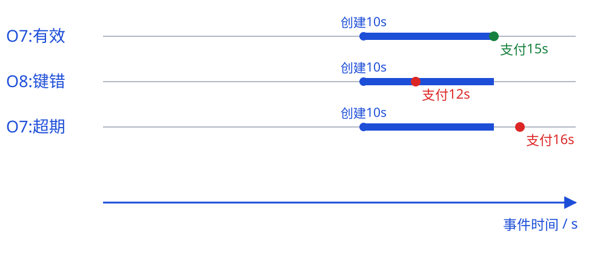</figure>

- O7@15s：差5s且同键，匹配2000；O8@12s键不符；O7@16s差6s超界。
- 时间有效与键相同必须同时成立。

<!--
只有十五秒的O7满足两个条件，恰好五秒仍包含在闭区间内。O8十二秒满足时间范围、订单键不同；O7十六秒键相同、超出时间范围，两者都被排除。请大家用不同标记分别指出键错误与时间错误，它们修复的位置不同。由此也能检查图是否画得足够完整：只有一条时间轴不带订单编号，就无法判断第二条为什么必须排除。

[Sources]
- https://nightlies.apache.org/flink/flink-docs-release-2.3/docs/dev/datastream/operators/joining/
- 教学构造数据：course/data/cases.json；金额单位为分。专项场景在页面注明参数。
-->


---
class: course story-course
---
## 动态表是随输入持续变化的关系

<figure class="story-figure">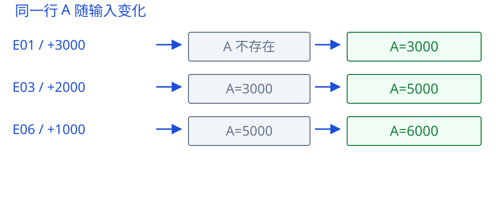</figure>

- <strong>动态表</strong>是随输入更新的逻辑表；持续查询把输入变化转为结果变化。
- 同一用户 A 的累计行依次更新为 3000、5000、6000 分。

<!--
请大家把结果想成一张仍在更新的用户表。第一条A支付到来，A行出现3000；第二条再来，这一行变5000；第三条变6000。表在每一刻都有当前内容，持续查询不断把输入变化映射成这张结果表的变化。动态表描述逻辑关系的变化，外部数据库如何保存这些变化由Sink协议决定。要把它传给外部系统，还需要一种消息协议，描述插入、删除或更新发生在哪个结果对象上。

[Sources]
- https://nightlies.apache.org/flink/flink-docs-release-2.3/docs/dev/table/concepts/dynamic_tables/
- 教学构造数据：course/data/cases.json；金额单位为分。专项场景在页面注明参数。
-->


---
class: course story-course
---
## Changelog 描述表的变化

<figure class="story-figure">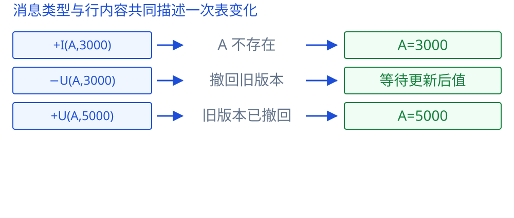</figure>

- <strong>变更日志（Changelog）</strong>传递插入、更新前、更新后或删除消息。
- 一种表示：+I(A,3000)，−U(A,3000)，+U(A,5000)。

<!--
每条变更消息描述某一行的插入、删除或更新。加I表示插入，减U表示更新前旧值，加U表示更新后新值，删除也有对应类型。图中A先插入三千，下一次把旧三千撤回，再给五千。实际查询计划和下游能力会决定采用哪些消息种类，本页展示一种完整变更表示，帮助大家读懂更新因果。更新同一行的消息使用相同结果键，负号表示撤回旧表版本；业务退款由退款事件表达。

[Sources]
- https://nightlies.apache.org/flink/flink-docs-release-2.3/docs/dev/table/concepts/dynamic_tables/
-->


---
class: course story-course
---
## Upsert 按键替换结果行

<figure class="story-figure">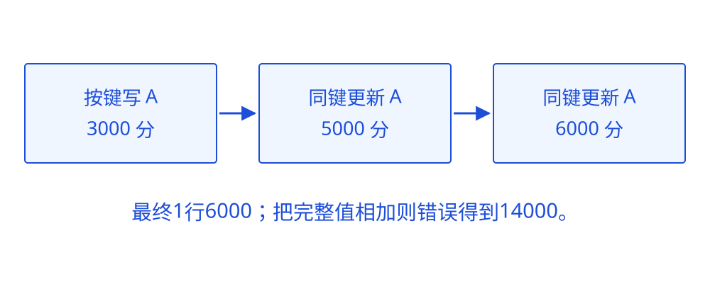</figure>

- <strong>Upsert</strong>按唯一键插入或更新；A=3000→5000→6000只保留一行。
- 消息协议区分增量与完整值；结果键唯一识别计算对象。

<!--
如果下游支持按键写最新结果，就可以用A作为唯一键，第一次插入三千，后两次更新成五千与六千。请大家把这三次变化和第一讲原始支付增量区分开：原始增量是三千、两千、一千，而结果完整值是三千、五千、六千。把完整值再累加会得到一万四，错误来自协议解释。若输出改成窗口结果，键还要包含窗口边界，单独A会覆盖掉另一个时间段。

[Sources]
- https://nightlies.apache.org/flink/flink-docs-release-2.3/docs/dev/table/concepts/dynamic_tables/
- 教学构造数据：course/data/cases.json；金额单位为分。专项场景在页面注明参数。
-->


---
class: course story-course
---
## SQL 分组累计对应同一份状态

<figure class="story-figure"></figure>

- GROUP BY userId确定状态归属；SUM(amountCents)定义累计值。
- 输入已完成成功过滤与身份去重；查询结果是持续更新的用户行。

<!--
这段SQL表达图中的分组与累计规则。FROM选择已经成功过滤、按身份去重的支付关系，GROUP BY按用户组织历史，SUM定义金额累计。请把E01与E03依次放入，指出A的结果从3000更新为5000。查询输出表示A这一行的变化，Sink按结果键更新到最新累计值。

[Sources]
- https://nightlies.apache.org/flink/flink-docs-release-2.3/docs/dev/table/sql/queries/overview/
- https://nightlies.apache.org/flink/flink-docs-release-2.3/docs/dev/table/concepts/dynamic_tables/
- 教学构造数据：course/data/cases.json；金额单位为分。专项场景在页面注明参数。
-->


---
class: course story-course
---
## SQL 分组累计的查询语句

```sql
SELECT userId,
       SUM(amountCents) AS sumCents,
       COUNT(*) AS paidCount
FROM UniquePaid
GROUP BY userId;
```

- UniquePaid已过滤成功并按身份去重；每条输入是一次唯一支付。
- userId识别结果行；SUM累计整数分，COUNT累计成功笔数。

<!--
大家现在对着代码逐行读。SELECT说结果需要哪些字段，SUM把每条唯一支付金额加起来，COUNT记录笔数；FROM给出已经完成成功过滤和身份去重的输入；GROUP BY告诉系统每个用户维护自己的聚合历史。分号表示这条查询定义结束，不表示持续输入已经结束。请把E01和E03依次放进去，说出A结果从三千一笔变成五千两笔，代码中的每个关键部分就都能指回前面的状态更新图。

[Sources]
- https://nightlies.apache.org/flink/flink-docs-release-2.3/docs/dev/table/sql/queries/overview/
- https://nightlies.apache.org/flink/flink-docs-release-2.3/docs/dev/table/concepts/dynamic_tables/
- 教学构造数据：course/data/cases.json；金额单位为分。专项场景在页面注明参数。
-->


---
class: course story-course
---
## SQL 窗口需要事件时间属性

<figure class="story-figure"></figure>

- 事件时间列与水位线明确进度；窗口函数按10s切分，GROUP BY包含窗口边界。
- 结果对象是（用户，窗口），其接纳与发布语义依所用算子确定。

<!--
如果要把累计改成十秒统计，必须先定义哪一列是事件时间，以及怎样生成水位线。窗口函数给每条记录附上窗口边界，再按用户和边界聚合。SQL窗口的发布、接纳与更新规则按所选算子的语义确定，配置时查对应SQL窗口文档。我们这里重点看同一抽象：业务时间决定范围，进度推动输出，结果键包含窗口。附录给出简短语法，主页面先让每个词都能指到图上对象。

[Sources]
- https://nightlies.apache.org/flink/flink-docs-release-2.3/docs/dev/table/sql/queries/overview/
- https://nightlies.apache.org/flink/flink-docs-release-2.3/docs/dev/table/sql/queries/window-tvf/
-->


---
class: course story-course
---
## SQL 与 DataStream 共同表达数据依赖


- SQL描述所需关系结果，优化器生成执行计划；DataStream显式组织算子。
- 两者都需键、时间、状态与输出协议；阅读计划检查实际计算边界。

<!--
大家比较两种表达。DataStream通常由开发者连接过滤、按键与聚合；SQL先描述想要的关系结果，再由优化器生成具体执行计划。SQL与DataStream都需要保留持续累计的用户历史，区别在于计算规则的表达方式。请沿这张数据流图找出输入、分组与结果，说明SQL中的GROUP BY落在哪个计算关系上。实际任务数量还要看生成计划与并行配置，不能从SQL只有一行就猜它只在一个线程执行。

[Sources]
- https://nightlies.apache.org/flink/flink-docs-release-2.3/docs/dev/table/concepts/dynamic_tables/
- https://nightlies.apache.org/flink/flink-docs-release-2.3/docs/dev/table/sql/queries/overview/
- https://nightlies.apache.org/flink/flink-docs-release-2.3/docs/concepts/flink-architecture/
-->


---
class: course story-course
---
## CEP 描述事件之间的顺序模式

<figure class="story-figure"></figure>

- <strong>复杂事件处理（CEP）</strong>按模式识别多条事件关系。
- 专项模式：同一订单create后接pay，事件时间差不超过5s；仅讨论正向匹配。

<!--
识别一串事件的先后模式时，可以使用复杂事件处理CEP。CEP可以把它表达成先出现create，接着出现pay，并限定时间范围。这里“接着”还需要规定是否允许夹杂别的事件，匹配后怎样继续寻找等策略。我们先给一个最小正向模式，沿同键、顺序和时限三项判断。它不会因为模式里没有pay就自动等同于前面所有超时业务政策，负向模式与超时输出还要另外定义。

[Sources]
- https://nightlies.apache.org/flink/flink-docs-release-2.3/docs/libs/cep/
- 教学构造数据：course/data/cases.json；金额单位为分。专项场景在页面注明参数。
-->


---
class: course story-course
---
## CEP 逐条保留部分匹配

<figure class="story-figure">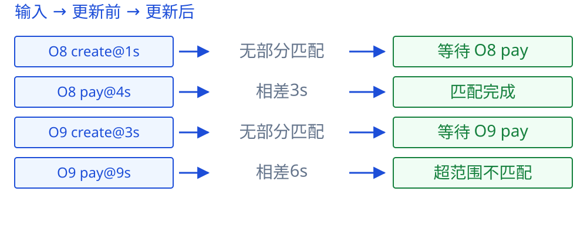</figure>

- 专项：O8 create@1s→pay@4s匹配；O9 create@3s→pay@9s超过5s。
- create建立部分匹配，pay推进或排除；中间历史也是状态。

<!--
现在沿模式跑两组输入。O8创建时只有前半段，系统把这份部分匹配保存下来；四秒支付到来，相差三秒，模式完成。O9三秒创建，九秒支付相差六秒，在本题时间范围之外，不能完成这个正向匹配。CEP跨记录维护可能的部分匹配，状态容量与清理取决于模式和匹配策略。复杂模式会产生更多匹配分支，设计时要评估各分支的保留量和退出条件。

[Sources]
- https://nightlies.apache.org/flink/flink-docs-release-2.3/docs/libs/cep/
- 教学构造数据：course/data/cases.json；金额单位为分。专项场景在页面注明参数。
-->


---
class: course story-course
layout: section
---
## 4 · 状态扩容与方案设计

<ol class="outline"><li>状态与订单生命周期</li><li>定时器与去重边界</li><li>流式查询与变更消息</li><li class="current">状态扩容与方案设计</li></ol>

<!--
最后我们让作业从两个实例扩成四个。机器和执行规模变了，但一个订单或用户的历史不能凭空消失，也不能被两个实例同时当作完整历史处理。我们先看固定的Key Group作为搬运单元，再用每组具体金额核对扩容前后是否保留同一份业务事实。

[Sources]
- https://nightlies.apache.org/flink/flink-docs-release-2.3/docs/concepts/stateful-stream-processing/
-->


---
class: course story-course
---
## 状态后端按工作负载选择

<figure class="story-figure">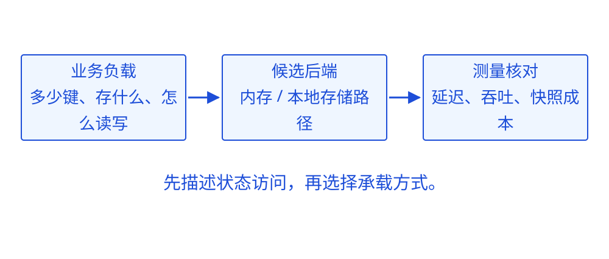</figure>

- 比较状态规模、访问模式、读写延迟、本地资源与快照成本。
- 小状态高频访问与大状态随机访问的资源压力不同，依据测量选择。

<!--
状态后端负责运行中的读写，所以选择时先看业务怎样访问历史。每条消息只读写一份小金额，与一个键要扫描大量待匹配支付，对资源要求不同。再看状态总量、工作内存、本地磁盘和快照成本，最后用真实或代表性负载测吞吐与延迟。选择后端时，用目标工作负载比较状态访问延迟、容量和快照成本。方案中应把状态数量、每条访问动作和保留边界写出来，再让测量结果支持后端与资源选择。

[Sources]
- https://nightlies.apache.org/flink/flink-docs-release-2.3/docs/ops/state/state_backends/
- https://nightlies.apache.org/flink/flink-docs-release-2.3/docs/dev/datastream/fault-tolerance/state/
-->


---
class: course story-course
---
## Key Group 是按键状态重分配单元

<figure class="story-figure">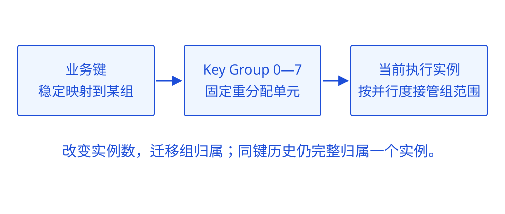</figure>

- <strong>Key Group</strong>是Flink重分配Keyed State的基本单元；键稳定映射到组。
- 专项最大并行度 8，组编号 0—7；本题直接给出键到组映射。

<!--
我们在业务键和执行实例之间加一层固定的小组，叫Key Group。键先稳定映射到某个组，当前并行度再决定每个实例接管哪一段组。扩容时移动组的归属，就能把组里的键状态交给新实例。本题最大并行度固定为八，当前并行度决定运行实例数；键到组的映射由题设给出，实际Flink按哈希规则分配。接下来沿题设映射追踪每个组，核对扩容后的归属和金额。

[Sources]
- https://nightlies.apache.org/flink/flink-docs-release-2.3/docs/concepts/stateful-stream-processing/
- https://nightlies.apache.org/flink/flink-docs-release-2.3/docs/dev/datastream/fault-tolerance/state/
- 教学构造数据：course/data/cases.json；金额单位为分。专项场景在页面注明参数。
-->


---
class: course story-course
---
## 扩容前：两个实例各管四组

<figure class="story-figure"></figure>

- 专项键A—H分别位于组0—7，金额3000、5000、4000、2000、6000、1000、8000、3000。
- 实例0接管组0—3共14000；实例1接管组4—7共18000，总计32000。

<!--
本页采用扩容专项键及其固定组映射，金额标在组旁。我们直接给出八个组及各自金额，前四组相加一万四，后四组一万八。两个实例各接管连续四组，合起来三万二。请大家先把这个总量和每组身份记下来，扩容以后只改变谁接管，不改变组里的金额。若新布局中多出或少掉一组，单看某个新实例的数值很难发现，逐组核对才能找出缺失或重复。

[Sources]
- https://nightlies.apache.org/flink/flink-docs-release-2.3/docs/concepts/stateful-stream-processing/
- https://nightlies.apache.org/flink/flink-docs-release-2.3/docs/dev/datastream/fault-tolerance/state/
- 教学构造数据：course/data/cases.json；金额单位为分。专项场景在页面注明参数。
-->


---
class: course story-course
---
## 扩容后：四个实例各接管两组

<figure class="story-figure">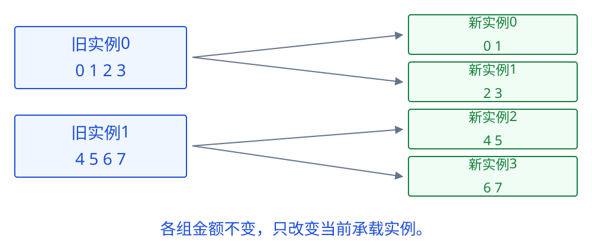</figure>

- 以一致恢复点扩容：组[0,1]、[2,3]、[4,5]、[6,7]分别交给四个实例。
- 来源位置与对应状态一起恢复；每个Key Group出现一次。

<!--
现在从一致恢复点把并行度改成四。原实例零的四个组拆为两段，分别给新实例零和一；原实例一的四组给新实例二和三。请沿四条迁移箭头看，每个Key Group连同其中完整的键状态一起迁移。实际升级还要求算子身份和状态兼容，并让输入从配套位置恢复。第五讲会讲恢复链，今天先在固定组映射下检查扩容前后是不是同一份历史。

[Sources]
- https://nightlies.apache.org/flink/flink-docs-release-2.3/docs/concepts/stateful-stream-processing/
- https://nightlies.apache.org/flink/flink-docs-release-2.3/docs/dev/datastream/fault-tolerance/state/
- 教学构造数据：course/data/cases.json；金额单位为分。专项场景在页面注明参数。
-->


---
class: course story-course
---
## 用组集合与金额共同核对扩容

<figure class="story-figure"></figure>

- 新实例金额8000、6000、7000、11000，合计32000；组集合仍为0—7且不重复。
- 同时核对总额、组集合与逐键金额，检查抵消误差。

<!--
我们分别计算新实例金额：组三千加五千是八千，四千加两千六千，六千加一千七千，八千加三千一万一。相加仍三万二。还要核对组集合恰好零到七、每组只出现一次。请问总额相同是不是已经证明所有状态都对？不一定，一组少两千另一组多两千会抵消，所以还需身份与逐组数值核对。把数值不变和归属不重不漏同时作为验收证据，扩容方案才可复查。

[Sources]
- https://nightlies.apache.org/flink/flink-docs-release-2.3/docs/concepts/stateful-stream-processing/
- https://nightlies.apache.org/flink/flink-docs-release-2.3/docs/dev/datastream/fault-tolerance/state/
- 教学构造数据：course/data/cases.json；金额单位为分。专项场景在页面注明参数。
-->


---
class: course story-course
---
## 状态方案需要同时写用途与退出条件

<figure class="story-figure"></figure>

- 对每份状态写业务键、字段、更新动作、定时器与清理条件。
- 再说明输入重投、后到消息、输出更新与扩容恢复怎样配合。

<!--
我们现在给状态方案一张检查框架。每份历史首先说明属于谁，用什么字段保存，哪些消息会更新；再写未来哪个条件会用它，以及什么时候不再需要。订单状态、待匹配缓冲和已见身份可能有不同保留期，不能全用一个五秒TTL清空。最后把它接到外部：重复消息怎样来，结束后事实怎样补核，输出能否修正，扩容怎样从同一恢复点接续。把用途、更新时间和退出条件连接起来，就得到完整的状态生命周期。

[Sources]
- https://nightlies.apache.org/flink/flink-docs-release-2.3/docs/dev/datastream/fault-tolerance/state/
- https://nightlies.apache.org/flink/flink-docs-release-2.3/docs/dev/table/concepts/dynamic_tables/
- https://nightlies.apache.org/flink/flink-docs-release-2.3/docs/concepts/stateful-stream-processing/
-->


---
class: course story-course
---
## 方案示范：等待支付与超时补核

<figure class="story-figure"></figure>

- orderId键状态保存阶段、创建时间与待匹配项；事件时间定时器检查业务截止。
- payId长期唯一约束配合在线Seen；结束后支付进补核，输出按订单更新。

<!--
示范方案先按订单把创建与支付接到同一份历史，支付先到则缓冲，创建后登记截止后一毫秒的事件时间检查。有效支付到来更新为已支付，超时检查仍等待则输出超时，结束后再到的事实全部保留到补核。在线Seen覆盖输入承诺的重投范围，长期防重由稳定支付身份约束配合。结果表按订单定位当前阶段，补核消息保留原始身份和时间。验收用O1到O4的完整轨迹，核对两单支付五千、两单超时和O2补核证据。

[Sources]
- https://nightlies.apache.org/flink/flink-docs-release-2.3/docs/dev/datastream/fault-tolerance/state/
- https://nightlies.apache.org/flink/flink-docs-release-2.3/docs/dev/table/concepts/dynamic_tables/
- 教学构造数据：course/data/cases.json；金额单位为分。专项场景在页面注明参数。
-->


---
class: course story-course
---
## 独立方案练习：重复、超时与扩容

- 订单O10@2s；支付P10@6s/4500，重投一次；O11@3s未支付。
- 进度最终到8001ms；按本讲5s含边界政策写状态和输出。
- 再把八组从2扩为4实例，给组范围、金额核对与恢复前提。

<!--
这道题把本讲两条完整机制放在一起。先按订单分别推演，不让重复P10再输出四千五；O11三秒创建，截止八秒，进度8001时应该作出检查。写清每份状态与定时器怎样退出，以及保留什么身份防止重投。第二部分不重新发明键哈希，沿给定八组移动，核对新实例的金额与组集合。方案要给别人足够信息，才能在故障或扩容后重跑同一组输入并验证结果。

[Sources]
- https://nightlies.apache.org/flink/flink-docs-release-2.3/docs/dev/datastream/fault-tolerance/state/
- https://nightlies.apache.org/flink/flink-docs-release-2.3/docs/concepts/stateful-stream-processing/
- 教学构造数据：course/data/cases.json；金额单位为分。专项场景在页面注明参数。
-->


---
class: course story-course
---
## 方案答案：业务结果与状态归属各自核对

<figure class="story-figure"></figure>

- O10差4s，输出一次4500；P10重投跳过；O11在W8001时输出一次超时。
- 扩容四组范围为[0,1]、[2,3]、[4,5]、[6,7]；金额仍8000、6000、7000、11000。

<!--
O10有效支付后进入PAID，第二条相同P10不能再次产生结果；O11仍未支付，在8001的检查中变成EXPIRED。请大家圈出两类证据，一类是业务输出只有一次，另一类是状态转移和取消或保留定时器有依据。扩容部分则检查八组在四实例上恰好出现一次，四份金额合计三万二，并写出算子身份兼容、恢复点与输入位置配套等前提。不能拿总额相同代替全部生命周期和身份规则都正确。

[Sources]
- https://nightlies.apache.org/flink/flink-docs-release-2.3/docs/dev/datastream/fault-tolerance/state/
- https://nightlies.apache.org/flink/flink-docs-release-2.3/docs/concepts/stateful-stream-processing/
- 教学构造数据：course/data/cases.json；金额单位为分。专项场景在页面注明参数。
-->


---
class: course story-course
---
## 本讲的状态与查询关系

<figure class="story-figure"></figure>

- 历史支持关联、累计和模式；定时器推动业务检查；生命周期控制保留。
- 动态结果通过变更消息传递；扩容迁移归属，同时保持键历史完整。

<!--
今天我们从订单为什么要记住创建时间开始，逐步看清了状态的用途。定时器让没有新支付时也能检查，TTL管理保留范围，Join与CEP保留未完成关系，SQL持续产生结果表的变化。扩容时，Key Group帮助迁移历史，金额与身份共同检验不重不漏。请大家最后按一个订单复述创建、等待、支付或超时、后到事实、清理与恢复的全过程。第五讲会继续追问：这些分散在多任务里的历史，怎样保存成一份真正能恢复的快照？

[Sources]
- https://nightlies.apache.org/flink/flink-docs-release-2.3/docs/dev/datastream/fault-tolerance/state/
- https://nightlies.apache.org/flink/flink-docs-release-2.3/docs/dev/table/concepts/dynamic_tables/
- https://nightlies.apache.org/flink/flink-docs-release-2.3/docs/concepts/stateful-stream-processing/
-->


---
class: course story-course
---
## 附录：SQL 事件时间与窗口语法

```sql
SELECT userId, window_start, window_end,
       SUM(amountCents) AS sumCents
FROM TABLE(TUMBLE(TABLE UniquePaid,
     DESCRIPTOR(rowtime), INTERVAL '10' SECOND))
GROUP BY userId, window_start, window_end;
```

- rowtime由业务时间字段转换；WATERMARK声明该表的事件时间进度规则。
- 窗口分组键包含userId、window_start、window_end。

<!--
如果同学想继续读SQL，先找事件时间列与WATERMARK声明。前者给出业务时间，后者规定怎样根据输入估计进度。再看窗口函数生成的起止字段，它们和用户一起构成分组范围。下面的查询骨架展示事件时间、窗口范围与分组键之间的关系。实际表名与连接器由部署实现提供，而当前要能逐段指出这行代码对应输入、范围、计算和结果身份中的哪一项。

[Sources]
- https://nightlies.apache.org/flink/flink-docs-release-2.3/docs/dev/table/sql/queries/overview/
- https://nightlies.apache.org/flink/flink-docs-release-2.3/docs/dev/table/sql/queries/window-tvf/
-->


---
class: course story-course
---
## 附录：平均值保留可合并的部分状态

<figure class="story-figure">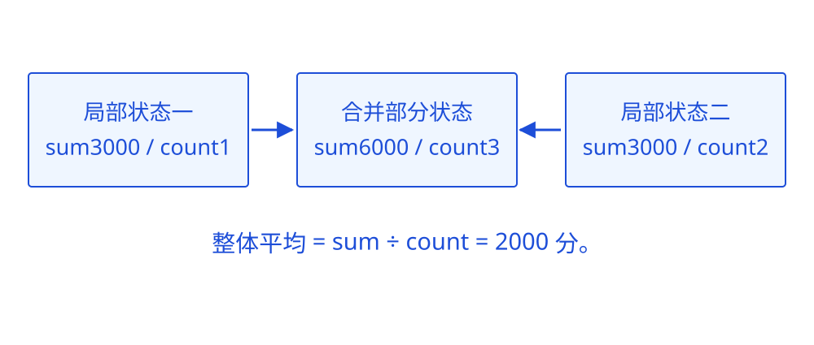</figure>

- 状态保留sum与count：3000、2000、1000→（6000,3）→平均2000分。
- 扩容或局部汇总时合并 sum 与 count，再计算整体平均数。

<!--
最后用平均值检查自己是否理解状态的抽象。只保存当前平均值，后面来一条新支付时还不知道原来有几笔，所以需要总和与个数。局部一保存三千一笔，局部二保存三千两笔，合并得到六千三笔，平均两千。若把两边平均三千和一千五再平均，会得到两千二百五，已经错了。状态应该保留足以支持未来更新和合并的信息，这项原则比记住一个API名称更能帮助大家设计新场景。

[Sources]
- https://nightlies.apache.org/flink/flink-docs-release-2.3/docs/dev/datastream/fault-tolerance/state/
- 教学构造数据：course/data/cases.json；金额单位为分。专项场景在页面注明参数。
-->
