# 分布式快照与故障恢复

> 第 5 次课 · 分布式实时计算

一笔支付怎样在故障之后保持正确的业务效果

<!--
同学们，前面几次课，我们已经让一笔支付经过过滤、分组和累计，最后变成屏幕上的营业额。今天我们把这个运行中的系统停下来：假设它刚刚算到21000分，计算任务突然退出了。重新启动以后，应该从哪里接着读？刚才写进数据库的钱，还能不能再写一遍？这节课我们始终跟着同一组订单走，亲眼看一笔钱怎样被保存、怎样重放，又怎样可能漏掉或者多算。最后，大家要能够为一家商店写出一份可恢复的实时营业额方案，并用故障实验说明方案为什么成立。

[Sources]
- https://nightlies.apache.org/flink/flink-docs-release-2.3/docs/concepts/stateful-stream-processing/
- https://nightlies.apache.org/flink/flink-docs-release-2.3/docs/dev/datastream/fault-tolerance/checkpointing/
- 教学构造数据：course/data/cases.json；本讲 A/B 使用独立 Offset，金额单位为分。
-->

---
class: course lesson05
---
## 奶茶店的三份记录

<figure class="story-figure">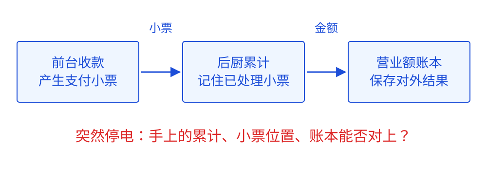</figure>

- 支付小票说明**发生了什么**；累计值说明**处理到了哪里**。
- 恢复后，要让小票、工作记录与营业额账本重新对应。

<!--
大家先看这家奶茶店。前台收完钱，把小票交给后厨；后厨处理小票，同时累计今天的营业额；右边的账本保存已经对外公布的金额。现在突然停电了。后厨手里的草稿没了，但前台的小票和营业额账本还在。重新开门时，能不能把所有小票从头再算，再把每笔钱都加到账本上？大家会发现，账本中已经记过的钱会再加一次。那如果只找一张最新小票，直接从它后面继续呢？后厨没来得及处理的小票又可能被跳过。这两个问题，就是我们今天要画出来的重复与漏算。现在把这三份记录对应到系统中的日志、工作状态和结果库。

[Sources]
- 教学构造数据：course/data/cases.json；本讲 A/B 使用独立 Offset，金额单位为分。
-->

---
class: course lesson05
---
## 日志、工作状态与结果库

<figure class="story-figure">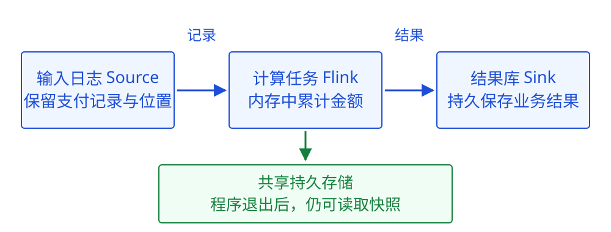</figure>

- **日志**留输入；**工作状态**留历史；**结果库**留业务结果。
- **进程**是运行中的程序；退出后工作内存丢失，持久数据仍保留。

<!--
请看，同样的三段关系，现在已经换成正式名称。左边的Source从输入日志读取支付记录。中间是运行中的Flink计算任务，它把累计金额保存在内存里，这份会随输入变化的信息叫工作状态。右边的Sink把结果写到数据库，供其他系统查询。进程可以理解成机器上正在运行的一份程序；程序退出后，它的内存内容通常就没有了，所以我们还要把恢复所需的信息写到下面的共享持久存储。大家特别留意两个保存位置：下面存的是供计算恢复的快照，右边存的是对外使用的业务结果。两者由不同的动作更新，故障时不会自动一起回到过去。

[Sources]
- https://nightlies.apache.org/flink/flink-docs-release-2.3/docs/concepts/stateful-stream-processing/
- https://nightlies.apache.org/flink/flink-docs-release-2.3/docs/dev/datastream/fault-tolerance/checkpointing/
- 教学构造数据：course/data/cases.json；本讲 A/B 使用独立 Offset，金额单位为分。
-->

---
class: course lesson05
---
## 本讲的恢复路径

- **看清边界**：哪些记录已经算过，哪些仍在通道里？
- **形成快照**：状态和各输入位置怎样保存成一套？
- **解释差额**：为什么会出现 26000、32000、39000 分？
- **写出方案**：输入能重放、内部能恢复、出口能承受重试。

<!--
这一讲沿着四个问题往下走。我们先画清楚系统在某一刻到底保存了哪些信息，再看红色屏障怎样给两条输入划出同一个恢复边界。然后我会让计算任务在已经写出两笔结果后故障，大家用手指沿着记录走一遍，找到少掉的6000分和多出来的7000分。最后我们把图变成方案文字：输入系统提供什么能力，Flink保存什么，数据库采用什么写法，怎么验证恢复以后钱是对的。大家看这四步，每一步都在回答前一步留下的具体问题。大家要能说清楚每个箭头发生了什么，再把它写成可验证的恢复方案。

[Sources]
- https://nightlies.apache.org/flink/flink-docs-release-2.3/docs/concepts/stateful-stream-processing/
- https://nightlies.apache.org/flink/flink-docs-release-2.3/docs/dev/datastream/fault-tolerance/checkpointing/
- 教学构造数据：course/data/cases.json；本讲 A/B 使用独立 Offset，金额单位为分。
-->

---
class: course lesson05
---
## 故障专项的八条支付记录

<figure class="story-figure">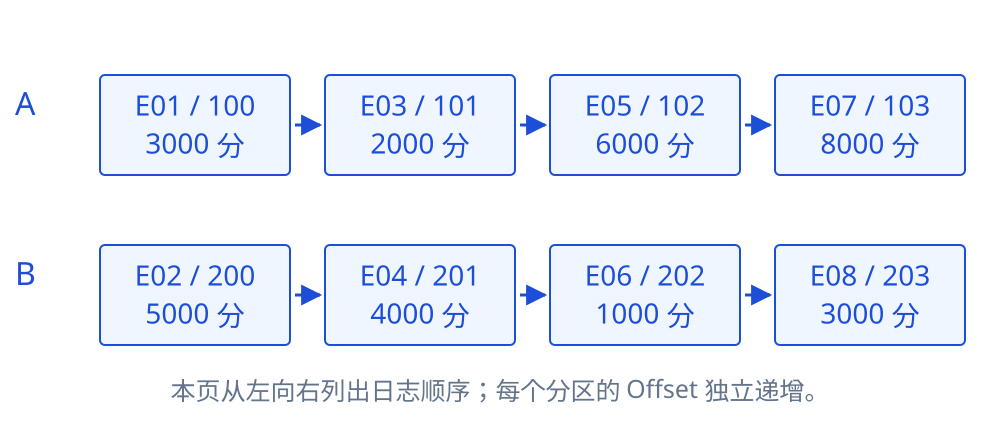</figure>

- 输入：8 个唯一成功事件；总金额 **32000 分**。
- 分区内有序、可按 Offset 重放；A/B 的位置分别记录。

<!--
我们把今天全部要用的记录放到一张图上。上面是A分区，下面是B分区，每个小框上面写事件编号和Offset，下面写金额。Offset就是这条记录在本分区日志里的位置。A里的100与B里的200没有谁比谁更新的全局含义；它们属于两条独立的队伍。请大家分别顺着两行读：A是3000、2000、6000、8000，B是5000、4000、1000、3000。加起来是32000分。输入系统会保留这些记录，后面我们可以指定A从102、B从202再读。这里的事件金额和前面几讲相同，位置编号是本讲单独构造的日志位置。

[Sources]
- 教学构造数据：course/data/cases.json；本讲 A/B 使用独立 Offset，金额单位为分。
-->

---
class: course lesson05
---
## 工作状态与持久快照

<figure class="story-figure">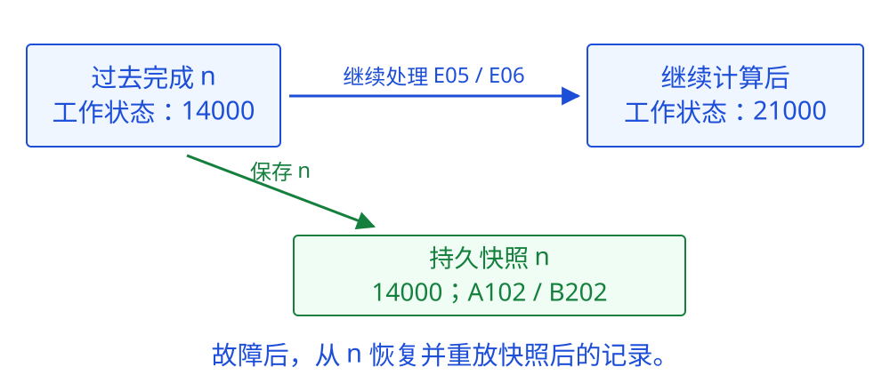</figure>

- <strong>检查点（Checkpoint）</strong>是计算故障后可恢复的一份系统快照。
- 工作状态可以前进到 21000；最近完成的快照仍然是 14000。

<!--
先把两种金额分开。工作状态表示程序现在算到了多少，它会不断变化。检查点则是我们在过去某个边界保存好的一份快照。大家看，当前工作状态是21000分，最近完成的持久快照仍是14000分。发生故障后，我们先用已经保存成功的14000分重新建立内存状态，再补上快照之后的记录。于是一个新问题就来了：补哪些记录？如果我们只知道14000这个数，却不知道它包含了哪些输入，恢复就无从下手。所以下面要讨论的核心，就是金额状态和输入边界怎样对应。

[Sources]
- https://nightlies.apache.org/flink/flink-docs-release-2.3/docs/concepts/stateful-stream-processing/
- https://nightlies.apache.org/flink/flink-docs-release-2.3/docs/dev/datastream/fault-tolerance/checkpointing/
- 教学构造数据：course/data/cases.json；本讲 A/B 使用独立 Offset，金额单位为分。
-->

---
class: course lesson05
layout: section
---
## 1 · 一致性切面

<ol class="outline"><li class="current">一致性切面</li><li>屏障传播与快照</li><li>故障、重放与差额</li><li>端到端方案设计</li></ol>

<!--
接下来我们把镜头拉近到两台正在通信的计算机。大家先判断一件事：保存下来的系统，能不能解释每一条已经发生的消息？如果快照里有“收到了钱”，却没有任何对应的发送，这份快照就解释不通。把这样的反例看明白，我们再给它一个正式名称——一致性切面。

[Sources]
- https://nightlies.apache.org/flink/flink-docs-release-2.3/docs/concepts/stateful-stream-processing/
- https://nightlies.apache.org/flink/flink-docs-release-2.3/docs/dev/datastream/fault-tolerance/checkpointing/
-->

---
class: course lesson05
---
## 接收必须有对应的发送

<figure class="story-figure">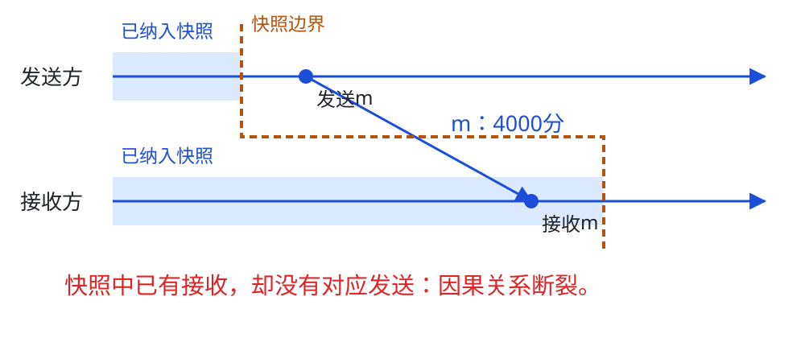</figure>

- **一致性切面**：纳入接收时，必须包含对应发送。
- 蓝色：已保存历史；橙色虚线：各进程的快照边界。

<!--
大家先学会读这张图。上面一条线是发送方的本地执行顺序，下面一条线是接收方的本地执行顺序，时间都向右走。斜箭头是一条4000分的消息，从发送走到接收。蓝色区域表示已经纳入快照的历史。现在顺着橙色边界看：下方已经保存了“收到这条消息”，上方却没有保存“发送这条消息”。恢复这样的快照，相当于系统凭空收到了一个没有来源的消息。问题出在因果关系，而不在两台机器的钟差了几毫秒。即使我们能让时钟非常接近，也仍要明确消息和本地状态属于哪一侧。

[Sources]
- https://lamport.azurewebsites.net/pubs/chandy.pdf
-->

---
class: course lesson05
---
## 在途消息也属于系统状态

<figure class="story-figure">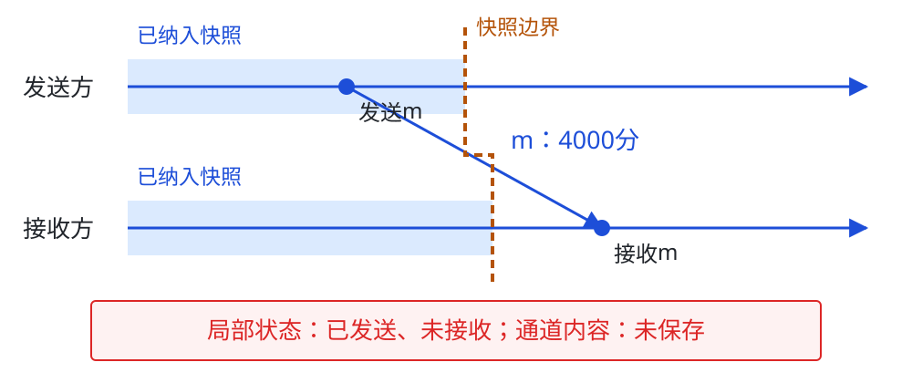</figure>

- 发送已纳入、接收尚未纳入：消息处于**在途**状态。
- 如果快照只存两端局部状态而遗漏通道，恢复后就丢失这条消息。

<!--
我们把边界换一下。现在发送方已经发出了4000分的消息，接收方还没有把它收进去。这个边界本身是合法的：发送在前，接收在后，没有违反因果关系。可是请大家看最下面，假如我们只保存两边的局部状态，通道里这条消息什么也没记，会怎样？恢复以后，发送方认为自己已经发过，接收方却没有收到，而消息也无法从快照里找回来。4000分就少了。这个切面满足因果关系，缺失的是恢复所需的通道信息。下一页只补一项信息，就能把这个状态解释完整。

[Sources]
- https://lamport.azurewebsites.net/pubs/chandy.pdf
-->

---
class: course lesson05
---
## 完整快照保存局部状态与通道状态

<figure class="story-figure">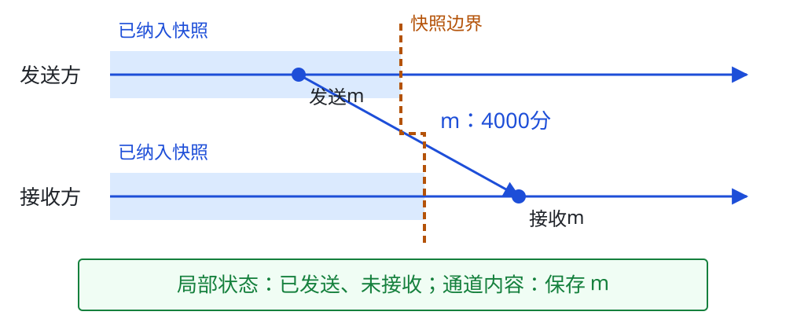</figure>

- 系统快照 = **各进程局部状态 + 必要的通道状态**。
- 恢复接收方后，把保存的在途消息继续交给它处理。

<!--
大家看，还是刚才的发送和接收，橙色边界也没有改变。我们只在下面多保存了“通道中还有消息m，金额4000分”。这一次恢复后，接收方先回到它当时的局部状态，再接着处理这条保存下来的消息，钱就接上了。请同学用自己的话把这两页区别说出来：上一页缺了什么？这一页为什么够了？回答里要有“消息已经发送、尚未接收、恢复时还要处理”这三个动作。分布式快照把各进程局部状态与必要的通道信息对应起来，形成可继续运行的系统状态。

[Sources]
- https://lamport.azurewebsites.net/pubs/chandy.pdf
-->

---
class: course lesson05
---
## Chandy–Lamport 的标记思想

<figure class="story-figure">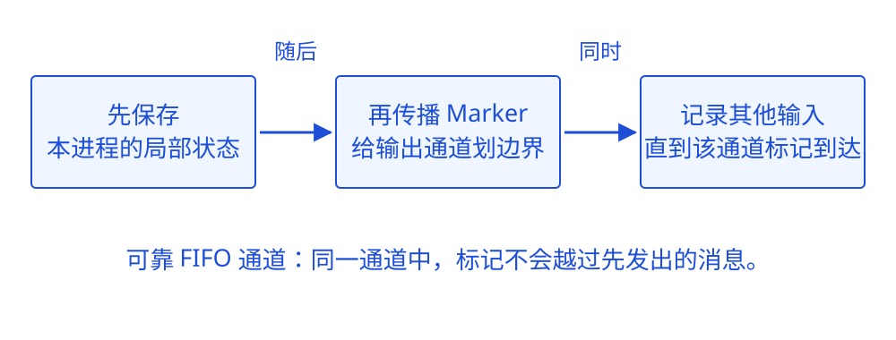</figure>

- <strong>Marker（标记）</strong>关联本地快照与通道边界。
- 前提：可靠 FIFO 通道；其他输入通道记录在途消息，直到各自标记到达。

<!--
刚才我们是假设已经知道边界在哪里。真正运行时，节点之间怎样协作把边界找出来？经典的Chandy–Lamport算法使用一种特殊消息，叫Marker。一个节点首次参与快照时，先保存自己的局部状态，再把标记沿输出通道发出去；对其他还没收到标记的输入通道，它继续记录到来的消息，直到那条通道的标记也到达。这里的FIFO表示同一通道按先发先到的顺序传递，标记不会偷偷越过前面的消息。这样，局部状态和在途消息就能对应起来。接下来看的Flink屏障受到这一思路启发，但它采用适合数据流执行的快照方式，具体动作要重新跟图看。

[Sources]
- https://lamport.azurewebsites.net/pubs/chandy.pdf
- https://arxiv.org/abs/1506.08603
-->

---
class: course lesson05
---
## 恢复点中的状态与下一条位置

<figure class="story-figure">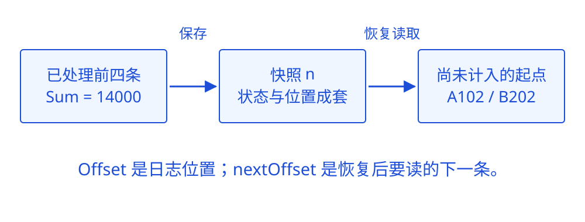</figure>

- 前四条：E01 + E02 + E03 + E04 = **14000 分**。
- **nextOffset**指尚未纳入该快照的下一条：A102、B202。

<!--
现在回到订单系统。请大家把前四条事件在输入图里找到：3000、5000、2000、4000，累计正好14000分。假如快照保存了这份状态，A里面100和101已经算过，下一条就应该读102；B里面200和201已经算过，下一条就应该读202。把这三个值放在一起读：金额14000，A下一条102，B下一条202。它们共同描述同一段已完成的历史。请分别圈出A和B的最后已处理位置，再指向紧随其后的nextOffset。后面我们会故意把102改成103，让大家亲眼看到6000分从哪个箭头上漏掉。

[Sources]
- https://nightlies.apache.org/flink/flink-docs-release-2.3/docs/concepts/stateful-stream-processing/
- 教学构造数据：course/data/cases.json；本讲 A/B 使用独立 Offset，金额单位为分。
-->

---
class: course lesson05
layout: section
---
## 2 · 屏障传播与快照

<ol class="outline"><li>一致性切面</li><li class="current">屏障传播与快照</li><li>故障、重放与差额</li><li>端到端方案设计</li></ol>

<!--
恢复点的目标已经明确了：前四条形成14000分，之后的记录留给恢复后继续处理。现在我们看系统怎样在不停接收记录的过程中，把这个边界做出来。接下来几页的通道、算子和颜色都保持不变，大家只跟着红色屏障和被它挡住的记录看。每翻一页，先判断哪一个对象发生了变化。

[Sources]
- https://nightlies.apache.org/flink/flink-docs-release-2.3/docs/concepts/stateful-stream-processing/
- https://nightlies.apache.org/flink/flink-docs-release-2.3/docs/dev/datastream/fault-tolerance/checkpointing/
-->

---
class: course lesson05
---
## 屏障在记录流中标记边界

<figure class="story-figure">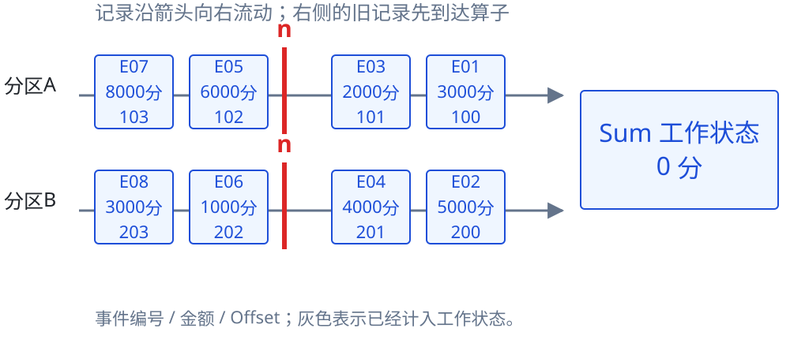</figure>

- <strong>Barrier n（屏障 n）</strong>标记同一检查点的输入边界，不参与金额累计。
- 记录向右流动；每个分区中，屏障前的旧记录先到达算子。

<!--
大家请看两条通道，右边是同一个Sum算子。我们这次把日志真正画成一条向右移动的队伍，因此最靠近算子的旧记录先被处理，左侧排着后续记录。每个记录框都有事件编号、金额和Offset。中间这条红线就是屏障n，它没有业务金额，只告诉算子：这是同一次检查点的边界。A里的E01、E03在红线前，B里的E02、E04也在红线前；E05和E06则在红线之后。两条红线都叫n，但它们经过不同通道，不会保证在同一瞬间抵达Sum。真正需要解决的问题，就是一条先到、一条后到时怎么办。

[Sources]
- https://nightlies.apache.org/flink/flink-docs-release-2.3/docs/dev/datastream/fault-tolerance/checkpointing/
- https://arxiv.org/abs/1506.08603
- 教学构造数据：course/data/cases.json；本讲 A/B 使用独立 Offset，金额单位为分。
-->

---
class: course lesson05
---
## 步骤一：源头注入同一个检查点屏障

<figure class="story-figure"></figure>

- 协调器发起检查点 n；Source 记录本次源位置，并把 n 放入各输入流。
- 本例需要纳入快照的记录：A100、A101、B200、B201。

<!--
现在由协调器发起检查点n。协调器负责组织这次快照，业务金额仍由Sum来算。Source在自己的记录流中插入屏障，同时保存本次对应的读取位置。请看红线两侧，右边的旧记录已经在本次边界之前，左边的E05、E06属于边界之后。接下来记录照常向右流动，Sum不会因为源头刚插入了屏障就立刻停止。请大家先做一个预测：如果A通道比较快，A的红线先到了，Sum此时手里一定有完整的14000分吗？不一定，因为B通道红线前面的4000分可能还在路上。这个不同步，就是下一页的画面。

[Sources]
- https://nightlies.apache.org/flink/flink-docs-release-2.3/docs/dev/datastream/fault-tolerance/checkpointing/
- https://arxiv.org/abs/1506.08603
- 教学构造数据：course/data/cases.json；本讲 A/B 使用独立 Offset，金额单位为分。
-->

---
class: course lesson05
---
## 步骤二：A 的屏障先到

<figure class="story-figure">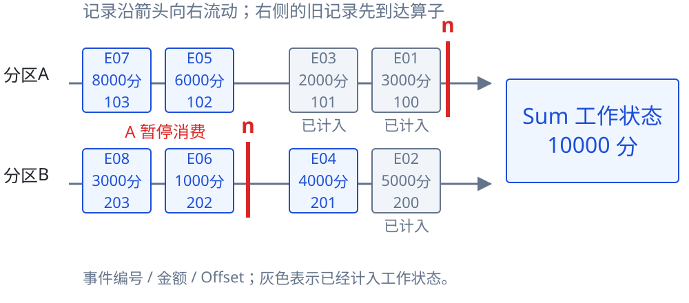</figure>

- Sum 已计入 E01、E02、E03：**3000 + 5000 + 2000 = 10000 分**。
- B201 的 E04 仍在路上；A102 的 E05 位于屏障之后。

<!--
同学们，现在请把目光放到右边。灰色的E01、E02、E03已经算进去了，Sum的工作状态是10000分。A的红线已经到达算子门口，B的红线还在左边。大家特别看B通道，E04是4000分，它还没有被Sum处理。再看A通道的6000分，E05在A的屏障后面，它虽然可能已经等在那里，却属于下一段历史。此时系统同时面对两种记录：一笔本次必须纳入的4000分，一笔本次不能提前纳入的6000分。先把这两笔的归属判断清楚，对齐这个动作就不再是一个抽象名词了。

[Sources]
- https://nightlies.apache.org/flink/flink-docs-release-2.3/docs/dev/datastream/fault-tolerance/checkpointing/
- https://arxiv.org/abs/1506.08603
- 教学构造数据：course/data/cases.json；本讲 A/B 使用独立 Offset，金额单位为分。
-->

---
class: course lesson05
---
## 预测：现在保存 10000 分会怎样？

<figure class="story-figure"></figure>

- 若把 **10000 分**与 A102 / B202 保存，E04 将被恢复位点跳过。
- E04 不在状态中，也不会被重读：会少 **4000 分**。

<!--
先别翻页，大家在图上找一找。如果我们现在就着急把10000分保存下来，却说B已经可以从202继续，E04会怎样？它的201在202之前，所以恢复时Source不会再读它。那10000分里面有没有它？也没有。于是4000分既没在状态里，又被恢复位置越过去了。请在图上指出少掉的B201：它既未计入状态，也被恢复位置跳过。如果想不等B就保存，我们必须额外保存这笔在途记录；那是稍后要看的非对齐方式。当前先把对齐快照这条路径走完整。

[Sources]
- https://nightlies.apache.org/flink/flink-docs-release-2.3/docs/dev/datastream/fault-tolerance/checkpointing/
- 教学构造数据：course/data/cases.json；本讲 A/B 使用独立 Offset，金额单位为分。
-->

---
class: course lesson05
---
## 步骤三：暂停 A，继续处理 B

<figure class="story-figure"></figure>

- A 已到屏障 n：**暂停消费 A 屏障后的记录**。
- B 尚未到屏障 n：继续消费屏障前的 E04，补齐本次输入。

<!--
现在我们终于能回答“为什么要等”。A已经到达本次边界，所以A后面的E05暂时留在通道里，不能加入这次状态。B还没有到边界，所以Sum继续处理B前面的记录。请看箭头，B201这4000分还会被正常消费。这个动作叫对齐：先到边界的输入等一等，让其他输入把本次边界以前的记录送齐。如果整个Sum都停住，B的4000分也会被挡住，快照就无法补齐。请一位同学用“A暂停什么、B继续什么”把这张图说一遍。

[Sources]
- https://nightlies.apache.org/flink/flink-docs-release-2.3/docs/dev/datastream/fault-tolerance/checkpointing/
- https://arxiv.org/abs/1506.08603
- 教学构造数据：course/data/cases.json；本讲 A/B 使用独立 Offset，金额单位为分。
-->

---
class: course lesson05
---
## 步骤四：B 的 4000 分进入工作状态

<figure class="story-figure">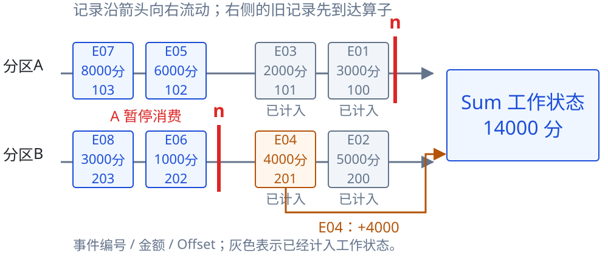</figure>

- 处理 E04：**10000 → 14000 分**；A 后面的 6000 分仍未加入。
- B201 处理完，B 的屏障 n 才能接着到达。

<!--
顺着橙色箭头看，B通道的E04终于走进Sum。金额从10000增加到14000。这一刻我们为什么能确定没有混进A的6000分？因为上一页已经暂停了A屏障后的消费，E05仍然等在原来的位置。E04的4000分补齐了同一输入边界之前的历史，使状态与源位置对应。E04处理完以后，B的红线沿同一条有序通道继续向右，接着就能到达Sum。我们需要的14000分，正是这两个边界共同限定出来的结果。

[Sources]
- https://nightlies.apache.org/flink/flink-docs-release-2.3/docs/dev/datastream/fault-tolerance/checkpointing/
- 教学构造数据：course/data/cases.json；本讲 A/B 使用独立 Offset，金额单位为分。
-->

---
class: course lesson05
---
## 步骤五：两条屏障到齐，固定快照视图

<figure class="story-figure">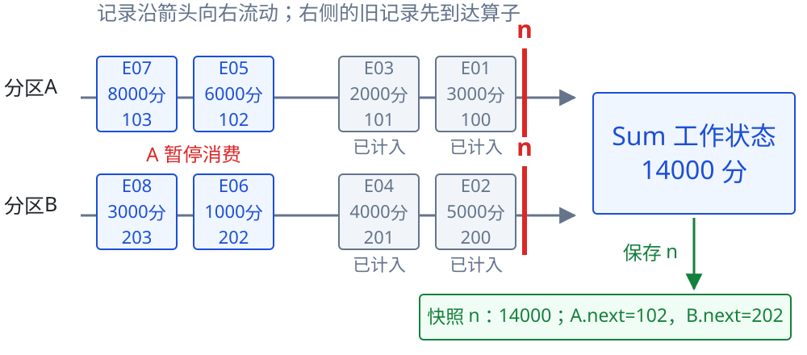</figure>

- **屏障对齐**完成：前四条全已处理，屏障后记录仍未纳入。
- 固定 n 的一致视图：**14000 分；A.next=102；B.next=202**。

<!--
大家看，现在两条红线终于都到达算子门口了。我们先核对数据：前四条都变成灰色，说明已经计入；左边的E05、E06仍然没有计入。因此可以把这份14000分的状态固定下来，它对应的后续读取位置就是A102和B202。两条屏障到齐，表示本次边界以前的输入已全部反映到状态，边界以后的输入仍留待后续处理。这就是图里的状态和位置能够配套的原因。下面绿色的框将14000分与A102、B202配成同一份待保存快照。

[Sources]
- https://nightlies.apache.org/flink/flink-docs-release-2.3/docs/dev/datastream/fault-tolerance/checkpointing/
- https://arxiv.org/abs/1506.08603
- 教学构造数据：course/data/cases.json；本讲 A/B 使用独立 Offset，金额单位为分。
-->

---
class: course lesson05
---
## 步骤六：传播屏障，继续计算

<figure class="story-figure">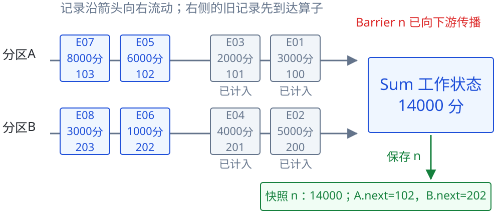</figure>

- 任务向下游传播屏障 n，解除已对齐输入的暂停。
- 工作状态继续更新；后台持久化的是**已经固定的 n 视图**。

<!--
到齐以后，系统还要继续做业务。请看，红线已经向下游传播，刚才等着的E05、E06也可以继续进入计算。一个常见疑问是：状态还在变化，后台怎么可能保存正确？关键在“固定视图”这四个字。任务先为n建立一致的状态视图，后面的正常更新继续作用于工作状态，后台写入的仍然是n的那一份。具体后端怎样管理这份视图可以不同，但恢复语义必须一致。准备快照与检查点完成是两个时刻：先固定状态视图并传递屏障，持久化成功后再确认完成。下一张图会把后台保存和确认的顺序接上。

[Sources]
- https://nightlies.apache.org/flink/flink-docs-release-2.3/docs/dev/datastream/fault-tolerance/checkpointing/
- https://nightlies.apache.org/flink/flink-docs-release-2.3/docs/ops/state/checkpoints/
- 教学构造数据：course/data/cases.json；本讲 A/B 使用独立 Offset，金额单位为分。
-->

---
class: course lesson05
---
## 异步持久化的三个阶段

<figure class="story-figure">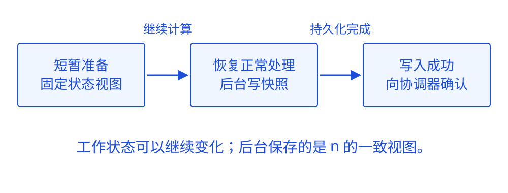</figure>

- **准备视图 → 后台持久化 → 成功确认**；持久化期间计算可以继续。
- 协调器收齐所有必要任务的成功确认，才宣布检查点 n 完成。

<!--
请大家沿着这三个框读。第一步，任务短暂地准备一份一致视图；第二步，把它交给后台保存，计算路径可以继续向前；第三步，只有写入成功，任务才向协调器确认自己这部分已经保存好。协调器还要等其他参与任务都成功，才把整个n标记成完成。异步持久化使业务计算与后台保存并行；检查点完成仍以持久化成功并收齐确认为条件。假设这时存储写失败了，会怎样？这次检查点不能成为新的可靠恢复点，系统仍要使用以前已经完成的一份。大家把这一条想清楚，下面的时序图就有一条非常自然的因果链。

[Sources]
- https://nightlies.apache.org/flink/flink-docs-release-2.3/docs/dev/datastream/fault-tolerance/checkpointing/
- https://nightlies.apache.org/flink/flink-docs-release-2.3/docs/ops/state/checkpoints/
-->

---
class: course lesson05
---
## 检查点完成的 UML 时序图

<figure class="story-figure">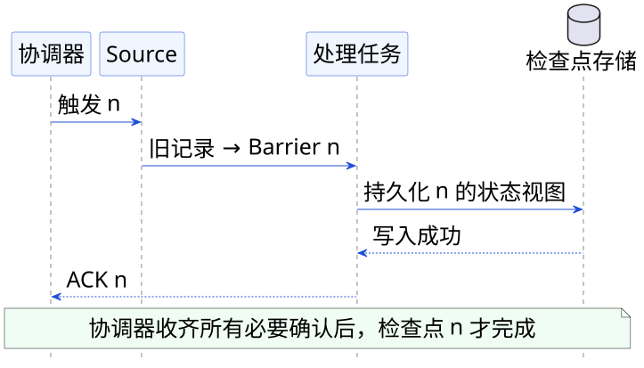</figure>

- 纵向表示先后；实线发送请求，虚线返回确认。
- **持久化成功在前，任务确认在后，全局完成最后发生。**

<!--
我们用标准的UML时序图把刚才的故事画严谨。每个竖向虚线是一位参与者的生命线，从上往下表示交互发生的先后。大家先找到处理任务发给检查点存储的持久化请求，再找到存储返回的写入成功，最后才是任务发给协调器的确认。请问，能把确认箭头移到写入成功上面吗？不能，因为协调器可能以为这份状态已经可靠保存，故障时却根本拿不回来。图里只画一个处理分支，协调器实际要收齐所有必要任务的确认。标准图的价值就在这里：不仅告诉我们有哪些组件，还能让大家检查动作之间的依赖顺序。

[Sources]
- https://nightlies.apache.org/flink/flink-docs-release-2.3/docs/dev/datastream/fault-tolerance/checkpointing/
- https://www.omg.org/spec/UML/2.5.1/PDF
-->

---
class: course lesson05
---
## 时序图绘图练习：补全确认顺序

- 参与者：协调器、Source、处理任务、检查点存储。
- 画出：触发 n、传播屏障、写状态、写入成功、ACK n、全局完成。
- 先画生命线；再按因果顺序加箭头；在 ACK 前标明成立条件。

<!--
现在请大家自己画一次。先在纸上并排写出四位参与者，各画一条向下的生命线。接着从协调器触发n开始，把屏障送到处理任务，再把状态写到存储。剩下的三个动作，请大家自己排：存储写入成功、任务ACK、协调器全局完成。请根据动作依赖排列箭头：状态持久化成功后，任务才具备发送成功确认的依据。画完后同桌互相检查：有没有一条确认发得太早？有没有忘记这是“收齐所有必要确认”才全局完成？最后请指着自己的图，解释每一条确认为什么必须放在这个位置，提前发送会漏掉哪一步。

[Sources]
- https://nightlies.apache.org/flink/flink-docs-release-2.3/docs/dev/datastream/fault-tolerance/checkpointing/
- https://www.omg.org/spec/UML/2.5.1/PDF
-->

---
class: course lesson05
---
## 绘图答案：先持久化，再确认

<figure class="story-figure"></figure>

- 写入成功 → 任务 ACK → 收齐确认 → 全局完成。
- 内存视图尚未持久化便 ACK，故障后可能无状态可恢复。

<!--
大家把自己的图和这张答案逐条对照。屏障到达，说明处理边界已经建立；写入成功，说明这部分恢复数据已经持久保存；ACK把这个事实告诉协调器。协调器收齐所有必要确认后，才宣布n完成。每一步都在增加一个已经成立的事实。请同学把ACK箭头圈出来，再用一句话说明它承诺了什么。任务确认表达的是“我负责的这部分快照已持久化成功”，屏障到达则标记输入边界。如果两者混在一起，画出来的系统就可能在最需要恢复时找不到数据。

[Sources]
- https://nightlies.apache.org/flink/flink-docs-release-2.3/docs/dev/datastream/fault-tolerance/checkpointing/
- https://www.omg.org/spec/UML/2.5.1/PDF
-->

---
class: course lesson05
---
## 非对齐快照：把在途记录一起保存

<figure class="story-figure">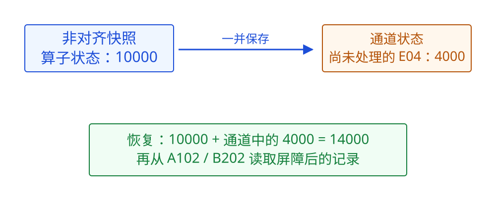</figure>

- 不等待所有输入排齐：保存**算子状态 + 必要的通道数据**。
- 本例保存 10000 分状态与在途 E04 的 4000 分；源位置仍与 n 对应。

<!--
刚才A一直等B。如果通道积压很多，红线要排很久，这个等待可能拖慢检查点。现在回到10000分、E04还没处理的那一刻。有没有办法不用等这4000分先加进状态，也能保存完整的恢复信息？有，把这条尚未处理的通道记录也保存下来。这次快照包含10000分的算子状态，以及待处理E04的4000分通道记录。两者合起来，才是完整的恢复信息。实际非对齐检查点还要正确捕获相关的输入、输出缓冲数据；这张图只放大我们这一条在途记录。减少对齐等待所付出的代价，是需要保存并恢复更多通道数据。

[Sources]
- https://nightlies.apache.org/flink/flink-docs-release-2.3/docs/ops/state/checkpoints/
- https://nightlies.apache.org/flink/flink-docs-release-2.3/docs/concepts/stateful-stream-processing/
- 教学构造数据：course/data/cases.json；本讲 A/B 使用独立 Offset，金额单位为分。
-->

---
class: course lesson05
---
## 非对齐恢复的先后关系

<figure class="story-figure">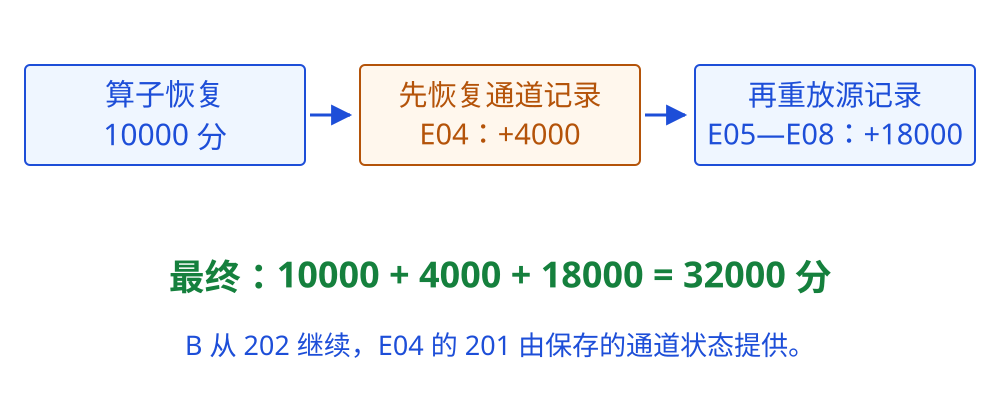</figure>

- 恢复算子与通道状态，再继续处理源的后续输入。
- 非对齐检查点仍可保持**内部精确一次**；恢复时不把在途记录漏掉或重复纳入。

<!--
大家现在跟着这份快照恢复一次。第一步，工作状态回到10000分。第二步，把保存的通道记录E04交给算子，它加4000，来到14000。然后再继续处理源位置之后的E05到E08，总共再加18000，最终还是32000分。为什么B不能又从201重读E04？因为它已经由保存的通道状态提供了，源的配套位置是202。这和对齐快照保存14000分是两种不同的保存方式，但它们都要保证每一段输入历史在恢复结果中接上。非对齐通过保存算子状态和必要的通道记录，保持内部恢复的一致性。请大家沿E04的箭头说明，它在恢复时怎样进入状态。

[Sources]
- https://nightlies.apache.org/flink/flink-docs-release-2.3/docs/ops/state/checkpoints/
- https://nightlies.apache.org/flink/flink-docs-release-2.3/docs/concepts/stateful-stream-processing/
- 教学构造数据：course/data/cases.json；本讲 A/B 使用独立 Offset，金额单位为分。
-->

---
class: course lesson05
layout: section
---
## 3 · 故障、重放与差额

<ol class="outline"><li>一致性切面</li><li>屏障传播与快照</li><li class="current">故障、重放与差额</li><li>端到端方案设计</li></ol>

<!--
快照的形成过程看完了，现在我们真的让系统故障。接下来的几张图中，请大家始终分开看左边的Flink工作状态和右边的数据库。两边金额对应各自已处理或已提交的记录；比较时先核对记录集合，再检查恢复与写入规则。

[Sources]
- https://nightlies.apache.org/flink/flink-docs-release-2.3/docs/concepts/stateful-stream-processing/
- https://nightlies.apache.org/flink/flink-docs-release-2.3/docs/dev/datastream/fault-tolerance/checkpointing/
-->

---
class: course lesson05
---
## 故障前：内外都已经处理到 E06

<figure class="story-figure">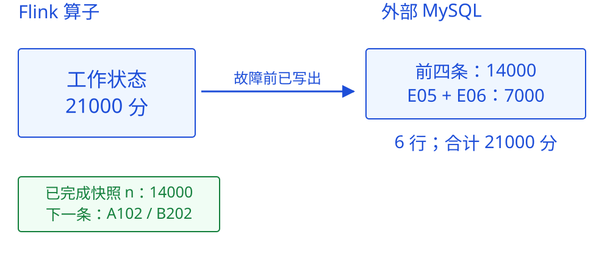</figure>

- 快照 n：14000；后续 E05 + E06：7000。
- 故障前：工作状态 **21000 分**；外部 **6 行，共 21000 分**。

<!--
请看故障发生之前的现场。下面绿色框里的快照n还停在14000分。程序已经继续处理了E05和E06，所以内存里的工作状态是21000分。本反例采用追加输出：每处理一个事件，就在数据库追加一行金额。右边因此也有六行，总共21000分。这一页只固定事实，还没有发生任何重复。请大家记住故障时数据库多于快照的那两行：E05的6000和E06的1000，它们合计7000分。稍后看到39000这个结果时，我们就要回到这两行，看看它们为什么又出现了一次。

[Sources]
- https://nightlies.apache.org/flink/flink-docs-release-2.3/docs/concepts/stateful-stream-processing/
- 教学构造数据：course/data/cases.json；本讲 A/B 使用独立 Offset，金额单位为分。
-->

---
class: course lesson05
---
## 进程故障后，数据库没有跟着回滚

<figure class="story-figure">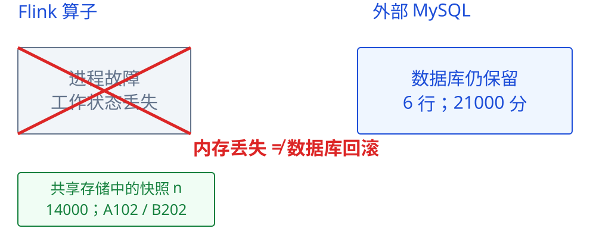</figure>

- 内存工作状态丢失；共享存储里的已完成快照 n 仍在。
- MySQL 中的 E05、E06 已经写入，**仍然保留那 7000 分**。

<!--
现在发生故障。大家看左上角，正在运行的计算进程停止，工作状态丢失了。下面已经持久保存的检查点还在，因此能够启动一个新任务来恢复。右边的数据库怎么样？数据库持久保留已提交的六行，Flink进程退出后这些行仍可查询。请沿图指出故障后的两个位置：Flink工作状态丢失，MySQL仍有六行21000分。这是今天一个很关键的分界。恢复计算时，我们会退回14000分，再读后续记录；可是数据库的历史已经走到了21000分。继续采用无条件追加时，重放会再次写入E05和E06，外部因此重复7000分。

[Sources]
- https://nightlies.apache.org/flink/flink-docs-release-2.3/docs/concepts/stateful-stream-processing/
- 教学构造数据：course/data/cases.json；本讲 A/B 使用独立 Offset，金额单位为分。
-->

---
class: course lesson05
---
## 恢复时选择同一完成检查点

<figure class="story-figure"></figure>

- 恢复 n：工作状态回到 **14000 分**；A 从 **102**、B 从 **202** 重读。
- 共享持久存储保存快照；Source 提供可重放的记录。

<!--
先只看计算内部怎么恢复。系统选择已经完成的n，重新建立14000分的工作状态，然后让两条输入分别从A102和B202继续。大家用手指回到最初的输入图：A102正是E05，B202正是E06，它们不在14000分里，所以需要重算。14000分快照与这两个位置配套，共同确定恢复边界。内部按快照边界重放，输出端再用幂等或事务规则处理重试。

[Sources]
- https://nightlies.apache.org/flink/flink-docs-release-2.3/docs/concepts/stateful-stream-processing/
- https://nightlies.apache.org/flink/flink-docs-release-2.3/docs/dev/datastream/fault-tolerance/checkpointing/
- 教学构造数据：course/data/cases.json；本讲 A/B 使用独立 Offset，金额单位为分。
-->

---
class: course lesson05
---
## 重放前两条，重新建立故障前状态

<figure class="story-figure">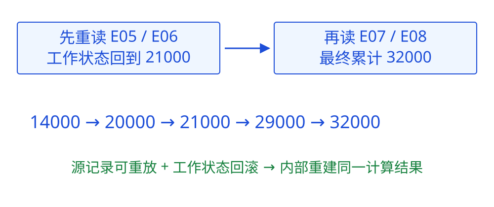</figure>

- E05：14000 → 20000；E06：20000 → **21000 分**。
- 再次执行记录是恢复过程的一部分；已恢复的旧状态中尚未包含它们。

<!--
大家看到E05又被执行，会不会马上说系统重复了？先看它加在哪份状态上。原来那份21000分的工作状态已经丢失；现在手里的是恢复出来的14000分，其中没有E05和E06。所以先加6000到20000，再加1000到21000，恰好重新建立故障前那段计算的结果。这叫重放。内部精确一次要求恢复后的状态和最终计算结果反映同一份输入历史，每条输入对最终状态贡献一次。请大家把“执行过两次”和“最终效果算了两次”区分开。下一页继续处理剩下两条，检查内部结果能否回到32000。

[Sources]
- https://nightlies.apache.org/flink/flink-docs-release-2.3/docs/concepts/stateful-stream-processing/
- 教学构造数据：course/data/cases.json；本讲 A/B 使用独立 Offset，金额单位为分。
-->

---
class: course lesson05
---
## 正常重放：内部最终累计 32000 分

<figure class="story-figure">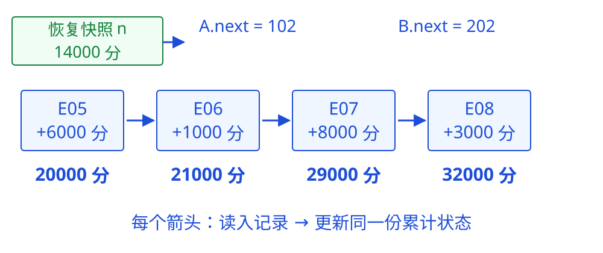</figure>

- E07 再加 8000，E08 再加 3000；累计 **32000 分**。
- 图下方是每条记录处理后的工作状态，金额与输入边界逐步对应。

<!--
请大家顺着这条线从左往右走。起点是14000，读E05变20000，读E06变21000，接着E07到29000，最后E08到32000。现在我们可以说，内部恢复后的累计金额与没有发生故障时一致。为什么成立？因为快照里面保存了前四条，输入重放准确补上后四条，两段历史刚好衔接，既没有空缺，也没有重叠。请在图上给八条记录逐个打勾，检查它们是否各贡献一次。这个判断方法，一会儿也可以直接用来定位错误。

[Sources]
- https://nightlies.apache.org/flink/flink-docs-release-2.3/docs/concepts/stateful-stream-processing/
- 教学构造数据：course/data/cases.json；本讲 A/B 使用独立 Offset，金额单位为分。
-->

---
class: course lesson05
---
## A 从 103 开始：E05 没有恢复来源

<figure class="story-figure">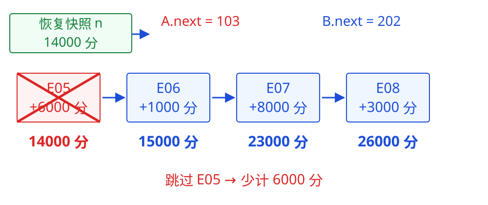</figure>

- 恢复状态不含 E05，输入又跳过 A102：**少计 6000 分**。
- 内部最终 **26000 分**；将恢复位置改回 A102，补回 E05。

<!--
现在只改一个位置：把A的下一条从102写成103，其他条件不变。大家看红叉划掉了谁？E05，金额6000分。请到快照里找，它有没有包含在14000分里？没有。再到恢复输入里找，它还会被读到吗？也不会。于是这笔钱在两处都没有来源，最后只有26000分。6000分差额定位到A102的E05：恢复位点跨过了这条尚未计入快照的输入。修复时应把状态和位置重新配套，不能直接给结果补6000，因为真正的业务事件还可能更新计数、订单状态和其他字段。

[Sources]
- https://nightlies.apache.org/flink/flink-docs-release-2.3/docs/concepts/stateful-stream-processing/
- 教学构造数据：course/data/cases.json；本讲 A/B 使用独立 Offset，金额单位为分。
-->

---
class: course lesson05
---
## A 从 101 开始：E03 被再次计入

<figure class="story-figure">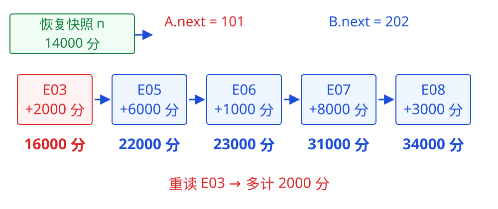</figure>

- E03 的 2000 分已经包含在快照中，再读 A101 会与旧状态重叠。
- 内部最终 **34000 分**；过早与过晚都来自恢复边界错配。

<!--
我们再往相反方向偏一条，A从101恢复。请大家看最左边，多读了一次E03。它的2000分已经保存在14000分里面，现在又加进去，所以最终多2000，变成34000。把这页和上一页放在一起：位置过晚造成空缺，位置过早造成重叠。错误的根源相同，都是输入位置没有对应到保存的状态边界。请同学用“快照里有没有、重放时会不会读到”这两个问题，分别解释E03与E05的命运。分析可重放系统时，先检查可疑记录是否已在快照中、是否又被重放，再核对对应金额。

[Sources]
- https://nightlies.apache.org/flink/flink-docs-release-2.3/docs/concepts/stateful-stream-processing/
- 教学构造数据：course/data/cases.json；本讲 A/B 使用独立 Offset，金额单位为分。
-->

---
class: course lesson05
---
## 盲目追加：外部最终变成 39000 分

<figure class="story-figure">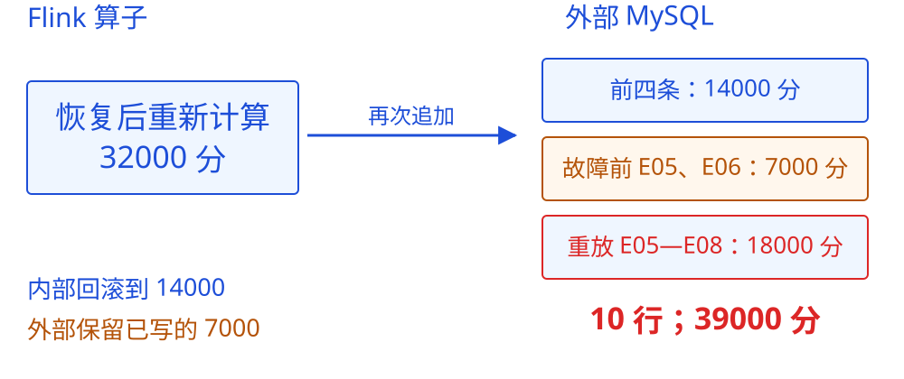</figure>

- 原有 21000 + 重放 E05—E08 的 18000 = **39000 分**。
- 其中 E05、E06 各多一行：**6000 + 1000 = 7000 分**。

<!--
现在内部采用正确位置恢复，最终已经是32000分。我们只看右边数据库会怎样。原来六行21000分还在；重放后四条时，Sink又逐条追加18000分，右边就成了十行39000分。多出来的7000分藏在哪？就是故障前已经写过、恢复后又追加的E05和E06。请大家把这两行圈出来。这一次输入位置没有错，内部累计也没有错，问题出在输出重试被当成新的业务写入。端到端结果还取决于数据库怎样处理同一事件的再次写入。

[Sources]
- https://nightlies.apache.org/flink/flink-docs-release-2.3/docs/concepts/stateful-stream-processing/
- 教学构造数据：course/data/cases.json；本讲 A/B 使用独立 Offset，金额单位为分。
-->

---
class: course lesson05
---
## 32000 与 39000 来自不同的恢复规则

<figure class="story-figure"></figure>

- Flink：恢复旧状态再重放 → 前四条 + 后四条 = **32000**。
- 结果库：保留旧行又追加 → 前六条 + 后四条 = **39000**。

<!--
我们停在这张对照图上，把两条因果链说完整。左边先回到n，所以它保存前四条，再补后四条，得到32000。右边没有回到n，仍保留前六条，再补后四条，就得到39000。同一批重放记录，为什么两边金额不同？因为它们开始重放时各自已经保留的历史不同。请分别圈出数据库旧行和重放新行，指出E05、E06在哪两段历史中重叠。答案是数据库里故障前的E05、E06与重放后的E05、E06重叠。我们找到了明确机制，才能提出明确方案：输出端要识别同一个业务事件，或者与检查点协同提交。

[Sources]
- https://nightlies.apache.org/flink/flink-docs-release-2.3/docs/concepts/stateful-stream-processing/
- 教学构造数据：course/data/cases.json；本讲 A/B 使用独立 Offset，金额单位为分。
-->

---
class: course lesson05
layout: section
---
## 4 · 端到端方案设计

<ol class="outline"><li>一致性切面</li><li>屏障传播与快照</li><li>故障、重放与差额</li><li class="current">端到端方案设计</li></ol>

<!--
数字已经帮我们定位出两类问题：输入位置错配，和外部重复写入。接下来我们把它们变成设计要求。请设想把方案交给商店负责人，逐段说明恢复动作、重试后的业务效果和验证方法。我们先给出结构，再比较两种可用的输出规则。

[Sources]
- https://nightlies.apache.org/flink/flink-docs-release-2.3/docs/concepts/stateful-stream-processing/
- https://nightlies.apache.org/flink/flink-docs-release-2.3/docs/dev/datastream/fault-tolerance/checkpointing/
-->

---
class: course lesson05
---
## 容错方案的三段式结构

<figure class="story-figure">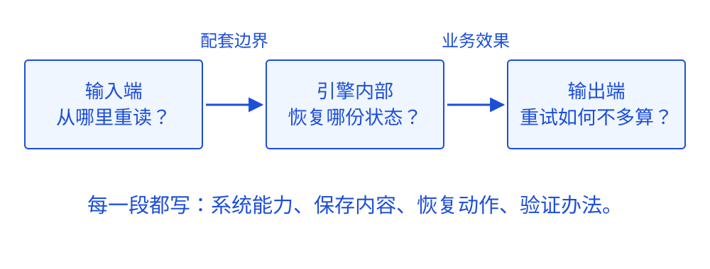</figure>

- **输入**写重放位置；**内部**写快照恢复；**出口**写重试效果。
- 每段写清：能力、保存信息、恢复动作、验证证据。

<!--
大家看这三个问题，它们就是方案的骨架。输入端从哪里重读？回答要包括日志是否保留、能否按位置重放，以及位置来自哪份快照。内部恢复哪份状态？回答要包括保存内容、保存位置、何时算成功。输出端重试会不会多算？回答要落到业务键、写入规则或者事务协议。最后补上验证办法：发生故障后，要看哪些位置、状态和业务记录才能证明结果正确。请大家发现这里每一段都能回指前面一幅图：A103的红叉提醒我们输入条件，14000分的绿色快照提醒内部条件，39000分的十行记录提醒输出条件。

[Sources]
- https://nightlies.apache.org/flink/flink-docs-release-2.3/docs/concepts/stateful-stream-processing/
- https://nightlies.apache.org/flink/flink-docs-release-2.3/docs/dev/datastream/fault-tolerance/checkpointing/
-->

---
class: course lesson05
---
## 幂等写入：同一事件保留同一行

<figure class="story-figure">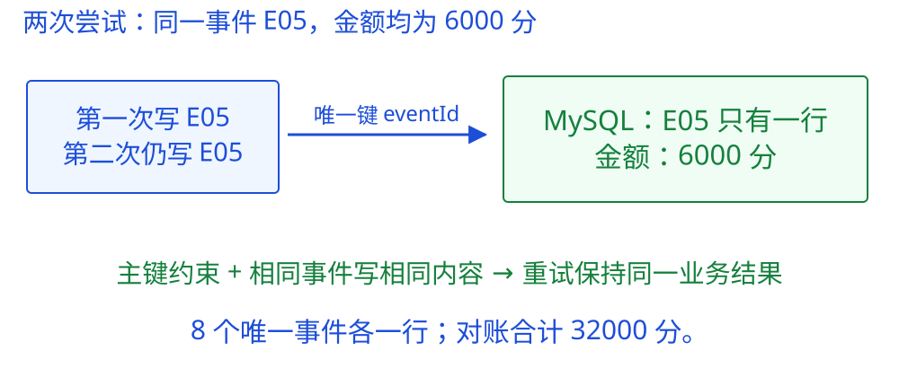</figure>

- **幂等**：同一操作重复执行，保持与执行一次相同的业务效果。
- eventId 唯一主键；同一事件重试时键与内容不变，重复写入不新增第二行。

<!--
先看一种适合支付事件明细账的办法。E05有稳定的事件编号，我们把eventId设成数据库唯一主键。第一次写E05，产生一行6000分；第二次仍用E05这个键和相同内容写入，数据库不会再创建第二行。大家看，同一个业务事实可以被发送两次，但最终账本里只保留一份。这个性质叫幂等。它成立的条件要写清楚：事件编号稳定且唯一，重复事件的内容一致，数据库真正执行唯一约束及相应写入规则。不能在每次重试时生成一个新编号，否则数据库看到的就是两件新事情。最后按八个唯一事件核对，明细账仍有八行，总额32000分。

[Sources]
- https://nightlies.apache.org/flink/flink-docs-release-2.3/docs/concepts/stateful-stream-processing/
- 教学构造数据：course/data/cases.json；本讲 A/B 使用独立 Offset，金额单位为分。
-->

---
class: course lesson05
---
## 重复递增与按事件保存的区别

<figure class="story-figure">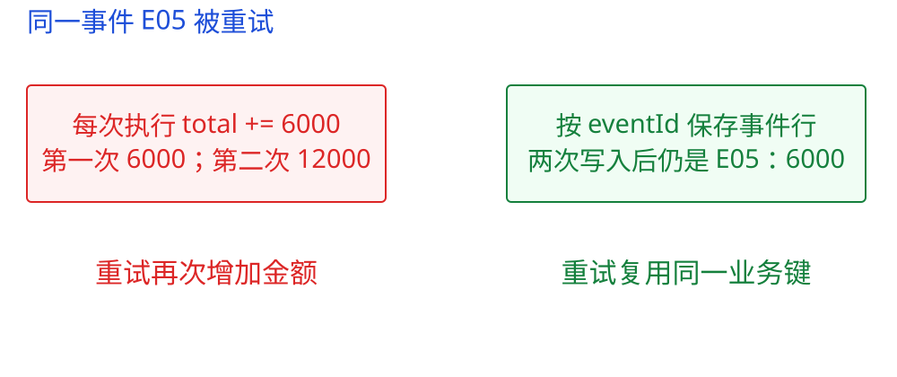</figure>

- 重复执行 `total += 6000`，会重复增加金额。
- eventId 唯一事件各保留一行；按唯一事件求和。

<!--
大家比较左右两种写法。左边的操作是“当前总额加6000”，重复执行就会再次增加6000。E05来了两次，就加成12000；即使数据库这条加法本身是原子的，也没有识别这两次是否是同一个事件。右边先以E05为唯一键保存业务事实，再对唯一事件求和，两次重试留下的仍是一笔6000。请大家把“数据库操作不会被写坏”和“业务事件不会重复计入”区分开。方案写明数据表的唯一键、重复写入操作，以及从唯一事件得到总金额的查询规则。具体选择要服从我们存的是事件明细，还是不断变化的汇总结果。

[Sources]
- https://nightlies.apache.org/flink/flink-docs-release-2.3/docs/concepts/stateful-stream-processing/
- 教学构造数据：course/data/cases.json；本讲 A/B 使用独立 Offset，金额单位为分。
-->

---
class: course lesson05
---
## 事务输出：让可见性跟随检查点

<figure class="story-figure">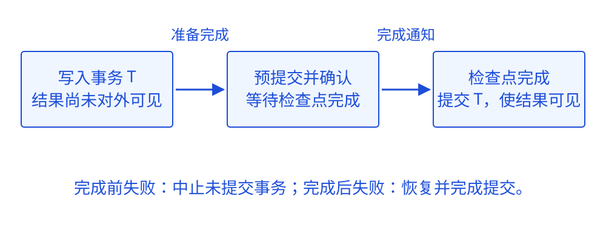</figure>

- <strong>两阶段提交（2PC）</strong>：先预提交；检查点完成后提交并可见。
- 前提：Sink 与外部系统支持事务协调与提交恢复。

<!--
另一类场景希望一批输出在同一个提交边界一起可见，这时可以让Sink事务与检查点协调。这种先准备、再决定提交的协议，叫两阶段提交，英文缩写是2PC。大家从左往右读：先把结果写进事务T，外部查询暂时看不到；然后预提交并报告准备完成；相应检查点完成后，再正式提交T，使结果对外可见。这套协议要求Sink与外部系统共同支持准备、提交和故障恢复。还要分清故障发生的时刻：检查点完成前，可以中止尚未完成的事务；检查点完成后，已经承诺的事务需要恢复并完成提交，不能当作没发生。附录有确认消息丢失的例子。

[Sources]
- https://nightlies.apache.org/flink/flink-docs-release-2.3/docs/dev/datastream/fault-tolerance/checkpointing/
- https://nightlies.apache.org/flink/flink-docs-release-2.3/docs/ops/state/checkpoints/
-->

---
class: course lesson05
---
## 完成前故障：未提交的 7000 分不暴露

<figure class="story-figure">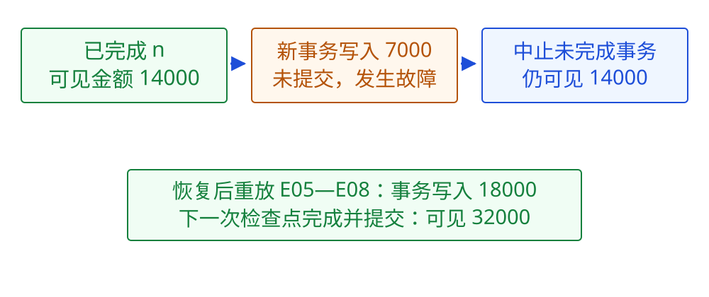</figure>

- 故障时仍可见 **14000 分**；后续 **7000 分**尚未提交。
- 中止未完成事务，重放后四条；下次成功提交可见 **32000 分**。

<!--
再把E05和E06放回事务方案。已完成检查点n对应的14000分已经可见。后面的7000分写进新事务，但相应检查点还没完成，这时发生故障。大家问一问外部查询：它看到21000吗？没有，它仍然看到14000，因为7000尚未提交。恢复时处理掉这个未完成事务，再重放E05到E08，形成18000分的新事务。下一次检查点成功并完成提交后，对外才变成32000。和刚才盲目追加的方案比较，区别不在金额怎样相加，而在故障前那7000分是否已经成为可见、不可重复追加的业务历史。事务把这个可见边界与恢复边界协调起来了。

[Sources]
- https://nightlies.apache.org/flink/flink-docs-release-2.3/docs/dev/datastream/fault-tolerance/checkpointing/
- https://nightlies.apache.org/flink/flink-docs-release-2.3/docs/ops/state/checkpoints/
- 教学构造数据：course/data/cases.json；本讲 A/B 使用独立 Offset，金额单位为分。
-->

---
class: course lesson05
---
## 输出协议要匹配业务对象

- **不可变支付明细**：稳定 eventId + 唯一约束 + 幂等写入；重试保留同一行。
- **一批结果共同可见**：支持检查点协调的事务 Sink；恢复时继续协调事务。
- **持续更新的汇总值**：还要定义结果键、版本与旧值覆盖顺序。

<!--
选择输出协议，先看业务要求保存什么，以及哪些结果需要共同可见。要保存每笔不可变支付明细，稳定事件键和数据库唯一约束就很有价值；要让一批结果在同一个边界一起可见，则需要事务可见性。保存持续更新的用户营业额时，需定义结果键与版本顺序，确保重试按版本保留最新结果。这三句话分别将业务可见要求对应到输出规则。写方案时，从业务可见效果选择输出协议，再检查幂等键、写入内容或事务恢复是否满足要求。

[Sources]
- https://nightlies.apache.org/flink/flink-docs-release-2.3/docs/concepts/stateful-stream-processing/
- https://nightlies.apache.org/flink/flink-docs-release-2.3/docs/dev/datastream/fault-tolerance/checkpointing/
-->

---
class: course lesson05
---
## 方案示范：商店支付明细与营业额

<figure class="story-figure">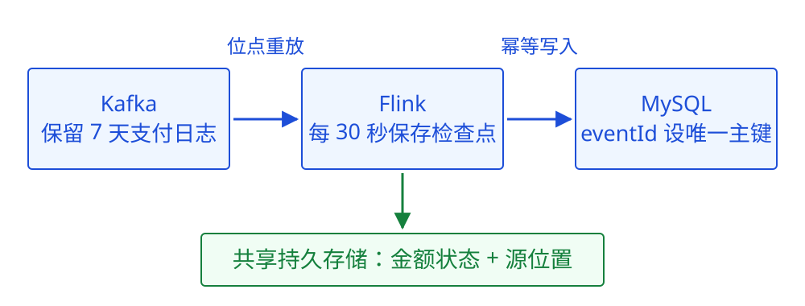</figure>

- 业务：每笔支付形成一行明细，查询唯一事件金额之和。
- 输入保留 7 天；Flink 每 30 秒写共享持久检查点；MySQL 以 eventId 为主键。

<!--
现在我们给商店写一份完整示范。业务要的是每笔支付可查询，并能核对累计营业额，因此输出对象选支付事件明细。输入用Kafka保留七天日志，故障时按已完成检查点中的各分区位置重放。Flink每三十秒保存一次检查点，状态和源位置写到共享持久存储，某台工作机器故障后仍可读取。MySQL把eventId设为唯一主键，同一事件重试沿用同一个键和内容；营业额从唯一明细求和。这些数值是本题设计参数，实际方案应按日志保留、故障时长和快照成本确定。负责人还应检查最长中断时间是否落在日志保留范围内，以及快照写入和恢复速度能否承受。

[Sources]
- https://nightlies.apache.org/flink/flink-docs-release-2.3/docs/concepts/stateful-stream-processing/
- https://nightlies.apache.org/flink/flink-docs-release-2.3/docs/dev/datastream/fault-tolerance/checkpointing/
- 教学构造数据：course/data/cases.json；本讲 A/B 使用独立 Offset，金额单位为分。
-->

---
class: course lesson05
---
## 用一次故障实验验证方案

<figure class="story-figure">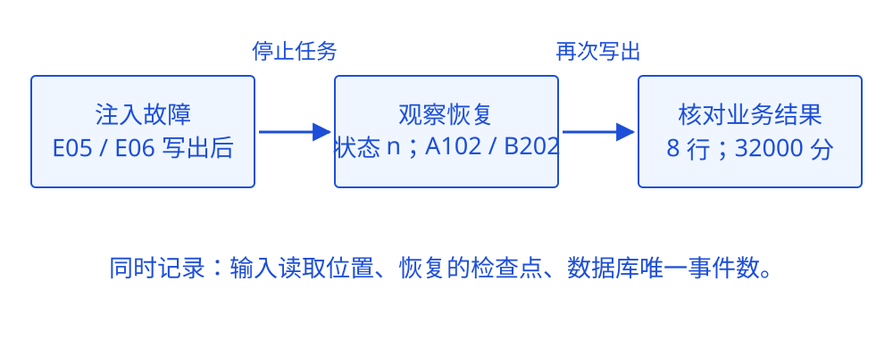</figure>

- 在 E05、E06 已写出后停止计算任务，再从 n 恢复。
- 验证：A102 / B202 开始重放；最终 **8 个唯一事件、32000 分**。

<!--
用故障实验验证方案：在E05、E06已写出后停止计算任务，再从n恢复。测试时同时留下三类证据：引擎恢复了哪个检查点，两个输入从哪里重读，数据库最后有哪些唯一事件。大家应该看到E05和E06确实被再次尝试写入，但数据库仍然各保留一行，最终八行32000分。假如只核对最终总数，两个金额正负抵消时可能掩盖错误，所以还要核对事件集合与每笔金额。这个实验把设计中的“可重放、可恢复、可重试”三项能力放到同一条链上验证。

[Sources]
- https://nightlies.apache.org/flink/flink-docs-release-2.3/docs/concepts/stateful-stream-processing/
- 教学构造数据：course/data/cases.json；本讲 A/B 使用独立 Offset，金额单位为分。
-->

---
class: course lesson05
---
## 独立设计练习：支付明细账

- 条件：Kafka 保留 2 小时；最长故障 20 分钟；MySQL 支持唯一键；每笔支付可独立可见。
- 按“输入—内部—出口”画方案：写明位置来源、快照保存地点、业务键与恢复动作。
- 故障点：E05、E06 已写出；给出恢复后事件数、总金额及验证证据。

<!--
轮到大家独立完成。题目换成两小时日志保留、最长二十分钟中断，输出要求是每笔支付能够独立可见。请先判断这些条件给了我们哪些选择：源记录在题设故障时间内仍然保留；数据库有唯一键；业务没有要求一批支付必须一起可见。然后按三个位置画框，在箭头旁写出恢复动作。尤其要回答：输入位置由谁保存，工作机器坏掉后快照从哪里拿，同一E05再写一次用什么键。最后加一条故障测试，说明你要观察哪些记录才能证明八个事件各保留一次。先自己写，再和同桌交换，找出对方方案里一句无法实际执行或无法验证的话。

[Sources]
- https://nightlies.apache.org/flink/flink-docs-release-2.3/docs/concepts/stateful-stream-processing/
- https://nightlies.apache.org/flink/flink-docs-release-2.3/docs/dev/datastream/fault-tolerance/checkpointing/
- 教学构造数据：course/data/cases.json；本讲 A/B 使用独立 Offset，金额单位为分。
-->

---
class: course lesson05
---
## 方案练习答案：重放、恢复与幂等配合

<figure class="story-figure">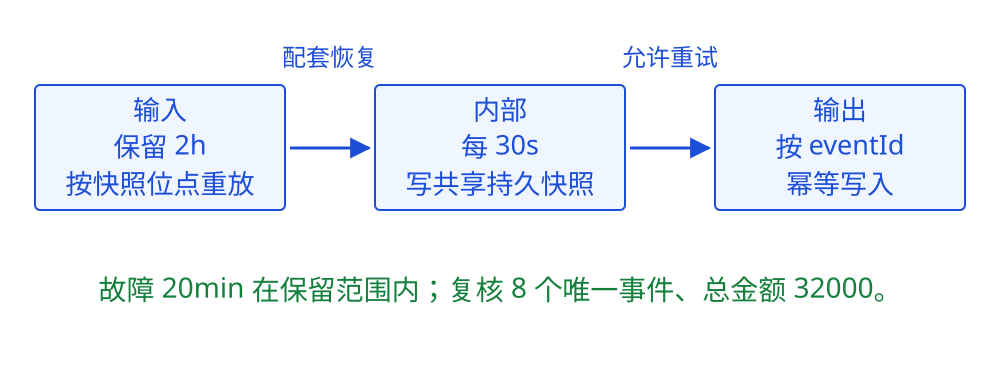</figure>

- 源位置重放 + 共享快照恢复 + eventId 幂等写入。
- E05、E06 可重试；最终 E01—E08：**8 行、32000 分**。

<!--
这是一份可以成立的答案。输入端保留两小时日志，最长二十分钟中断落在保留范围内，再按已完成检查点里的位置重放。内部定期保存状态与源位置，快照放在工作机器故障后仍可读取的共享持久存储；答案中三十秒是一个示例周期，还要结合快照成本评估。出口以稳定eventId做唯一键，重复E05、E06不新建第二行。最后核对数据库中的事件集合、唯一行数和总金额。请对照答案逐段检查：Kafka提供什么重放位置，Flink恢复哪份快照，MySQL怎样识别重复E05。

[Sources]
- https://nightlies.apache.org/flink/flink-docs-release-2.3/docs/concepts/stateful-stream-processing/
- https://nightlies.apache.org/flink/flink-docs-release-2.3/docs/dev/datastream/fault-tolerance/checkpointing/
- 教学构造数据：course/data/cases.json；本讲 A/B 使用独立 Offset，金额单位为分。
-->

---
class: course lesson05
---
## 综合练习：在图上定位两种差额

- 已完成 n：14000 分，A.next=102，B.next=202；E05、E06 已在故障前追加到结果库。
- 甲：内部恢复 14000，但 A 从 103 读；计算内部最终金额，并画出漏掉的记录。
- 乙：输入位置正确，出口继续无条件追加；计算外部最终行数与金额，并圈出重复记录。

<!--
最后做一道图与数字结合的练习，甲、乙是两个独立方案。甲的问题只在内部恢复位置，请把被跳过的事件画出来，写出它原本应当在哪段历史里。乙的位置正确，但数据库保留故障前六行，又接收了后四条重放，请把重复的两条标成同一种颜色。答案包含金额和因果解释：各条记录是否在快照中、是否被重放、在数据库中保留几份。做完后，再分别给两种方案写一条修复动作。用图定位具体记录，比看见总数错误就笼统地“重启一下”更能说明大家理解了系统机制。

[Sources]
- 教学构造数据：course/data/cases.json；本讲 A/B 使用独立 Offset，金额单位为分。
- https://nightlies.apache.org/flink/flink-docs-release-2.3/docs/concepts/stateful-stream-processing/
-->

---
class: course lesson05
---
## 差额答案：漏掉 6000，重复 7000

<figure class="story-figure">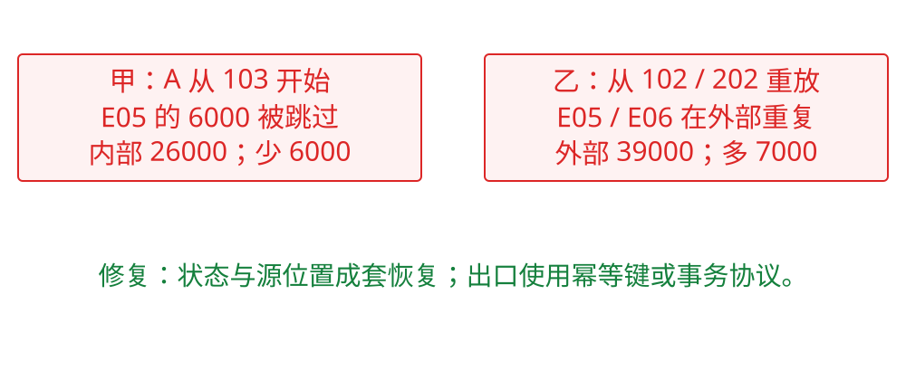</figure>

- 甲：内部 **26000 分**，缺 E05；乙：外部 **10 行、39000 分**，E05/E06 重复。
- 每个差额都对应一段丢失或重叠的业务历史。

<!--
大家看，甲少6000，是E05同时不在恢复状态和重放输入里；乙多7000，是E05、E06同时存在于数据库旧行和重放的新行里。两种错误虽然都在故障恢复后出现，修复位置却不同。甲要修复状态与源位置的配套，乙要修复出口的幂等或事务规则。现在请两位同学分别沿着图讲一次，不先报答案，先指事件经过哪些位置，再推导金额。每个差额都由具体记录及其恢复规则解释，修复动作也就有了明确位置。

[Sources]
- 教学构造数据：course/data/cases.json；本讲 A/B 使用独立 Offset，金额单位为分。
- https://nightlies.apache.org/flink/flink-docs-release-2.3/docs/concepts/stateful-stream-processing/
-->

---
class: course lesson05
---
## 恢复机制与系统方案的对应关系

<figure class="story-figure">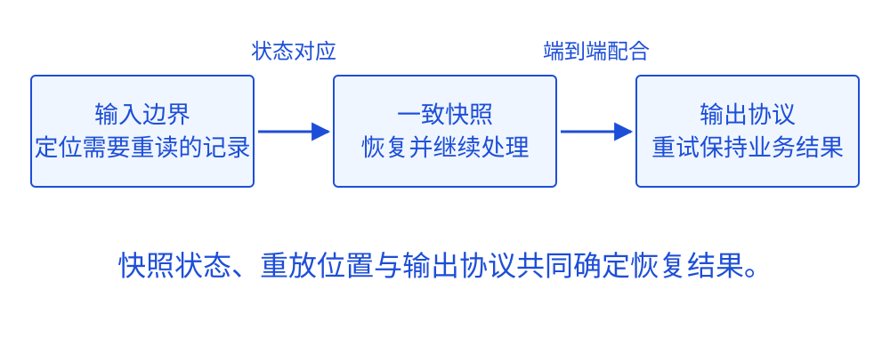</figure>

- 屏障划输入边界；快照保存可继续运行的状态。
- 业务结果依赖**输入重放、内部恢复与输出协议**。

<!--
我们把今天的图重新连成一条线。输入端知道从哪里重读，快照保存与该边界对应的状态，输出端规定重复尝试后留下什么业务效果。屏障的作用是帮助建立边界；对齐通过等待相关输入到齐形成状态视图，非对齐则还要保存必要的通道数据。故障后，工作状态可以回滚、记录可以重放，但业务结果需要由整条链共同保证。回到开头那家店，请把已处理的历史、接着处理的位置和账本的重试规则对应起来，解释每笔支付怎样接续。这也是大家写下一份实时系统方案时，可以直接使用的思考顺序。

[Sources]
- https://nightlies.apache.org/flink/flink-docs-release-2.3/docs/concepts/stateful-stream-processing/
- https://nightlies.apache.org/flink/flink-docs-release-2.3/docs/dev/datastream/fault-tolerance/checkpointing/
-->

---
class: course lesson05
---
## 附录：Checkpoint、Savepoint 与 HA

<figure class="story-figure">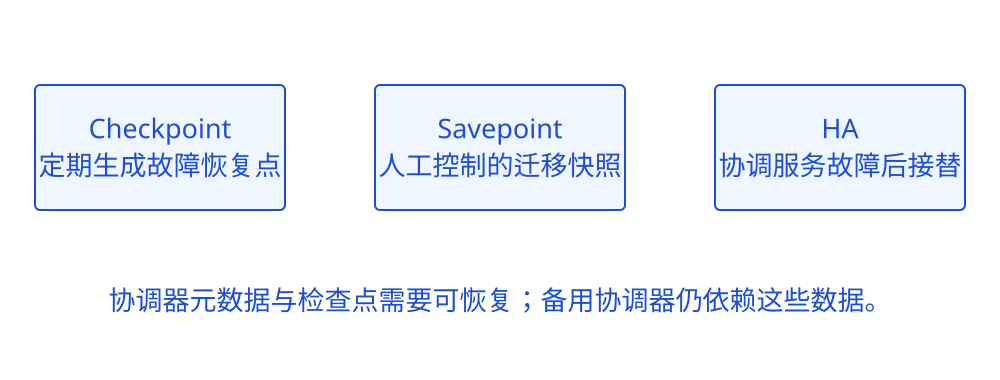</figure>

- Checkpoint：故障恢复；Savepoint：用户控制的迁移快照。
- HA 接替协调服务，仍需元数据、状态与可重放日志。

<!--
同学们常会把三个名字混在一起，我们按用途区分。Checkpoint是系统定期形成的故障恢复点；Savepoint是用户主动控制的快照，常用于升级、迁移或计划性调整；HA则关注协调服务本身故障后由谁接替。假设协调器停止了，备用协调器起来以后，仍需要恢复元数据、找到完成的检查点，并让任务读取对应输入。恢复所需的日志、快照和元数据需由各自的持久存储保留。HA方案需同时写明协调服务的接替方式、恢复数据保存地点和输入记录保留期。三者解决不同层次的问题，需要在同一条恢复链上配合。

[Sources]
- https://nightlies.apache.org/flink/flink-docs-release-2.3/docs/ops/state/checkpoints/
- https://nightlies.apache.org/flink/flink-docs-release-2.3/docs/ops/state/savepoints/
- https://nightlies.apache.org/flink/flink-docs-release-2.3/docs/deployment/ha/overview/
-->

---
class: course lesson05
---
## 附录：快照频率与存储带宽

<figure class="story-figure">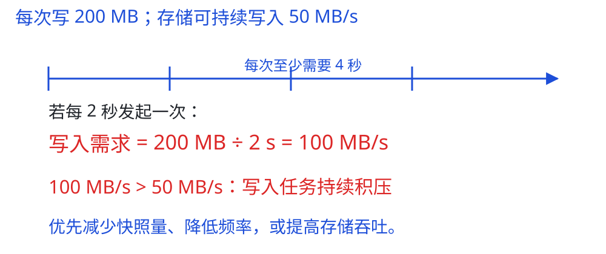</figure>

- 题设：每次实际写入 200 MB，可用持续带宽 50 MB/s，忽略其他成本。
- 更频繁的检查点可减少待重放历史，但要先满足持久化能力。

<!--
假设每次实际写出200MB，存储持续只能接收每秒50MB，光数据写入就至少四秒。现在有人希望每两秒保存一次，觉得这样恢复更快，大家帮他检查一下：每两秒产生200MB，平均每秒需要100MB，比存储能接收的50MB多一倍。按这个周期运行，快照数据会持续积压。设计时可以减少每次快照量、适当降低频率，或者增加可用存储吞吐。这里给出的都是题设值，真实系统还要观察对齐等待、状态准备和其他I/O。大家把周期与成本联系起来，才是在设计可运行的方案。

[Sources]
- https://nightlies.apache.org/flink/flink-docs-release-2.3/docs/ops/state/checkpoints/
- 教学构造数据：course/data/cases.json；本讲 A/B 使用独立 Offset，金额单位为分。
-->

---
class: course lesson05
---
## 附录：提交成功但确认消息丢失

<figure class="story-figure">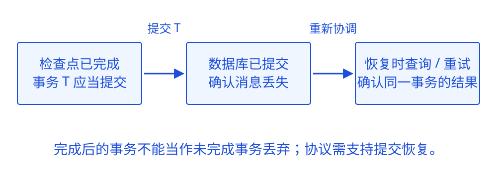</figure>

- 检查点已完成：事务提交结果必须能**恢复确认**。
- 通过事务身份查询或重试；已承诺输出不能当作未完成事务丢弃。

<!--
最后补一个事务恢复的边界情况。检查点已经完成，Sink请求数据库提交，数据库也真的提交了，可返回的确认消息在网络中丢失。此时Flink不知道结果，能不能直接认为失败并丢弃这批输出？不能，因为这份检查点已经承诺了对应历史。能不能盲目开一个新事务再追加一遍？也不能，那又可能重复。协议需要保留事务身份，并支持恢复后查询、重试提交或以其他方式确认同一事务的结果。具体连接器的恢复协议可以不同，但必须解决这个“不知道是否提交”的窗口。因此两阶段提交方案应同时画出正常提交与确认丢失后的恢复路径。

[Sources]
- https://nightlies.apache.org/flink/flink-docs-release-2.3/docs/dev/datastream/fault-tolerance/checkpointing/
- https://nightlies.apache.org/flink/flink-docs-release-2.3/docs/ops/state/checkpoints/
-->
